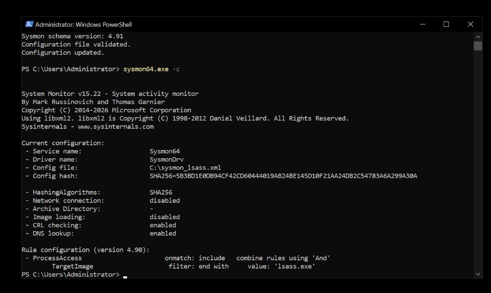
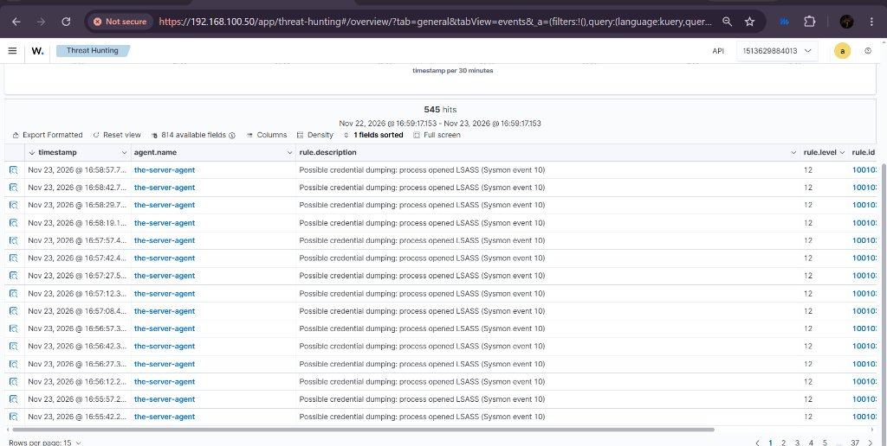
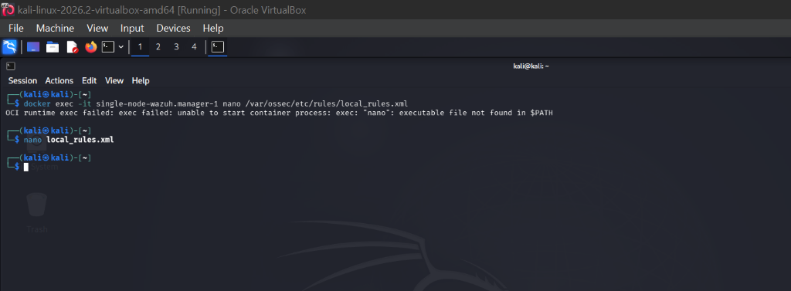

# Lab 15 — LSASS Ticket Stealing & Memory Dumping Detection

*Part of the [Kerberos Attacks and Defense Labs](../README.md) — an advanced purple-team investigation: Windows Local Security Authority Subsystem Service (LSASS) internals, in-memory Kerberos ticket harvesting (`KERB_TICKET_CACHE`), Win32 process handle abuse (`OpenProcess`), Sysmon Event ID 10 (`ProcessAccess`) instrumentation, real-world alert fatigue triage (775 false-positive storm), production SIEM tuning with child suppression rules (Rule 100127), and live detection verification (Custom Rule 100103).*

---

## 💡 Student Notes & Conceptual Breakthrough: Why Target LSASS?

> *"In Labs 13 and 14, we forged Kerberos tickets offline using stolen service hashes or the domain krbtgt key. But what if an attacker does not have domain replication rights or service hashes? Where do genuine, active admin tickets already exist?"*

This question bridges the gap between network-based authentication attacks and endpoint memory exploitation:

### 1. The Windows Credential Vault (`lsass.exe`)
When any user logs into a Windows endpoint or Domain Controller (via console, RDP, SMB, or network services), Windows must maintain their session without prompting for credentials on every transaction. To accomplish this:
- The **Local Security Authority Subsystem Service (`lsass.exe`)** loads security packages like `kerberos.dll` and `msv1_0.dll`.
- Active **Kerberos Ticket Granting Tickets (TGTs)**, **Service Tickets (TGS)**, and session keys are kept directly in the process memory of `lsass.exe` inside `KERB_TICKET_CACHE` tables.
- These credentials remain in memory until the session is terminated or the machine is rebooted.

### 2. The Intrusion Prerequisite
An adversary cannot touch `lsass.exe` remotely or as an unprivileged user. They must first achieve **Local Administrator / SYSTEM** privileges on the host. Once elevated, the attacker holds `SeDebugPrivilege`, enabling them to open a handle to any process running on the operating system.

### 3. The Extraction vs. Detection Race
Adversary tools (e.g., Mimikatz `sekurlsa::tickets /export`, Nanodump, Procdump) request an `OpenProcess` handle with `PROCESS_VM_READ` (`0x0010`) to carve `.kirbi` ticket files from memory. 
In modern SOC detection engineering, our goal is **pre-theft detection**: alerting on the exact Win32 API handle request (`Sysmon Event ID 10`) at the microsecond it touches LSASS, before memory extraction completes.

---

## Overview

| Field | Value |
|---|---|
| **Target Host** | `WIN-SOCLAB` (Windows Server 2022 DC — `192.168.100.146`) |
| **SIEM Platform** | Wazuh 4.14.5 Manager (`192.168.100.50`) via Docker Compose |
| **Monitored Agent** | Agent `001` (`the-server-agent`) — `windows_eventchannel` |
| **Primary Telemetry** | **Sysmon Event ID 10 (`ProcessAccess`)** |
| **Target Image** | `C:\Windows\system32\lsass.exe` |
| **Tested SIEM Rules** | **Rule 100103** (Level 12 Threat Alert) & **Rule 100127** (Level 0 Noise Suppressor) |
| **MITRE ATT&CK** | **T1003.001** (OS Credential Dumping: LSASS Memory) & **T1558** (Steal or Forge Kerberos Tickets) |

---

## Architectural Deep Dive: Win32 Handle Access & GrantedAccess Bitmasks

```
┌─────────────────────────────────────────────────────────────────────────────┐
│                      LSASS PROCESS ACCESS ARCHITECTURE                      │
├─────────────────────────────────────────────────────────────────────────────┤
│                                                                             │
│  [ Caller Process ] ──► Calls OpenProcess(dwDesiredAccess, lsass.exe)       │
│                                │                                            │
│                                ▼                                            │
│  [ Windows Kernel Executive ] ──► SysmonDrv.sys (Kernel Filter Driver)      │
│                                │                                            │
│                                ▼ Intercepts & Logs Event ID 10              │
│       ┌────────────────────────────────────────────────────────────┐        │
│       │ Telemetry Fields:                                          │        │
│       │ - SourceImage:   Calling executable path                   │        │
│       │ - TargetImage:   C:\Windows\system32\lsass.exe             │        │
│       │ - GrantedAccess: Hexadecimal access rights bitmask         │        │
│       │ - CallTrace:     DLL execution stack trace                 │        │
│       └────────────────────────────────────────────────────────────┘        │
│                                                                             │
└─────────────────────────────────────────────────────────────────────────────┘
```

### Deciphering the `GrantedAccess` Mask:
Not all handles to LSASS represent an attack. Windows security engineers evaluate the requested rights:
- **`0x1400` (`PROCESS_QUERY_INFORMATION` | `PROCESS_QUERY_LIMITED_INFORMATION`):** Routine diagnostic status queries. No memory read permissions.
- **`0x0010` (`PROCESS_VM_READ`):** Mandatory for credential extractors to read virtual memory pages.
- **`0x1010` (`PROCESS_QUERY_LIMITED_INFORMATION` | `PROCESS_VM_READ`):** Standard credential dumping footprint.
- **`0x1410` (`PROCESS_QUERY_INFORMATION` | `PROCESS_VM_READ`):** Elevated diagnostic dump footprint.
- **`0x1fffff` (`PROCESS_ALL_ACCESS`):** Unrestricted handle request.

---

## Phase 1: Kernel Driver Telemetry Setup (Sysmon Event ID 10)

By default, Sysmon does not log `ProcessAccess` events to prevent log flooding. A targeted configuration must be loaded into the kernel driver.

### Step 1: Deploy Targeted Sysmon Configuration
On `WIN-SOCLAB`, an administrative PowerShell session created and committed `C:\sysmon_lsass.xml`:

```powershell
@"
<Sysmon schemaversion="4.90">
  <EventFiltering>
    <ProcessAccess onmatch="include">
      <TargetImage condition="end with">lsass.exe</TargetImage>
    </ProcessAccess>
  </EventFiltering>
</Sysmon>
"@ | Out-File -FilePath "C:\sysmon_lsass.xml" -Encoding utf8

# Commit to running Sysmon driver
sysmon64.exe -c "C:\sysmon_lsass.xml"
```

### Step 2: Verification of Kernel Schema
Executing `sysmon64.exe -c` verified that `ProcessAccess` filtering on `TargetImage: lsass.exe` was officially committed:



---

## Phase 2: The Alert Storm & False-Positive Discovery

Upon activating Event ID 10 collection, the un-tuned **Rule 100103** (`level="12"`) immediately triggered an enterprise-grade alert storm in the Wazuh Threat Hunting dashboard:



Within minutes, the alert count peaked at **775 hits**:


### Forensic Triage of the Noise Source:
Executing a diagnostic event query in PowerShell isolated the exact caller responsible for the noise:

```powershell
Get-WinEvent -LogName "Microsoft-Windows-Sysmon/Operational" -FilterXPath "*[System[(EventID=10)]]" -MaxEvents 1 | Format-List
```


#### Triage Findings:
- **`SourceImage`:** `C:\Windows\System32\VBoxService.exe` (VirtualBox Guest Additions).
- **`GrantedAccess`:** `0x1400` (`PROCESS_QUERY_INFORMATION`).
- **Root Cause:** The hypervisor integration service polls user session state every 10–15 seconds by querying LSASS process properties. Because it lacked `0x0010` (`PROCESS_VM_READ`), this represented a **benign false-positive polling loop**.

---

## Phase 3: Detection Engineering & Production SIEM Tuning

To eliminate alert fatigue without blinding the SIEM to genuine threats, a two-tier rule structure was deployed.

### Step 1: Rule Architecture
1. **Parent Detector (`Rule 100103` — Level 12):** Fires on all non-whitelisted access to `lsass.exe`.
2. **Child Suppressor (`Rule 100127` — Level 0):** Intercepts events matching `VBoxService.exe` with query-only mask `0x1400` and silently drops them.

```xml
<!-- Custom Rule 100103: Threat Detector -->
<rule id="100103" level="12">
  <if_group>windows</if_group>
  <field name="win.system.eventID">^10$</field>
  <field name="win.eventdata.targetImage">lsass\.exe$</field>
  <description>Possible credential dumping: process opened LSASS (Sysmon event 10)</description>
  <mitre>
    <id>T1003.001</id>
  </mitre>
  <group>credential_access,</group>
</rule>

<!-- Custom Rule 100127: Production Tuning Filter -->
<rule id="100127" level="0">
  <if_sid>100103</if_sid>
  <field name="win.eventdata.sourceImage">VBoxService\.exe$</field>
  <field name="win.eventdata.grantedAccess">^0x1400$</field>
  <description>Tuning: Suppress benign VirtualBox Guest Additions status queries to LSASS</description>
</rule>
```

### Step 2: Deployment via Kali Linux Docker Workflow
On Kali Linux, the rule was integrated into the active manager container:

```bash
# 1. Copy active ruleset from container
docker cp single-node-wazuh.manager-1:/var/ossec/etc/rules/local_rules.xml ./local_rules.xml

# 2. Append Rule 100127 via nano
nano ./local_rules.xml

# 3. Copy back and set required ownership
docker cp ./local_rules.xml single-node-wazuh.manager-1:/var/ossec/etc/rules/local_rules.xml
docker exec single-node-wazuh.manager-1 chown wazuh:wazuh /var/ossec/etc/rules/local_rules.xml

# 4. Verify syntax and restart
docker exec single-node-wazuh.manager-1 /var/ossec/bin/wazuh-analysisd -t
docker restart single-node-wazuh.manager-1
```



---

## Phase 4: Live Verification — Negative & Positive Proof

### Test A: Negative Verification (8-Minute Zero-Noise Dead-Band)
Following the manager restart at `17:55:17`, the Wazuh Threat Hunting stream was monitored. Over an 8-minute window (`17:55:17` to `18:03:51`), **zero alerts were generated**. The 775 alert storm was completely neutralized.

### Test B: Positive True-Positive Verification (`Taskmgr.exe`)
To prove detection fidelity was intact, an administrative process (`taskmgr.exe`) was launched on `WIN-SOCLAB`:

```powershell
Start-Process taskmgr.exe
```

Immediately, **Rule 100103 fired at Level 12**:


### Forensic Document Details:
Opening Document Details in Wazuh verified the exact parameters of the true positive:


- **`rule.id`:** `100103` (Level 12 — Critical Alert)
- **`data.win.eventdata.sourceImage`:** `C:\Windows\system32\Taskmgr.exe`
- **`data.win.eventdata.targetImage`:** `C:\Windows\system32\lsass.exe`
- **`data.win.eventdata.sourceUser`:** `SOCLAB\Administrator`
- **`data.win.eventdata.targetUser`:** `NT AUTHORITY\SYSTEM`
- **`data.win.eventdata.callTrace`:** `ntdll.dll` $\rightarrow$ `KERNELBASE.dll` $\rightarrow$ `Taskmgr.exe`

---

## Phase 5: Enterprise Hardening & Prevention (Mitigations)

Detection must be paired with preventative architectural controls:

### 1. LSA Protection (`RunAsPPL`)
Configuring the Local Security Authority to execute as a **Protected Process Light (PPL)** prevents non-protected processes from obtaining a handle with `PROCESS_VM_READ` rights, even when running as local `Administrator` or `SYSTEM`:
- **Registry Key:** `HKLM\SYSTEM\CurrentControlSet\Control\Lsa`
- **Value:** `RunAsPPL` (DWORD = `1`)
- **Impact:** Any un-signed dumper tool calling `OpenProcess` fails immediately with `ACCESS_DENIED`.

### 2. Windows Defender Credential Guard (VBS)
Uses Hyper-V Virtualization-Based Security (VBS) to isolate Kerberos keys and NTLM secrets into an isolated virtual container (`LsaIso.exe` — Isolated LSA). Even if the host `lsass.exe` process memory is dumped in its entirety, the credentials are not present in raw RAM.

### 3. Restricting `SeDebugPrivilege`
Auditing and removing `SeDebugPrivilege` from local user groups via Group Policy ensures that standard domain users cannot escalate to memory dump capabilities.

---

## Conclusion & Transition to Lab 16

Lab 15 successfully instrumented host-based memory access telemetry, resolved a high-volume false-positive alert storm through precise SIEM tuning, and validated **Rule 100103** as a verified, high-fidelity detection.

In **Lab 16 — Pass-the-Ticket (PtT) Lateral Movement (`MITRE T1550.003`)**, we examine the operational consequence of memory dumping: injecting harvested `.kirbi` tickets into secondary sessions to achieve stealth lateral movement across Active Directory without passwords or hashes.
