# Lab 05 — Chained Attack: One Incident, Five Alerts

*Part of the [Core Detection Labs](../README.md) — five alerts, one attacker story, verified end to end on November 5, 2026.*

---
## Overview

Most detections are single events. Real incidents are not. This lab runs one attacker story through the SIEM as a single chain and proves every step fired:

| # | Step | Event | Wazuh rule | Level | Time (Nov 5, 2026) |
|---|---|---|---|---|---|
| 1 | New account created | 4720 | 60109 | 8 | ~14:55 |
| 2 | Added to a privileged group | 4728 | 100105 (custom) | 10 | Nov 3 01:40:41 (svc-backup run); Nov 5 user-confirmed |
| 3 | RDP logon, type 10 | 4624 | 92653 | 3 | 15:05:55 |
| 4 | Process created (notepad.exe) | 4688 | 67027 | 3 | 15:31:03 |
| 5 | Security log cleared | 1102 | 100108 (custom) | 12 | 15:38:54 |

Test account: **svc-chain02** (SID ending `-1141`). Attacker path in this lab: the analyst's own PC (`192.168.100.27`) → DC `WIN-SOCLAB` (`192.168.100.146`, `soclab.local`) → Wazuh agent 001 → Wazuh 4.14.5 on Kali (`192.168.100.50`).

**Evidence honesty:** Steps 1, 3, 4, and 5 are screenshot-verified below. Step 2 is supported by the November 3 screenshot of rule 100105 firing for `svc-backup` (same rule, same group, Nov 3 01:40:41) plus user confirmation for the November 5 `svc-chain02` run — the screenshot is from the earlier run, not this run, and it is labelled as such where it appears.

---
## What is this lab

The chain is the classic backdoor-account attack, played as one incident:

1. **Create** a new account — the backdoor.
2. **Grant** it privilege — add it to a privileged group.
3. **Use** it — log on over RDP.
4. **Act** — run a process inside that session.
5. **Hide** — clear the Security log.

Each step alone is a routine alert. Together they are an incident — and the proof that they belong together is the **Logon ID**: Step 3's RDP logon and Step 4's process creation share Logon ID `0x222F38`. That single value ties the logon to everything done inside the session.

---
## Lab setup — the rebuilt DC

This run happened on a **rebuilt domain controller** (fresh Windows install). That matters, because a fresh install leaves most audit subcategories at **No Auditing** — and on this run that is exactly why Step 4 first failed: `Process Creation` was off, so no 4688 existed at all, while 4720, 4728, and 4624 worked fine (their subcategories were already on).

The fix was a full audit enable — every subcategory, Success and Failure — documented separately in [04-Audit-Policy-Setup](../../04-Audit-Policy-Setup/) (including the before-state `auditpol` output and the Group Policy warning). Run that setup before this lab, or Step 4 will silently not exist.

---
## Lab steps

### Step 1 — Create the account (4720)

```powershell
$Pass = ConvertTo-SecureString "ChainLab@2026" -AsPlainText -Force
New-ADUser -Name "SVC-Chain02" -SamAccountName "svc-chain02" -UserPrincipalName "svc-chain02@soclab.local" -AccountPassword $Pass -Enabled $true -PasswordNeverExpires $true -Description "Chain lab test account 2 - Nov 5 redo"
```

The account was created fresh for this run — the previous test account, `svc-backup`, was abandoned after its RDP attempts failed on a rights error, and reusing it would have mixed lockout confusion into a clean chain.

**What Wazuh said:** rule **60109**, level **8**, "User account enabled or created", Nov 5 @ 14:55. (Daytime, so the off-hours custom rule 100109 did not fire — correct behavior; it only fires 5 pm–8 am UTC.)

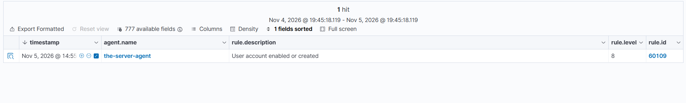

---

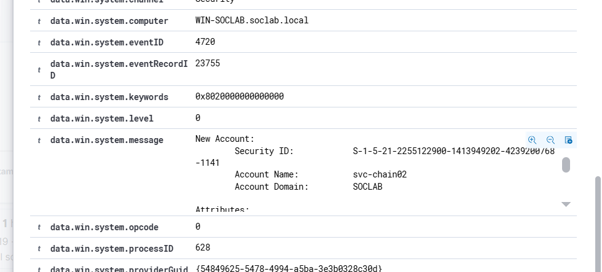

---

### Step 2 — Add the account to a privileged group (4728)

```powershell
Add-ADGroupMember -Identity "Domain-Admins-Custom" -Members "svc-chain02"
```

**What Wazuh said:** custom rule **100105**, level **10**, "Account added to a privileged group (possible privilege escalation)". The built-in **60141** stayed silent on this event — the shadowing finding from Lab 01, confirmed again: when the custom rule matches, the built-in chain never completes.

> **Evidence note:** the screenshot below is from the November 3 run (`svc-backup` added to `Domain-Admins-Custom`, Nov 3 01:40:41) — same rule, same group. The November 5 run for `svc-chain02` was user-confirmed. The `wazuh-logtest` check for 100105 vs 60141 (which rule wins on the same event, without removing rules) is still open — see [Lessons learned](#lessons-learned).

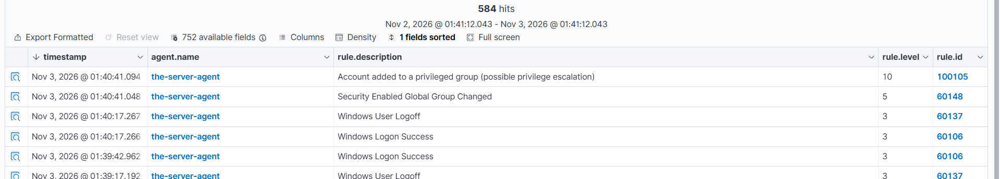

---

### Step 3 — RDP logon as the new account (4624, LogonType 10)

This step failed twice before it worked, and both failures are part of the lab:

1. **Wrong username format** — `DESKTOP-DBRTAE3\svc-backup` (the local PC's prefix) instead of the domain account. Fixed by using `SOCLAB\svc-chain02`.
2. **"The connection was denied because the user account is not authorized for remote login"** — a rights error (`0xC000015B`), not a password error. The fix was adding the account to the built-in **Remote Desktop Users** group:
   ```powershell
   Add-ADGroupMember -Identity "Remote Desktop Users" -Members "svc-chain02"
   ```
   The durable fix is the Group Policy route — add `Domain-Admins-Custom` to **Allow log on through Remote Desktop Services** (Default Domain Controllers Policy) and run `gpupdate /force`.

The third lesson is the one that cost the most time: **switching users inside an existing admin RDP session gives a console logon (type 2), not a remote logon (type 10).** Type 10 needs a *new* RDP window from the analyst's own PC (`mstsc`, computer `192.168.100.146`, user `SOCLAB\svc-chain02`). The admin session stays open alongside it — that is fine.

**What Wazuh said:** rule **92653**, level **3**, "User: SOCLAB\svc-chain02 logged using Remote Desktop Connection (RDP) from ip:192.168.100.27", Nov 5 @ 15:05:55. Logon ID `0x222F38`, Linked Logon ID `0x222E58`, Logon Process `User32`, Authentication Package `Negotiate`.

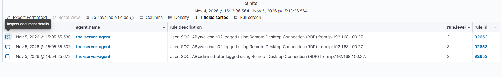

---

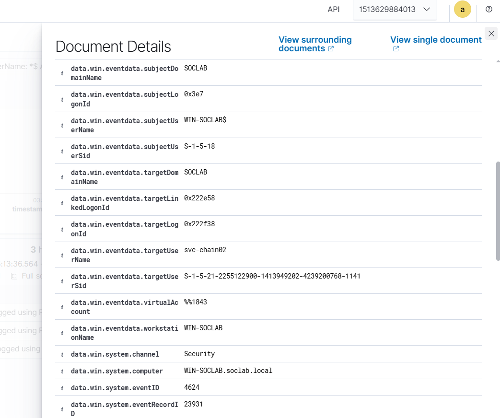

---

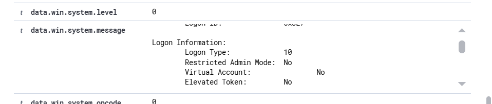

---

### Step 4 — Run a process inside the session (4688)

In the `svc-chain02` RDP session:

```powershell
notepad.exe
```

**What Wazuh said:** rule **67027**, level **3**, "A process was created", Nov 5 @ 15:31:03, eventRecordID `24962`. New process `C:\Windows\System32\notepad.exe` (PID `0x1ec4`), parent `C:\Windows\System32\WindowsPowerShell\v1.0\powershell.exe` (PID `0x1144`), subject `svc-chain02`, SubjectLogonId `0x222F38`.

That Logon ID is the correlation: the process was created inside the Step 3 RDP session. Same `0x222F38` on both events — one session, one story.

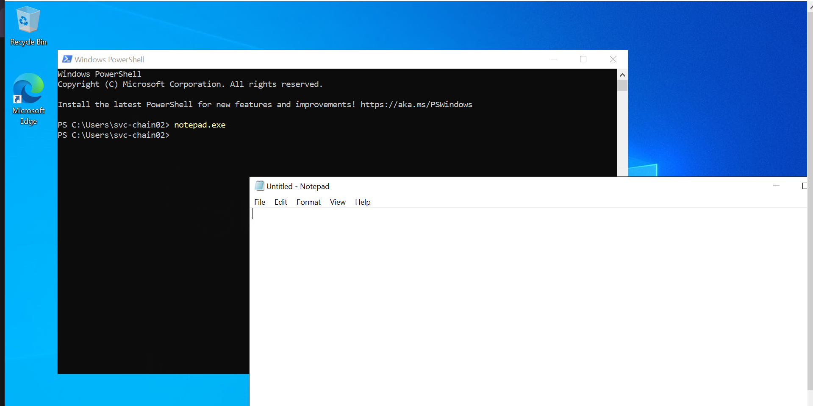

---

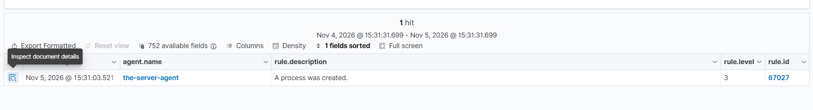

---

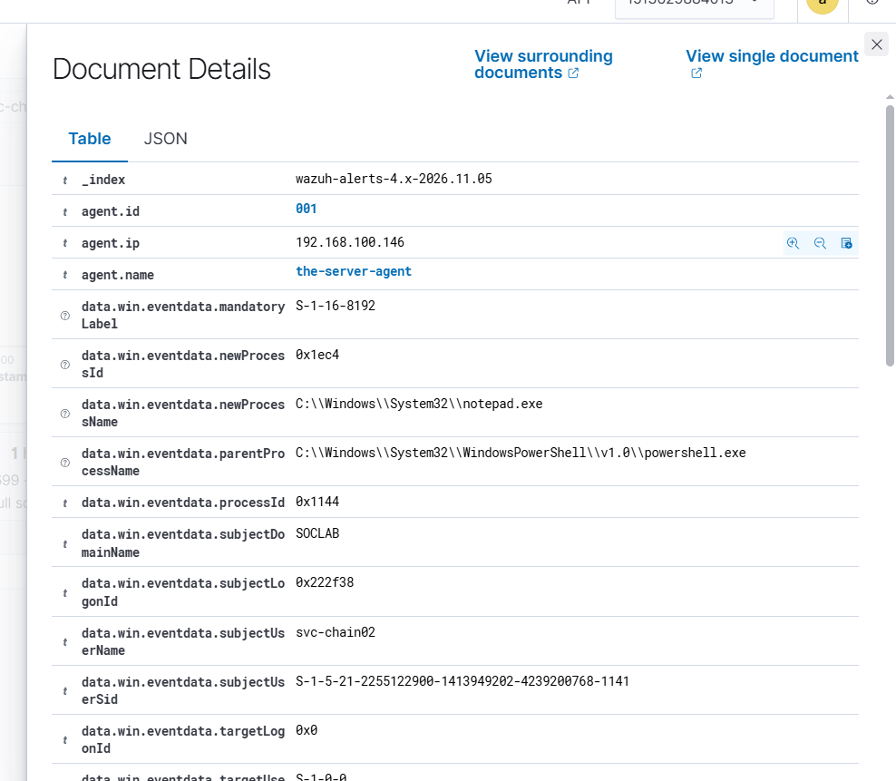

---

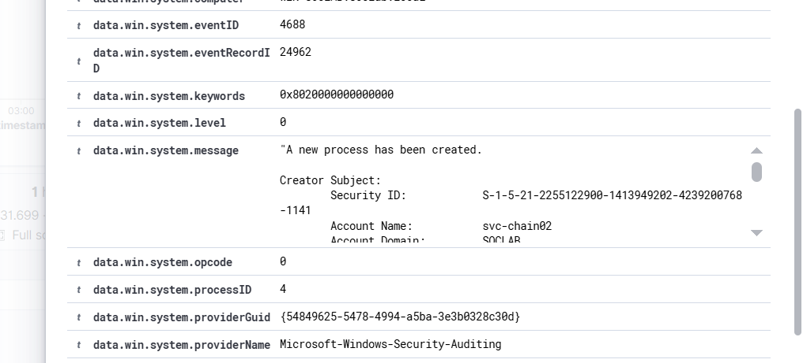

---

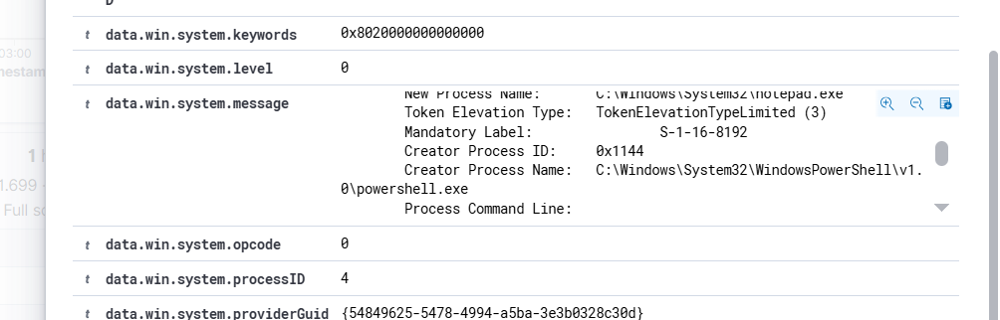

---

**UAC note:** the token is **TokenElevationTypeLimited (3)** with Mandatory Label `S-1-16-8192` (Medium integrity). `svc-chain02` is a privileged-group member, but an interactive logon gives it a *filtered* token — the UAC split-token behavior. That is also why the log clear in Step 5 was run from the admin session, not as `svc-chain02`: the filtered token does not carry the right to clear the log.

### Step 5 — Clear the Security log (1102)

From the **Administrator** session (not as `svc-chain02`, for the filtered-token reason above):

```powershell
Clear-EventLog -LogName Security
```

**What Wazuh said:** custom rule **100108**, level **12**, "Windows audit log was cleared (possible defense evasion, event 1102)", Nov 5 @ 15:38:54. MITRE **T1070.001** (Defense Evasion — Clear Windows Event Logs), rule groups `soclab, custom, defense_evasion`, eventRecordID `27176`, subject `administrator` (Logon ID `0x1A258B`).

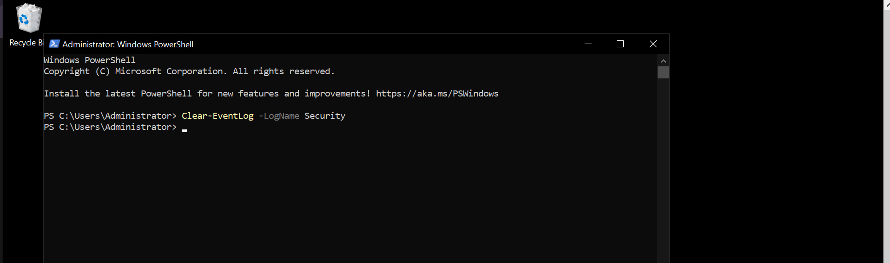

---

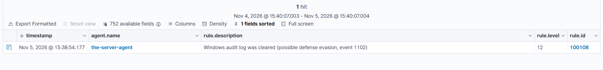

---

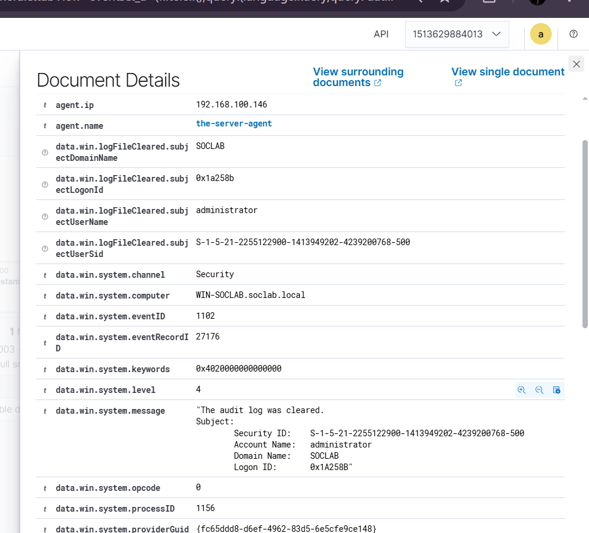

---

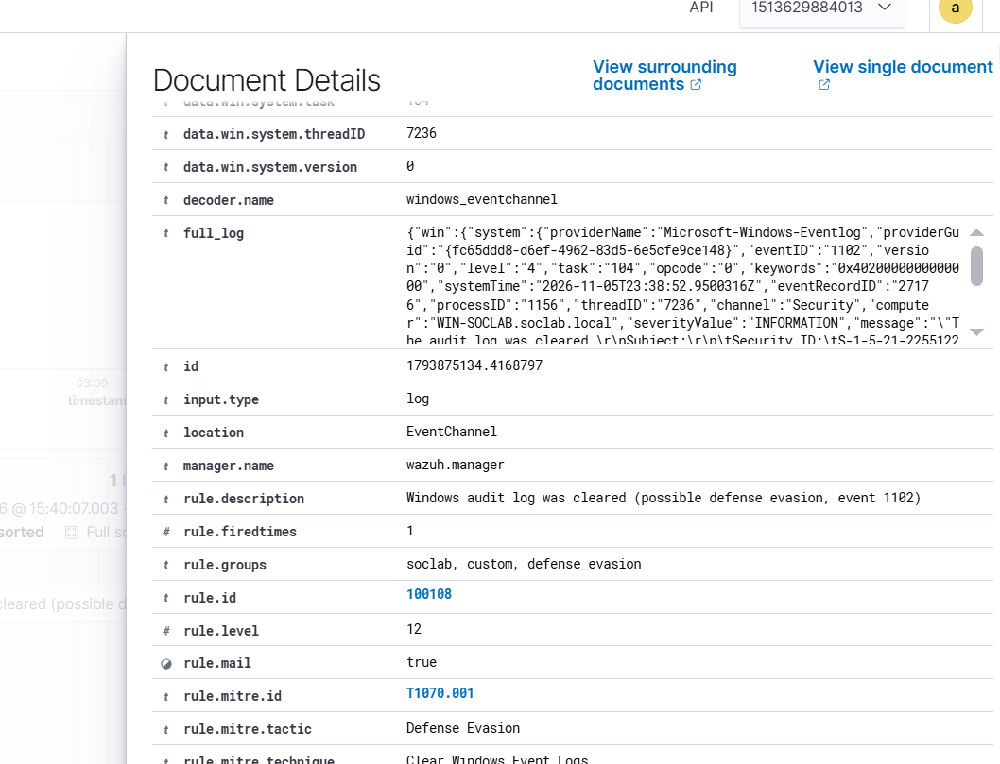

---

Clearing the log empties the DC's local Security log — that is the point of the step. The evidence is not lost: Wazuh already indexed every event, so verification happens in Threat Hunting, not on the DC.

---
## What Wazuh said — the whole chain

| Time (Nov 5) | Event | Rule | Level | What proves it |
|---|---|---|---|---|
| ~14:55 | 4720 — account created | 60109 | 8 | New Account `svc-chain02`, SID ending `-1141` |
| Nov 3 01:40:41 | 4728 — added to privileged group | 100105 | 10 | Screenshot from Nov 3 svc-backup run; Nov 5 user-confirmed; 60141 silent |
| 15:05:55 | 4624 — RDP logon, type 10 | 92653 | 3 | From `192.168.100.27`, Logon ID `0x222F38` |
| 15:31:03 | 4688 — notepad.exe created | 67027 | 3 | Parent `powershell.exe`, SubjectLogonId `0x222F38` |
| 15:38:54 | 1102 — audit log cleared | 100108 | 12 | MITRE T1070.001, cleared by `administrator` |

One Logon ID (`0x222F38`) ties Steps 3 and 4 together. One account (`svc-chain02`, SID ending `-1141`) ties all five together.

---
## Threat Hunting in Wazuh

Threat Hunting uses DQL. These are the queries that find each step — paste them into the search bar (Events tab) over the lab time window. Threat Hunting shows the **alerts** index only; if an event fired no rule, it is invisible here and you need the archives index or `Get-WinEvent` on the DC.

**Step 1 — the new account:**
```
data.win.system.eventID: 4720 AND data.win.eventdata.targetUserName: svc-chain02
```
```
rule.id: 60109 AND data.win.system.eventID: 4720
```

**Step 2 — the privileged-group add:**
```
data.win.system.eventID: 4728 AND data.win.eventdata.targetUserName: Domain-Admins-Custom
```
```
data.win.system.eventID: 4728 AND data.win.eventdata.memberName: *svc-chain02*
```
```
rule.id: 100105
```
```
rule.id: 60141
```
The last two are the shadowing check: with the custom rules loaded, 100105 fires on privileged adds and 60141 stays silent. If 60141 fires on a privileged add, the custom rule is not loaded.

**Step 3 — the remote logon:**
```
data.win.system.eventID: 4624 AND data.win.eventdata.targetUserName: svc-chain02 AND data.win.eventdata.logonType: 10
```
```
rule.id: 92653 AND data.win.eventdata.targetUserName: svc-chain02
```

**Step 4 — the process:**
```
data.win.system.eventID: 4688 AND data.win.eventdata.subjectUserName: svc-chain02
```
```
rule.id: 67027 AND data.win.eventdata.subjectUserName: svc-chain02
```

**Step 5 — the log clear:**
```
data.win.system.eventID: 1102
```
```
rule.id: 100108
```

**The whole chain in one query** (target or subject is the test account):
```
(data.win.eventdata.targetUserName: svc-chain02 OR data.win.eventdata.subjectUserName: svc-chain02)
```

**Cutting the noise — human logons only:**
The 60106 "Windows Logon Success" list is flooded by computer accounts (`WIN-SOCLAB$`), `SYSTEM`, and services. This filter keeps remote logons and drops the machine noise:
```
data.win.system.eventID: 4624 AND data.win.eventdata.logonType: 10 AND NOT data.win.eventdata.targetUserName: *$ AND NOT data.win.eventdata.targetUserName: SYSTEM
```

**Make the names visible:** in Discover / Threat Hunting, add `data.win.eventdata.targetUserName`, `data.win.eventdata.logonType`, and `data.win.eventdata.ipAddress` as columns — then every row shows the account, the logon type, and the source IP without opening the document. (For 4688, the account field is `data.win.eventdata.subjectUserName`, not `targetUserName`.)

---
## Bonus — a Sysmon false positive (and a channel verified)

While the chain ran, Sysmon fired its own alert: a Sysmon 11 FileCreate for `__PSScriptPolicyTest_*.ps1` in Temp, created by PowerShell for `svc-chain02`, at level 15. It looks alarming — level 15, a `.ps1` in Temp — but it is PowerShell's own startup policy test, a benign false positive. Read the filename and the Image before reacting to the level.

The alert also proved something the lab had never confirmed before: the Sysmon Operational channel flows to Wazuh. Until this run, Sysmon events reaching Wazuh were unverified.

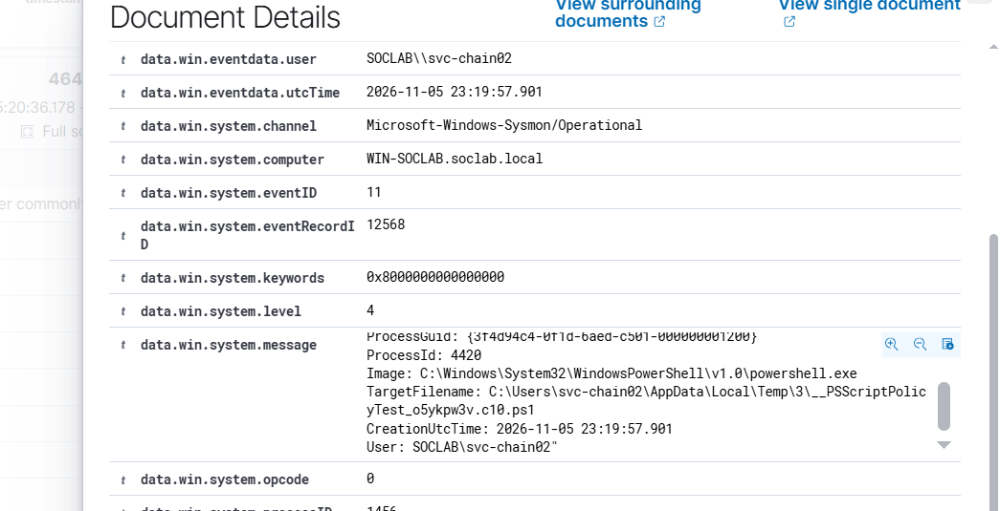

---
## Lessons learned

- **Audit policy is the detection.** A fresh Windows install leaves most subcategories at No Auditing. On this run, `Process Creation` was off, so 4688 did not exist — no rule can fire on an event Windows never writes. Enable auditing first; see [04-Audit-Policy-Setup](../../04-Audit-Policy-Setup/).
- **Logon Type is the difference between "logged on" and "logged on remotely."** A type 2 logon (console, `127.0.0.1`) and a type 10 logon (RDP, real source IP) look identical in the alert list until you open the document. Always check `logonType` and `ipAddress`.
- **A rights error is not a password error.** "Not authorized for remote login" (`0xC000015B`) means the account lacks the RDP right — fix the right (Remote Desktop Users, or the Group Policy user right), don't keep guessing the password. The password was already proven good by the console logon.
- **Correlate on Logon ID, not on time.** The RDP logon and the process it launched share Logon ID `0x222F38`. Timestamps drift — the rebuilt DC's clock ran ahead of the dashboard (the raw 1102 `systemTime` reads `23:38:52Z` against an alert-list time of `15:38:54`) — but the Logon ID never lies.
- **Severity ≠ certainty.** A Sysmon 11 FileCreate for `__PSScriptPolicyTest_*.ps1` in Temp fired at level 15 — and it is PowerShell's own startup policy test, a benign false positive. Read the filename and the Image before reacting to the level. (That alert also proved the Sysmon Operational channel flows to Wazuh — previously unverified.)
- **One incident, five alerts.** The SOC value is not five separate alerts — it is the story they tell together: account created, privilege granted, remote logon, process run, log cleared. That sequence, from one account in 44 minutes, is the incident.
- **Open follow-up:** verify 100105 vs 60141 with `wazuh-logtest` on a captured 4728 event (which rule wins, without removing rules) and keep that event as a regression case for future rule changes.

---
## Cleanup

- The test account `svc-chain02` was left in place after the run for verification; remove it (`Remove-ADUser -Identity "svc-chain02" -Confirm:$false`) and remove it from `Domain-Admins-Custom` and `Remote Desktop Users` when the chain is no longer needed. (Removing it fires 4726 and 4729 — the cleanup generates its own evidence.)
- The cleared Security log on the DC is expected — Wazuh holds the indexed copy.

---

*Part of [Wazuh Home SOC Lab](../../README.md) — the chained attack is the lab where single-event detections become incident triage.*
