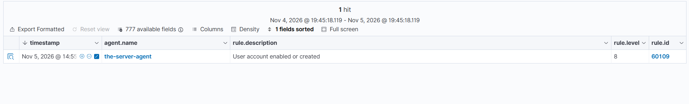
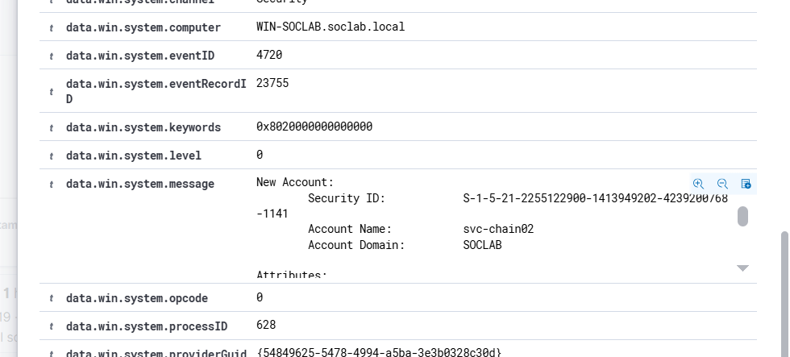
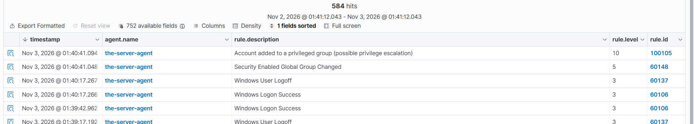
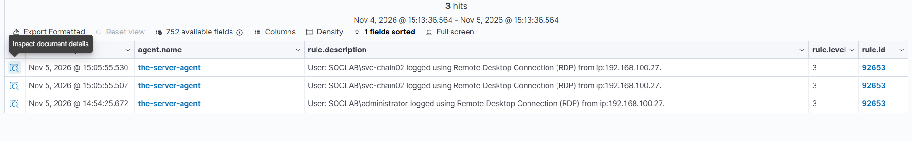
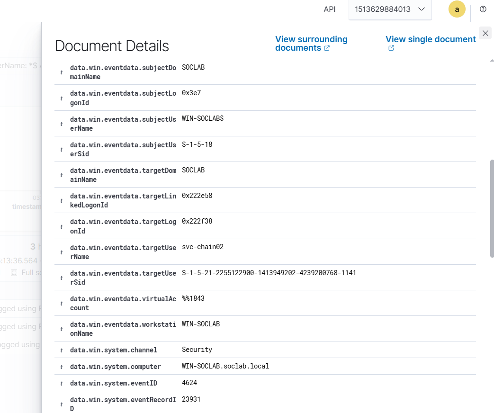
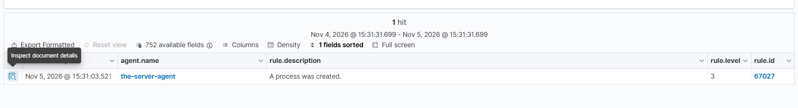
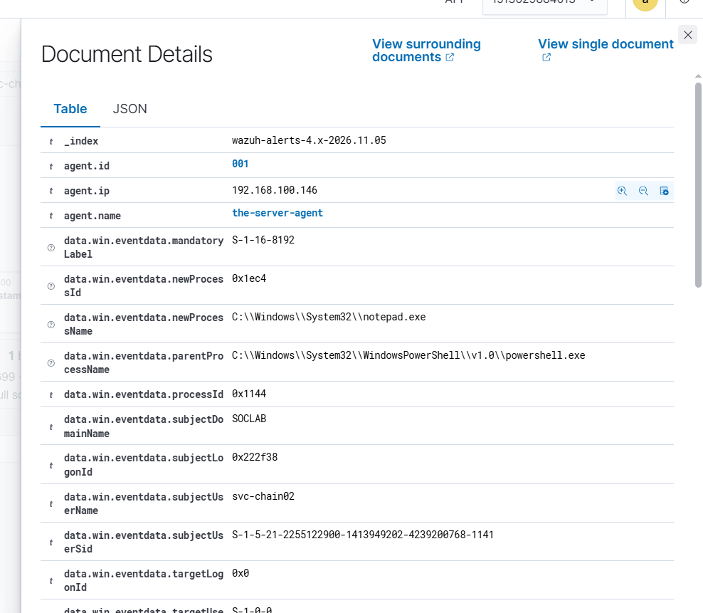
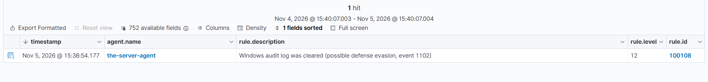
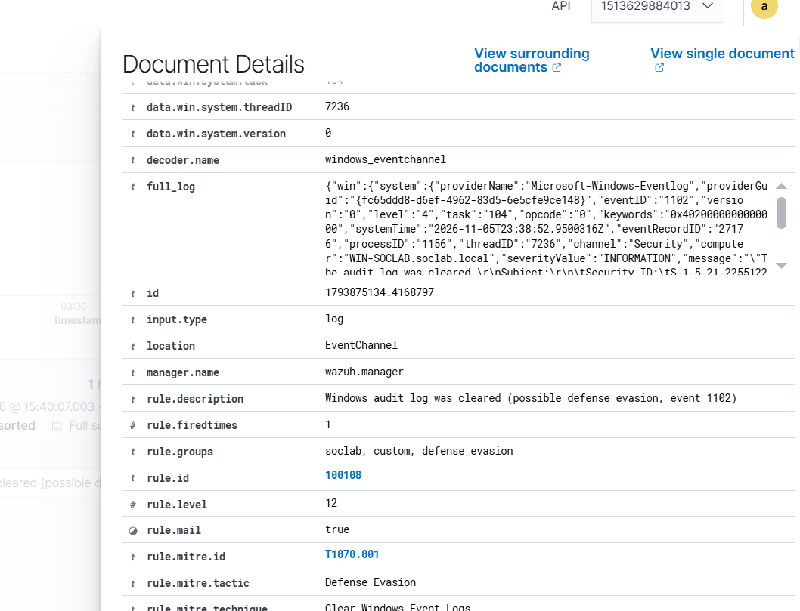

# Lab 06 — Rogue Admin: The Chain as a Purple-Team Story

*Part of the [Core Detection Labs](../README.md) — Lab 05 retold as one attack, then broken step by step. Same evidence, new question: how would the attacker have dodged each alert, and what would still have caught them?*

---
## Overview

Lab 05 proved the chain fires: five alerts, one incident, verified end to end on November 5, 2026. This lab replays the same chain three times, from three chairs:

1. **The attacker** — what they did, and why each step matters.
2. **The defender** — what Wazuh saw, rule by rule, and the evidence that ties the steps together.
3. **The purple team** — how the attacker could have evaded each detection, what would still have caught them, and the re-tests that prove it.

The lab runs on the same environment as Lab 05: domain `soclab.local` (`SOCLAB`), domain controller `WIN-SOCLAB` (`192.168.100.146`), analyst PC `192.168.100.27`, Wazuh 4.14.5 on Kali (`192.168.100.50`), agent 001. Test account: **svc-chain02**, SID ending `-1141`.

**Evidence honesty:** all screenshots in this lab are reused from Lab 05 — no new screenshots were taken for this write-up. The Step 2 screenshot of rule 100105 firing is from the **November 3 run** (`svc-backup` added to `Domain-Admins-Custom`, Nov 3 01:40:41), not the November 5 run; the November 5 run for `svc-chain02` was user-confirmed. It is labelled as the earlier run wherever it appears.

**Assumption, stated plainly:** this chain starts with the attacker already holding an Administrator session on the DC — the account is created from that session. That is a deliberate lab simplification, not a real attack path. In a real incident the first foothold would come from somewhere else (phishing, an exposed service, a stolen credential) and would have its own alerts. The chain here covers what happens *after* the foothold.

---
## 1. The story — attacker point of view

The goal is a backdoor account with domain privilege that can be used from outside the DC, and a clean exit. Five moves, in order. Each one depends on the one before it.

### Move 1 — Create the backdoor account (4720)

A brand-new account is the cleanest backdoor: no owner, no baseline, no one watching for its logons because it has never logged on before.

```powershell
$Pass = Read-Host -AsSecureString "Lab password for the new account"
New-ADUser -Name "SVC-Chain02" -SamAccountName "svc-chain02" -UserPrincipalName "svc-chain02@soclab.local" -AccountPassword $Pass -Enabled $true -PasswordNeverExpires $true -Description "Chain lab test account 2 - Nov 5 redo"
```

**Why this step matters:** everything after this is done *as* `svc-chain02`. If the account is discovered, it can be deleted and the chain dies — but until then, every alert names an account nobody recognizes. `PasswordNeverExpires` removes the risk of the backdoor locking itself out mid-operation.

### Move 2 — Give it privilege (4728)

A new account is useless without rights. One group add turns a nobody into a domain admin:

```powershell
Add-ADGroupMember -Identity "Domain-Admins-Custom" -Members "svc-chain02"
```

**Why this step matters:** privilege is the difference between an account that can read and an account that can change. This is the loudest move in the chain — group membership changes are among the most-watched events in any domain — and it is also the move the attacker cannot skip. There is no quiet way to become a domain admin; the question is only *which* watched event fires.

### Move 3 — Log on from outside (4624, LogonType 10)

From the analyst's own PC (`192.168.100.27`), a new RDP window to the DC (`192.168.100.146`) as `SOCLAB\svc-chain02`:

```powershell
mstsc
```

**Why this step matters:** until now the attacker has only touched the DC through the admin session. The RDP logon is the first time the backdoor account is *used* — and the first time it appears on the network, with a source IP that is not the DC itself. Two failures on the way here are part of the story: the first attempt used the wrong username format (`DESKTOP-DBRTAE3\svc-backup`, the local PC's prefix, instead of the domain account), and the second failed on a rights error — `0xC000015B`, "not authorized for remote login" — fixed by adding the account to **Remote Desktop Users**. A rights error is not a password error, and the fix is a right, not a new password.

### Move 4 — Act inside the session (4688)

Inside the `svc-chain02` RDP session, from PowerShell:

```powershell
notepad.exe
```

**Why this step matters:** `notepad.exe` is harmless on purpose — this is a lab, and the process is a stand-in for anything the attacker would run next: a shell, a dumper, a lateral-movement tool. What matters is not *which* process, but that a process was created inside the backdoor's session, by the backdoor's account, under the backdoor's logon. That is the moment the chain becomes an active intrusion instead of a dormant backdoor.

### Move 5 — Hide it (1102)

From the **Administrator** session — not as `svc-chain02`, because the filtered token of an interactive logon does not carry the right to clear the log:

```powershell
Clear-EventLog -LogName Security
```

**Why this step matters:** clearing the Security log deletes the DC's local copy of every event in the chain — the account creation, the group add, the logon, the process. It is the anti-forensics move, and it is also the loudest: a cleared log is itself an event, and it is the one event the attacker cannot hide from the SIEM, because Wazuh already indexed the events before the log was cleared.

---
## 2. What the defender saw

One account, five alerts, 44 minutes (14:55 → 15:38:54, November 5, 2026).

| # | Step | Event | Rule | Level | MITRE | What proves it |
|---|---|---|---|---|---|---|
| 1 | Account created | 4720 | 60109 | 8 | T1136 Create Account | New Account `svc-chain02`, SID ending `-1141`, eventRecordID 23755 |
| 2 | Added to privileged group | 4728 | 100105 (custom) | 10 | T1098 Account Manipulation | Target group `Domain-Admins-Custom`; built-in 60141 silent (shadowing) |
| 3 | RDP logon, type 10 | 4624 | 92653 | 3 | T1021.001 Remote Desktop Protocol | Source `192.168.100.27`, Logon ID `0x222F38`, 15:05:55 |
| 4 | Process created | 4688 | 67027 | 3 | T1059.001 PowerShell | `notepad.exe`, parent `powershell.exe`, SubjectLogonId `0x222F38`, eventRecordID 24962 |
| 5 | Audit log cleared | 1102 | 100108 (custom) | 12 | T1070.001 Clear Windows Event Logs | Cleared by `administrator`, eventRecordID 27176, 15:38:54 |

**The correlation that makes it one incident:** Step 3's RDP logon and Step 4's process creation share Logon ID `0x222F38` — the process was created inside the RDP session. One account (`svc-chain02`, SID ending `-1141`) ties all five steps together. Timestamps drift (the rebuilt DC's clock ran ahead of the dashboard), but the Logon ID does not.

### Step 1 — the defender saw 60109, level 8

Rule **60109**, "User account enabled or created", Nov 5 @ ~14:55. New Account `svc-chain02`, SID ending `-1141`, eventRecordID `23755`. The off-hours custom rule **100109** did *not* fire — the creation happened in daytime, outside its 5 pm–8 am UTC window. That is correct behavior, and it is also the first gap (see Section 3).



---



---

### Step 2 — the defender saw 100105, level 10

Custom rule **100105**, "Account added to a privileged group (possible privilege escalation)", level 10, MITRE **T1098**. The built-in **60141** stayed silent on this event — the shadowing finding from Lab 01, confirmed again: when the custom rule matches, the built-in chain never completes.

> **Evidence note:** the screenshot below is from the November 3 run (`svc-backup` added to `Domain-Admins-Custom`, Nov 3 01:40:41) — same rule, same group. The November 5 run for `svc-chain02` was user-confirmed.



---

### Step 3 — the defender saw 92653, level 3

Rule **92653**, "User: SOCLAB\svc-chain02 logged using Remote Desktop Connection (RDP) from ip:192.168.100.27", Nov 5 @ 15:05:55. Logon ID `0x222F38`, Linked Logon ID `0x222E58`, Logon Process `User32`, Authentication Package `Negotiate`, LogonType 10.



---



---

### Step 4 — the defender saw 67027, level 3

Rule **67027**, "A process was created", Nov 5 @ 15:31:03, eventRecordID `24962`. New process `C:\Windows\System32\notepad.exe` (PID `0x1ec4`), parent `C:\Windows\System32\WindowsPowerShell\v1.0\powershell.exe` (PID `0x1144`), subject `svc-chain02`, SubjectLogonId `0x222F38` — the same Logon ID as the Step 3 RDP logon. The token is **TokenElevationTypeLimited (3)**, Mandatory Label `S-1-16-8192` (Medium integrity): an interactive logon gives even a privileged-group member a *filtered* token — the UAC split-token behavior, and the reason Step 5 ran from the admin session instead.



---



---

### Step 5 — the defender saw 100108, level 12

Custom rule **100108**, "Windows audit log was cleared (possible defense evasion, event 1102)", level 12, MITRE **T1070.001**, Nov 5 @ 15:38:54, eventRecordID `27176`, subject `administrator` (Logon ID `0x1A258B`). Clearing the log emptied the DC's local Security log — but Wazuh already held the indexed copy, so verification happens in Threat Hunting, not on the DC.



---



---

### The alert that was not part of the chain

While the chain ran, a Sysmon 11 FileCreate for `__PSScriptPolicyTest_*.ps1` in Temp fired at level 15 — PowerShell's own startup policy test, a benign false positive. It looked alarming (level 15, a `.ps1` in Temp) and it was nothing. Severity ≠ certainty: read the filename and the Image before reacting to the level. The same alert proved the Sysmon Operational channel flows to Wazuh — previously unverified.

---
## 3. Detection gaps and evasion — step by step

Every detection in Section 2 has a dodge. The point of this section is not to admire the evasion — it is to find the *next* detection. For each step: how the attacker could have evaded it, and what would still catch them.

### Step 1 (4720) — dodge the clock, or skip the creation entirely

**The dodge:** create the account in business hours. Custom rule 100109 only fires on off-hours creations (5 pm–8 am UTC) — the November 5 run proved it by accident, when the daytime creation left 100109 silent. A patient attacker creates the backdoor at 10 am and the loudest rule never fires. The stronger dodge is to skip creation altogether: re-enable a dormant account (event 4722) or use an existing service account. No 4720, no 60109.

**What still catches it:** rule 60109 fires on *every* 4720, whatever the hour — the off-hours rule is a bonus, not the detection. A re-enabled account fires 4722, which maps to the same rule 60109. And the sequence is the real catch: a brand-new account that gains privilege and logs on within the hour is suspicious at any hour of the day. That sequence rule is Project B (the account-lifecycle anomaly rule pack).

### Step 2 (4728) — dodge the name, or dodge the group

**The dodge:** rename the account. A rule that matches on `targetUserName` goes blind the moment the name changes — that is the SID lesson from Lab 02, where renaming `Administrator` to `Administratorss` during testing evaded the attacker's own rule, and the fix was matching on the SID (`-500$`) instead of the name. But 100105 does not match the member name at all: it matches the *target group*. Renaming `svc-chain02` changes nothing — the rule still fires, because the group is still `Domain-Admins-Custom`. The dodge that works against a group-name rule is renaming the *group*. The dodge that works against the step itself is skipping groups entirely: grant the privilege directly through an ACL or delegation change (event 4738), or use a group that is not on the rule's privileged list.

**What still catches it:** any 4728 fires a rule — 100105 when the custom rules are loaded, 60141 when they are not. A 4738 change to the Administrator SID is caught by custom rule 100110. And the nesting test from Lab 01 already closed one escape route: adding a plain group *into* a privileged group fires 100105 on the nesting add, because the target group of that add is the privileged one. The rule watches the destination, not the member.

### Step 3 (4624) — dodge the protocol, or dodge the network

**The dodge:** log on at the console instead of over RDP. A type 2 logon has no source IP and no 92653 — the abandoned `svc-backup` attempt did exactly this, producing a type 2 logon from `127.0.0.1` that the RDP rule never saw. A type 3 network logon (SMB, WinRM) is the same idea from the other side: 4624 still fires, but the RDP-specific rule 92653 does not.

**What still catches it:** rule 60106 fires on *every* 4624, whatever the type — the logon is never invisible, only the RDP label is. A first-logon rule for a newly created privileged account (any logon type, any source) would catch all three variants at once. And again the sequence: an account created an hour ago, added to a privileged group, logging on for the first time is the incident — the logon type only changes which single alert fires.

### Step 4 (4688) — dodge the process name, or dodge the auditing

**The dodge:** run anything except `notepad.exe`. The process name is arbitrary — a living-off-the-land binary (`rundll32.exe`, `mshta.exe`, `regsvr32.exe`), a renamed binary, or the same `notepad.exe` launched from Explorer instead of PowerShell to change the parent. No rule in this lab matches on the name `notepad.exe`, so changing the name costs the attacker nothing.

**What still catches it:** rule 67027 fires on *any* 4688, regardless of the image name — the detection is process *creation*, not the process. The signal is the parent-child pair (an unusual parent for the process, a process running under a brand-new privileged account, inside a fresh RDP session), not the filename. The real gap is underneath the rule: if `Process Creation` auditing is off, no 4688 exists at all. That is exactly what happened on the first Step 4 attempt — the rebuilt DC had the subcategory at No Auditing, and the step was invisible until the full audit enable was applied (see [04-Audit-Policy-Setup](../../04-Audit-Policy-Setup/)). Audit policy is the detection; the rule only reads what Windows writes.

### Step 5 (1102) — dodge the clear, or dodge the attribution

**The dodge:** do not clear the log at all. A cleared log is the loudest event in the chain (level 12), and an attacker who leaves the log alone bets that nobody is watching. The quieter dodge is to disable auditing instead of clearing the log (`auditpol /set` to turn a subcategory off) — but that fires event 4719, audit policy changed. The third dodge is attribution: clear the log from a different account. In this lab the 1102 subject was already `administrator`, not `svc-chain02` — the filtered token forced it — so the clear does not even name the backdoor account. That break in the account tie is itself a detection gap.

**What still catches it:** custom rule 100108 fires on *any* 1102, whatever the subject. And clearing the local log does not touch the SIEM copy — Wazuh indexed every event before the clear, so the evidence survives the anti-forensics. The defender's copy is the one that matters, and the attacker cannot reach it from the DC.

### The gap underneath all five steps

No single step in this chain is hard to evade on its own. The gap is that nothing in the current ruleset fires on the *sequence*: new account → privileged group → first logon → process → log cleared, from one account in 44 minutes. Each alert is explainable alone; together they are the incident. Closing that gap is Project B — one correlation rule for the whole lifecycle.

---
## 4. Break your own detection — the purple-team loop

Purple team is a loop, not a report: **attack → detect → evade → re-detect → document**. One change at a time, snapshot first, and record the exact alert — or its absence — for every run. Three re-tests below. Each one breaks one detection from Section 2 and asks for the detection that replaces it.

### Re-test 1 — the nested-group add (breaks Step 2)

1. Create a fresh test account (not `svc-chain02` — that chain is done).
2. Add it to a plain, non-privileged group.
3. Add that plain group into `Domain-Admins-Custom`.
4. Check Threat Hunting: which 4728 fired 100105 — the member add, or the nesting add?

**Expected result:** 100105 fires on the nesting add, because its target group is the privileged one; the member add to the plain group fires only the built-in rule. **What it proves:** the rule watches the destination group, not the member — the Lab 01 nesting finding, re-verified on a live chain. **The re-detection to write down:** a rule on *any* add where the target group is privileged already exists (100105). The follow-up question is whether a nesting add should score higher than a direct add, and what a rule for "group added to a privileged group" would look like.

### Re-test 2 — the console logon (breaks Step 3)

1. Create a fresh test account, add it to `Domain-Admins-Custom`.
2. Log on at the DC console as that account (type 2) instead of over RDP.
3. Check Threat Hunting: does 92653 fire? Does 60106?

**Expected result:** no 92653 (it is RDP-specific), 60106 fires on the 4624. **What it proves:** the RDP rule is a protocol label, not a logon detection — a console logon by a brand-new privileged account is invisible to it. **The re-detection to write down:** a first-logon rule for a newly created privileged account, any logon type, any source. Draft it as a Project B input: the trigger is not the protocol, it is the account's age.

### Re-test 3 — the audit switch (breaks Step 4)

1. Take a clean snapshot of the DC first.
2. Turn off Process Creation auditing: `auditpol /set /subcategory:"Process Creation" /success:disable /failure:disable`.
3. Re-run Step 4 (log on as the test account, launch a process).
4. Check Threat Hunting: any 4688? Any 67027?
5. Re-enable immediately with the full enable set from [04-Audit-Policy-Setup](../../04-Audit-Policy-Setup/) and verify with `auditpol /get /category:*`.

**Expected result:** nothing — no 4688, no alert, no trace. **What it proves:** audit policy *is* the detection. A rule cannot fire on an event Windows never writes, and a fresh install leaves this subcategory off by default. **The re-detection to write down:** none exists for a missing event. The control is the audit baseline itself — a scheduled check that the subcategories are still on (and the 4719 alert if someone changes them).

**Extra idea:** swap the process. Replace `notepad.exe` with `calc.exe` or a living-off-the-land binary launched from PowerShell, and compare the 4688 rows. Same rule 67027 fires, different image and parent — the exercise is reading the parent-child pair instead of the filename.

---
## 5. Threat Hunting in Wazuh

Threat Hunting uses DQL. Paste these into the search bar (Events tab) over the lab time window. Threat Hunting shows the **alerts** index only; if an event fired no rule, it is invisible here and you need the archives index or `Get-WinEvent` on the DC.

**Step 1 — the new account:**
```
data.win.system.eventID: 4720 AND data.win.eventdata.targetUserName: svc-chain02
```

**Step 2 — the privileged-group add:**
```
data.win.system.eventID: 4728 AND data.win.eventdata.targetUserName: Domain-Admins-Custom
```
```
rule.id: 100105
```

**Step 3 — the remote logon:**
```
data.win.system.eventID: 4624 AND data.win.eventdata.targetUserName: svc-chain02 AND data.win.eventdata.logonType: 10
```

**Step 4 — the process:**
```
data.win.system.eventID: 4688 AND data.win.eventdata.subjectUserName: svc-chain02
```

**Step 5 — the log clear:**
```
data.win.system.eventID: 1102
```
```
rule.id: 100108
```

**The whole chain in one query** (target or subject is the test account — 4688 records the account as the subject, the rest as the target):
```
(data.win.eventdata.targetUserName: svc-chain02 OR data.win.eventdata.subjectUserName: svc-chain02)
```

**Cutting the noise — human logons only:**
```
data.win.system.eventID: 4624 AND data.win.eventdata.logonType: 10 AND NOT data.win.eventdata.targetUserName: *$ AND NOT data.win.eventdata.targetUserName: SYSTEM
```

**Make the names visible:** in Discover / Threat Hunting, add `data.win.eventdata.targetUserName`, `data.win.eventdata.logonType`, and `data.win.eventdata.ipAddress` as columns — then every row shows the account, the logon type, and the source IP without opening the document. (For 4688, the account field is `data.win.eventdata.subjectUserName`, not `targetUserName`.)

---
## 6. Cleanup and revert

1. Remove the test account from both groups first (removal fires 4729 — the cleanup generates its own evidence):
   ```powershell
   Remove-ADGroupMember -Identity "Domain-Admins-Custom" -Members "svc-chain02" -Confirm:$false
   Remove-ADGroupMember -Identity "Remote Desktop Users" -Members "svc-chain02" -Confirm:$false
   ```
2. Delete the account (fires 4726):
   ```powershell
   Remove-ADUser -Identity "svc-chain02" -Confirm:$false
   ```
3. Verify the cleanup in Threat Hunting:
   ```
   data.win.system.eventID: 4729 AND data.win.eventdata.targetUserName: Domain-Admins-Custom
   ```
   ```
   data.win.system.eventID: 4726 AND data.win.eventdata.targetUserName: svc-chain02
   ```
4. **Re-enable auditing if any re-test disabled it.** Re-run the full enable set from [04-Audit-Policy-Setup](../../04-Audit-Policy-Setup/) and verify with `auditpol /get /category:*` — every subcategory should show Success and Failure. If the DC is domain-joined, Group Policy can override local `auditpol` on refresh; the durable fix is the Default Domain Controllers Policy.
5. If the Group Policy durable fix for RDP was applied (adding `Domain-Admins-Custom` to **Allow log on through Remote Desktop Services**), remove the group from that right again and run `gpupdate /force` — the lab's RDP path should not outlive the lab.
6. The cleared Security log on the DC is expected — Wazuh holds the indexed copy. Do not "fix" it by restoring anything; the chain's evidence lives in the SIEM.

---

*Part of [Wazuh Home SOC Lab](../../README.md) — Lab 05 is the chain, Lab 06 is the same chain with the attacker fighting back. Next: Project B, the correlation rule pack that fires on the whole sequence.*
