# Account Management: 25 Windows Events, Mapped to Wazuh

Every account-management event that matters in Active Directory — **generated by hand in the lab, caught by Wazuh, triaged like a SOC analyst**. Each event below has a plain-English explanation, an interview-ready answer, the exact Wazuh rule that fired, and the PowerShell to reproduce it.

This is my interview-prep document: when I get the call, I revise from here.

## Lab overview

| Field | Details |
|---|---|
| SIEM | Wazuh 4.14.5 single-node (Docker Compose) on Kali Linux |
| SIEM host | `192.168.100.50` — dashboard at `https://192.168.100.50` |
| Monitored host | Windows Server 2022 DC — `WIN-SOCLAB`, domain `soclab.local`, `192.168.100.146` |
| Agent | `001` (`the-server-agent`) — Active |
| Test accounts | `testuser01`, `testuser02` (lab-created) |
| Test groups | `GG-Sales` (Global), `DL-SecretData-Read` (Domain Local), `U-TestUniversal` (Universal) |
| Events covered | 25 — full account lifecycle, group lifecycle (all three scopes), computer accounts |
| Method | Generate each event → find the alert in Threat Hunting → read the rule ID **off the fired alert** (`data.win.system.eventID`), never off the rules list |

## How to use this for interview prep

1. **Memorize the IDs cold.** The [revision sheet](phase-1-sheet.pdf) in this folder lists all 25 in numerical order with one-line meanings — drill it until someone can say "4743" and you answer "computer account deleted" without thinking.
2. **Know the "why" for the big ones.** Every event below has a *"Why a SOC analyst cares"* written as an interview answer — say it out loud, in your own words.
3. **Know the two noisy ones.** 4720 and 4738 fire constantly at enterprise scale; be ready to explain *how you'd tune them*.
4. **Know the gotchas.** The [lab errors](#lab-errors-i-hit--how-i-fixed-them) section is pure interview gold — every interviewer loves "tell me about a time something broke."

---

## Core concepts

### Group scopes: the lock, the badge, and the forest-wide badge

Active Directory has three group scopes. Think of a college with campuses:

- **Domain Local group — the lock on a specific door.** The group *is* the access list attached to a resource. `DL-SecretData-Read` sits on the folder `C:\SecretData` like a lock on a door. Being added to the group = someone cuts you a key to that lock. It grants access to **one specific resource**, and it can contain users and groups from anywhere in the forest.
- **Global group — the badge.** `GG-Sales` is a role badge: "this person is in Sales." A badge by itself opens nothing — but doors (domain local groups) are configured to accept certain badges. A global group can only contain members from **its own domain**.
- **Universal group — the badge valid at every campus.** Same idea as a global badge, but recognized in **every domain in the forest**. Its membership is stored in the **Global Catalog**, which is why the forest needs it replicated everywhere. In a single-domain lab it behaves like a global group — the difference only shows with a second domain.

### The AGDLP nesting model

The intended design, and what the lab demonstrated:

```
User → Global role group → Domain Local resource group → Permission on the resource
```

`testuser01` → member of `GG-Sales` (the badge) → `GG-Sales` placed in `DL-SecretData-Read` (the lock) → lock grants Read on `C:\SecretData`. Add the user to the badge group once, and every door that accepts the badge opens. Remove the badge group from the lock, and every door closes at once. **The 4728 moment — adding the member — is when permission is granted.** Nothing is "handed over" again later; the power rides with the identity from that moment on.

### Computer accounts: the machine's ID card

Every domain-joined machine has an account in AD — the machine's ID card. You can spot one by the **`$` at the end of the name** (e.g. `WIN-SOCLAB$`): that suffix means "this is a machine, not a person."

What the ID card does: at boot, the machine authenticates to the domain with it (like a user logging on, but automatic), then receives Group Policies, exposes SYSVOL/NETLOGON, and validates domain users who log on to it.

The part that matters for security: `New-ADComputer` prints an ID card **with no real machine behind it** — a *ghost* account. Attackers create ghost computer accounts they control, then authenticate *as that machine* from their own box and abuse delegation to impersonate users (resource-based constrained delegation / shadow-credential style attacks). The card is genuine; the machine holding it is fake.

And the uncomfortable detail: **Machine Account Quota.** By default, *any* authenticated domain user can create up to **10** computer accounts — no admin rights needed. That is why 4741 deserves attention even though it looks boring.

### Logon types (you'll need these)

| Type | Name | Meaning |
|---|---|---|
| 2 | Interactive | Console logon — someone physically (or virtually) at the machine's own screen |
| 3 | Network | Network logon — accessing a share, authenticating to a service, lateral movement |
| 10 | RemoteInteractive | RDP session |

Key insight from the lab: an **interactive (type 2)** logon by a privileged-group member gets a *filtered* token (UAC split-token), while a **network (type 3)** logon carries the *full* token. Attackers don't sit at the console — they come over the network, where their stolen privileges work at full strength. **A type-3 logon by a privileged-group member from an unusual source is the lateral-movement pattern to watch.**

---
## The 25 events

Each event: what it is, why a SOC analyst cares (as an interview answer), the Wazuh rule that fired in this lab, how to generate it, and how to clean up.

> Screenshot placeholders mark where each capture belongs. Screenshots are being added — the comments show exactly what goes where.

---

### 4720 — User account created

**What it means:** A new user account object was created in Active Directory. The birth certificate of an account.

**Why a SOC analyst cares:** *"4720 is where I start asking 'who made this, and why does it exist?' On its own it's usually just onboarding — but an account created at 3 AM, by an unusual admin, or immediately added to a privileged group is how backdoor accounts begin. Creation followed by first logon from a strange IP is the pattern I watch for."*

**Wazuh:** rule **60109**, level **8** — verdict: **needs tuning**. It fires on every single onboarding, so at enterprise scale this is high-volume. Tune by alerting on *creation + privileged-group membership* or *creation outside business hours*, not on every 4720.

**Generate:**
```powershell
New-ADUser -Name "testuser02" -SamAccountName "testuser02" `
  -AccountPassword (ConvertTo-SecureString "P@ssw0rd123!" -AsPlainText -Force) `
  -Enabled $true -Path "CN=Users,DC=soclab,DC=local"
```

**Cleanup:** `Remove-ADUser -Identity "testuser02" -Confirm:$false` (note: the cleanup itself fires 4726 — deleting the evidence generates evidence).

**Watch out:** `New-ADUser -Enabled $true` fires **4720 + two 4738s + 4722 in the same second** — one automated operation, not four human actions. Also: 4720 *immediately followed by 4726* for the same account means failed provisioning (e.g. the password violated policy and AD rolled the object back) — not an attack. Windows audits operations, not outcomes.


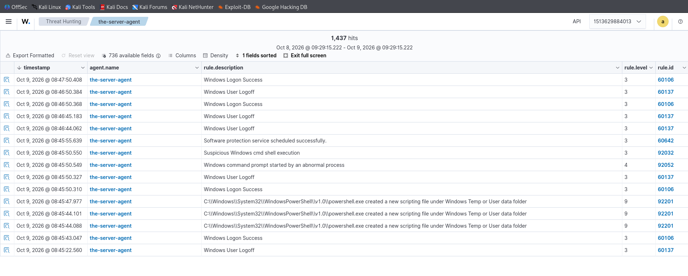


---

### 4722 — User account enabled

**What it means:** A disabled account was switched back on.

**Why a SOC analyst cares:** *"A dormant account waking up is interesting — attackers love re-enabling old disabled accounts because they already exist, they have history, and nobody watches them. I check who enabled it, and whether the logon that follows looks like the original owner."*

**Wazuh:** rule **60109**, level **8** — verdict: **covered**.

**Generate:** `Enable-ADAccount -Identity "testuser02"`

**Cleanup:** `Disable-ADAccount -Identity "testuser02"`

**Watch out:** usually stacks with a 4738 (account changed) in the same second — same operation, two events.


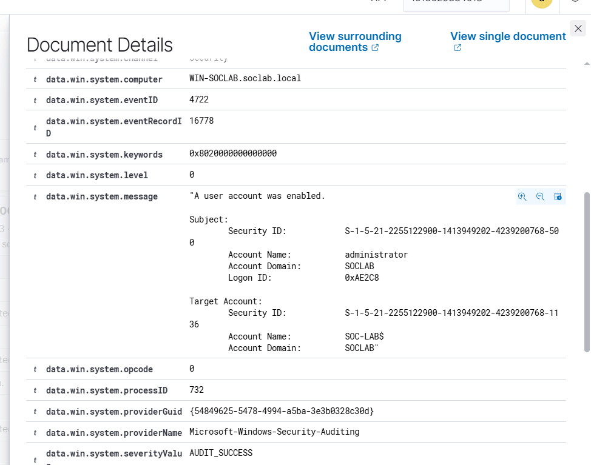

---

### 4723 — Password change attempted

**What it means:** A user attempted to change **their own** password (Ctrl+Alt+Del → Change password).

**Why a SOC analyst cares:** *"This is the user changing their own password — normal. It matters as context: a password change right before suspicious activity can mean the legitimate user just secured the account — or that someone holding the session is locking the real user out. I read it alongside the logons around it."*

**Wazuh:** rule **60110**, level **8** — verdict: **covered**.

**Generate:** log on as the user → Ctrl+Alt+Del → Change a password.

**Cleanup:** none needed.

**Watch out:** Wazuh maps this to the generic **60110** ("user account changed") — the same rule as 4738, 4724, and 4781. The SIEM sees "account changed," not *which kind* of change. That's a fidelity gap and a future custom-rule idea.

*No screenshot captured for this step — password change dialog.*
*No screenshot captured for this step — Threat Hunting alert, rule 60110.*

---

### 4724 — Password reset by admin

**What it means:** An administrator reset **someone else's** password.

**Why a SOC analyst cares:** *"Resetting passwords is standard helpdesk work — but it's also exactly what an attacker does with a compromised admin account to take over other accounts. I verify it maps to a real request: a ticket, a user asking for help. An admin resetting the CEO's password at midnight with no ticket is an incident."*

**Wazuh:** rule **60110**, level **8** — verdict: **covered**.

**Generate:**
```powershell
Set-ADAccountPassword -Identity "testuser02" `
  -NewPassword (ConvertTo-SecureString "NewP@ss456!" -AsPlainText -Force) -Reset
```

**Cleanup:** none needed (or reset again to a known value).

**Watch out:** same generic 60110 as 4723/4738/4781 — Wazuh can't distinguish an admin reset from a user edit at this rule level.


*No screenshot captured for this step — Threat Hunting alert, rule 60110.*

---

### 4725 — User account disabled

**What it means:** An account was disabled — it can't log on, but the object (and its history) is kept.

**Why a SOC analyst cares:** *"Disabling is the reversible off-switch: leavers, suspensions, incident response. If I see an account disabled and then re-enabled an hour later, I want to know why — that pattern can be an attacker toggling access, or an admin who changed their mind. Either way it gets a question."*

**Wazuh:** rule **60111**, level **8** — verdict: **covered**.

**Generate:** `Disable-ADAccount -Identity "testuser02"`

**Cleanup:** `Enable-ADAccount -Identity "testuser02"`

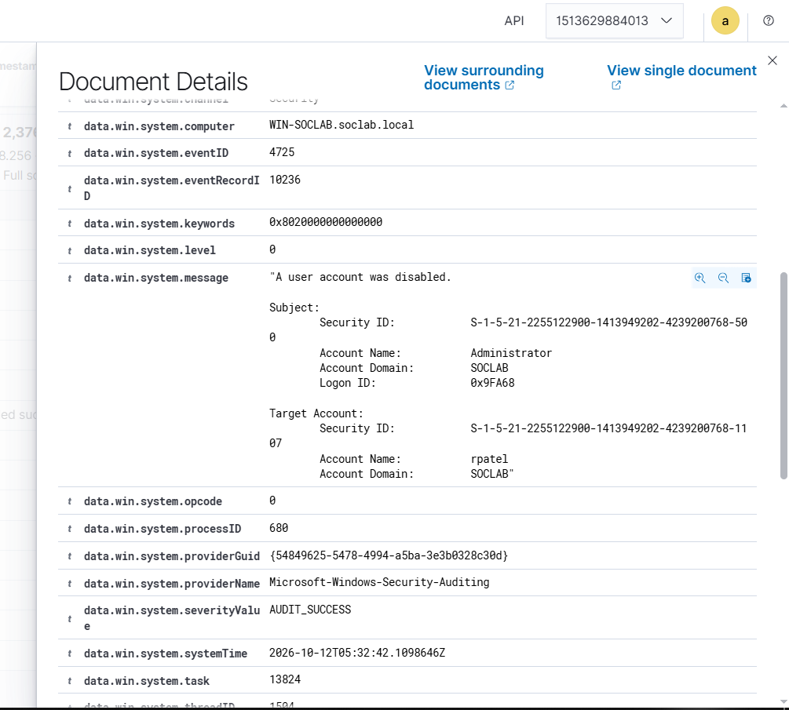
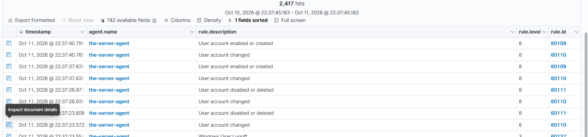

---

### 4726 — User account deleted

**What it means:** The account object was permanently deleted from AD.

**Why a SOC analyst cares:** *"Deletion is forever — and it's how attackers remove evidence. A deletion in odd hours, or of an account tied to an incident I'm already investigating, is a red flag. Legitimate deletions follow HR offboarding during business hours. I always check: who deleted it, and what did that account do in its last 24 hours?"*

**Wazuh:** rule **60111**, level **8** — verdict: **covered**.

**Generate:** `Remove-ADUser -Identity "testuser02" -Confirm:$false`

**Cleanup:** the deletion *is* the cleanup; to undo it, recreate the account (fires a new 4720).


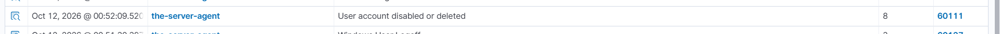

---

### 4738 — User account changed

**What it means:** An attribute of a user account was modified — description, display name, password set, enabled flag, almost anything.

**Why a SOC analyst cares:** *"4738 is the noisiest useful event in this category — it fires on nearly any account edit, even an address change. At enterprise scale it's a flood, which is why it needs tuning rather than alerting as-is. The value is in filtering: 4738 on a privileged account, or 4738 touching security-sensitive attributes, is worth a look. Everything else is baseline."*

**Wazuh:** rule **60110**, level **8** — verdict: **needs tuning**. Same generic rule as 4723/4724/4781 — one rule, four different real-world meanings.

**Generate:**
```powershell
Set-ADUser -Identity "testuser02" -Description "Updated role"
```
(Also fires when a password is set during `New-ADUser` — that's where the stacked 4738s in 4720 come from.)

**Cleanup:** `Set-ADUser -Identity "testuser02" -Clear Description`


---

### 4740 — Account locked out

**What it means:** An account was automatically locked after too many failed logons.

**Why a SOC analyst cares:** *"4740 is the brute-force alarm bell. One lockout is usually a user fat-fingering their password. But lockouts across many accounts from one source IP is password spraying — and a lockout followed by a successful logon from an unusual IP is the nightmare scenario: they guessed right. I always check what happened right after the lockout."*

**Wazuh:** rule **60115**, level **9** — verdict: **covered**. The highest level in this lab's account events, and it earns it.

**Generate:** set an account lockout threshold via Group Policy (5 attempts in this lab), then fail logons 5 times as the user.

**Cleanup:** `Unlock-ADAccount -Identity "testuser02"` (fires 4767).

**Watch out:** without a lockout-threshold policy, **4740 can never fire** — the lab initially had no threshold, so this event was untestable until the policy was added. A detection that can't fire is the same as no detection.

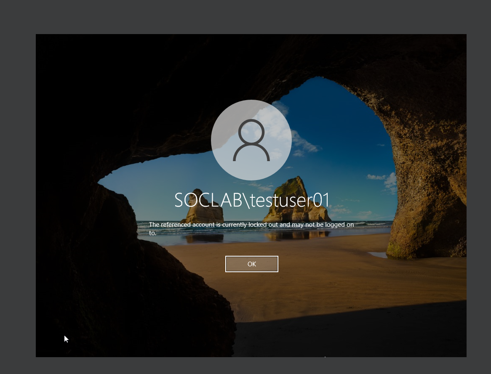

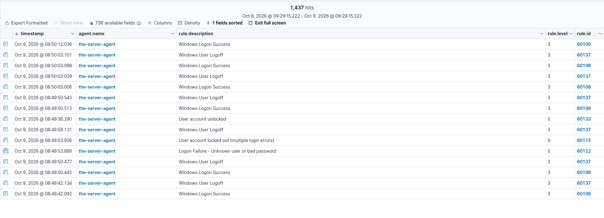

---

### 4767 — Account unlocked

**What it means:** An administrator unlocked a locked account.

**Why a SOC analyst cares:** *"The all-clear after a lockout — or the attacker unlocking their own backdoor account. I never read 4767 alone; I pair it with the 4740 that came before it. Was there a brute-force pattern? And critically: did anyone log on successfully after the unlock, and from where?"*

**Wazuh:** rule **60133**, level **5** — verdict: **covered**.

**Generate:** `Unlock-ADAccount -Identity "testuser02"`

**Cleanup:** none needed.

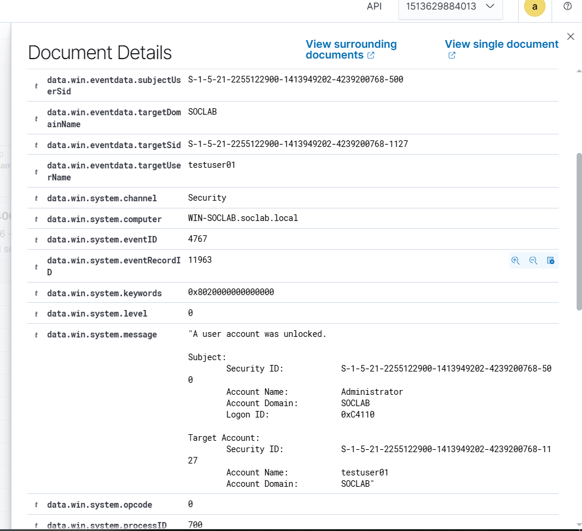
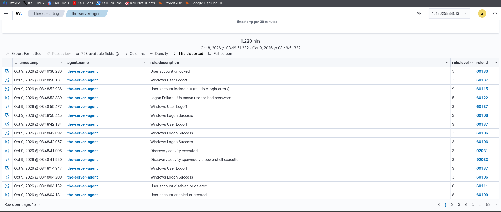

---

### 4781 — Account name (SAM) changed

**What it means:** An account's `sAMAccountName` (the actual logon name) was renamed.

**Why a SOC analyst cares:** *"Renames are camouflage. An attacker renames a backdoor account to look like a service account — or like a former employee's account — so it blends into the noise. Any rename of a privileged account, or a rename followed by suspicious logons under the new name, gets investigated. I also check the old name: what was it hiding from?"*

**Wazuh:** rule **60110**, level **8** — verdict: **covered** — but note the fidelity problem: Wazuh files this under generic "account changed." Nothing in the alert says *renamed*.

**Generate:**
```powershell
Set-ADUser -Identity "testuser02" -SamAccountName "renamed02"
```

**Cleanup:** `Set-ADUser -Identity "renamed02" -SamAccountName "testuser02"`


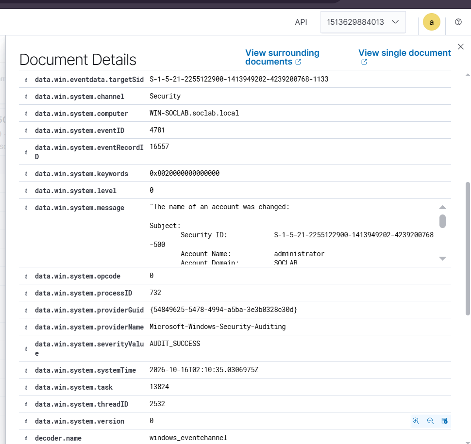

---
### 4727 — Security-enabled global group created

**What it means:** A new global security group (a new badge) was created.

**Why a SOC analyst cares:** *"New groups are staging. Before an attacker hands out access, they often create the group that will carry it. My question is always: does this group have a business reason to exist? A group with no owner, no description, and no members yet is suspicious — it's infrastructure for something."*

**Wazuh:** rule **60140**, level **5** — verdict: **covered**.

**Generate:**
```powershell
New-ADGroup -Name "G-TestGlobal" -GroupScope Global -GroupCategory Security `
  -Path "CN=Users,DC=soclab,DC=local"
```

**Cleanup:** `Remove-ADGroup -Identity "G-TestGlobal" -Confirm:$false` (fires 4730).


---

### 4728 — Member added to security-enabled global group

**What it means:** Someone was added to a global security group. **This is the moment permission is granted** — the 4728 event *is* the handover of power.

**Why a SOC analyst cares:** *"This is the single most important event in the category. 4728 is the exact instant someone is handed a privilege — group membership is when access is granted, not when it's used. An attacker adding a low-privilege account to Domain Admins is the textbook privilege-escalation pattern. My triage is always the same four questions: who was added, to which group, by whom, and was there a change ticket? If any answer is missing, it's an incident until proven otherwise."*

**Wazuh:** rule **60141**, level **5** — verdict: **covered**. (The lab also has a custom rule, **100105**, that fires louder specifically on *privileged*-group additions — built-in coverage is good, targeted coverage is better.)

**Generate:**
```powershell
Add-ADGroupMember -Identity "GG-Sales" -Members "testuser01"
```

**Cleanup:** `Remove-ADGroupMember -Identity "GG-Sales" -Members "testuser01" -Confirm:$false` (fires 4729).

**Watch out:** verify group scope in the alert — 4728 (global), 4732 (local), and 4756 (universal) are three different events with three different blast radii, and they fire three different Wazuh rules.


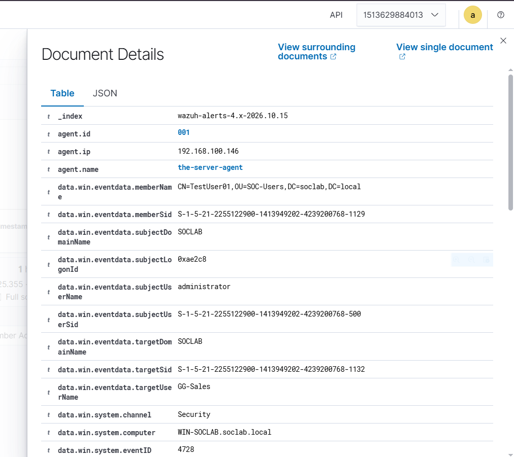

---

### 4729 — Member removed from security-enabled global group

**What it means:** Someone was removed from a global security group — a badge taken away.

**Why a SOC analyst cares:** *"Removal cuts access — normal for role changes and offboarding. But there's a darker read: an attacker removing their backdoor account from a privileged group after they're done, cleaning up the 4728 that gave them away. I check removals against the additions: does every 4729 have a matching, explainable 4728 somewhere in history?"*

**Wazuh:** rule **60142**, level **5** — verdict: **covered**.

**Generate:**
```powershell
Remove-ADGroupMember -Identity "GG-Sales" -Members "testuser01" -Confirm:$false
```

**Cleanup:** re-add the member (`Add-ADGroupMember`).


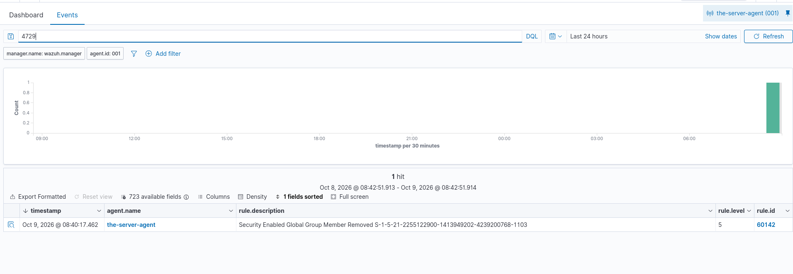

---

### 4730 — Security-enabled global group deleted

**What it means:** A global security group was deleted outright.

**Why a SOC analyst cares:** *"Deleting a group destroys the access structure built on it — it can break legitimate access or hide evidence of how access was organized. Before calling it cleanup, I check whether anything still referenced that group and whether the deletion followed a change process."*

**Wazuh:** rule **60202**, level **5** — verdict: **covered**.

**Generate:** `Remove-ADGroup -Identity "G-TestGlobal" -Confirm:$false`

**Cleanup:** recreate the group (fires a new 4727).


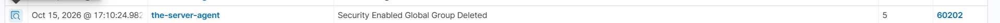

---

### 4731 — Security-enabled local group created

**What it means:** A new domain local security group was created — a new lock on a door.

**Why a SOC analyst cares:** *"Someone is defining access to a specific resource. In this lab it was DL-SecretData-Read guarding a folder. My check: does the group map to a real resource and a real business need? A lock with no door behind it — or a door nobody admits to owning — is worth a second look."*

**Wazuh:** rule **60143**, level **5** — verdict: **covered**.

**Generate:**
```powershell
New-ADGroup -Name "DL-SecretData-Read" -GroupScope DomainLocal -GroupCategory Security `
  -Path "CN=Users,DC=soclab,DC=local"
```

**Cleanup:** `Remove-ADGroup -Identity "DL-SecretData-Read" -Confirm:$false`

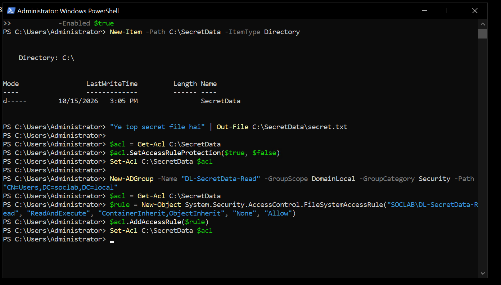


---

### 4733 — Member removed from security-enabled local group

**What it means:** Someone's key to a *specific* resource was revoked.

**Why a SOC analyst cares:** *"Their access to that one door is gone. Usually a role change — but timing matters. If the removal happens right after sensitive data was accessed from that resource, it can be an attacker covering their tracks: take what you need, then return the key."*

**Wazuh:** rule **60145**, level **5** — verdict: **covered**.

**Generate:**
```powershell
Remove-ADGroupMember -Identity "DL-SecretData-Read" -Members "GG-Sales" -Confirm:$false
```

**Cleanup:** re-add the member (fires 4732).

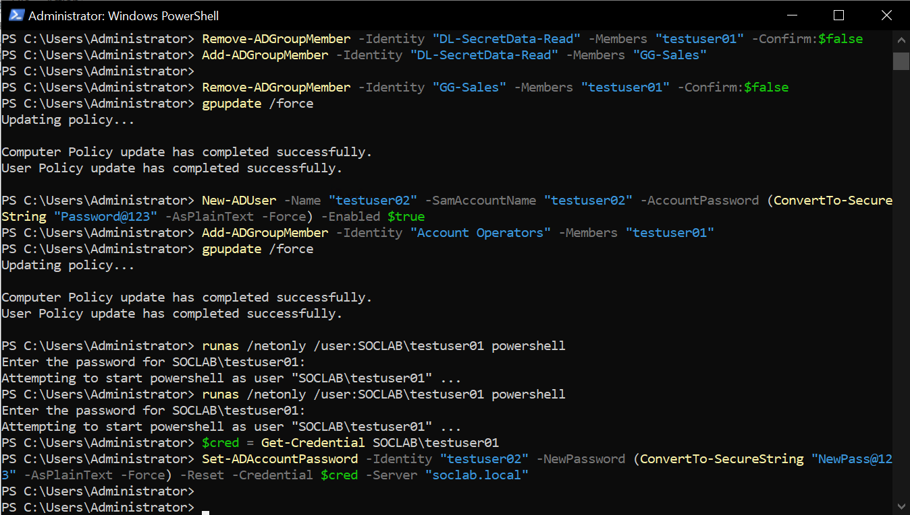
*No screenshot captured for this step — Threat Hunting alert, rule 60145.*

---

### 4737 — Security-enabled global group changed

**What it means:** A global group's own attributes were modified — description, managed-by, notes.

**Why a SOC analyst cares:** *"Someone edited the badge itself rather than its members. Usually housekeeping. But attackers tweaking group attributes — renaming a group to look legitimate, changing who 'manages' it — is how persistence stays subtle. Low urgency, but I want it on the timeline."*

**Wazuh:** rule **60148**, level **5** — verdict: **covered**.

**Generate:**
```powershell
Set-ADGroup -Identity "GG-Sales" -Description "Sales role badge"
```

**Cleanup:** revert the attribute (`-Clear Description`).

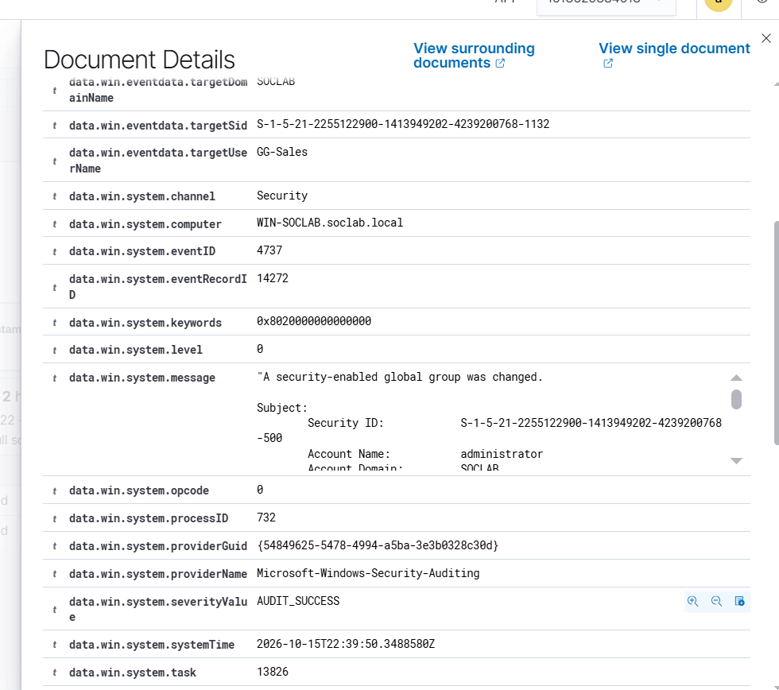


---

### 4754 — Security-enabled universal group created

**What it means:** A new universal security group was created — a badge valid in **every domain of the forest**.

**Why a SOC analyst cares:** *"Same as 4727, but the blast radius is the whole forest, not one domain. In a multi-domain environment this gets extra scrutiny from me — a universal group created without a clear forest-wide purpose is someone building infrastructure with maximum reach."*

**Wazuh:** rule **60149**, level **5** — verdict: **covered**.

**Generate:**
```powershell
New-ADGroup -Name "U-TestUniversal" -GroupScope Universal -GroupCategory Security `
  -Path "CN=Users,DC=soclab,DC=local"
```

**Cleanup:** `Remove-ADGroup -Identity "U-TestUniversal" -Confirm:$false` (fires 4758).


---

### 4755 — Security-enabled universal group changed

**What it means:** A universal group's attributes were modified.

**Why a SOC analyst cares:** *"Same triage as 4737 — someone edited the group rather than its membership — with the forest-wide scope in mind. A quiet edit to a forest-wide badge is exactly the kind of thing that doesn't alarm anyone and should."*

**Wazuh:** rule **60150**, level **5** — verdict: **covered**.

**Generate:**
```powershell
Set-ADGroup -Identity "U-TestUniversal" -Description "Test universal group"
```

**Cleanup:** revert the attribute.


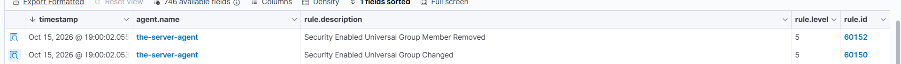

---

### 4756 — Member added to security-enabled universal group

**What it means:** Someone was added to a universal security group — the 4728 moment, but forest-wide.

**Why a SOC analyst cares:** *"This is 4728 with a bigger blast radius. Membership in a privileged universal group can mean privileges in every domain in the forest — and universal membership replicates through the Global Catalog, so it spreads fast. If an attacker lands here, containment gets much harder. In a multi-domain environment, this is the highest-priority group-membership event I watch."*

**Wazuh:** rule **60151**, level **5** — verdict: **covered**.

**Generate:**
```powershell
Add-ADGroupMember -Identity "U-TestUniversal" -Members "testuser01"
```

**Cleanup:** `Remove-ADGroupMember -Identity "U-TestUniversal" -Members "testuser01" -Confirm:$false` (fires 4757).


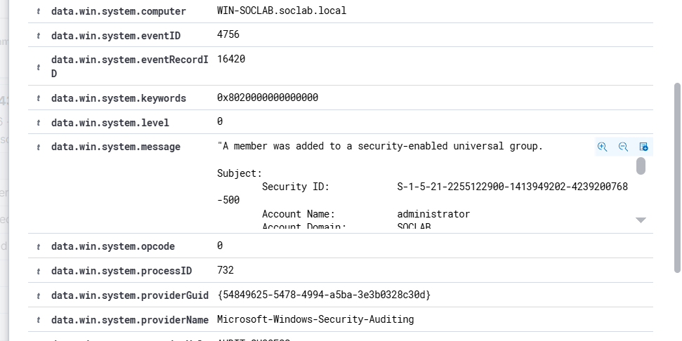

---

### 4757 — Member removed from security-enabled universal group

**What it means:** Someone was removed from a universal security group.

**Why a SOC analyst cares:** *"Access revoked across the forest — or cleanup after the fact. Same read as 4729 and 4733: legitimate for role changes, suspicious when it follows the activity it might be hiding."*

**Wazuh:** rule **60152**, level **5** — verdict: **covered**.

**Generate:**
```powershell
Remove-ADGroupMember -Identity "U-TestUniversal" -Members "testuser01" -Confirm:$false
```

**Cleanup:** re-add the member.

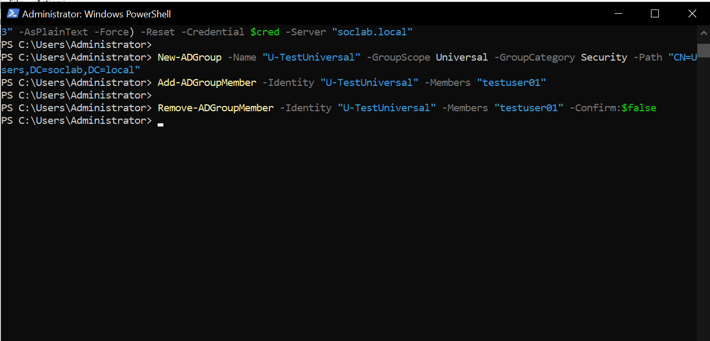


---

### 4758 — Security-enabled universal group deleted

**What it means:** A universal security group was deleted.

**Why a SOC analyst cares:** *"The forest-wide access structure is gone — that breaks access everywhere at once, or hides evidence everywhere at once. Either way I verify intent before moving on, because the impact isn't contained to one domain."*

**Wazuh:** rule **60153**, level **5** — verdict: **covered**.

**Generate:** `Remove-ADGroup -Identity "U-TestUniversal" -Confirm:$false`

**Cleanup:** recreate the group (fires a new 4754).


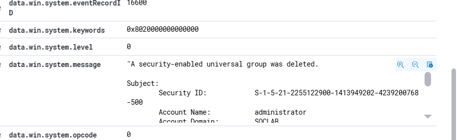

---

### 4741 — Computer account created

**What it means:** A new computer account — a new machine ID card — was created in AD.

**Why a SOC analyst cares:** *"Here's the catch most people miss: by default, any authenticated domain user can create up to 10 computer accounts — no admin rights needed. Attackers create 'ghost' computer accounts they control and then authenticate as that machine to run delegation attacks. So my questions are: who created it, does a real machine actually hold this identity, and has it authenticated since?"*

**Wazuh:** rule **60121**, level **5** — verdict: **covered**.

**Generate:**
```powershell
New-ADComputer -Name "TEST-PC01" -SamAccountName 'TEST-PC01$'
```

**Cleanup:** `Remove-ADComputer -Identity "TEST-PC01" -Confirm:$false` (fires 4743).


---

### 4742 — Computer account changed

**What it means:** A computer account's attributes were modified.

**Why a SOC analyst cares:** *"Same idea as 4738, but for a machine identity. Attackers modify computer accounts when setting up delegation attacks — changing attributes to make the ghost account usable. A computer account edited by a user who doesn't manage machines is worth investigating."*

**Wazuh:** rule **60121**, level **5** — verdict: **covered**.

**Generate:**
```powershell
Set-ADComputer -Identity "TEST-PC01" -Description "Test computer"
```

**Cleanup:** revert the attribute (`-Clear Description`).


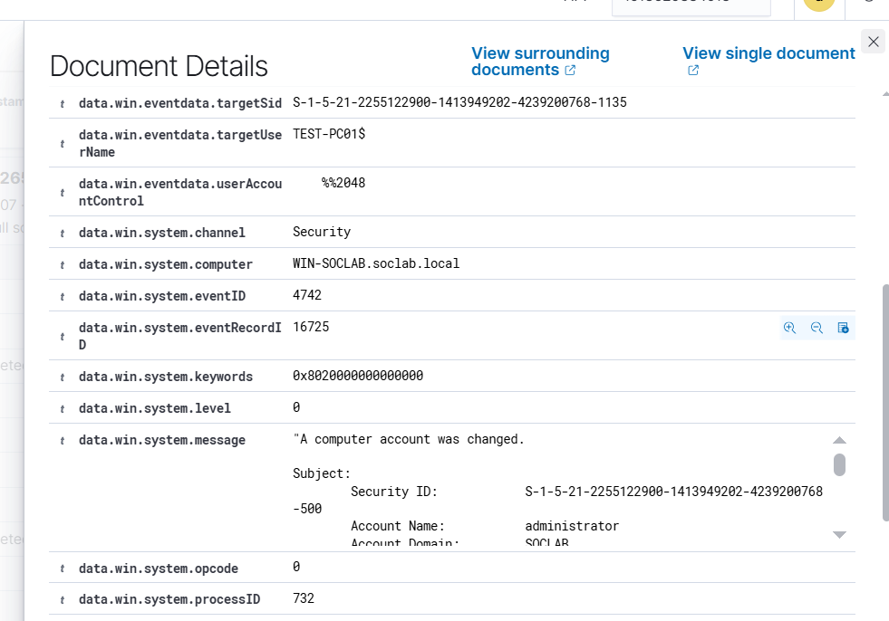

---

### 4743 — Computer account deleted

**What it means:** A computer account was deleted — that machine's domain identity no longer exists.

**Why a SOC analyst cares:** *"The machine can't authenticate anymore. Usually decommissioning. But paired with a recent 4741 by an unusual user, it reads differently: create a ghost account, use it, delete it. I check the account's lifetime — created and deleted within hours is not decommissioning."*

**Wazuh:** rule **60121**, level **5** — verdict: **covered**.

**Generate:** `Remove-ADComputer -Identity "TEST-PC01" -Confirm:$false`

**Cleanup:** recreate the account if the machine still needs domain membership (fires a new 4741).


---
## Lab errors I hit — & how I fixed them

Real troubleshooting from this lab. Every one of these is an interview story.

### 1. "The sign-in method isn't allowed" — wrong logon type, wrong fix

**What happened:** `testuser01` couldn't log on at the VirtualBox console: *"the sign-in method you are trying to use isn't allowed."* An hour was spent fixing **RDP** permissions.

**Root cause:** The error was at the *console* (logon **type 2**), not RDP (logon **type 10**). The RDP user right was never the problem — the console logon right was.

**Fix:** Added `SOCLAB\testuser01` to **"Allow log on locally"** in the *Default Domain Controllers Policy*, then `gpupdate /force`.

**Lesson:** *Verify the actual symptom before troubleshooting.* Logon type 2 = console/interactive, type 10 = RDP, type 3 = network. Read the type first, then pick the fix. An hour of the wrong fix taught this permanently.

### 2. Access Denied *after* getting the group key

**What happened:** `testuser01` was added to `DL-SecretData-Read`, logged out and back in, `whoami /groups` confirmed membership — but the file `C:\SecretData\secret.txt` still said Access Denied. The folder opened; the file didn't.

**Root cause:** The *folder* granted access, but the *file's* own ACL was broken — inheritance wasn't carrying the permission down.

**Fix:** Took ownership (`takeown`) and repaired the ACLs with `icacls` on both folder and file.

**Lesson:** *Group membership is the key, but folder and file permissions can differ.* Inheritance carries rules downward — when it's broken, the key doesn't reach every lock. And ownership is the recovery path when an ACL is damaged beyond normal repair.


### 3. "Group used for deny only" — the filtered token

**What happened:** After adding `testuser01` to **Account Operators**, `whoami /groups` showed the group as *"Group used for deny only"* — and a password reset as that user was still denied.

**Root cause:** An interactive/console logon (type 2) gets a **filtered token** under UAC: privileged group memberships are present but neutered. A **network logon (type 3)** carries the **full** token.

**Lesson:** *Attackers don't sit at the console.* They authenticate over the network, where stolen privileges work at full strength. That's why the SOC signal is a **type-3 logon by a privileged-group member from an unusual source** — someone arriving to use their full privileges. The 4728 grants the power; the type-3 logon is when it's spent.

### 4. 4720 followed by 4726 — the "attack" that wasn't

**What happened:** A new account generated **4720** (created) and, one second later, **4726** (deleted). It looked like an attacker creating and destroying an account.

**Root cause:** Failed provisioning — the chosen password violated domain policy, so AD rolled the half-created object back.

**Lesson:** *Windows audits operations, not outcomes.* Two scary events in sequence can be one boring failure. Always check *why* before escalating *what*.

### 5. One command, four events

**What happened:** A single `New-ADUser -Enabled $true` fired **4720 + 4738 + 4738 + 4722** in the same second.

**Root cause:** One automated operation touches several attributes; Windows logs each touch.

**Lesson:** *Correlate before you count.* Four events in one second from one actor is one story, not four incidents. Same-second, same-actor event stacks get read as a unit.

### 6. Read the rule off the fired alert — always

**What happened:** Twice, a rule ID was read off the Management → Rules list instead of the actual alert — and twice it was wrong (4728 was logged as 4720's rule; 4740 picked up a neighboring 4625 rule).

**Lesson:** *Wazuh fires the most specific matching rule.* The rules list shows candidates; only the **fired alert** (`data.win.system.eventID` + `rule.id` in Threat Hunting) shows what actually matched. This discipline is non-negotiable — on shift, the wrong rule ID means the wrong runbook.

---

## Coverage summary

| Event | Meaning | Wazuh rule | Level | Verdict |
|---|---|---|---|---|
| 4720 | User account created | 60109 | 8 | needs tuning |
| 4722 | User account enabled | 60109 | 8 | covered |
| 4723 | Password change attempted | 60110 | 8 | covered |
| 4724 | Password reset by admin | 60110 | 8 | covered |
| 4725 | User account disabled | 60111 | 8 | covered |
| 4726 | User account deleted | 60111 | 8 | covered |
| 4727 | Security-enabled global group created | 60140 | 5 | covered |
| 4728 | Member added to security-enabled global group | 60141 | 5 | covered |
| 4729 | Member removed from security-enabled global group | 60142 | 5 | covered |
| 4730 | Security-enabled global group deleted | 60202 | 5 | covered |
| 4731 | Security-enabled local group created | 60143 | 5 | covered |
| 4733 | Member removed from security-enabled local group | 60145 | 5 | covered |
| 4737 | Security-enabled global group changed | 60148 | 5 | covered |
| 4738 | User account changed | 60110 | 8 | needs tuning |
| 4740 | Account locked out | 60115 | 9 | covered |
| 4741 | Computer account created | 60121 | 5 | covered |
| 4742 | Computer account changed | 60121 | 5 | covered |
| 4743 | Computer account deleted | 60121 | 5 | covered |
| 4754 | Security-enabled universal group created | 60149 | 5 | covered |
| 4755 | Security-enabled universal group changed | 60150 | 5 | covered |
| 4756 | Member added to security-enabled universal group | 60151 | 5 | covered |
| 4757 | Member removed from security-enabled universal group | 60152 | 5 | covered |
| 4758 | Security-enabled universal group deleted | 60153 | 5 | covered |
| 4767 | Account unlocked | 60133 | 5 | covered |
| 4781 | Account name (SAM) changed | 60110 | 8 | covered |

**Verdicts explained:**
- **covered** — the built-in rule fires correctly on the event; good as-is.
- **needs tuning** (4720, 4738) — the rule fires, but it's noisy at scale: every onboarding fires 4720, and nearly any account edit fires 4738. The tuning direction is filtering (privileged accounts, odd hours, sensitive attributes), not disabling.

**Fidelity note:** rule **60110** ("user account changed") is shared by 4723, 4724, 4738, and 4781 — four different real-world meanings, one generic rule. A custom rule distinguishing *password reset by admin* from *rename* from *attribute edit* is an open improvement item.

---

## MITRE ATT&CK mapping

| Event(s) | Technique | Why |
|---|---|---|
| 4720, 4741 | **T1136** — Create Account | New domain/computer account — persistence via new identity |
| 4728, 4756 | **T1098** — Account Manipulation | Added to privileged group — privilege escalation / persistence |
| 4722, 4725, 4723, 4724, 4738, 4742, 4767 | **T1098** — Account Manipulation | Enable/disable, password changes/resets, attribute edits, unlocks |
| 4727, 4731, 4754 | **T1098** — Account Manipulation | New groups as access infrastructure (staging) |
| 4729, 4733, 4757, 4737, 4755 | **T1098** — Account Manipulation | Membership/attribute changes (also read as possible cleanup) |
| 4726, 4743, 4730, 4758 | **T1070** — Indicator Removal | Deletions that destroy evidence or access structures |
| 4781 | **T1036** — Masquerading | Rename to blend in (e.g. mimic a service account) |
| 4740 | *(indicator for)* **T1110** — Brute Force | Lockouts are the visible symptom of password guessing / spraying |

---

## Revision sheet

**[phase-1-sheet.pdf](phase-1-sheet.pdf)** — the one-page-per-section memorization sheet: all 25 events in numerical order with one-line meanings, plus the full rule/level/verdict mapping table. When an interview is coming, drill this until the IDs are reflex.

---

## Field notes: two alerts worth knowing

Spotted during lab work, outside the 25 events — both are good triage exercises:

- **Rule 60104 — "Windows audit failure event" (level 5).** A *generic bucket* for any Windows event carrying the Audit Failure keyword — not "an attack failed." The instance seen here was event **5061** (cryptographic operation: the Software Key Storage Provider handling a Connected Devices Platform device certificate). Benign OS noise. Lesson: read the underlying `eventID` before reacting to a bucket rule's name.
- **Rule 92307 — "Evidence of new service creation" (level 3).** Fires on **Sysmon Event 13** (registry value set) when a service `ImagePath` is written under `HKLM\System\CurrentControlSet\Services\` — the **T1050** (New Service) persistence technique. The instances seen were legitimate Windows per-user services (`cbdhsvc_*`, `CaptureService_*`, created by `services.exe` as SYSTEM). Benign *here* — but the detection pattern is exactly right, and the same alert on an unknown service with a suspicious `ImagePath` is an immediate investigation. Behavior fires the rule; context decides the verdict.


---

*Part of [Wazuh Home SOC Lab](../README.md) — a working home SIEM with real detections, built October 2026.*
