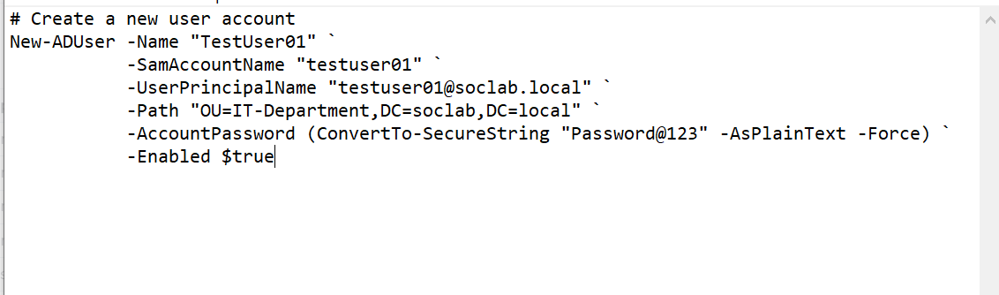
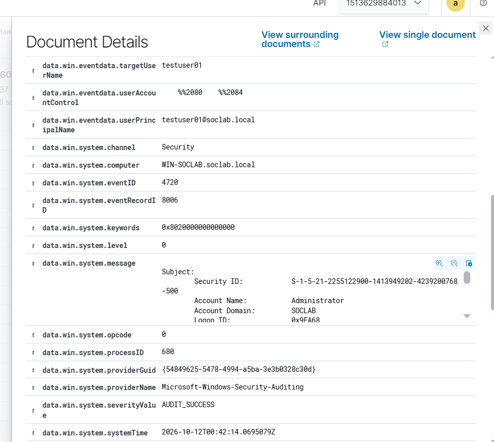

# Event 4720 — User account created

*Part of the [Account Management lab](../README.md) — 27 Windows events mapped to Wazuh, interview-prep edition.*

---
**What it means:** A new user account object was created in Active Directory. The birth certificate of an account.

**Why a SOC analyst cares:** *"4720 is where I start asking 'who made this, and why does it exist?' On its own it's usually just onboarding — but an account created at 3 AM, by an unusual admin, or immediately added to a privileged group is how backdoor accounts begin. Creation followed by first logon from a strange IP is the pattern I watch for."*

**Wazuh:** rule **60109**, level **8** — verdict: **needs tuning**. It fires on every single onboarding, so at enterprise scale this is high-volume. Tune by alerting on *creation + privileged-group membership* or *creation outside business hours*, not on every 4720.

**Generate:**
```powershell
New-ADUser -Name "testuser02" -SamAccountName "testuser02" `
  -AccountPassword (ConvertTo-SecureString "P@ssw0rd123!" -AsPlainText -Force) `
  -Enabled $true -Path "CN=Users,DC=soclab,DC=local"
```

**Cleanup:** `Remove-ADUser -Identity "testuser02" -Confirm:$false` (note: the cleanup itself fires 4726 — deleting the evidence generates evidence).

**Watch out:** `New-ADUser -Enabled $true` fires **4720 + two 4738s + 4722 in the same second** — one automated operation, not four human actions. Also: 4720 *immediately followed by 4726* for the same account means failed provisioning (e.g. the password violated policy and AD rolled the object back) — not an attack. Windows audits operations, not outcomes.




