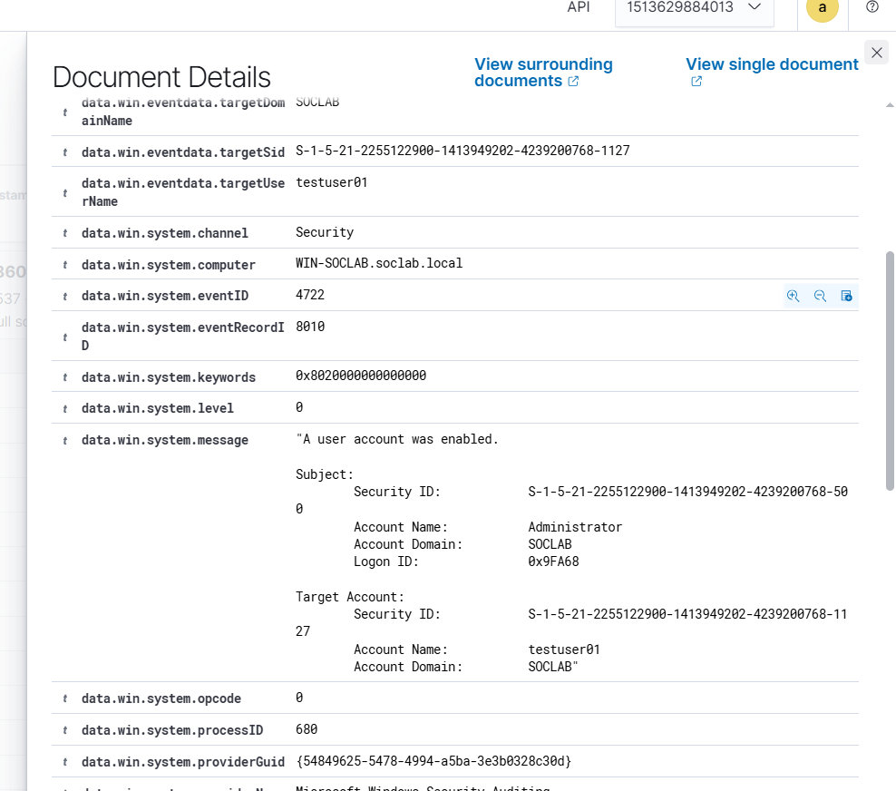

# Event 4722 — User account enabled

*Part of the [Account Management lab](../README.md) — 27 Windows events mapped to Wazuh, interview-prep edition.*

---
**What it means:** A disabled account was switched back on.

**Why a SOC analyst cares:** *"A dormant account waking up is interesting — attackers love re-enabling old disabled accounts because they already exist, they have history, and nobody watches them. I check who enabled it, and whether the logon that follows looks like the original owner."*

**Wazuh:** rule **60109**, level **8** — verdict: **covered**.

**Generate:** `Enable-ADAccount -Identity "testuser02"`

**Cleanup:** `Disable-ADAccount -Identity "testuser02"`

**Watch out:** usually stacks with a 4738 (account changed) in the same second — same operation, two events.

