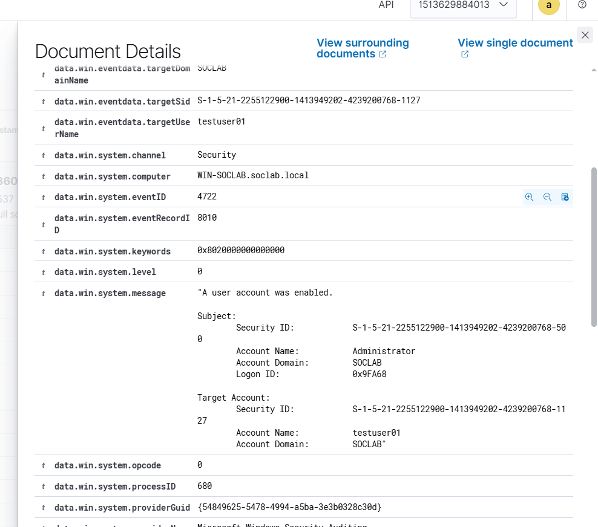
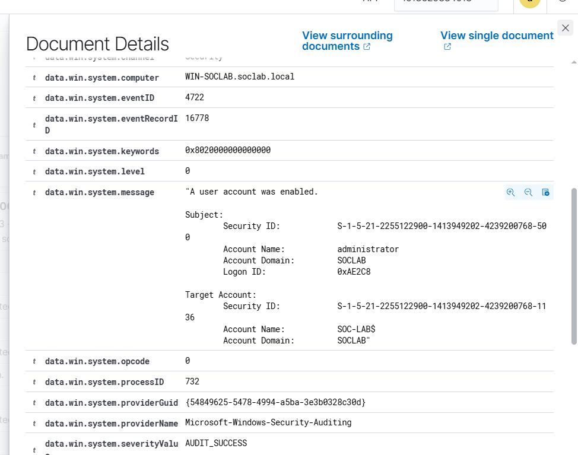

# Event 4722 — User account enabled

*Part of the [Account Management lab](../README.md) — 27 Windows events mapped to Wazuh, interview-prep edition.*

---
**What it means:** A disabled account was switched back on.

**Why a SOC analyst cares:** *"A dormant account waking up is interesting — attackers love re-enabling old disabled accounts because they already exist, they have history, and nobody watches them. I check who enabled it, and whether the logon that follows looks like the original owner."*

**Wazuh:** rule **60109**, level **8** — verdict: **covered**.

**Generate:** `Enable-ADAccount -Identity "testuser02"`

**Cleanup:** `Disable-ADAccount -Identity "testuser02"`

**Watch out:** usually stacks with a 4738 (account changed) in the same second — same operation, two events.



---


---

## Threat Hunting in Wazuh

Threat Hunting uses DQL. Paste these into the search bar (Events tab) over the time window of the lab. Threat Hunting shows the **alerts** index only — if an event fired no rule, it is invisible here; check the archives index or `Get-WinEvent` on the DC instead.

**All of them:**
```
data.win.system.eventID: 4722
```

**Just one account:**
```
data.win.system.eventID: 4722 AND data.win.eventdata.targetUserName: testuser02
```

**Who did it:**
```
data.win.system.eventID: 4722 AND data.win.eventdata.subjectUserName: administrator
```

**By rule:**
```
rule.id: 60109 AND data.win.system.eventID: 4722
```

**Human accounts only** (drops computer accounts ending in `$` and SYSTEM noise):
```
data.win.system.eventID: 4722 AND NOT data.win.eventdata.targetUserName: *$ AND NOT data.win.eventdata.targetUserName: SYSTEM
```

Rule 60109 is shared with 4720 — use the eventID to tell an enable from a creation.
