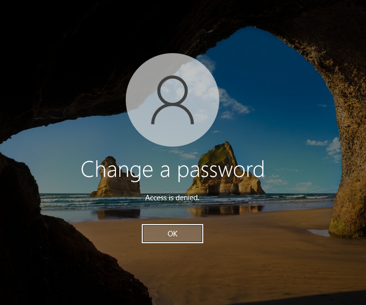

# Event 4723 — Password change attempted

*Part of the [Account Management lab](../README.md) — 27 Windows events mapped to Wazuh, interview-prep edition.*

---
**What it means:** A user attempted to change **their own** password (Ctrl+Alt+Del → Change password).

**Why a SOC analyst cares:** *"This is the user changing their own password — normal. It matters as context: a password change right before suspicious activity can mean the legitimate user just secured the account — or that someone holding the session is locking the real user out. I read it alongside the logons around it."*

**Wazuh:** rule **60110**, level **8** — verdict: **covered**.

**Generate:** log on as the user → Ctrl+Alt+Del → Change a password.

**Cleanup:** none needed.

**Watch out:** Wazuh maps this to the generic **60110** ("user account changed") — the same rule as 4738, 4724, and 4781. The SIEM sees "account changed," not *which kind* of change. That's a fidelity gap and a future custom-rule idea.

**Lab note (honest):** in this environment, the GUI password-change attempt was **denied** — 4723 never fired as a separate event:

Password changes in this lab surface as **4738** ("user account changed") instead — see [Event 4738](../Event-4738-user-account-changed/). The SIEM sees "account changed," not *who* changed the password or *how*.
