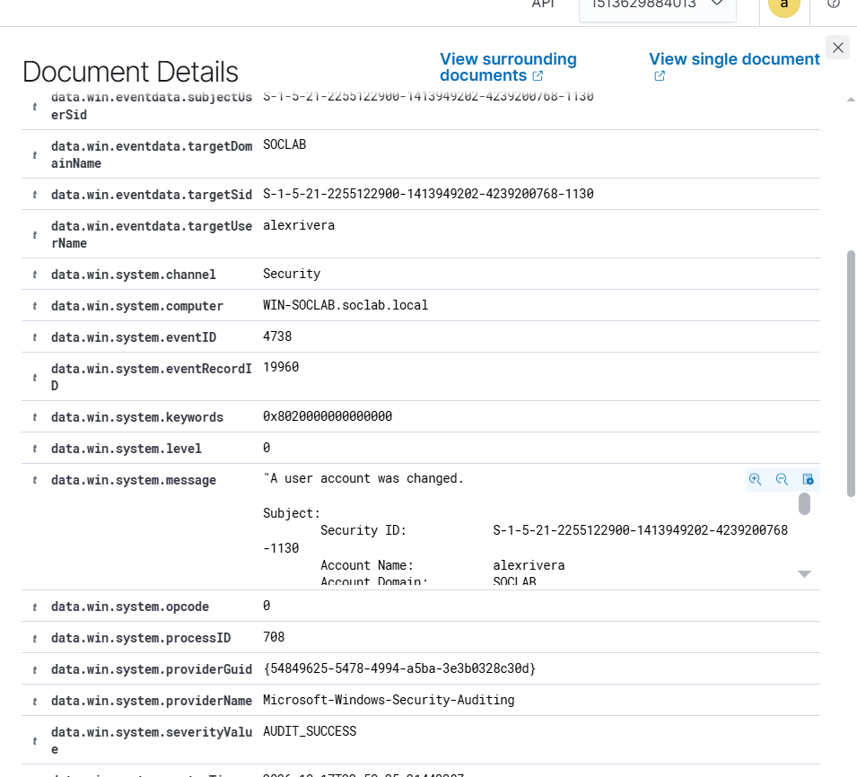
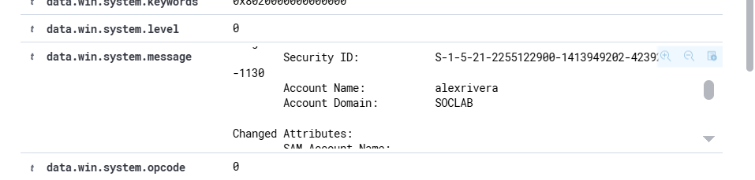
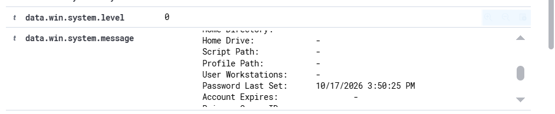

# Event 4724 — Password reset by admin

*Part of the [Account Management lab](../README.md) — 27 Windows events mapped to Wazuh, interview-prep edition.*

---
**What it means:** An administrator reset **someone else's** password.

**Why a SOC analyst cares:** *"Resetting passwords is standard helpdesk work — but it's also exactly what an attacker does with a compromised admin account to take over other accounts. I verify it maps to a real request: a ticket, a user asking for help. An admin resetting the CEO's password at midnight with no ticket is an incident."*

**Wazuh:** rule **60110**, level **8** — verdict: **covered**.

**Generate:**
```powershell
Set-ADAccountPassword -Identity "testuser02" `
  -NewPassword (ConvertTo-SecureString "NewP@ss456!" -AsPlainText -Force) -Reset
```

**Cleanup:** none needed (or reset again to a known value).

**Watch out:** same generic 60110 as 4723/4738/4781 — Wazuh can't distinguish an admin reset from a user edit at this rule level.


**Lab note (honest):** the admin password reset did **not** generate a distinct 4724 event in this lab — it surfaced as **4738**, with `Password Last Set` updated in the changed attributes:





Takeaway: Wazuh rule 60110 still fires (on the 4738), so the reset *is* detected — but the SIEM can't distinguish an admin reset from any other account edit. Same fidelity gap as 4723, and a future custom-rule idea.
