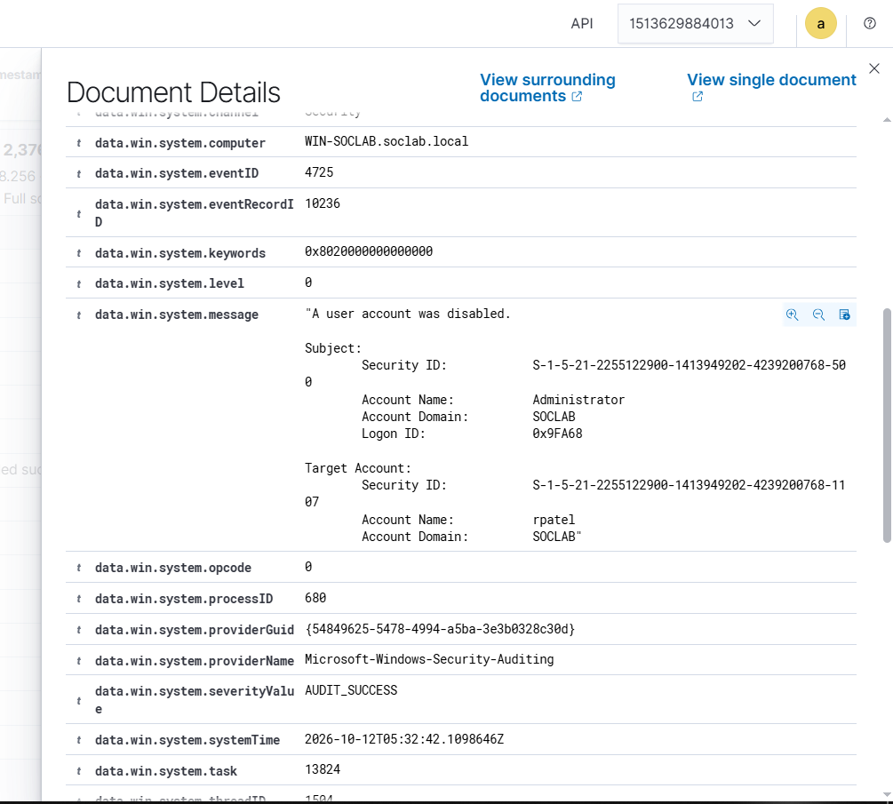
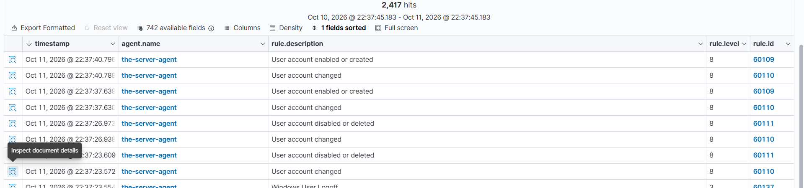

# Event 4725 — User account disabled

*Part of the [Account Management lab](../README.md) — 27 Windows events mapped to Wazuh, interview-prep edition.*

---
**What it means:** An account was disabled — it can't log on, but the object (and its history) is kept.

**Why a SOC analyst cares:** *"Disabling is the reversible off-switch: leavers, suspensions, incident response. If I see an account disabled and then re-enabled an hour later, I want to know why — that pattern can be an attacker toggling access, or an admin who changed their mind. Either way it gets a question."*

**Wazuh:** rule **60111**, level **8** — verdict: **covered**.

**Generate:** `Disable-ADAccount -Identity "testuser02"`

**Cleanup:** `Enable-ADAccount -Identity "testuser02"`



---


---

## Threat Hunting in Wazuh

Threat Hunting uses DQL. Paste these into the search bar (Events tab) over the time window of the lab. Threat Hunting shows the **alerts** index only — if an event fired no rule, it is invisible here; check the archives index or `Get-WinEvent` on the DC instead.

**All of them:**
```
data.win.system.eventID: 4725
```

**Just one account:**
```
data.win.system.eventID: 4725 AND data.win.eventdata.targetUserName: testuser02
```

**Who did it:**
```
data.win.system.eventID: 4725 AND data.win.eventdata.subjectUserName: administrator
```

**By rule:**
```
rule.id: 60111 AND data.win.system.eventID: 4725
```

**Human accounts only** (drops computer accounts ending in `$` and SYSTEM noise):
```
data.win.system.eventID: 4725 AND NOT data.win.eventdata.targetUserName: *$ AND NOT data.win.eventdata.targetUserName: SYSTEM
```
