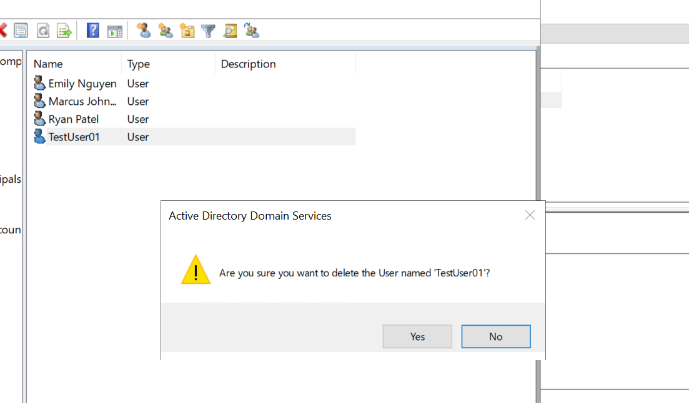

# Event 4726 — User account deleted

*Part of the [Account Management lab](../README.md) — 27 Windows events mapped to Wazuh, interview-prep edition.*

---
**What it means:** The account object was permanently deleted from AD.

**Why a SOC analyst cares:** *"Deletion is forever — and it's how attackers remove evidence. A deletion in odd hours, or of an account tied to an incident I'm already investigating, is a red flag. Legitimate deletions follow HR offboarding during business hours. I always check: who deleted it, and what did that account do in its last 24 hours?"*

**Wazuh:** rule **60111**, level **8** — verdict: **covered**.

**Generate:** `Remove-ADUser -Identity "testuser02" -Confirm:$false`

**Cleanup:** the deletion *is* the cleanup; to undo it, recreate the account (fires a new 4720).

