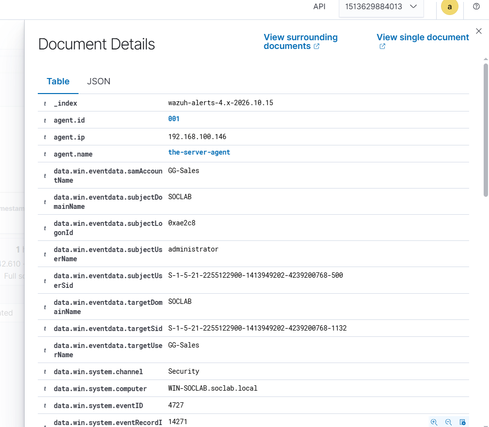
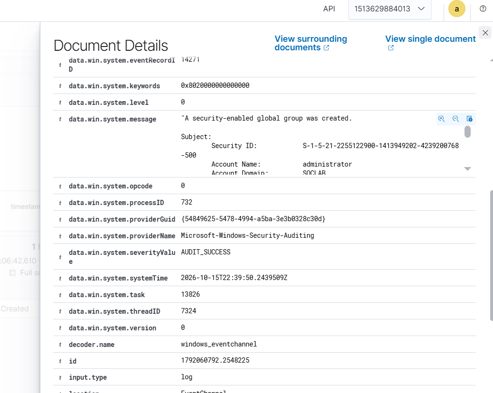

# Event 4727 — Security-enabled global group created

*Part of the [Account Management lab](../README.md) — 27 Windows events mapped to Wazuh, interview-prep edition.*

---
**What it means:** A new global security group (a new badge) was created.

**Why a SOC analyst cares:** *"New groups are staging. Before an attacker hands out access, they often create the group that will carry it. My question is always: does this group have a business reason to exist? A group with no owner, no description, and no members yet is suspicious — it's infrastructure for something."*

**Wazuh:** rule **60140**, level **5** — verdict: **covered**.

**Generate:**
```powershell
New-ADGroup -Name "G-TestGlobal" -GroupScope Global -GroupCategory Security `
  -Path "CN=Users,DC=soclab,DC=local"
```

**Cleanup:** `Remove-ADGroup -Identity "G-TestGlobal" -Confirm:$false` (fires 4730).



