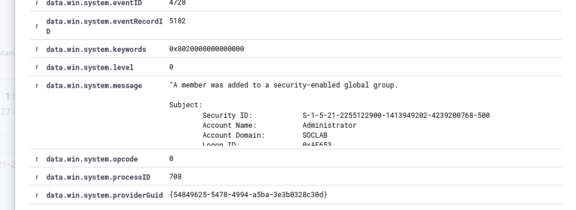
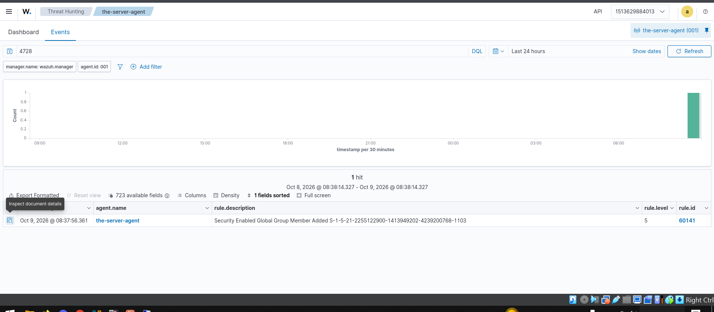

# Event 4728 — Member added to security-enabled global group

*Part of the [Account Management lab](../README.md) — 27 Windows events mapped to Wazuh, interview-prep edition.*

---
**What it means:** Someone was added to a global security group. **This is the moment permission is granted** — the 4728 event *is* the handover of power.

**Why a SOC analyst cares:** *"This is the single most important event in the category. 4728 is the exact instant someone is handed a privilege — group membership is when access is granted, not when it's used. An attacker adding a low-privilege account to Domain Admins is the textbook privilege-escalation pattern. My triage is always the same four questions: who was added, to which group, by whom, and was there a change ticket? If any answer is missing, it's an incident until proven otherwise."*

**Wazuh:** rule **60141**, level **5** — verdict: **covered**. (The lab also has a custom rule, **100105**, that fires louder specifically on *privileged*-group additions — built-in coverage is good, targeted coverage is better.)

**Generate:**
```powershell
Add-ADGroupMember -Identity "GG-Sales" -Members "testuser01"
```

**Cleanup:** `Remove-ADGroupMember -Identity "GG-Sales" -Members "testuser01" -Confirm:$false` (fires 4729).

**Watch out:** verify group scope in the alert — 4728 (global), 4732 (local), and 4756 (universal) are three different events with three different blast radii, and they fire three different Wazuh rules.




