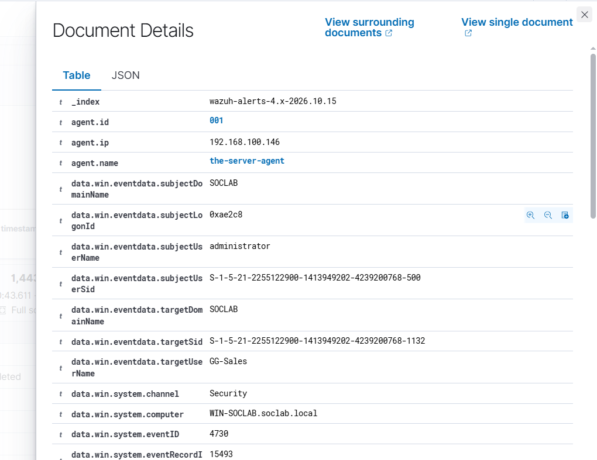

# Event 4730 — Security-enabled global group deleted

*Part of the [Account Management lab](../README.md) — 27 Windows events mapped to Wazuh, interview-prep edition.*

---
**What it means:** A global security group was deleted outright.

**Why a SOC analyst cares:** *"Deleting a group destroys the access structure built on it — it can break legitimate access or hide evidence of how access was organized. Before calling it cleanup, I check whether anything still referenced that group and whether the deletion followed a change process."*

**Wazuh:** rule **60202**, level **5** — verdict: **covered**.

**Generate:** `Remove-ADGroup -Identity "G-TestGlobal" -Confirm:$false`

**Cleanup:** recreate the group (fires a new 4727).

