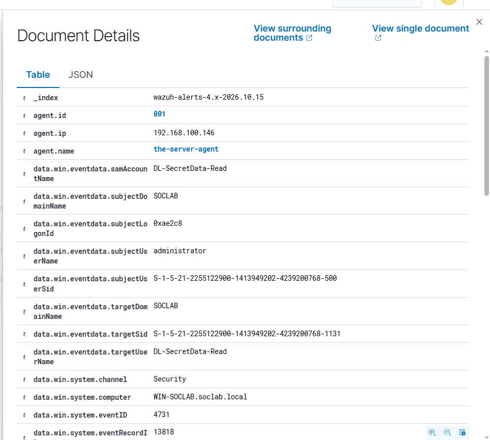

# Event 4731 — Security-enabled local group created

*Part of the [Account Management lab](../README.md) — 27 Windows events mapped to Wazuh, interview-prep edition.*

---
**What it means:** A new domain local security group was created — a new lock on a door.

**Why a SOC analyst cares:** *"Someone is defining access to a specific resource. In this lab it was DL-SecretData-Read guarding a folder. My check: does the group map to a real resource and a real business need? A lock with no door behind it — or a door nobody admits to owning — is worth a second look."*

**Wazuh:** rule **60143**, level **5** — verdict: **covered**.

**Generate:**
```powershell
New-ADGroup -Name "DL-SecretData-Read" -GroupScope DomainLocal -GroupCategory Security `
  -Path "CN=Users,DC=soclab,DC=local"
```

**Cleanup:** `Remove-ADGroup -Identity "DL-SecretData-Read" -Confirm:$false`



