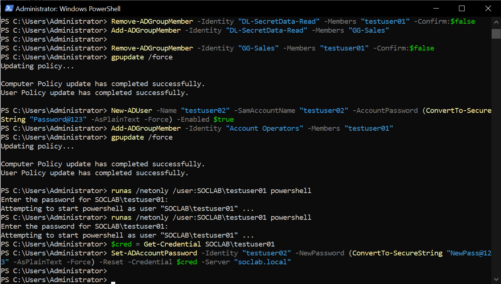
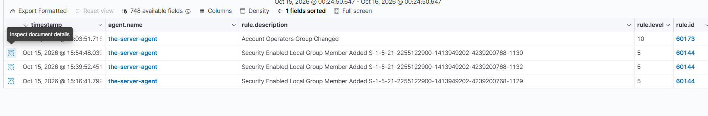
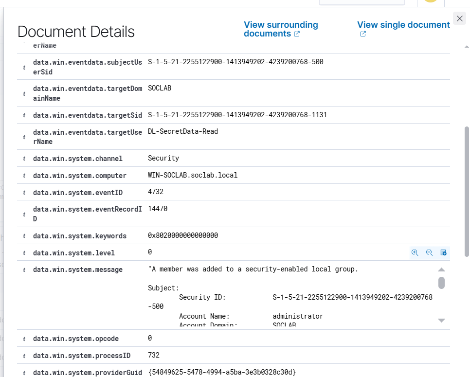
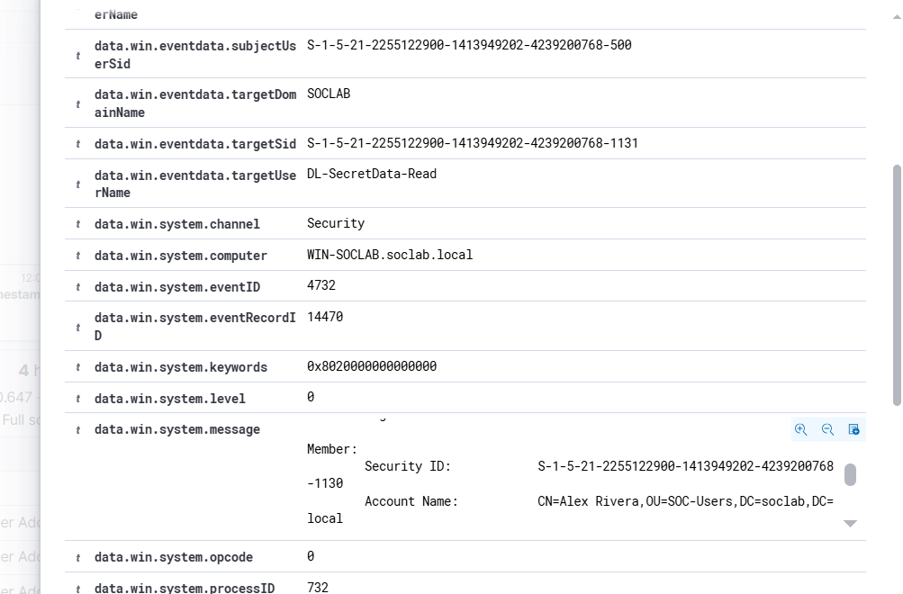
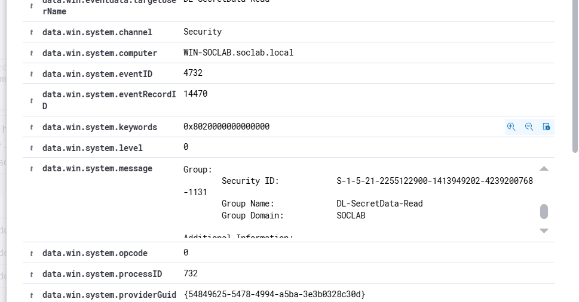
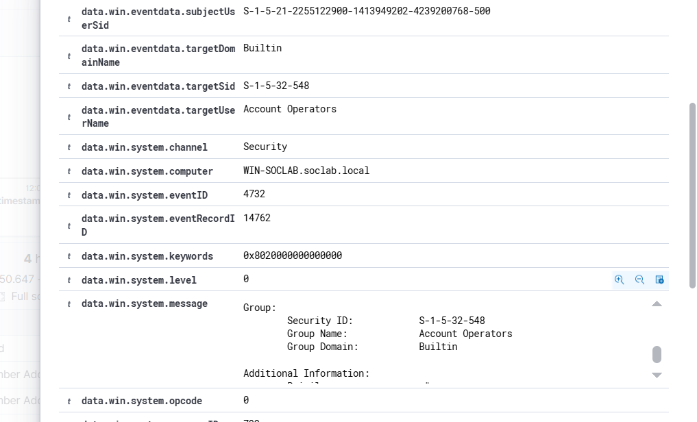
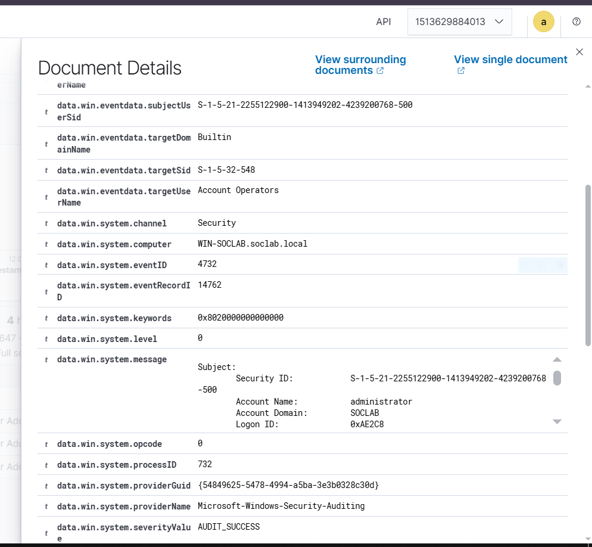

# Event 4732 — Member added to security-enabled local group

*Part of the [Account Management lab](../README.md) — 27 Windows events mapped to Wazuh, interview-prep edition.*

---
**What it means:** A member was added to a domain local security group — someone just got a key cut for a specific door.

**Why a SOC analyst cares:** *"This is the moment access is granted to a resource. In this lab it was the GG-Sales badge being nested into DL-SecretData-Read — the key being cut. My questions on shift: who got access to what, who approved it, and does a business need justify it? Attackers love this event because it's quieter than creating accounts — they just collect keys to doors."*

**Wazuh:** rule **60144**, level **5** — verdict: **covered**.

**Generate:**
```powershell
Add-ADGroupMember -Identity "DL-SecretData-Read" -Members "GG-Sales"
```

**Cleanup:** `Remove-ADGroupMember -Identity "DL-SecretData-Read" -Members "GG-Sales" -Confirm:$false`



---


---


---


---


---


---


---

## Threat Hunting in Wazuh

Threat Hunting uses DQL. Paste these into the search bar (Events tab) over the time window of the lab. Threat Hunting shows the **alerts** index only — if an event fired no rule, it is invisible here; check the archives index or `Get-WinEvent` on the DC instead.

**All of them:**
```
data.win.system.eventID: 4732
```

**One group:**
```
data.win.system.eventID: 4732 AND data.win.eventdata.targetUserName: DL-SecretData-Read
```

**One member:**
```
data.win.system.eventID: 4732 AND data.win.eventdata.memberName: *GG-Sales*
```

**Who did it:**
```
data.win.system.eventID: 4732 AND data.win.eventdata.subjectUserName: administrator
```

**By rule:**
```
rule.id: 60144 AND data.win.system.eventID: 4732
```

**Human members only** (drops computer accounts and nested groups ending in `$`):
```
data.win.system.eventID: 4732 AND NOT data.win.eventdata.memberName: *$
```

In this lab the member was a group (`GG-Sales` nested into `DL-SecretData-Read`), not a user — group nesting is the quiet way to hand out access.
