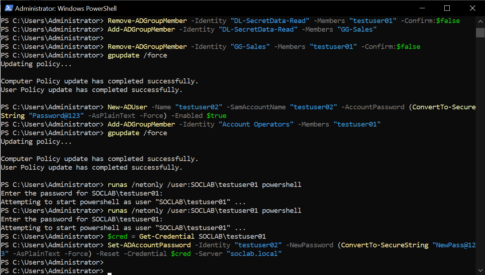

# Event 4733 — Member removed from security-enabled local group

*Part of the [Account Management lab](../README.md) — 27 Windows events mapped to Wazuh, interview-prep edition.*

---
**What it means:** Someone's key to a *specific* resource was revoked.

**Why a SOC analyst cares:** *"Their access to that one door is gone. Usually a role change — but timing matters. If the removal happens right after sensitive data was accessed from that resource, it can be an attacker covering their tracks: take what you need, then return the key."*

**Wazuh:** rule **60145**, level **5** — verdict: **covered**.

**Generate:**
```powershell
Remove-ADGroupMember -Identity "DL-SecretData-Read" -Members "GG-Sales" -Confirm:$false
```

**Cleanup:** re-add the member (fires 4732).



---
*No screenshot captured for this step — Threat Hunting alert, rule 60145.*

## Threat Hunting in Wazuh

Threat Hunting uses DQL. Paste these into the search bar (Events tab) over the time window of the lab. Threat Hunting shows the **alerts** index only — if an event fired no rule, it is invisible here; check the archives index or `Get-WinEvent` on the DC instead.

**All of them:**
```
data.win.system.eventID: 4733
```

**One group:**
```
data.win.system.eventID: 4733 AND data.win.eventdata.targetUserName: DL-SecretData-Read
```

**One member:**
```
data.win.system.eventID: 4733 AND data.win.eventdata.memberName: *GG-Sales*
```

**Who did it:**
```
data.win.system.eventID: 4733 AND data.win.eventdata.subjectUserName: administrator
```

**By rule:**
```
rule.id: 60145 AND data.win.system.eventID: 4733
```

**Human members only** (drops computer accounts and nested groups ending in `$`):
```
data.win.system.eventID: 4733 AND NOT data.win.eventdata.memberName: *$
```
