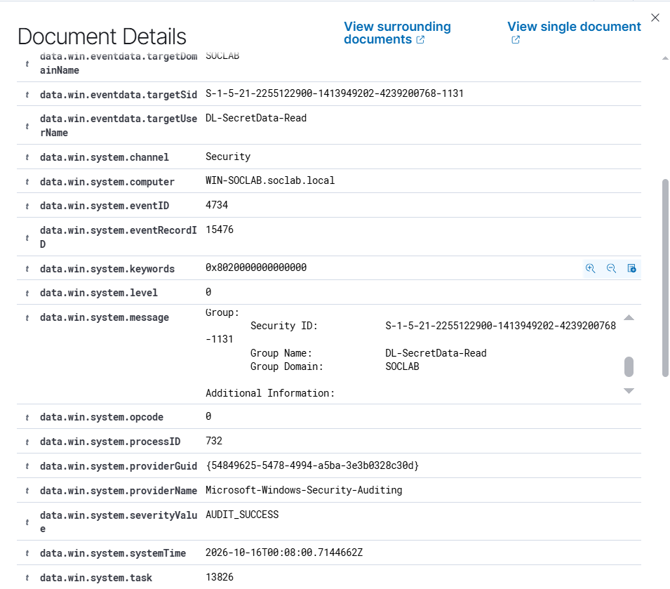
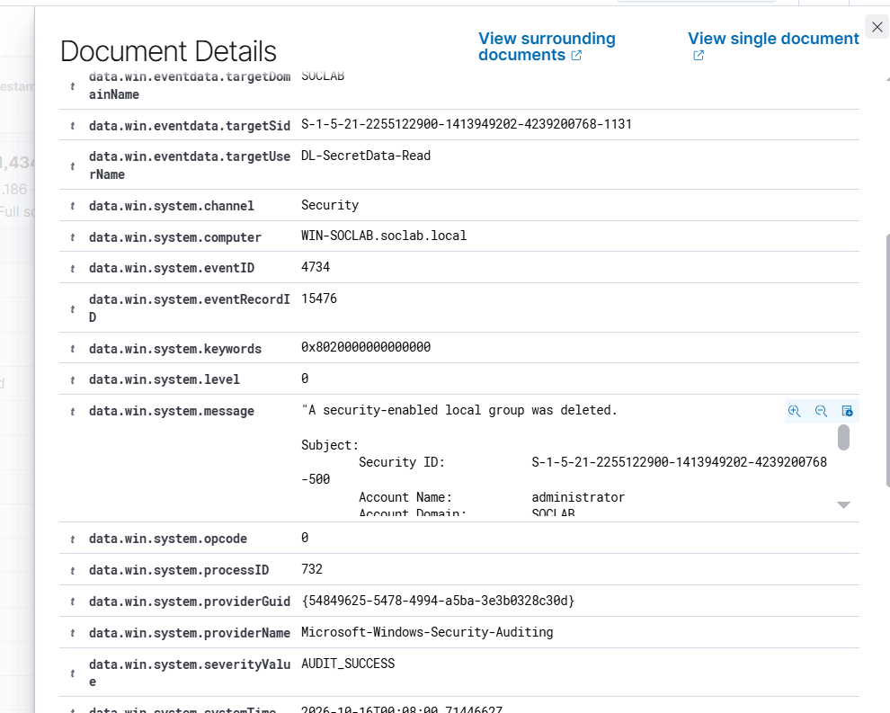

# Event 4734 — Security-enabled local group deleted

*Part of the [Account Management lab](../README.md) — 27 Windows events mapped to Wazuh, interview-prep edition.*

---
**What it means:** A domain local security group was deleted — a lock was removed from a door, along with the record of who held its keys.

**Why a SOC analyst cares:** *"Deleting the group destroys the access structure itself. Legitimate when a resource is decommissioned; suspicious when it follows sensitive access — it can be cleanup after data theft, erasing the evidence of who could open that door. I always check what the group guarded before it vanished."*

**Wazuh:** rule **60146**, level **5** — verdict: **covered**.

**Generate:**
```powershell
Remove-ADGroup -Identity "DL-SecretData-Read" -Confirm:$false
```




