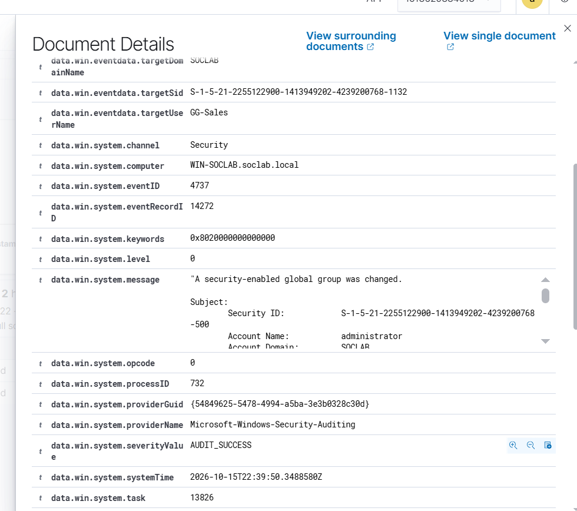
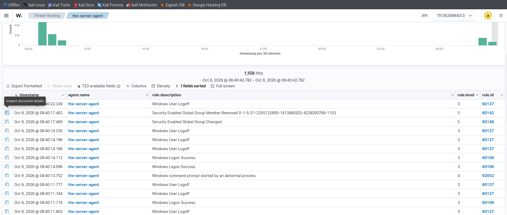

# Event 4737 — Security-enabled global group changed

*Part of the [Account Management lab](../README.md) — 27 Windows events mapped to Wazuh, interview-prep edition.*

---
**What it means:** A global group's own attributes were modified — description, managed-by, notes.

**Why a SOC analyst cares:** *"Someone edited the badge itself rather than its members. Usually housekeeping. But attackers tweaking group attributes — renaming a group to look legitimate, changing who 'manages' it — is how persistence stays subtle. Low urgency, but I want it on the timeline."*

**Wazuh:** rule **60148**, level **5** — verdict: **covered**.

**Generate:**
```powershell
Set-ADGroup -Identity "GG-Sales" -Description "Sales role badge"
```

**Cleanup:** revert the attribute (`-Clear Description`).



---


---

## Threat Hunting in Wazuh

Threat Hunting uses DQL. Paste these into the search bar (Events tab) over the time window of the lab. Threat Hunting shows the **alerts** index only — if an event fired no rule, it is invisible here; check the archives index or `Get-WinEvent` on the DC instead.

**All of them:**
```
data.win.system.eventID: 4737
```

**One group:**
```
data.win.system.eventID: 4737 AND data.win.eventdata.targetUserName: GG-Sales
```

**Who did it:**
```
data.win.system.eventID: 4737 AND data.win.eventdata.subjectUserName: administrator
```

**By rule:**
```
rule.id: 60148 AND data.win.system.eventID: 4737
```
