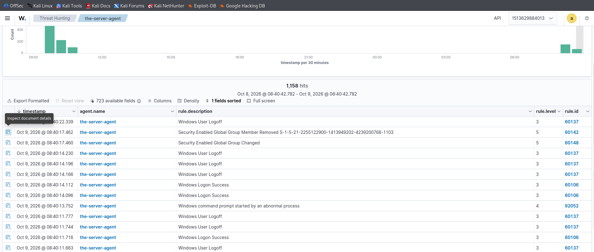

# Event 4737 — Security-enabled global group changed

*Part of the [Account Management lab](../README.md) — 27 Windows events mapped to Wazuh, interview-prep edition.*

---
**What it means:** A global group's own attributes were modified — description, managed-by, notes.

**Why a SOC analyst cares:** *"Someone edited the badge itself rather than its members. Usually housekeeping. But attackers tweaking group attributes — renaming a group to look legitimate, changing who 'manages' it — is how persistence stays subtle. Low urgency, but I want it on the timeline."*

**Wazuh:** rule **60148**, level **5** — verdict: **covered**.

**Generate:**
```powershell
Set-ADGroup -Identity "GG-Sales" -Description "Sales role badge"
```

**Cleanup:** revert the attribute (`-Clear Description`).



