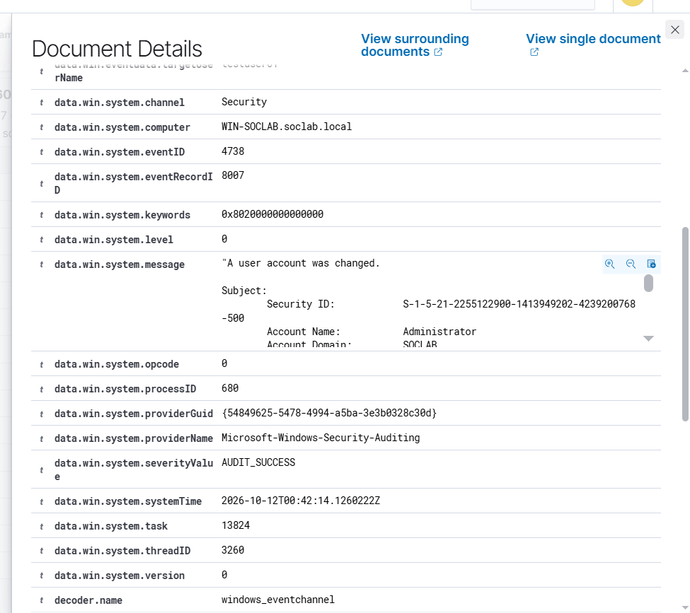

# Event 4738 — User account changed

*Part of the [Account Management lab](../README.md) — 27 Windows events mapped to Wazuh, interview-prep edition.*

---
**What it means:** An attribute of a user account was modified — description, display name, password set, enabled flag, almost anything.

**Why a SOC analyst cares:** *"4738 is the noisiest useful event in this category — it fires on nearly any account edit, even an address change. At enterprise scale it's a flood, which is why it needs tuning rather than alerting as-is. The value is in filtering: 4738 on a privileged account, or 4738 touching security-sensitive attributes, is worth a look. Everything else is baseline."*

**Wazuh:** rule **60110**, level **8** — verdict: **needs tuning**. Same generic rule as 4723/4724/4781 — one rule, four different real-world meanings.

**Generate:**
```powershell
Set-ADUser -Identity "testuser02" -Description "Updated role"
```
(Also fires when a password is set during `New-ADUser` — that's where the stacked 4738s in 4720 come from.)

**Cleanup:** `Set-ADUser -Identity "testuser02" -Clear Description`



