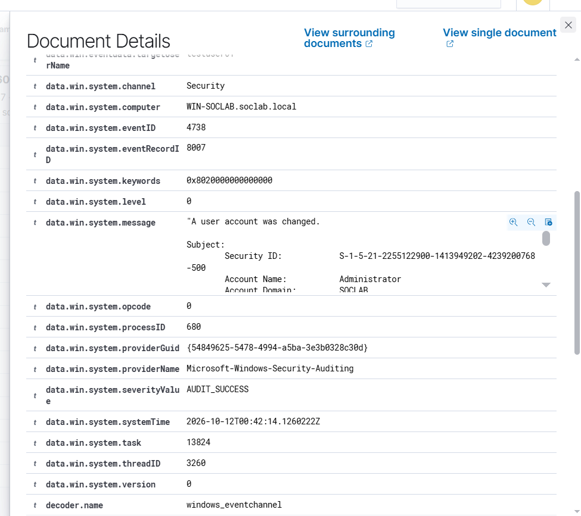
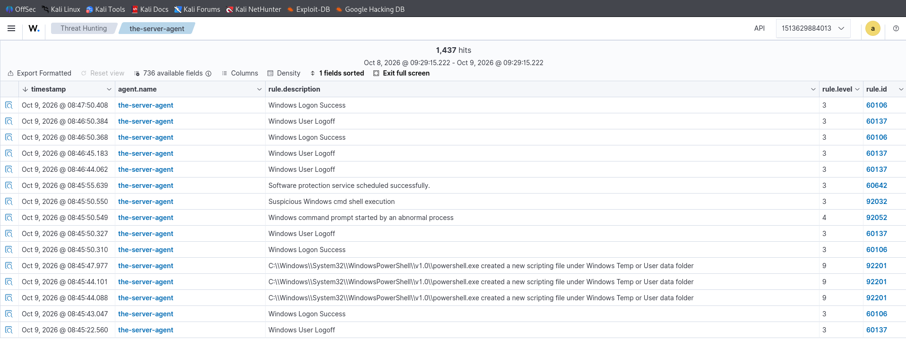

# Event 4738 — User account changed

*Part of the [Account Management lab](../README.md) — 27 Windows events mapped to Wazuh, interview-prep edition.*

---
**What it means:** An attribute of a user account was modified — description, display name, password set, enabled flag, almost anything.

**Why a SOC analyst cares:** *"4738 is the noisiest useful event in this category — it fires on nearly any account edit, even an address change. At enterprise scale it's a flood, which is why it needs tuning rather than alerting as-is. The value is in filtering: 4738 on a privileged account, or 4738 touching security-sensitive attributes, is worth a look. Everything else is baseline."*

**Wazuh:** rule **60110**, level **8** — verdict: **needs tuning**. Same generic rule as 4723/4724/4781 — one rule, four different real-world meanings.

**Generate:**
```powershell
Set-ADUser -Identity "testuser02" -Description "Updated role"
```
(Also fires when a password is set during `New-ADUser` — that's where the stacked 4738s in 4720 come from.)

**Cleanup:** `Set-ADUser -Identity "testuser02" -Clear Description`



---


---

## Threat Hunting in Wazuh

Threat Hunting uses DQL. Paste these into the search bar (Events tab) over the time window of the lab. Threat Hunting shows the **alerts** index only — if an event fired no rule, it is invisible here; check the archives index or `Get-WinEvent` on the DC instead.

**All of them:**
```
data.win.system.eventID: 4738
```

**Just one account:**
```
data.win.system.eventID: 4738 AND data.win.eventdata.targetUserName: testuser02
```

**Who did it:**
```
data.win.system.eventID: 4738 AND data.win.eventdata.subjectUserName: administrator
```

**By rule:**
```
rule.id: 60110 AND data.win.system.eventID: 4738
```

**Human accounts only** (drops computer accounts ending in `$` and SYSTEM noise):
```
data.win.system.eventID: 4738 AND NOT data.win.eventdata.targetUserName: *$ AND NOT data.win.eventdata.targetUserName: SYSTEM
```

Rule 60110 is shared with 4723, 4724, and 4781 — one rule, four different real-world meanings. Use the eventID to tell them apart, and filter on the account.
