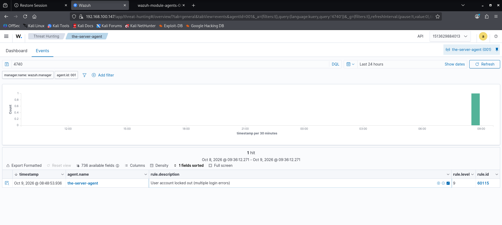

# Event 4740 — Account locked out

*Part of the [Account Management lab](../README.md) — 27 Windows events mapped to Wazuh, interview-prep edition.*

---
**What it means:** An account was automatically locked after too many failed logons.

**Why a SOC analyst cares:** *"4740 is the brute-force alarm bell. One lockout is usually a user fat-fingering their password. But lockouts across many accounts from one source IP is password spraying — and a lockout followed by a successful logon from an unusual IP is the nightmare scenario: they guessed right. I always check what happened right after the lockout."*

**Wazuh:** rule **60115**, level **9** — verdict: **covered**. The highest level in this lab's account events, and it earns it.

**Generate:** set an account lockout threshold via Group Policy (5 attempts in this lab), then fail logons 5 times as the user.

**Cleanup:** `Unlock-ADAccount -Identity "testuser02"` (fires 4767).

**Watch out:** without a lockout-threshold policy, **4740 can never fire** — the lab initially had no threshold, so this event was untestable until the policy was added. A detection that can't fire is the same as no detection.

