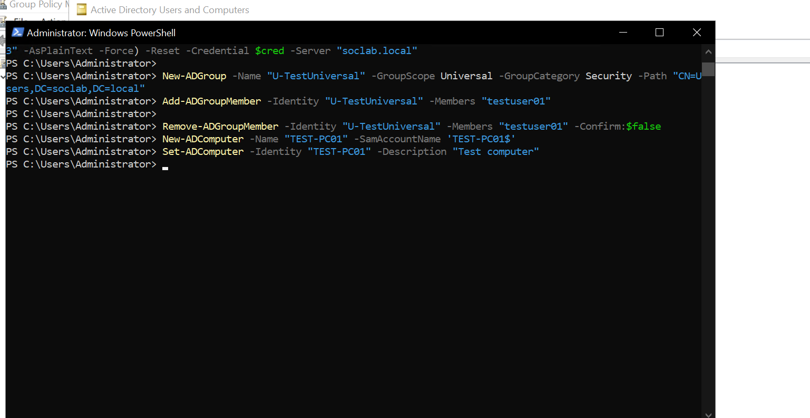
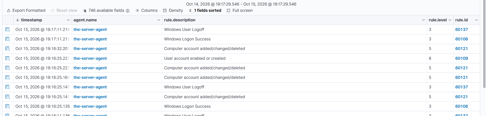

# Event 4741 — Computer account created

*Part of the [Account Management lab](../README.md) — 27 Windows events mapped to Wazuh, interview-prep edition.*

---
**What it means:** A new computer account — a new machine ID card — was created in AD.

**Why a SOC analyst cares:** *"Here's the catch most people miss: by default, any authenticated domain user can create up to 10 computer accounts — no admin rights needed. Attackers create 'ghost' computer accounts they control and then authenticate as that machine to run delegation attacks. So my questions are: who created it, does a real machine actually hold this identity, and has it authenticated since?"*

**Wazuh:** rule **60121**, level **5** — verdict: **covered**.

**Generate:**
```powershell
New-ADComputer -Name "TEST-PC01" -SamAccountName 'TEST-PC01$'
```

**Cleanup:** `Remove-ADComputer -Identity "TEST-PC01" -Confirm:$false` (fires 4743).



