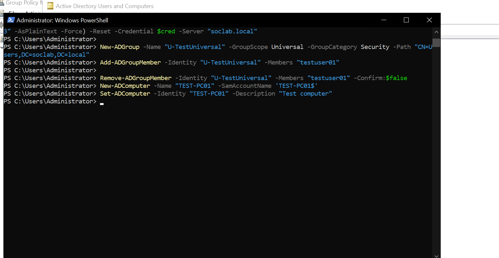
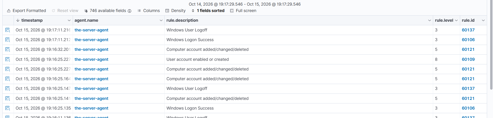

# Event 4741 — Computer account created

*Part of the [Account Management lab](../README.md) — 27 Windows events mapped to Wazuh, interview-prep edition.*

---
**What it means:** A new computer account — a new machine ID card — was created in AD.

**Why a SOC analyst cares:** *"Here's the catch most people miss: by default, any authenticated domain user can create up to 10 computer accounts — no admin rights needed. Attackers create 'ghost' computer accounts they control and then authenticate as that machine to run delegation attacks. So my questions are: who created it, does a real machine actually hold this identity, and has it authenticated since?"*

**Wazuh:** rule **60121**, level **5** — verdict: **covered**.

**Generate:**
```powershell
New-ADComputer -Name "TEST-PC01" -SamAccountName 'TEST-PC01$'
```

**Cleanup:** `Remove-ADComputer -Identity "TEST-PC01" -Confirm:$false` (fires 4743).



---


---

## Threat Hunting in Wazuh

Threat Hunting uses DQL. Paste these into the search bar (Events tab) over the time window of the lab. Threat Hunting shows the **alerts** index only — if an event fired no rule, it is invisible here; check the archives index or `Get-WinEvent` on the DC instead.

**All of them:**
```
data.win.system.eventID: 4741
```

**One computer:**
```
data.win.system.eventID: 4741 AND data.win.eventdata.targetUserName: TEST-PC01
```

**Who did it:**
```
data.win.system.eventID: 4741 AND data.win.eventdata.subjectUserName: administrator
```

**By rule:**
```
rule.id: 60121 AND data.win.system.eventID: 4741
```

Note: the target here is a computer account, so it ends in `$` — do not use the human-only `NOT *$` filter on this event.
