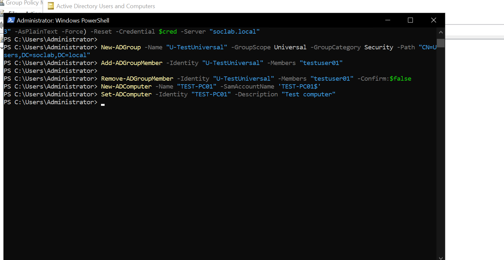
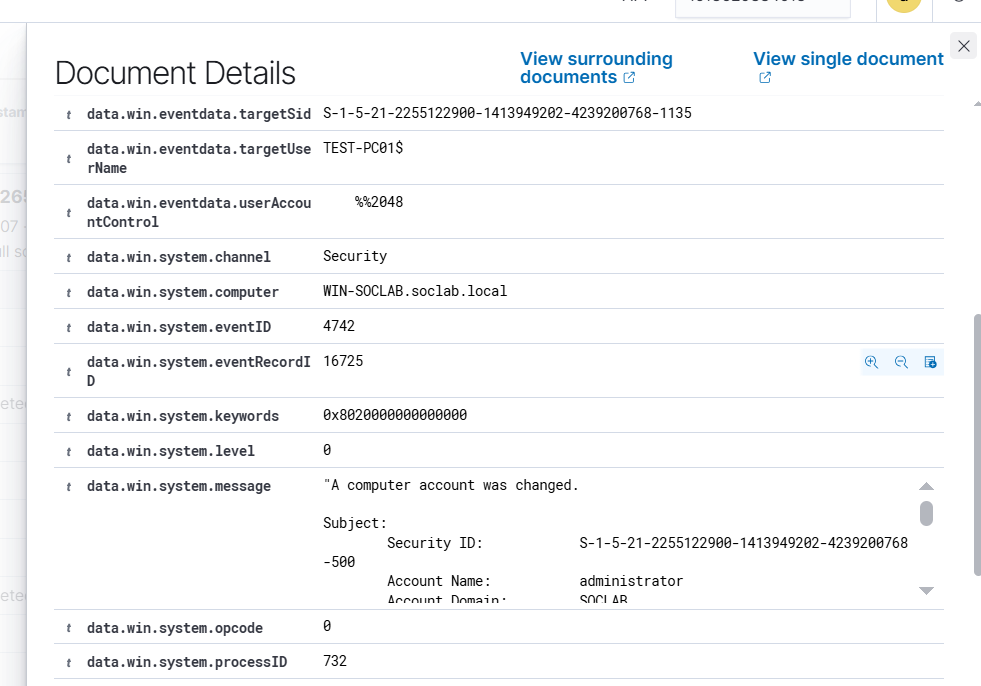

# Event 4742 — Computer account changed

*Part of the [Account Management lab](../README.md) — 27 Windows events mapped to Wazuh, interview-prep edition.*

---
**What it means:** A computer account's attributes were modified.

**Why a SOC analyst cares:** *"Same idea as 4738, but for a machine identity. Attackers modify computer accounts when setting up delegation attacks — changing attributes to make the ghost account usable. A computer account edited by a user who doesn't manage machines is worth investigating."*

**Wazuh:** rule **60121**, level **5** — verdict: **covered**.

**Generate:**
```powershell
Set-ADComputer -Identity "TEST-PC01" -Description "Test computer"
```

**Cleanup:** revert the attribute (`-Clear Description`).



---


---

## Threat Hunting in Wazuh

Threat Hunting uses DQL. Paste these into the search bar (Events tab) over the time window of the lab. Threat Hunting shows the **alerts** index only — if an event fired no rule, it is invisible here; check the archives index or `Get-WinEvent` on the DC instead.

**All of them:**
```
data.win.system.eventID: 4742
```

**One computer:**
```
data.win.system.eventID: 4742 AND data.win.eventdata.targetUserName: TEST-PC01
```

**Who did it:**
```
data.win.system.eventID: 4742 AND data.win.eventdata.subjectUserName: administrator
```

**By rule:**
```
rule.id: 60121 AND data.win.system.eventID: 4742
```

Note: the target here is a computer account, so it ends in `$` — do not use the human-only `NOT *$` filter on this event.
