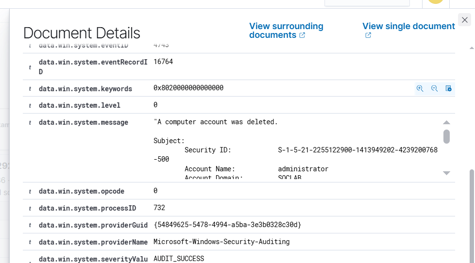
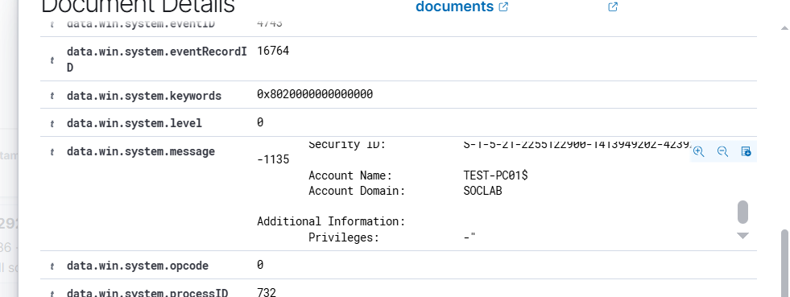

# Event 4743 — Computer account deleted

*Part of the [Account Management lab](../README.md) — 27 Windows events mapped to Wazuh, interview-prep edition.*

---
**What it means:** A computer account was deleted — that machine's domain identity no longer exists.

**Why a SOC analyst cares:** *"The machine can't authenticate anymore. Usually decommissioning. But paired with a recent 4741 by an unusual user, it reads differently: create a ghost account, use it, delete it. I check the account's lifetime — created and deleted within hours is not decommissioning."*

**Wazuh:** rule **60121**, level **5** — verdict: **covered**.

**Generate:** `Remove-ADComputer -Identity "TEST-PC01" -Confirm:$false`

**Cleanup:** recreate the account if the machine still needs domain membership (fires a new 4741).

