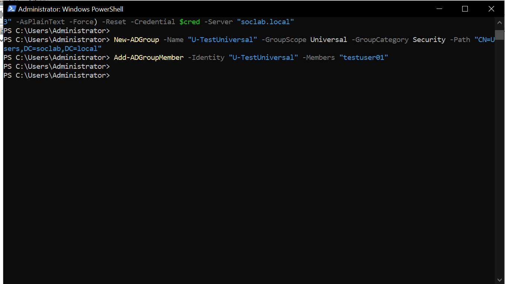
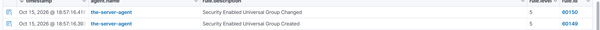

# Event 4754 — Security-enabled universal group created

*Part of the [Account Management lab](../README.md) — 27 Windows events mapped to Wazuh, interview-prep edition.*

---
**What it means:** A new universal security group was created — a badge valid in **every domain of the forest**.

**Why a SOC analyst cares:** *"Same as 4727, but the blast radius is the whole forest, not one domain. In a multi-domain environment this gets extra scrutiny from me — a universal group created without a clear forest-wide purpose is someone building infrastructure with maximum reach."*

**Wazuh:** rule **60149**, level **5** — verdict: **covered**.

**Generate:**
```powershell
New-ADGroup -Name "U-TestUniversal" -GroupScope Universal -GroupCategory Security `
  -Path "CN=Users,DC=soclab,DC=local"
```

**Cleanup:** `Remove-ADGroup -Identity "U-TestUniversal" -Confirm:$false` (fires 4758).



