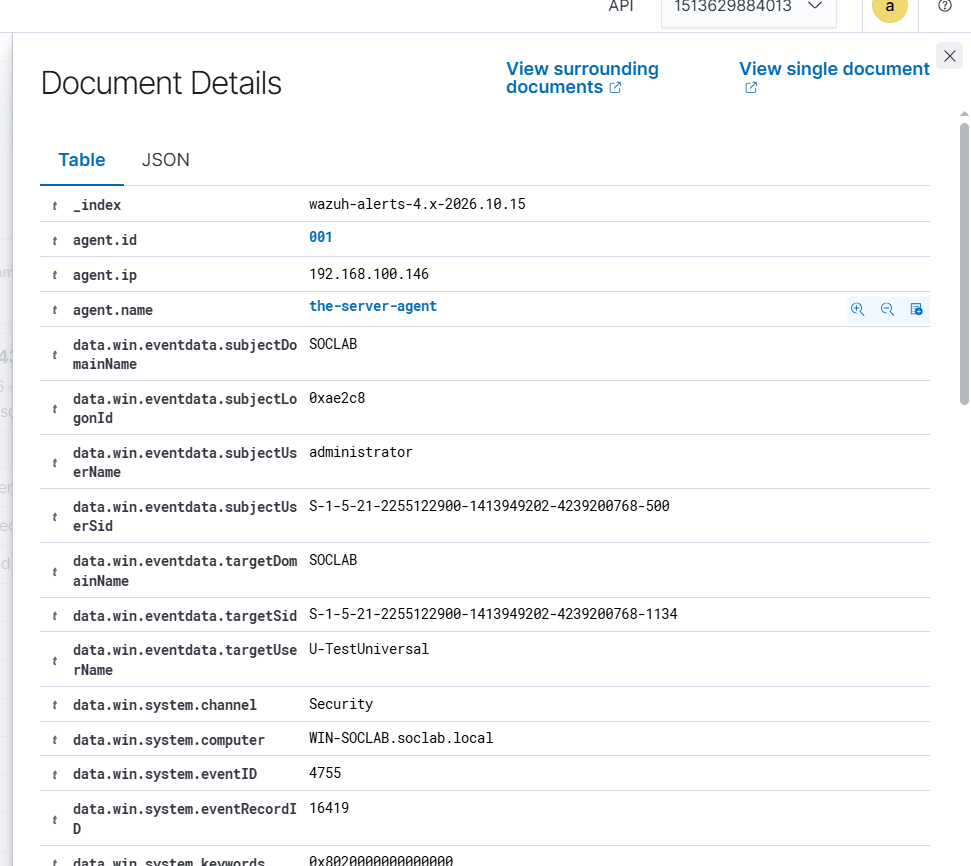
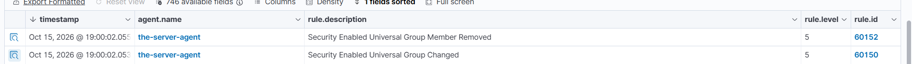

# Event 4755 — Security-enabled universal group changed

*Part of the [Account Management lab](../README.md) — 27 Windows events mapped to Wazuh, interview-prep edition.*

---
**What it means:** A universal group's attributes were modified.

**Why a SOC analyst cares:** *"Same triage as 4737 — someone edited the group rather than its membership — with the forest-wide scope in mind. A quiet edit to a forest-wide badge is exactly the kind of thing that doesn't alarm anyone and should."*

**Wazuh:** rule **60150**, level **5** — verdict: **covered**.

**Generate:**
```powershell
Set-ADGroup -Identity "U-TestUniversal" -Description "Test universal group"
```

**Cleanup:** revert the attribute.



---


---

## Threat Hunting in Wazuh

Threat Hunting uses DQL. Paste these into the search bar (Events tab) over the time window of the lab. Threat Hunting shows the **alerts** index only — if an event fired no rule, it is invisible here; check the archives index or `Get-WinEvent` on the DC instead.

**All of them:**
```
data.win.system.eventID: 4755
```

**One group:**
```
data.win.system.eventID: 4755 AND data.win.eventdata.targetUserName: U-TestUniversal
```

**Who did it:**
```
data.win.system.eventID: 4755 AND data.win.eventdata.subjectUserName: administrator
```

**By rule:**
```
rule.id: 60150 AND data.win.system.eventID: 4755
```
