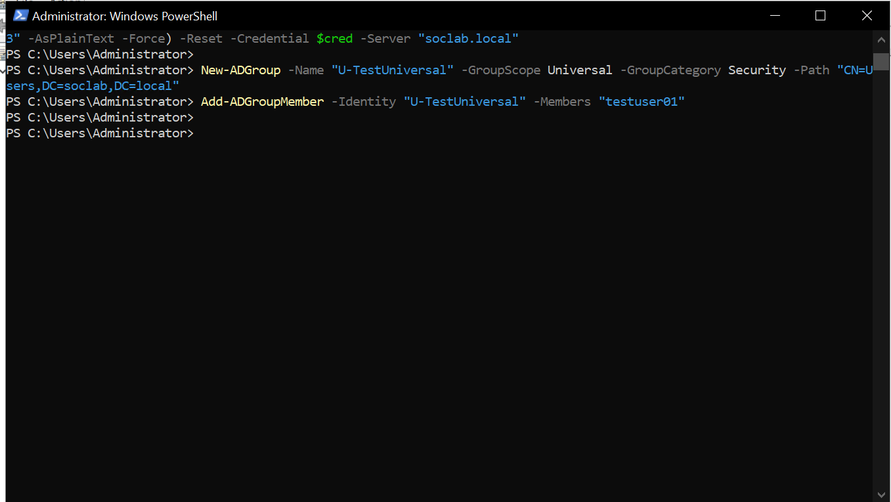
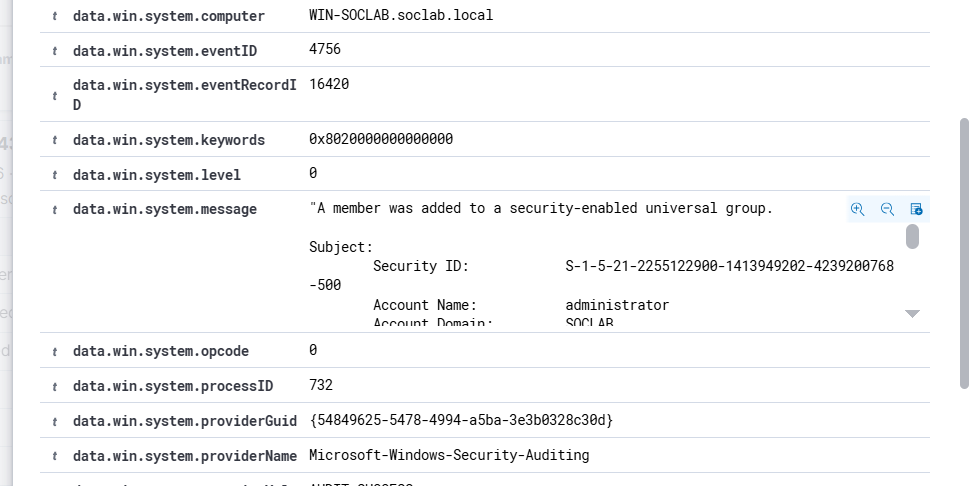

# Event 4756 — Member added to security-enabled universal group

*Part of the [Account Management lab](../README.md) — 27 Windows events mapped to Wazuh, interview-prep edition.*

---
**What it means:** Someone was added to a universal security group — the 4728 moment, but forest-wide.

**Why a SOC analyst cares:** *"This is 4728 with a bigger blast radius. Membership in a privileged universal group can mean privileges in every domain in the forest — and universal membership replicates through the Global Catalog, so it spreads fast. If an attacker lands here, containment gets much harder. In a multi-domain environment, this is the highest-priority group-membership event I watch."*

**Wazuh:** rule **60151**, level **5** — verdict: **covered**.

**Generate:**
```powershell
Add-ADGroupMember -Identity "U-TestUniversal" -Members "testuser01"
```

**Cleanup:** `Remove-ADGroupMember -Identity "U-TestUniversal" -Members "testuser01" -Confirm:$false` (fires 4757).



---


---

## Threat Hunting in Wazuh

Threat Hunting uses DQL. Paste these into the search bar (Events tab) over the time window of the lab. Threat Hunting shows the **alerts** index only — if an event fired no rule, it is invisible here; check the archives index or `Get-WinEvent` on the DC instead.

**All of them:**
```
data.win.system.eventID: 4756
```

**One group:**
```
data.win.system.eventID: 4756 AND data.win.eventdata.targetUserName: U-TestUniversal
```

**One member:**
```
data.win.system.eventID: 4756 AND data.win.eventdata.memberName: *testuser01*
```

**Who did it:**
```
data.win.system.eventID: 4756 AND data.win.eventdata.subjectUserName: administrator
```

**By rule:**
```
rule.id: 60151 AND data.win.system.eventID: 4756
```

**Human members only** (drops computer accounts and nested groups ending in `$`):
```
data.win.system.eventID: 4756 AND NOT data.win.eventdata.memberName: *$
```
