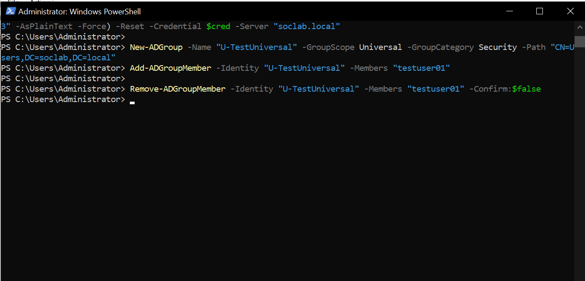
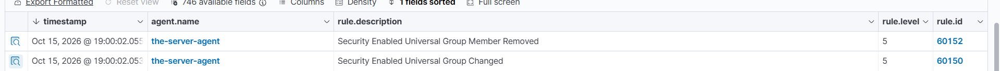

# Event 4757 — Member removed from security-enabled universal group

*Part of the [Account Management lab](../README.md) — 27 Windows events mapped to Wazuh, interview-prep edition.*

---
**What it means:** Someone was removed from a universal security group.

**Why a SOC analyst cares:** *"Access revoked across the forest — or cleanup after the fact. Same read as 4729 and 4733: legitimate for role changes, suspicious when it follows the activity it might be hiding."*

**Wazuh:** rule **60152**, level **5** — verdict: **covered**.

**Generate:**
```powershell
Remove-ADGroupMember -Identity "U-TestUniversal" -Members "testuser01" -Confirm:$false
```

**Cleanup:** re-add the member.



---


---

## Threat Hunting in Wazuh

Threat Hunting uses DQL. Paste these into the search bar (Events tab) over the time window of the lab. Threat Hunting shows the **alerts** index only — if an event fired no rule, it is invisible here; check the archives index or `Get-WinEvent` on the DC instead.

**All of them:**
```
data.win.system.eventID: 4757
```

**One group:**
```
data.win.system.eventID: 4757 AND data.win.eventdata.targetUserName: U-TestUniversal
```

**One member:**
```
data.win.system.eventID: 4757 AND data.win.eventdata.memberName: *testuser01*
```

**Who did it:**
```
data.win.system.eventID: 4757 AND data.win.eventdata.subjectUserName: administrator
```

**By rule:**
```
rule.id: 60152 AND data.win.system.eventID: 4757
```

**Human members only** (drops computer accounts and nested groups ending in `$`):
```
data.win.system.eventID: 4757 AND NOT data.win.eventdata.memberName: *$
```
