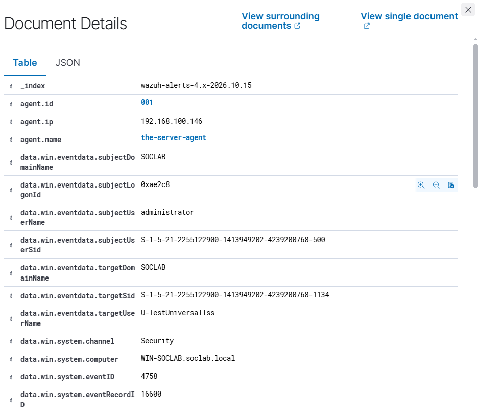
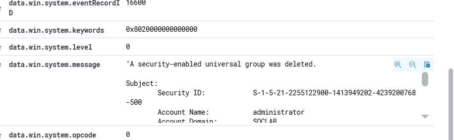

# Event 4758 — Security-enabled universal group deleted

*Part of the [Account Management lab](../README.md) — 27 Windows events mapped to Wazuh, interview-prep edition.*

---
**What it means:** A universal security group was deleted.

**Why a SOC analyst cares:** *"The forest-wide access structure is gone — that breaks access everywhere at once, or hides evidence everywhere at once. Either way I verify intent before moving on, because the impact isn't contained to one domain."*

**Wazuh:** rule **60153**, level **5** — verdict: **covered**.

**Generate:** `Remove-ADGroup -Identity "U-TestUniversal" -Confirm:$false`

**Cleanup:** recreate the group (fires a new 4754).



---


---

## Threat Hunting in Wazuh

Threat Hunting uses DQL. Paste these into the search bar (Events tab) over the time window of the lab. Threat Hunting shows the **alerts** index only — if an event fired no rule, it is invisible here; check the archives index or `Get-WinEvent` on the DC instead.

**All of them:**
```
data.win.system.eventID: 4758
```

**One group:**
```
data.win.system.eventID: 4758 AND data.win.eventdata.targetUserName: U-TestUniversal
```

**Who did it:**
```
data.win.system.eventID: 4758 AND data.win.eventdata.subjectUserName: administrator
```

**By rule:**
```
rule.id: 60153 AND data.win.system.eventID: 4758
```
