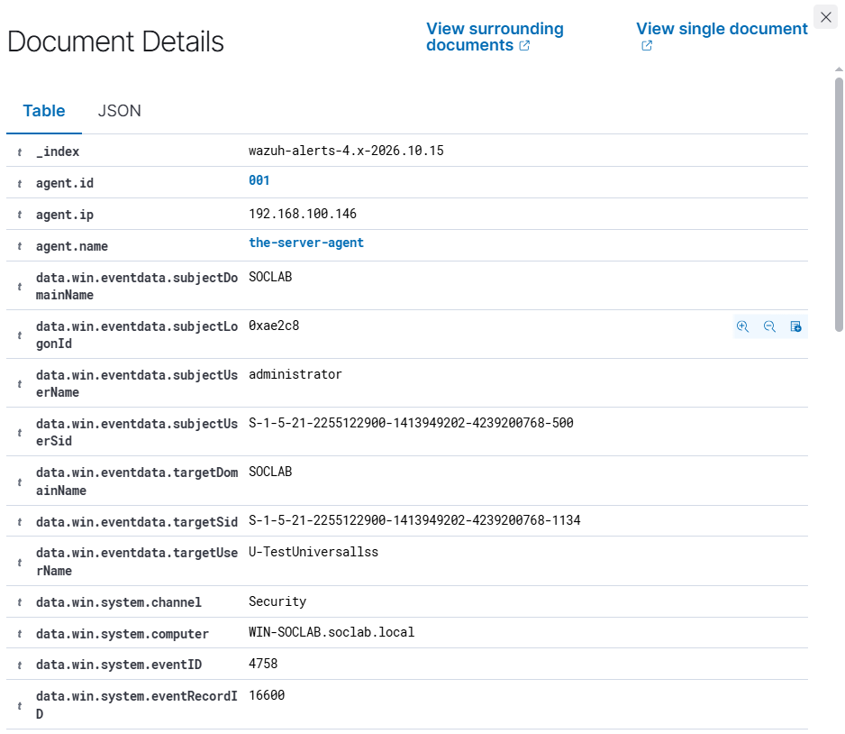

# Event 4758 — Security-enabled universal group deleted

*Part of the [Account Management lab](../README.md) — 27 Windows events mapped to Wazuh, interview-prep edition.*

---
**What it means:** A universal security group was deleted.

**Why a SOC analyst cares:** *"The forest-wide access structure is gone — that breaks access everywhere at once, or hides evidence everywhere at once. Either way I verify intent before moving on, because the impact isn't contained to one domain."*

**Wazuh:** rule **60153**, level **5** — verdict: **covered**.

**Generate:** `Remove-ADGroup -Identity "U-TestUniversal" -Confirm:$false`

**Cleanup:** recreate the group (fires a new 4754).

