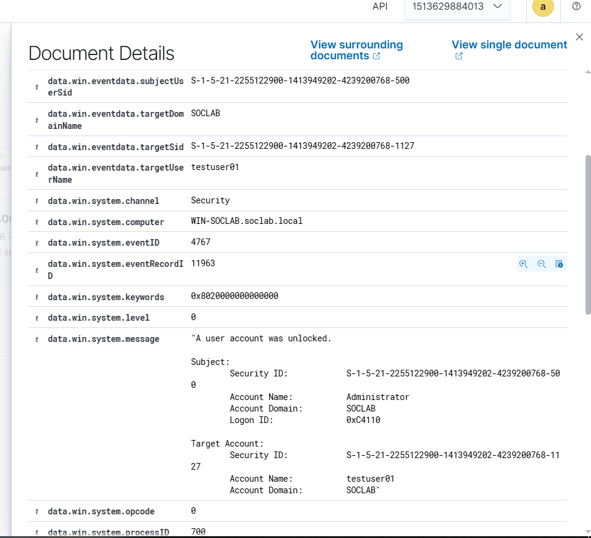
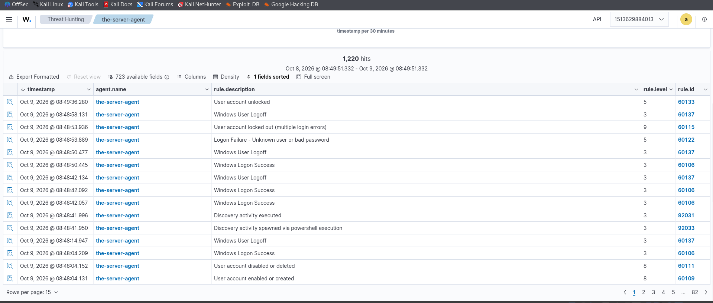

# Event 4767 — Account unlocked

*Part of the [Account Management lab](../README.md) — 27 Windows events mapped to Wazuh, interview-prep edition.*

---
**What it means:** An administrator unlocked a locked account.

**Why a SOC analyst cares:** *"The all-clear after a lockout — or the attacker unlocking their own backdoor account. I never read 4767 alone; I pair it with the 4740 that came before it. Was there a brute-force pattern? And critically: did anyone log on successfully after the unlock, and from where?"*

**Wazuh:** rule **60133**, level **5** — verdict: **covered**.

**Generate:** `Unlock-ADAccount -Identity "testuser02"`

**Cleanup:** none needed.



---


---

## Threat Hunting in Wazuh

Threat Hunting uses DQL. Paste these into the search bar (Events tab) over the time window of the lab. Threat Hunting shows the **alerts** index only — if an event fired no rule, it is invisible here; check the archives index or `Get-WinEvent` on the DC instead.

**All of them:**
```
data.win.system.eventID: 4767
```

**Just one account:**
```
data.win.system.eventID: 4767 AND data.win.eventdata.targetUserName: testuser02
```

**Who did it:**
```
data.win.system.eventID: 4767 AND data.win.eventdata.subjectUserName: administrator
```

**By rule:**
```
rule.id: 60133 AND data.win.system.eventID: 4767
```

**Human accounts only** (drops computer accounts ending in `$` and SYSTEM noise):
```
data.win.system.eventID: 4767 AND NOT data.win.eventdata.targetUserName: *$ AND NOT data.win.eventdata.targetUserName: SYSTEM
```

Never read an unlock alone — pair it with the 4740 that came before it, and check whether anyone logged on successfully after the unlock, and from where.
