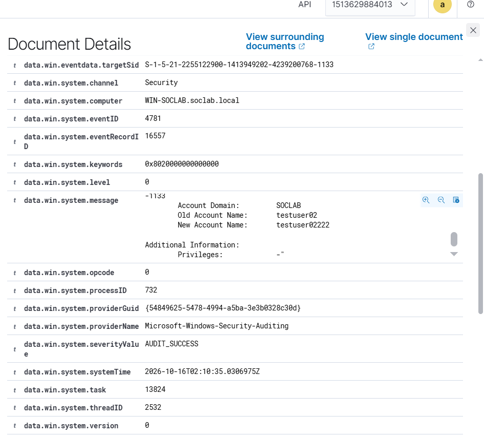

# Event 4781 — Account name (SAM) changed

*Part of the [Account Management lab](../README.md) — 27 Windows events mapped to Wazuh, interview-prep edition.*

---
**What it means:** An account's `sAMAccountName` (the actual logon name) was renamed.

**Why a SOC analyst cares:** *"Renames are camouflage. An attacker renames a backdoor account to look like a service account — or like a former employee's account — so it blends into the noise. Any rename of a privileged account, or a rename followed by suspicious logons under the new name, gets investigated. I also check the old name: what was it hiding from?"*

**Wazuh:** rule **60110**, level **8** — verdict: **covered** — but note the fidelity problem: Wazuh files this under generic "account changed." Nothing in the alert says *renamed*.

**Generate:**
```powershell
Set-ADUser -Identity "testuser02" -SamAccountName "renamed02"
```

**Cleanup:** `Set-ADUser -Identity "renamed02" -SamAccountName "testuser02"`



