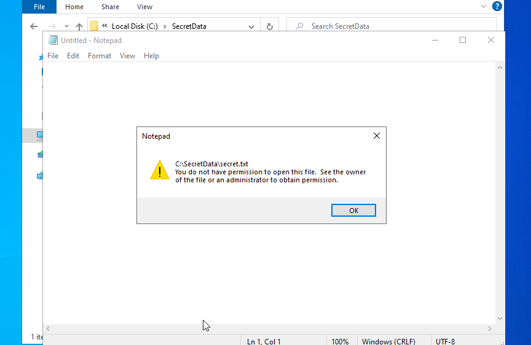
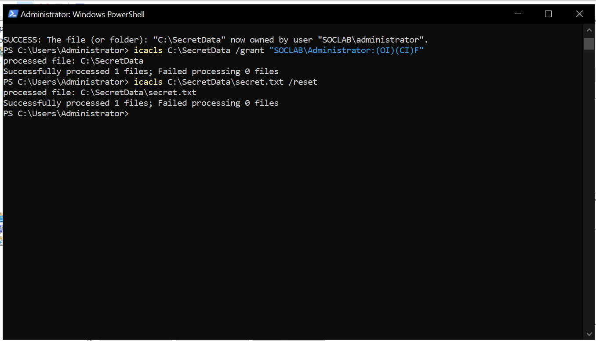
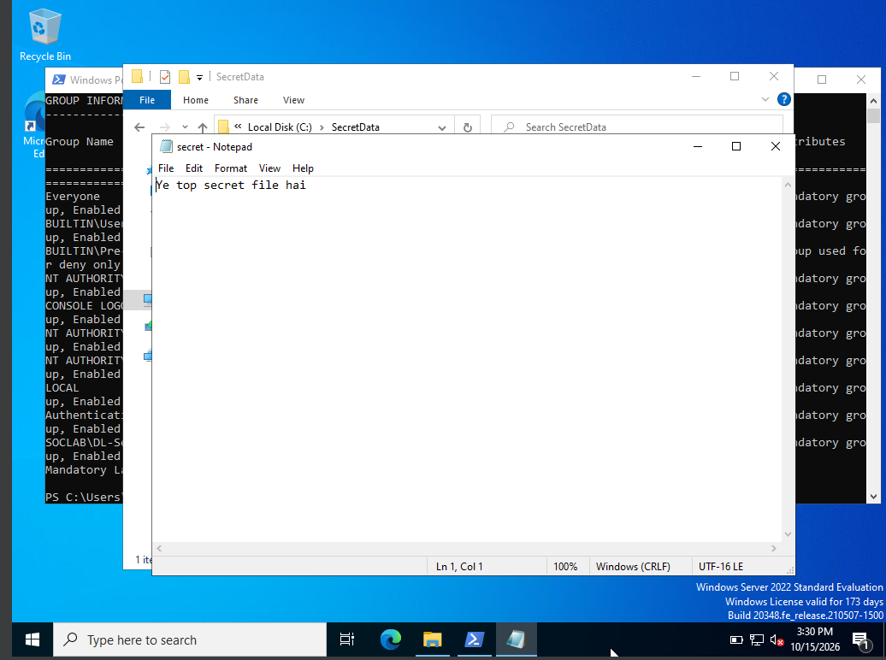
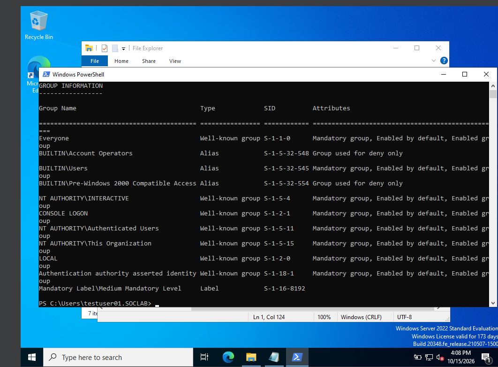
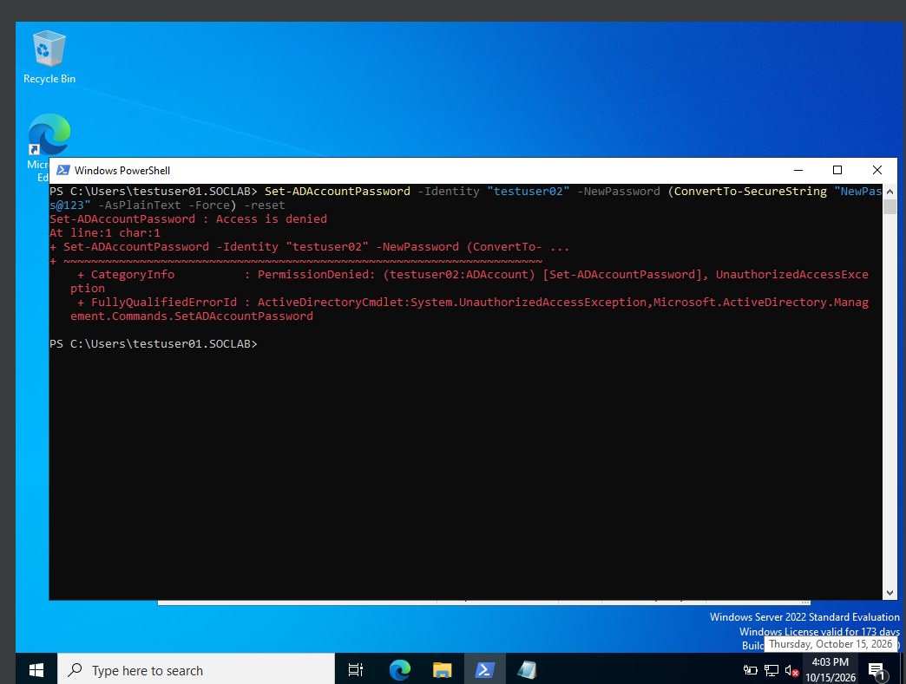
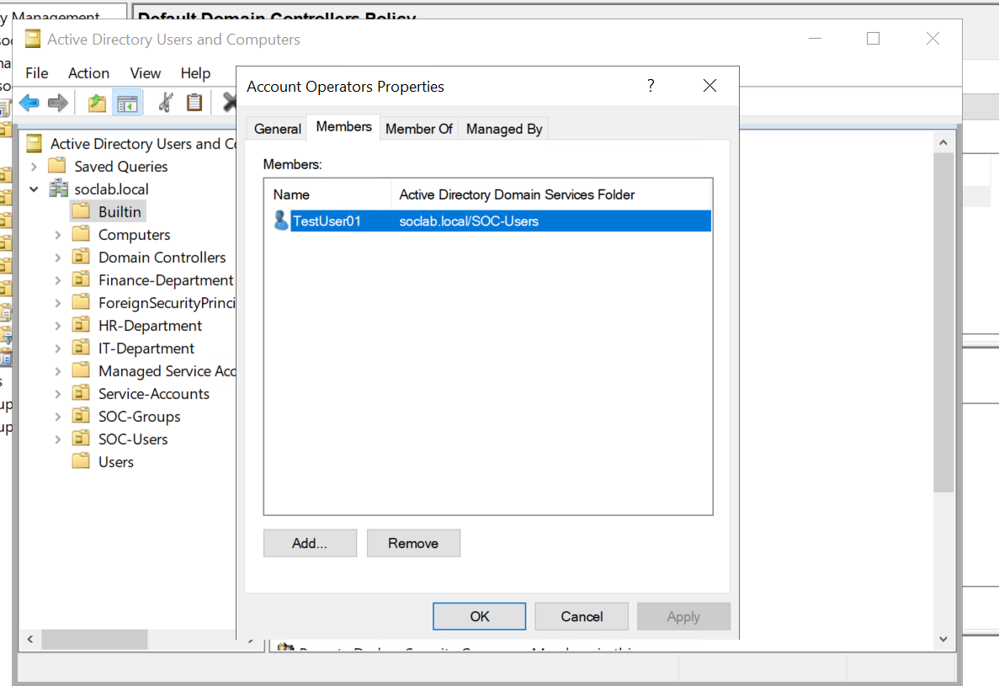
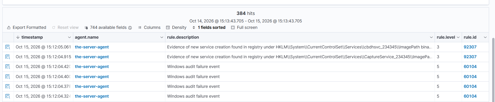
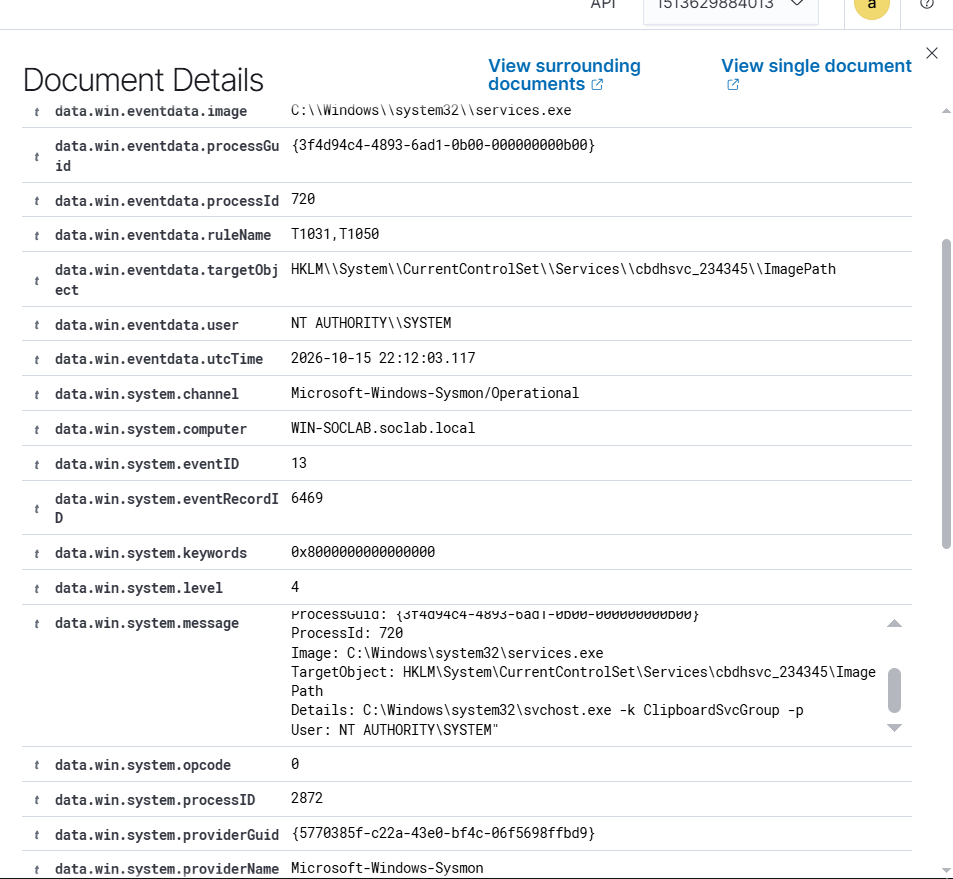
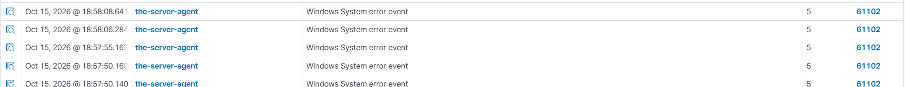

# Lab Errors & Bonus Detections

*Things that broke during the 27-event Account Management lab — and what they taught me. Pure interview gold: every interviewer loves "tell me about a time something broke."*

*Part of the [Account Management lab](../README.md).*

---

## Lab errors I hit — & how I fixed them

Real troubleshooting from this lab. Every one of these is an interview story.

### 1. "The sign-in method isn't allowed" — wrong logon type, wrong fix

**What happened:** `testuser01` couldn't log on at the VirtualBox console: *"the sign-in method you are trying to use isn't allowed."* An hour was spent fixing **RDP** permissions.

**Root cause:** The error was at the *console* (logon **type 2**), not RDP (logon **type 10**). The RDP user right was never the problem — the console logon right was.

**Fix:** Added `SOCLAB\testuser01` to **"Allow log on locally"** in the *Default Domain Controllers Policy*, then `gpupdate /force`.

**Lesson:** *Verify the actual symptom before troubleshooting.* Logon type 2 = console/interactive, type 10 = RDP, type 3 = network. Read the type first, then pick the fix. An hour of the wrong fix taught this permanently.

### 2. Access Denied *after* getting the group key

**What happened:** `testuser01` was added to `DL-SecretData-Read`, logged out and back in, `whoami /groups` confirmed membership — but the file `C:\SecretData\secret.txt` still said Access Denied. The folder opened; the file didn't.

**Root cause:** The *folder* granted access, but the *file's* own ACL was broken — inheritance wasn't carrying the permission down.

**Fix:** Took ownership (`takeown`) and repaired the ACLs with `icacls` on both folder and file.

**Lesson:** *Group membership is the key, but folder and file permissions can differ.* Inheritance carries rules downward — when it's broken, the key doesn't reach every lock. And ownership is the recovery path when an ACL is damaged beyond normal repair.

### 3. "Group used for deny only" — the filtered token

**What happened:** After adding `testuser01` to **Account Operators**, `whoami /groups` showed the group as *"Group used for deny only"* — and a password reset as that user was still denied.

**Root cause:** An interactive/console logon (type 2) gets a **filtered token** under UAC: privileged group memberships are present but neutered. A **network logon (type 3)** carries the **full** token.

**Lesson:** *Attackers don't sit at the console.* They authenticate over the network, where stolen privileges work at full strength. That's why the SOC signal is a **type-3 logon by a privileged-group member from an unusual source** — someone arriving to use their full privileges. The 4728 grants the power; the type-3 logon is when it's spent.

### 4. 4720 followed by 4726 — the "attack" that wasn't

**What happened:** A new account generated **4720** (created) and, one second later, **4726** (deleted). It looked like an attacker creating and destroying an account.

**Root cause:** Failed provisioning — the chosen password violated domain policy, so AD rolled the half-created object back.

**Lesson:** *Windows audits operations, not outcomes.* Two scary events in sequence can be one boring failure. Always check *why* before escalating *what*.

### 5. One command, four events

**What happened:** A single `New-ADUser -Enabled $true` fired **4720 + 4738 + 4738 + 4722** in the same second.

**Root cause:** One automated operation touches several attributes; Windows logs each touch.

**Lesson:** *Correlate before you count.* Four events in one second from one actor is one story, not four incidents. Same-second, same-actor event stacks get read as a unit.

### 6. Read the rule off the fired alert — always

**What happened:** Twice, a rule ID was read off the Management → Rules list instead of the actual alert — and twice it was wrong (4728 was logged as 4720's rule; 4740 picked up a neighboring 4625 rule).

**Lesson:** *Wazuh fires the most specific matching rule.* The rules list shows candidates; only the **fired alert** (`data.win.system.eventID` + `rule.id` in Threat Hunting) shows what actually matched. This discipline is non-negotiable — on shift, the wrong rule ID means the wrong runbook.

---

---

## Field notes: two alerts worth knowing

Spotted during lab work, outside the 27 events — both are good triage exercises:

- **Rule 60104 — "Windows audit failure event" (level 5).** A *generic bucket* for any Windows event carrying the Audit Failure keyword — not "an attack failed." The instance seen here was event **5061** (cryptographic operation: the Software Key Storage Provider handling a Connected Devices Platform device certificate). Benign OS noise. Lesson: read the underlying `eventID` before reacting to a bucket rule's name.
- **Rule 92307 — "Evidence of new service creation" (level 3).** Fires on **Sysmon Event 13** (registry value set) when a service `ImagePath` is written under `HKLM\System\CurrentControlSet\Services\` — the **T1050** (New Service) persistence technique. The instances seen were legitimate Windows per-user services (`cbdhsvc_*`, `CaptureService_*`, created by `services.exe` as SYSTEM). Benign *here* — but the detection pattern is exactly right, and the same alert on an unknown service with a suspicious `ImagePath` is an immediate investigation. Behavior fires the rule; context decides the verdict.

---
