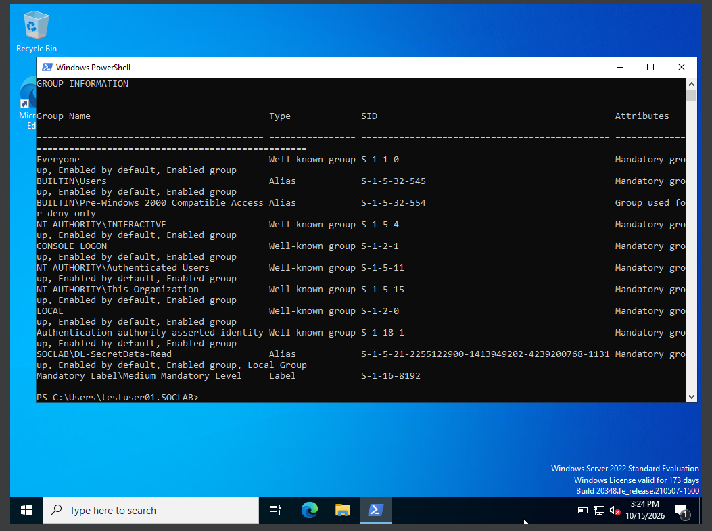
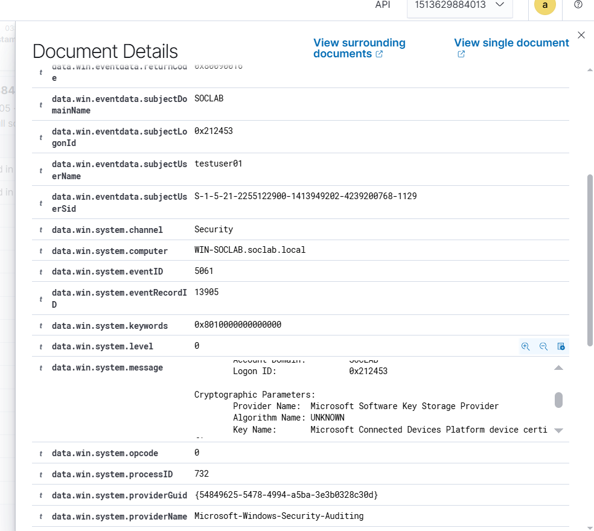

# Account Management: 27 Windows Events, Mapped to Wazuh

Every account-management event that matters in Active Directory — **generated by hand in the lab, caught by Wazuh, triaged like a SOC analyst**. Each event below has a plain-English explanation, an interview-ready answer, the exact Wazuh rule that fired, and the PowerShell to reproduce it.

This is my interview-prep document: when I get the call, I revise from here.

## Lab overview

| Field | Details |
|---|---|
| SIEM | Wazuh 4.14.5 single-node (Docker Compose) on Kali Linux |
| SIEM host | `192.168.100.50` — dashboard at `https://192.168.100.50` |
| Monitored host | Windows Server 2022 DC — `WIN-SOCLAB`, domain `soclab.local`, `192.168.100.146` |
| Agent | `001` (`the-server-agent`) — Active |
| Test accounts | `testuser01`, `testuser02` (lab-created) |
| Test groups | `GG-Sales` (Global), `DL-SecretData-Read` (Domain Local), `U-TestUniversal` (Universal) |
| Events covered | 27 — full account lifecycle, group lifecycle (all three scopes), computer accounts |
| Method | Generate each event → find the alert in Threat Hunting → read the rule ID **off the fired alert** (`data.win.system.eventID`), never off the rules list |

## How to use this for interview prep

1. **Memorize the IDs cold.** The [revision sheet](phase-1-sheet.pdf) in this folder lists all 27 in numerical order with one-line meanings — drill it until someone can say "4743" and you answer "computer account deleted" without thinking.
2. **Know the "why" for the big ones.** Every event below has a *"Why a SOC analyst cares"* written as an interview answer — say it out loud, in your own words.
3. **Know the two noisy ones.** 4720 and 4738 fire constantly at enterprise scale; be ready to explain *how you'd tune them*.
4. **Know the gotchas.** The [lab errors](#lab-errors-i-hit--how-i-fixed-them) section is pure interview gold — every interviewer loves "tell me about a time something broke."

---

## Core concepts

### Group scopes: the lock, the badge, and the forest-wide badge

Active Directory has three group scopes. Think of a college with campuses:

- **Domain Local group — the lock on a specific door.** The group *is* the access list attached to a resource. `DL-SecretData-Read` sits on the folder `C:\SecretData` like a lock on a door. Being added to the group = someone cuts you a key to that lock. It grants access to **one specific resource**, and it can contain users and groups from anywhere in the forest.
- **Global group — the badge.** `GG-Sales` is a role badge: "this person is in Sales." A badge by itself opens nothing — but doors (domain local groups) are configured to accept certain badges. A global group can only contain members from **its own domain**.
- **Universal group — the badge valid at every campus.** Same idea as a global badge, but recognized in **every domain in the forest**. Its membership is stored in the **Global Catalog**, which is why the forest needs it replicated everywhere. In a single-domain lab it behaves like a global group — the difference only shows with a second domain.

### The AGDLP nesting model

The intended design, and what the lab demonstrated:

```
User → Global role group → Domain Local resource group → Permission on the resource
```

`testuser01` → member of `GG-Sales` (the badge) → `GG-Sales` placed in `DL-SecretData-Read` (the lock) → lock grants Read on `C:\SecretData`. Add the user to the badge group once, and every door that accepts the badge opens. Remove the badge group from the lock, and every door closes at once. **The 4728 moment — adding the member — is when permission is granted.** Nothing is "handed over" again later; the power rides with the identity from that moment on.

### Computer accounts: the machine's ID card

Every domain-joined machine has an account in AD — the machine's ID card. You can spot one by the **`$` at the end of the name** (e.g. `WIN-SOCLAB$`): that suffix means "this is a machine, not a person."

What the ID card does: at boot, the machine authenticates to the domain with it (like a user logging on, but automatic), then receives Group Policies, exposes SYSVOL/NETLOGON, and validates domain users who log on to it.

The part that matters for security: `New-ADComputer` prints an ID card **with no real machine behind it** — a *ghost* account. Attackers create ghost computer accounts they control, then authenticate *as that machine* from their own box and abuse delegation to impersonate users (resource-based constrained delegation / shadow-credential style attacks). The card is genuine; the machine holding it is fake.

And the uncomfortable detail: **Machine Account Quota.** By default, *any* authenticated domain user can create up to **10** computer accounts — no admin rights needed. That is why 4741 deserves attention even though it looks boring.

### Logon types (you'll need these)

| Type | Name | Meaning |
|---|---|---|
| 2 | Interactive | Console logon — someone physically (or virtually) at the machine's own screen |
| 3 | Network | Network logon — accessing a share, authenticating to a service, lateral movement |
| 10 | RemoteInteractive | RDP session |

Key insight from the lab: an **interactive (type 2)** logon by a privileged-group member gets a *filtered* token (UAC split-token), while a **network (type 3)** logon carries the *full* token. Attackers don't sit at the console — they come over the network, where their stolen privileges work at full strength. **A type-3 logon by a privileged-group member from an unusual source is the lateral-movement pattern to watch.**

---
## The 27 events

| Event | Meaning | Folder |
|---|---|---|
| 4720 | User account created | [Event-4720-user-account-created](Event-4720-user-account-created/) |
| 4722 | User account enabled | [Event-4722-user-account-enabled](Event-4722-user-account-enabled/) |
| 4723 | Password change attempted | [Event-4723-password-change-attempted](Event-4723-password-change-attempted/) |
| 4724 | Password reset by admin | [Event-4724-password-reset-by-admin](Event-4724-password-reset-by-admin/) |
| 4725 | User account disabled | [Event-4725-user-account-disabled](Event-4725-user-account-disabled/) |
| 4726 | User account deleted | [Event-4726-user-account-deleted](Event-4726-user-account-deleted/) |
| 4738 | User account changed | [Event-4738-user-account-changed](Event-4738-user-account-changed/) |
| 4740 | Account locked out | [Event-4740-account-locked-out](Event-4740-account-locked-out/) |
| 4767 | Account unlocked | [Event-4767-account-unlocked](Event-4767-account-unlocked/) |
| 4781 | Account name (SAM) changed | [Event-4781-account-name-sam-changed](Event-4781-account-name-sam-changed/) |
| 4727 | Security-enabled global group created | [Event-4727-security-enabled-global-group-created](Event-4727-security-enabled-global-group-created/) |
| 4728 | Member added to security-enabled global group | [Event-4728-member-added-to-security-enabled-global-group](Event-4728-member-added-to-security-enabled-global-group/) |
| 4729 | Member removed from security-enabled global group | [Event-4729-member-removed-from-security-enabled-global-group](Event-4729-member-removed-from-security-enabled-global-group/) |
| 4730 | Security-enabled global group deleted | [Event-4730-security-enabled-global-group-deleted](Event-4730-security-enabled-global-group-deleted/) |
| 4731 | Security-enabled local group created | [Event-4731-security-enabled-local-group-created](Event-4731-security-enabled-local-group-created/) |
| 4732 | Member added to security-enabled local group | [Event-4732-member-added-to-security-enabled-local-group](Event-4732-member-added-to-security-enabled-local-group/) |
| 4733 | Member removed from security-enabled local group | [Event-4733-member-removed-from-security-enabled-local-group](Event-4733-member-removed-from-security-enabled-local-group/) |
| 4734 | Security-enabled local group deleted | [Event-4734-security-enabled-local-group-deleted](Event-4734-security-enabled-local-group-deleted/) |
| 4737 | Security-enabled global group changed | [Event-4737-security-enabled-global-group-changed](Event-4737-security-enabled-global-group-changed/) |
| 4754 | Security-enabled universal group created | [Event-4754-security-enabled-universal-group-created](Event-4754-security-enabled-universal-group-created/) |
| 4755 | Security-enabled universal group changed | [Event-4755-security-enabled-universal-group-changed](Event-4755-security-enabled-universal-group-changed/) |
| 4756 | Member added to security-enabled universal group | [Event-4756-member-added-to-security-enabled-universal-group](Event-4756-member-added-to-security-enabled-universal-group/) |
| 4757 | Member removed from security-enabled universal group | [Event-4757-member-removed-from-security-enabled-universal-group](Event-4757-member-removed-from-security-enabled-universal-group/) |
| 4758 | Security-enabled universal group deleted | [Event-4758-security-enabled-universal-group-deleted](Event-4758-security-enabled-universal-group-deleted/) |
| 4741 | Computer account created | [Event-4741-computer-account-created](Event-4741-computer-account-created/) |
| 4742 | Computer account changed | [Event-4742-computer-account-changed](Event-4742-computer-account-changed/) |
| 4743 | Computer account deleted | [Event-4743-computer-account-deleted](Event-4743-computer-account-deleted/) |

*Each folder has the full write-up: plain-English explanation, interview-ready answer, Wazuh rule/level/verdict, generation + cleanup commands, and screenshots.*

---

## Lab errors I hit — & how I fixed them

Real troubleshooting from this lab. Every one of these is an interview story.

### 1. "The sign-in method isn't allowed" — wrong logon type, wrong fix

**What happened:** `testuser01` couldn't log on at the VirtualBox console: *"the sign-in method you are trying to use isn't allowed."* An hour was spent fixing **RDP** permissions.

**Root cause:** The error was at the *console* (logon **type 2**), not RDP (logon **type 10**). The RDP user right was never the problem — the console logon right was.

**Fix:** Added `SOCLAB\testuser01` to **"Allow log on locally"** in the *Default Domain Controllers Policy*, then `gpupdate /force`.

**Lesson:** *Verify the actual symptom before troubleshooting.* Logon type 2 = console/interactive, type 10 = RDP, type 3 = network. Read the type first, then pick the fix. An hour of the wrong fix taught this permanently.

### 2. Access Denied *after* getting the group key

**What happened:** `testuser01` was added to `DL-SecretData-Read`, logged out and back in, `whoami /groups` confirmed membership — but the file `C:\SecretData\secret.txt` still said Access Denied. The folder opened; the file didn't.

**Root cause:** The *folder* granted access, but the *file's* own ACL was broken — inheritance wasn't carrying the permission down.

**Fix:** Took ownership (`takeown`) and repaired the ACLs with `icacls` on both folder and file.

**Lesson:** *Group membership is the key, but folder and file permissions can differ.* Inheritance carries rules downward — when it's broken, the key doesn't reach every lock. And ownership is the recovery path when an ACL is damaged beyond normal repair.




### 3. "Group used for deny only" — the filtered token

**What happened:** After adding `testuser01` to **Account Operators**, `whoami /groups` showed the group as *"Group used for deny only"* — and a password reset as that user was still denied.

**Root cause:** An interactive/console logon (type 2) gets a **filtered token** under UAC: privileged group memberships are present but neutered. A **network logon (type 3)** carries the **full** token.

**Lesson:** *Attackers don't sit at the console.* They authenticate over the network, where stolen privileges work at full strength. That's why the SOC signal is a **type-3 logon by a privileged-group member from an unusual source** — someone arriving to use their full privileges. The 4728 grants the power; the type-3 logon is when it's spent.

### 4. 4720 followed by 4726 — the "attack" that wasn't

**What happened:** A new account generated **4720** (created) and, one second later, **4726** (deleted). It looked like an attacker creating and destroying an account.

**Root cause:** Failed provisioning — the chosen password violated domain policy, so AD rolled the half-created object back.

**Lesson:** *Windows audits operations, not outcomes.* Two scary events in sequence can be one boring failure. Always check *why* before escalating *what*.

### 5. One command, four events

**What happened:** A single `New-ADUser -Enabled $true` fired **4720 + 4738 + 4738 + 4722** in the same second.

**Root cause:** One automated operation touches several attributes; Windows logs each touch.

**Lesson:** *Correlate before you count.* Four events in one second from one actor is one story, not four incidents. Same-second, same-actor event stacks get read as a unit.

### 6. Read the rule off the fired alert — always

**What happened:** Twice, a rule ID was read off the Management → Rules list instead of the actual alert — and twice it was wrong (4728 was logged as 4720's rule; 4740 picked up a neighboring 4625 rule).

**Lesson:** *Wazuh fires the most specific matching rule.* The rules list shows candidates; only the **fired alert** (`data.win.system.eventID` + `rule.id` in Threat Hunting) shows what actually matched. This discipline is non-negotiable — on shift, the wrong rule ID means the wrong runbook.

---

## Coverage summary

| Event | Meaning | Wazuh rule | Level | Verdict |
|---|---|---|---|---|
| 4720 | User account created | 60109 | 8 | needs tuning |
| 4722 | User account enabled | 60109 | 8 | covered |
| 4723 | Password change attempted | 60110 | 8 | covered |
| 4724 | Password reset by admin | 60110 | 8 | covered |
| 4725 | User account disabled | 60111 | 8 | covered |
| 4726 | User account deleted | 60111 | 8 | covered |
| 4727 | Security-enabled global group created | 60140 | 5 | covered |
| 4728 | Member added to security-enabled global group | 60141 | 5 | covered |
| 4729 | Member removed from security-enabled global group | 60142 | 5 | covered |
| 4730 | Security-enabled global group deleted | 60202 | 5 | covered |
| 4731 | Security-enabled local group created | 60143 | 5 | covered |
| 4732 | Member added to security-enabled local group | (verify) |  | covered |
| 4733 | Member removed from security-enabled local group | 60145 | 5 | covered |
| 4734 | Security-enabled local group deleted | 60146 | 5 | covered |
| 4737 | Security-enabled global group changed | 60148 | 5 | covered |
| 4738 | User account changed | 60110 | 8 | needs tuning |
| 4740 | Account locked out | 60115 | 9 | covered |
| 4741 | Computer account created | 60121 | 5 | covered |
| 4742 | Computer account changed | 60121 | 5 | covered |
| 4743 | Computer account deleted | 60121 | 5 | covered |
| 4754 | Security-enabled universal group created | 60149 | 5 | covered |
| 4755 | Security-enabled universal group changed | 60150 | 5 | covered |
| 4756 | Member added to security-enabled universal group | 60151 | 5 | covered |
| 4757 | Member removed from security-enabled universal group | 60152 | 5 | covered |
| 4758 | Security-enabled universal group deleted | 60153 | 5 | covered |
| 4767 | Account unlocked | 60133 | 5 | covered |
| 4781 | Account name (SAM) changed | 60110 | 8 | covered |

**Verdicts explained:**
- **covered** — the built-in rule fires correctly on the event; good as-is.
- **needs tuning** (4720, 4738) — the rule fires, but it's noisy at scale: every onboarding fires 4720, and nearly any account edit fires 4738. The tuning direction is filtering (privileged accounts, odd hours, sensitive attributes), not disabling.

**Fidelity note:** rule **60110** ("user account changed") is shared by 4723, 4724, 4738, and 4781 — four different real-world meanings, one generic rule. A custom rule distinguishing *password reset by admin* from *rename* from *attribute edit* is an open improvement item.

---

## MITRE ATT&CK mapping

| Event(s) | Technique | Why |
|---|---|---|
| 4720, 4741 | **T1136** — Create Account | New domain/computer account — persistence via new identity |
| 4728, 4756 | **T1098** — Account Manipulation | Added to privileged group — privilege escalation / persistence |
| 4722, 4725, 4723, 4724, 4738, 4742, 4767 | **T1098** — Account Manipulation | Enable/disable, password changes/resets, attribute edits, unlocks |
| 4727, 4731, 4754 | **T1098** — Account Manipulation | New groups as access infrastructure (staging) |
| 4729, 4732, 4733, 4757, 4737, 4755 | **T1098** — Account Manipulation | Membership/attribute changes (also read as possible cleanup) |
| 4726, 4743, 4730, 4734, 4758 | **T1070** — Indicator Removal | Deletions that destroy evidence or access structures |
| 4781 | **T1036** — Masquerading | Rename to blend in (e.g. mimic a service account) |
| 4740 | *(indicator for)* **T1110** — Brute Force | Lockouts are the visible symptom of password guessing / spraying |

---

## Revision sheet

**[phase-1-sheet.pdf](phase-1-sheet.pdf)** — the one-page-per-section memorization sheet: all 27 events in numerical order with one-line meanings, plus the full rule/level/verdict mapping table. When an interview is coming, drill this until the IDs are reflex.

---

## Field notes: two alerts worth knowing

Spotted during lab work, outside the 27 events — both are good triage exercises:

- **Rule 60104 — "Windows audit failure event" (level 5).** A *generic bucket* for any Windows event carrying the Audit Failure keyword — not "an attack failed." The instance seen here was event **5061** (cryptographic operation: the Software Key Storage Provider handling a Connected Devices Platform device certificate). Benign OS noise. Lesson: read the underlying `eventID` before reacting to a bucket rule's name.
- **Rule 92307 — "Evidence of new service creation" (level 3).** Fires on **Sysmon Event 13** (registry value set) when a service `ImagePath` is written under `HKLM\System\CurrentControlSet\Services\` — the **T1050** (New Service) persistence technique. The instances seen were legitimate Windows per-user services (`cbdhsvc_*`, `CaptureService_*`, created by `services.exe` as SYSTEM). Benign *here* — but the detection pattern is exactly right, and the same alert on an unknown service with a suspicious `ImagePath` is an immediate investigation. Behavior fires the rule; context decides the verdict.





---

*Part of [Wazuh Home SOC Lab](../README.md) — a working home SIEM with real detections, built October 2026.*
