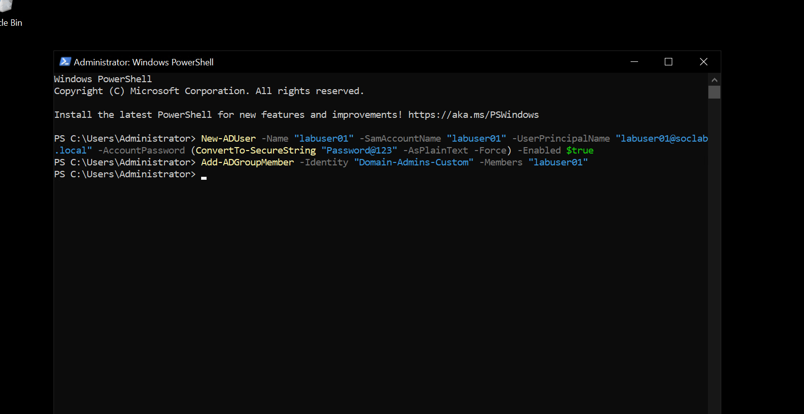
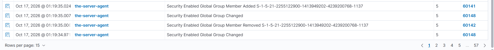
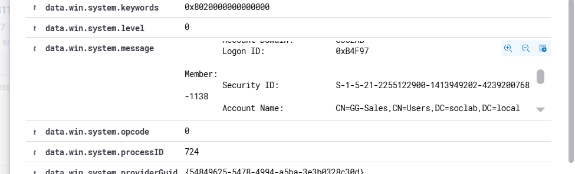

# Lab 01 — Privileged Group Monitoring (Custom Rule 100105)

*Part of [03-Custom-Detection-Rules](../README.md). The first custom Wazuh rule I ever wrote — and the experiment that taught me how custom rules interact with the built-in ruleset.*

---

## The problem

Wazuh's built-in rule **60141** fires on every `4728` (member added to a security-enabled global group) at level 5 — whether the group is `GG-Sales` or `Domain Admins`. From a SOC analyst's perspective, those two are not the same event. Adding someone to Domain Admins is a potential privilege escalation and deserves a louder, more specific alert.

## The rule

```xml
<rule id="100105" level="10">
  <if_group>windows</if_group>
  <field name="win.system.eventID">^4728$</field>
  <field name="win.eventdata.targetUserName">Domain Admins|Enterprise Admins|Administrators|Schema Admins|Domain-Admins-Custom</field>
  <description>Member added to privileged group (possible privilege escalation)</description>
  <mitre>
    <id>T1098</id>
  </mitre>
  <group>privilege_escalation,</group>
</rule>
```

The logic: don't check **who** was added — check **where** they were added. If the destination is a privileged group, fire at level 10 with MITRE T1098 (Account Manipulation).

## Positive test

Created a fresh test user and added them to the privileged group:



---

Result: **100105 fired at level 10.** The rule works.

## Negative test

Added the same user to `GG-Sales` (a normal group) instead. Result: **100105 stayed silent**, and the built-in **60141** fired at level 5. Coverage is preserved — every `4728` gets exactly one alert: privileged destinations get the loud custom rule, normal groups get the generic built-in. No blind spot, no duplicates.

## The shadowing discovery

While testing, I noticed something odd: the built-in **60141** never fired on privileged `4728` events — only my custom rule did. I designed a controlled experiment:

1. **Removed** the custom rules → re-ran the `4728` → **60141 fired** (screenshot below, 01:19:35)
2. **Restored** the custom rules → re-ran the same `4728` → **60141 silent**, only 100105 fired



---


---


---


**Conclusion:** 100105 *shadows* 60141. When the custom rule matches, the built-in chain never completes. This is not a bug — it's how Wazuh rule matching works — but you have to know it's happening, or you'll misread your coverage.

## Nesting test

I added an entire **group** (`GG-Sales`) as a member of a privileged group, instead of a user. **100105 still fired** — proving the rule checks the destination (WHERE), not the member (WHO). Whether an attacker adds a user or nests a whole group, the rule catches it.



---

## Lessons learned

- **Tuning pattern:** built-in rule too broad → narrow to the dangerous subset → fire louder. This pattern repeats in every detection engineering task.
- **Shadowing:** custom rules can suppress built-in rules on match. Always verify what *doesn't* fire, not just what does.
- **Test both directions:** positive test (should fire) and negative test (should stay silent) — one without the other proves nothing.
- **`<mitre>` takes IDs only.** `<tactic>` and `<technique>` inside `<mitre>` will prevent the manager from starting. (Learned the hard way — v1 of this rule pack crashed analysisd.)
