# Lab 02 — Tuning Noisy Rules (Custom Rules 100109 & 100110)

*Part of [03-Custom-Detection-Rules](../README.md). I wrote both of these rules myself — targeting the two "needs tuning" verdicts from the Account Management mapping (4720 and 4738).*

---

## The problem

Two built-in rules were flagged as **needs tuning** during the event mapping:

- **60109** (event 4720, level 8) — fires on *every* account creation. Fine in a 5-user lab, noise at enterprise scale.
- **60110** (event 4738, level 8) — fires on *any* account change, even an address edit. Same problem.

The tuning strategy (same pattern as Lab 01): narrow to the dangerous subset, fire louder.

## Rule 100109 — Account created outside business hours

```xml
<rule id="100109" level="10">
  <if_group>windows</if_group>
  <field name="win.system.eventID">^4720$</field>
  <time>5 pm - 8 am</time>
  <description>Account created outside business hours (possible backdoor)</description>
  <mitre>
    <id>T1136</id>
  </mitre>
  <group>privilege_escalation,</group>
</rule>
```

HR creates accounts during the day — that's normal. An account created at 3 AM is a potential backdoor. The `<time>` element is evaluated against the manager's clock.

**Test:** created a user at night → **100109 fired at level 10** (MITRE T1136 — Create Account). First custom rule I wrote that fired on the first try.

## Rule 100110 — Built-in Administrator modified

```xml
<rule id="100110" level="10">
  <if_group>windows</if_group>
  <field name="win.system.eventID">^4738$</field>
  <field name="win.eventdata.targetSid">-500$</field>
  <description>Built-in Administrator account (RID 500) modified (possible persistence)</description>
  <mitre>
    <id>T1098</id>
  </mitre>
  <group>privilege_escalation,</group>
</rule>
```

Any modification to the built-in Administrator account — display name, enable/disable, description — fires at level 10.

### The group-name bug (my mistake)

My first version of this rule matched `targetUserName` against a list of **group** names (`Domain Admins|Enterprise Admins|...`). It never fired. The reason: event 4738's target is always a **user**, never a group. I was checking for group names at a door only users walk through.

### The rename discovery (the lab's best finding)

While testing, the rule suddenly stopped firing — even though 4738 events were clearly being generated. The Event Viewer revealed why:

> Target Account Name: **Administratorss** (double "s")

I had renamed the Administrator account during earlier testing. My `^Administrator$` regex (exact match) went blind. **I had accidentally evaded my own detection** — exactly what a real attacker does.

### The fix: match on SID, not name

The built-in Administrator's SID always ends in `-500` (well-known RID), regardless of what the account is named. Switching the rule to `targetSid: -500$` made it **rename-proof**.

**Lesson: names are fragile, SIDs are stone.** Any detection based on account names can be evaded with a rename. This is a foundational detection engineering principle, and I learned it by tripping over it.

## Boundary testing: what actually generates a 4738?

I systematically changed every attribute on the Administrator account to map the detection boundary:

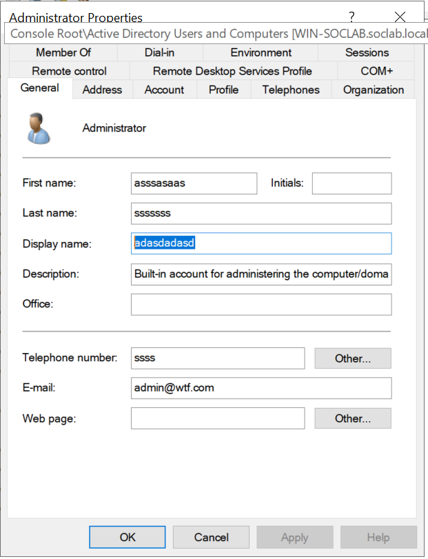

---

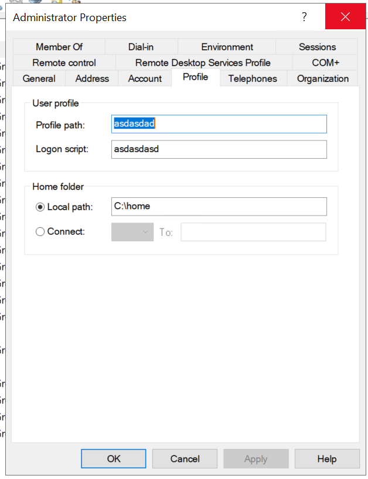

---

**Attributes that generated a 4738 (rule fires):**

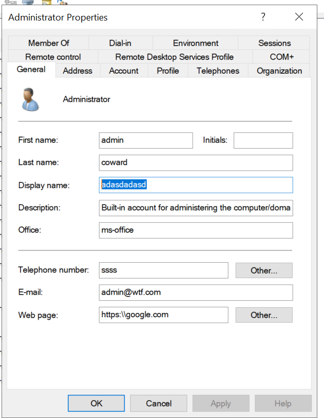

---

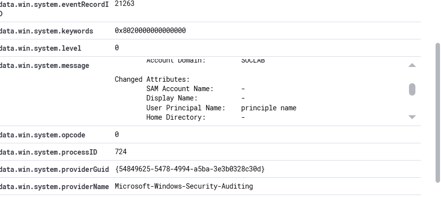

---

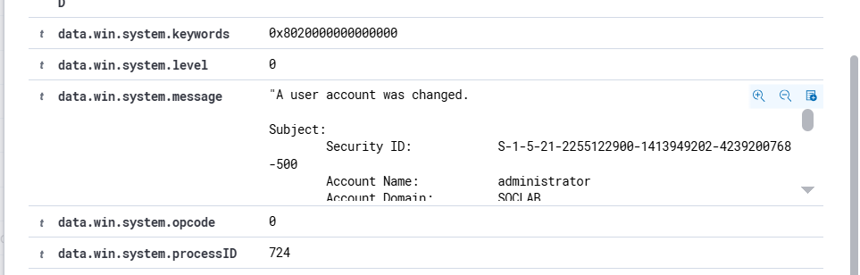

---

Display name changes, account enable/disable (UAC value flips), description, and profile attributes all generate 4738 events that the rule catches.

## Bonus finding: 4738 doesn't always say WHAT changed

Comparing two 4738 events revealed a fidelity gap:

- **Display Name** change → event shows `Display Name: adasdadasd` ✓ visible
- **First name** (`givenName`) change → all Changed Attributes show `-` ✗ invisible

Event 4738 only reports attributes in its tracked list. Changes to `givenName`, `sn`, and similar attributes fire the event but leave the details blank. The SIEM sees "account changed" without knowing what changed.

## Privileged group event coverage

As part of this lab I also verified 4732/4737/4755 events across every privileged group name to confirm built-in coverage:

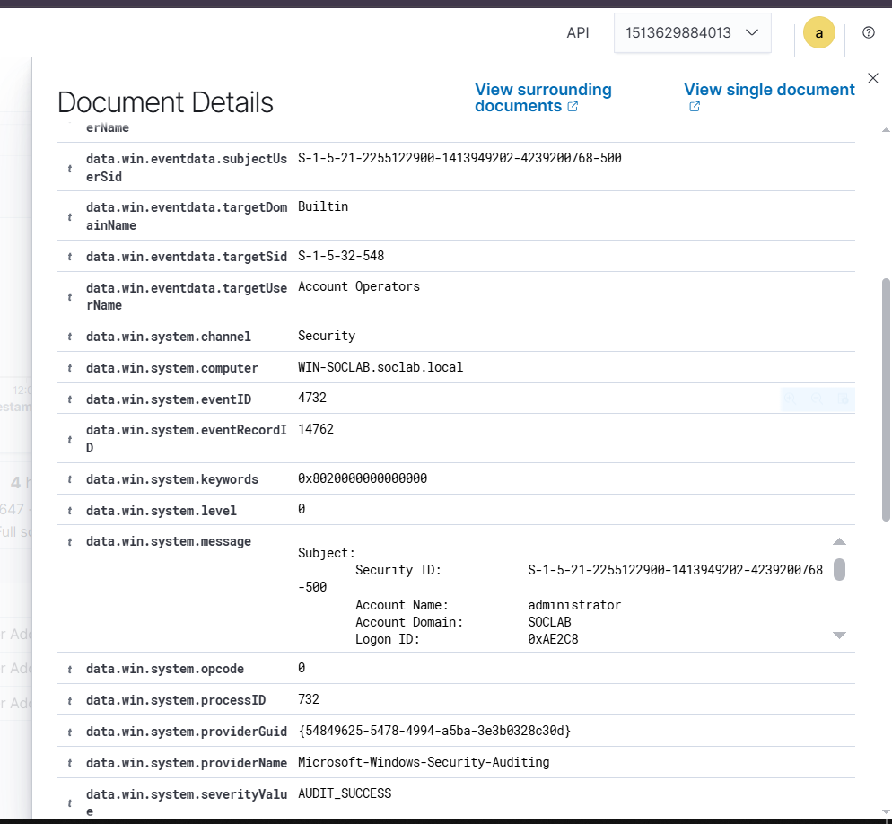

---

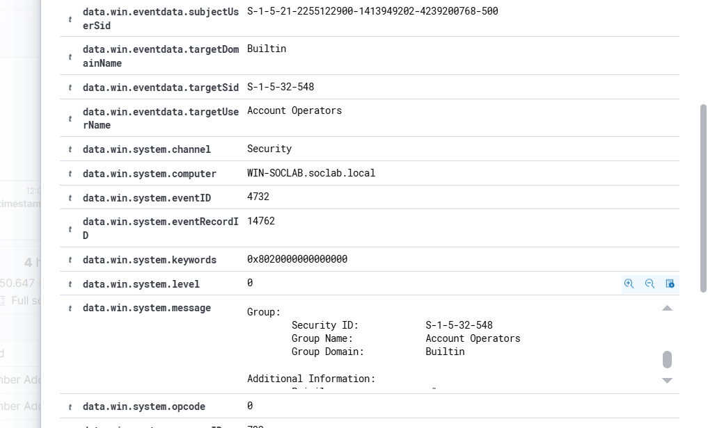

---

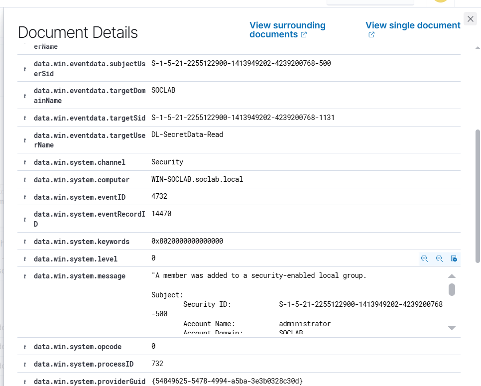

---

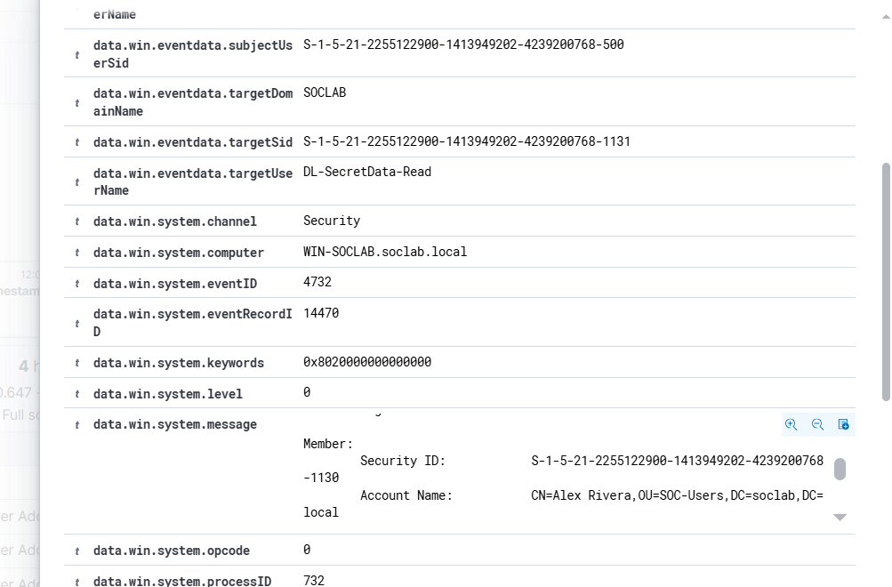

---

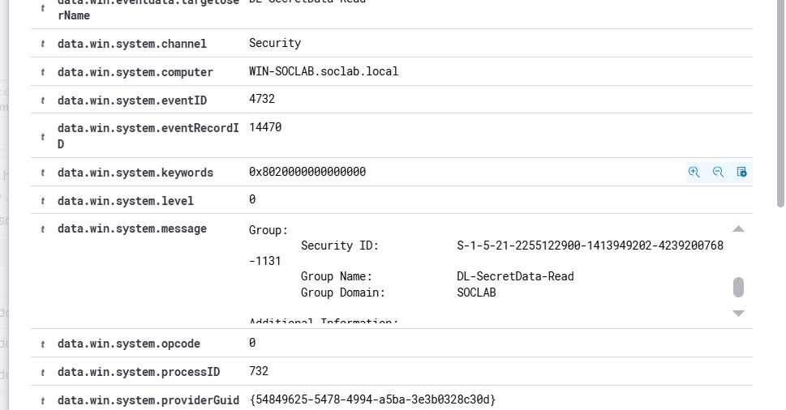

---

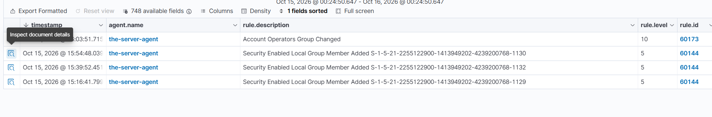

---

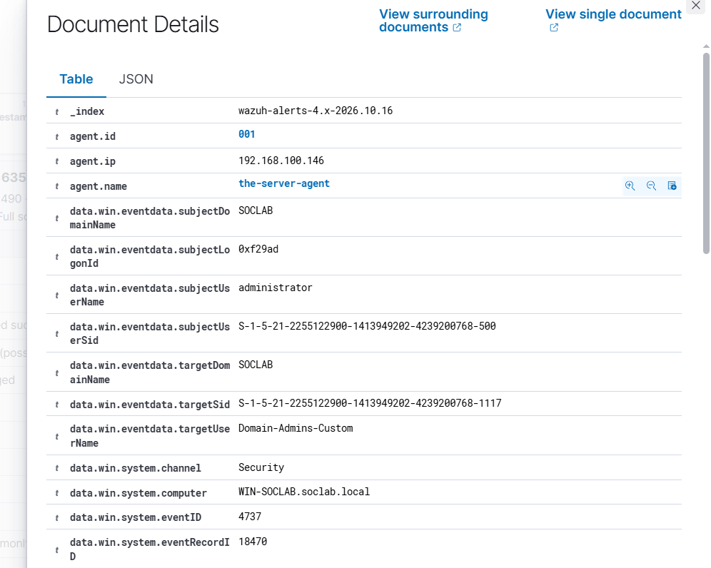

---

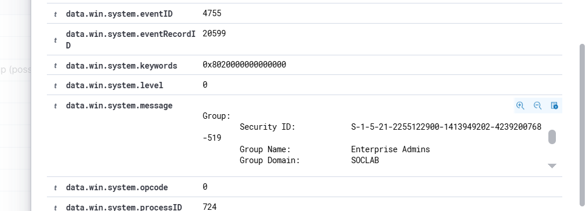

---

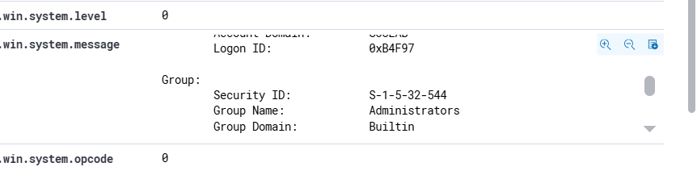

---

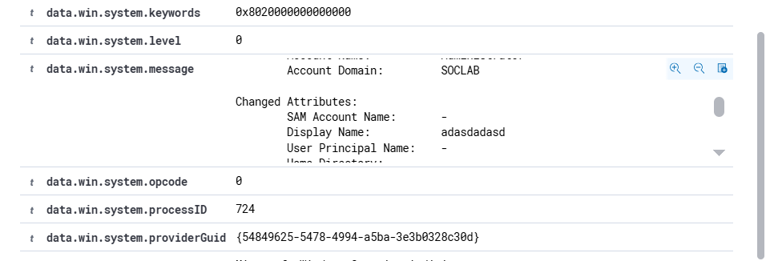

---

## Lessons learned

- **Copy-paste is fine — review is mandatory.** I copy-pasted Lab 01's rule as a starting point. The 3-point review checklist: description matches the event, no stray whitespace in fields, unique rule ID.
- **Match on SIDs, not names**, for anything an attacker (or you) might rename.
- **Boundary-test every rule:** find where it fires AND where it goes blind. A rule you haven't boundary-tested is a rule you don't understand.
- **4738's visibility depends on the attribute changed** — some changes are fully detailed, others are invisible. Know your gaps.
