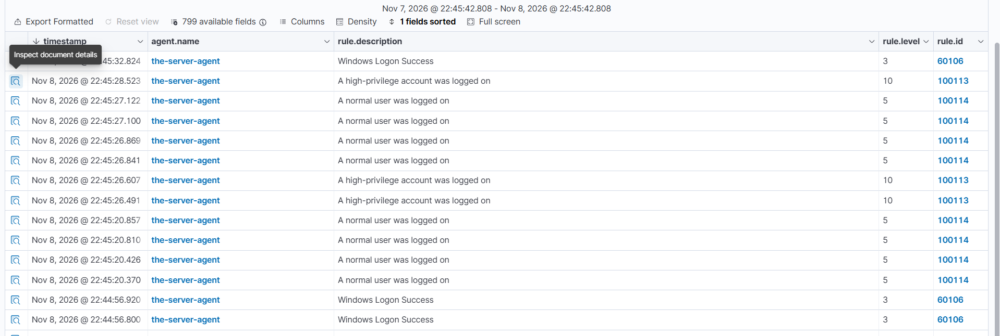
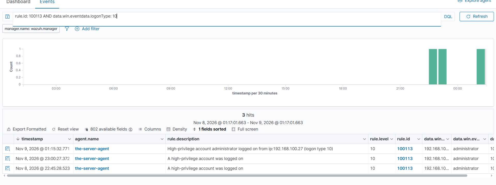
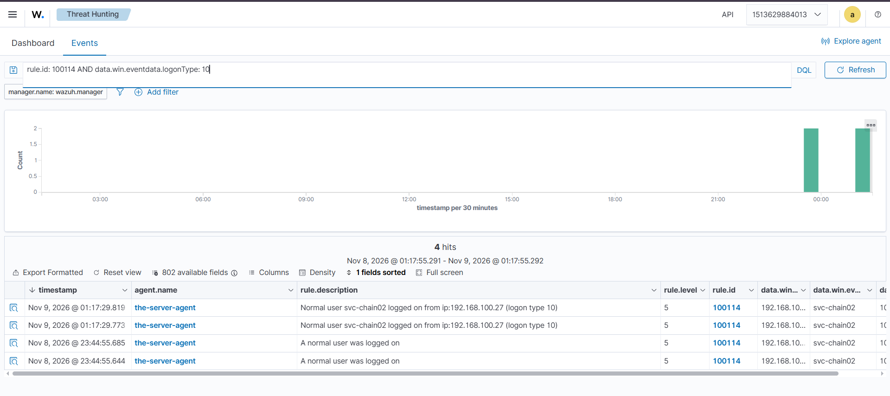

# Lab 04 — Logon Tuning Rules (100113 & 100114)

*Part of [03-Custom-Detection-Rules](../README.md). Tuning 4624: split the logon flood by privilege, so a human logon reads as a human logon.*

---

> **Status: TESTED Nov 8–9, 2026.** Both rules fired on every logon type (2, 3, 10) for both tiers — see [Test results](#test-results--tested-nov-89-2026) below.

## The problem

Rule **60106** ("Windows Logon Success", level 3) fires on **every** 4624. The alert list from Nov 8, 2026 shows the flood: row after row of 60106, plus its child **60118** ("Windows Workstation Logon Success") on type 2 logons. Most of those rows are not people — they are Kerberos ticket logons, computer accounts (`WIN-SOCLAB$`), SYSTEM and services. A real account logging on drowns in them. The Phase 2 sheet already records the verdict for 4624: **needs tuning**. This lab is the tuning.

The 4624 that started it (Nov 8, 2026, eventRecordID 1555053) shows the shape of the problem: logonType 2, `targetUserName: administrator`, `targetUserSid` ending `-500`, but `subjectUserName: WIN-SOCLAB$` and `ipAddress: 127.0.0.1`. One event, three stories at once — a person, a machine, and a local address. A rule that fires on all of them equally tells the analyst nothing.

## The design

Two rules, one split — by privilege, for the three human logon types (2 console, 3 network, 10 RDP):

| Who logs on | Rule | Level | Description |
|---|---|---|---|
| Administrator (SID `-500`) | **100113** | 10 | A high-privilege account was logged on |
| Normal human user | **100114** | 5 | A normal user was logged on |
| Computer account (`$`), SYSTEM, service | neither — 60106 still fires | 3 | Windows Logon Success (unchanged) |

100114 is human-only by exclusion: computer accounts end in `$`, SYSTEM is not a person, and `-500` belongs to 100113. The three negates make the two rules **mutually exclusive** — one logon fires exactly one of them. Machine logons match neither, so 60106 still fires for them: coverage is preserved, the flood is split.

There is deliberately **no third generic rule** ("an account was logged on"). A rule matching every 4624 would either shadow both of these or be shadowed by them — the two-tier split *is* the generic-plus-privileged design. 60106 already plays the generic role for the machine noise.

Expected shadowing: on a human logon, 100113 or 100114 should fire and **60106 (and its child 60118) should stay silent** — the same shadowing behaviour Lab 01 proved for 100105/60141. Verify this in the test; if 60106 still fires alongside the custom rule, that is a finding to record, not a failure to hide.

## The rules

Copy-paste ready — the same XML also lives in [`local_rules-100113-100114.xml`](local_rules-100113-100114.xml) in this folder. Append both rules inside the `<group>` of `local_rules.xml` on the manager.

```xml
<!-- 100113: a high-privilege account logged on (Administrator, SID -500) -->
<rule id="100113" level="10">
  <if_group>windows</if_group>
  <field name="win.system.eventID">^4624$</field>
  <field name="win.eventdata.logonType">^2$|^3$|^10$</field>
  <field name="win.eventdata.targetUserSid">-500$</field>
  <description>A high-privilege account was logged on</description>
  <mitre>
    <id>T1078</id>
  </mitre>
  <group>privilege_escalation,</group>
</rule>

<!-- 100114: a normal (human, non-privileged) user logged on -->
<rule id="100114" level="5">
  <if_group>windows</if_group>
  <field name="win.system.eventID">^4624$</field>
  <field name="win.eventdata.logonType">^2$|^3$|^10$</field>
  <field name="win.eventdata.targetUserName" negate="yes">\$$</field>
  <field name="win.eventdata.targetUserName" negate="yes">^SYSTEM$</field>
  <field name="win.eventdata.targetUserSid" negate="yes">-500$</field>
  <description>A normal user was logged on</description>
  <mitre>
    <id>T1078</id>
  </mitre>
  <group>authentication_success,</group>
</rule>
```

SID-based, rename-proof (the Lab 02 lesson): 100113 matches the `-500` RID, not the name "Administrator". Both rules carry MITRE T1078 (Valid Accounts) — the logon itself is the technique; the privilege is what the level expresses.

## The privilege limit — read this before testing

100113 catches the **Administrator account** only. It does **not** catch a normal account that happens to be a member of a privileged group — `svc-chain02` is in `Domain-Admins-Custom`, but its own SID ends in `-1141`, so 100113 will not fire for it and 100114 will (calling it "normal"). That is wrong for the chain scenario, and the reason is structural: **group membership is not a field on the 4624 event**. The event knows who logged on, not what groups they belong to.

The proper fix is a correlation rule on **4672** (Special Privileges Assigned to New Logon): when a privileged-group member logs on, Windows fires 4672 with the same Logon ID. Chaining 4624 to a recent 4672 for the same Logon ID would catch every privileged logon, group membership included. That is the follow-up for this lab — it needs the 4672 rule ID verified first (Phase 2 sheet, still "verify in lab"), so it is not built here. Until then, 100113 means "the built-in Administrator logged on", and the README says so plainly.

## Install

On the manager (Kali), from the folder holding your `local_rules.xml`:

```bash
docker cp local_rules.xml single-node-wazuh.manager-1:/var/ossec/etc/rules/local_rules.xml
docker exec single-node-wazuh.manager-1 /var/ossec/bin/wazuh-control restart
```

No `-it` — these are non-interactive commands. Then confirm the rules loaded before testing: run the config test (`wazuh-analysisd -t` — it must report no errors) and check the manager log for the ruleset load. **Do not assert the rules loaded from the restart log alone** — the proof is the test below, where the alerts either appear or they don't.

## Test plan

**Positive tests — each logon type, each tier:**

| # | Action | Expected alert |
|---|---|---|
| 1 | Console logon as `administrator` on the DC (type 2) | **100113 L10** |
| 2 | RDP logon as a normal user, e.g. `labuser01`, from your PC (new `mstsc` window — a user-switch inside an admin session gives type 2, not type 10) | **100114 L5** |
| 3 | Network logon as a normal user (type 3 — e.g. `net use` to a share on the DC from your PC) | **100114 L5** |
| 4 | RDP logon as `administrator` (type 10) | **100113 L10** |

For each one, check in Threat Hunting that **60106 did not also fire** for the same event (shadowing check) and record the `eventRecordID`, `Logon ID` and `logonType` from the document detail.

**Negative tests — these must stay silent on the custom rules:**

- A computer-account logon (`WIN-SOCLAB$`, type 3) → neither 100113 nor 100114; **60106 must still fire** (coverage preserved).
- A service logon (type 5) → neither custom rule (logonType is outside 2/3/10).
- A logon as `svc-chain02` via RDP → **100114 fires** (this is the known privilege limit, not a bug — record it as such).

## Test results — TESTED Nov 8–9, 2026

Both rules fired on every logon type, for both tiers. Types 2, 3 and 10 all verified:

- **Admin (100113):** type 10 at 01:15:32 (fresh RDP after `logoff`); type 3s at 01:15:31, 01:13:10, 01:04:44, 00:21:18; type 2 console from 127.0.0.1 at 01:19:12, 01:10:51.
- **svc-chain02 (100114):** type 10 at 01:17:29 (fresh RDP after `logoff`); type 3s at 01:17:28, 00:55:11, 00:28:39, 00:14:38; type 2 console from 127.0.0.1 at 01:21:19, 01:00:00.
- **Shadowing confirmed:** 60106 stayed silent on human logons (its flood rows are the DC logging on to itself, IPs `::1` and `fe80::7410:22f:12c7:f70`); 92653 last fired Nov 8 18:08, before these rules loaded.
- **False positives fixed in the run:** the DWM flood (four SID negates) and the UMFD-2 virtual account (`^UMFD-` negate). Descriptions were upgraded to the 92653 style (username + IP + logon type) and confirmed rendering from Nov 9 00:14.



*The Lab 04 first test, Nov 8 22:45:20–22:45:28 — 100113 at level 10 and 100114 at level 5 with the original descriptions, 60106 alongside on machine logons. This is the one old-description shot; the descriptions were upgraded the same night.*

---



*Administrator type 10 at 01:15:32.771 under 100113, new description. The missing type 10s earlier that night were session reconnections, not a rule problem — after `logoff` and a fresh RDP, the type 10 fired.*

---



*svc-chain02 type 10 at 01:17:29.819/.773 under 100114, new description. Note the known limit in action: svc-chain02 is a Domain-Admins-Custom member, but 100113 only catches the Administrator SID (-500), so the privileged-group member fires 100114 ("normal user") — the 4672-correlation follow-up is the fix.*

---

## Troubleshooting — if the rules do not fire

**1. 60106 fires but the custom rules do not.** First check the rules loaded (config test + logtest on a captured 4624). Then check the field names in the document detail: `win.eventdata.logonType`, `win.eventdata.targetUserName`, `win.eventdata.targetUserSid` — if any of them is absent or named differently on your events, the rule can never match. Do not guess; read the field.

**2. 100114 fires on computer accounts.** The `\$` negate did not take effect. Check the exact regex in the deployed `local_rules.xml` on the manager — a copy-paste error here (a missing backslash) silently breaks the exclusion. Fix, restart, re-test.

**3. Both 100113/100114 and 60106 fire on the same event.** Shadowing did not happen the way Lab 01 showed it. Record the event (rule IDs, eventRecordID, timestamp) — it changes the shadowing model and matters for every later rule.

**4. Nothing fires at all, not even 60106.** The event is not reaching Wazuh — check the agent (001 Active?), the Logon audit subcategory (`auditpol /get /subcategory:"Logon"` — Success and Failure must both be enabled), and that the DC is actually generating 4624s in Event Viewer first.

## Threat Hunting in Wazuh

Paste into the search bar (Events tab) over the lab time window:

**100113 — high-privilege logons:**
```
rule.id: 100113
```

**100114 — normal user logons:**
```
rule.id: 100114
```

**Human logons only (the flood filter from the chain lab):**
```
data.win.system.eventID: 4624 AND NOT data.win.eventdata.targetUserName: *$ AND NOT data.win.eventdata.targetUserName: SYSTEM
```

**One account, all its logons:**
```
data.win.system.eventID: 4624 AND data.win.eventdata.targetUserName: labuser01
```

## Open items

- **These rules are tested (Nov 8–9, 2026).** See [Test results](#test-results--tested-nov-89-2026) above.
- **4672-correlation follow-up:** a rule chaining 4624 to a recent 4672 for the same Logon ID would catch privileged-group members (like `svc-chain02`), which 100113 cannot. Blocked on verifying the 4672 rule ID first.
- **Phase 2 sheet:** the 4624 row can now flip from "needs tuning (floods)" to "covered" — the test passed.
- **Edge case:** `ANONYMOUS LOGON` (type 3) is not excluded by 100114's negates — if it appears in testing, add a `^ANONYMOUS LOGON$` negate and note it here.
- **Scope limit:** type 11 (cached) and type 5 (service) logons are outside these rules by design.
